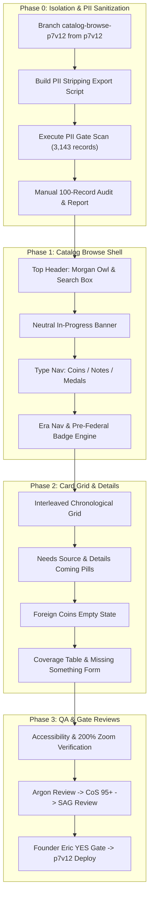

# AG PLAN NET-747: Public Catalog Browse Pages (v1)

- **Track:** NET-747 (Catalog Browse Pages)
- **Station:** AG CoS v4 / Gemini 3.8 (`ba2bfdb2-60a1-47d5-befb-78ea742d3dc3`)
- **Date:** 2026-11-03 12:48 PM ET
- **Status:** **PLAN ONLY — STRICTLY NO EXECUTION, NO CODE, NO COMMITS TO DEV/MAIN, NO DEPLOYS**
- **Authority / Baton:** `BATON_NET-747_AG_CATALOG-BROWSE-PLAN-ONLY_20261103.md` (Desk / Catalog Builder)
- **Review Pipeline Required:** AG Plan -> Argon Review -> CoS Score 95+ -> SAG Concurrence -> Founder Eric's Typed YES -> Execute

---

## 0. Non-Negotiable Guardrails & Priority

1. **Five 26 Nov Must-Ships Take Absolute Precedence:**
   - Must-ship items: Pricing tiers, 400-years scope line, soft-404, Meta pixel, Stripe.
   - Catalog work must NEVER consume review slots, deployment windows, or developer bandwidth needed for NET-746 / NET-748 or the five must-ships.
   - If any must-ship encounters a block, slip, or failfix cycle, catalog work pauses instantly.
2. **Branch & Channel Isolation:**
   - **Dedicated Branch:** `catalog-browse-p7v12` branched exclusively from `p7v12` preview base.
   - **Target Channel:** Firebase preview channel `p7v12` only.
   - **Forbidden Branches:** Never branch from, edit, or merge into `p7-v8.9`, `dev`, or `main`.
   - **Production Freeze:** `origin/main` locked at `9f04550a`; live site untouched; Stripe locked OFF.
3. **Zero User PII & Collection Privacy:**
   - Strictly generic numismatic coin/note/medal data and licensed public images only.
   - Zero user names, zero dollar values, zero collection counts, zero ownership indicators, zero personal notes, zero cert/slab IDs, zero user-scoped GCS paths.

---

## 1. Input Datasets & Ingestion (Read-Only)

| Dataset | Scope / Count | Status & Handling |
|---|---|---|
| `/workspace/catalog-preview/schema.json` | Schema definition | NAC1 code, type, year, mintage, sources, public images, social links |
| `entries_20261103.jsonl` | 531 entries (376 coins, 99 notes, 56 medals) | 170 with licensed image; 13 published on X; 220 flagged for fact-check |
| `entries_seed_20261103.jsonl` | 2,612 entries (2,530 coins, 82 notes, 0 medals) | 1,724 draft, 888 name-only placeholders (`details coming`). 0 images |
| `images_MANIFEST.csv` | 171 image rows | Verified license, credit, source, sha256 |
| Total Combined | **3,143 records** | **100% Unsourced Mintages** -> Display "Needs source" everywhere |

---

## 2. PII Stripping Pipeline & PII Gate

### 2.1 Allow-List Public Export
An offline export build script reads raw entries and outputs a single sanitized public JSON artifact using a strict **allow-list only**:
- **Allowed Fields:** `nac_code`, `category` (coin/note/medal), `title`, `year`, `era`, `denomination`, `series`, `designer`, `composition`, `diameter`, `weight`, `pre_federal`, `status_badge`, `images` (manifest-verified only), `sources` (allow-listed public citations).
- **Mandatory Stripped Fields:**
  - Internal/local paths: `primary_image.local_path`, `primary_image.local_manifest`, `reused_from`, `doc_id`, `product_code`.
  - User/Collection labels: `seed_type`, `record_status` (`COLLECTION_DERIVED_DRAFT`, `PLACEHOLDER_NAME_ONLY`), `image_status`.
  - Internal scoring/notes: `figures.*.method`, `grounding_score`, unvetted `social_posts[].note`.

### 2.2 Dual-Stage PII Gate
Before any public JSON is committed to the preview branch:
1. **Automated Scan (3,143 / 3,143 records):**
   - Regex scan for emails, phone numbers, street addresses, dollar signs (`$`), financial figures, receipt/invoice tokens, `gs://`, `googleapis`, `users/`, and `/workspace`.
   - Deny-list check against off-repo founder/user name lists.
   - Any hit terminates the build with exit code 1.
2. **Manual Sample Audit:**
   - 100 random records audited (50+ from seed records, plus 100% of records with history or images).
   - Documented in `PII_GATE_REPORT_<date>.md`.

---

## 3. Core Architectural Rules (Founder & UX Decisions)

### 3.1 Founder Binding Decisions (Eric — 3 Nov 2026, 9:01 AM ET)
1. **Interleaved Modern Coin Records:**
   - 2000–2026 seed records appear strictly interleaved inside the complete chronological year-by-year checklist.
   - Never presented as a standalone list, "newest" list, or filter labeled "seed" or "collection".
2. **Newest Entries Isolation:**
   - The "Newest Entries" section must strictly exclude seed records.
3. **888 Placeholders:**
   - Display name-only cards with neutral pill: `"details coming"`.
   - Zero invented figures, zero guessed images, neutral placeholder outline.
4. **UI Privacy Check:**
   - Confirm zero "seed", "collection", or "derived" tokens in HTML source, URLs, or API payloads.

### 3.2 UX Designer Specifications (Signed-off — 3 Nov 2026, 9:02 AM ET)
1. **Top Block Hierarchy:**
   - Center Morgan owl (`Morgan_Owl_NoBubble_2048.png` with transparent/circular crop; 160–200px).
   - Primary Search Input: 64px height, 22px font, explicit label "Search the catalog".
   - "Ask Morgan" Button: Filled navy button with high-contrast text (>7:1 ratio).
2. **In-Progress Notification:**
   - One sentence in a calm neutral box (never warning/yellow) below search:
     *"This catalog is being built in public. Some details still need a source."*
3. **Badges & Pills:**
   - **Pre-Federal Badge:** Blue outline pill (`#1B365D`), dark navy text, 16px bold min, 32px height: `"Pre-Federal (before 1792)"`. Displayed on all 9 pre-1792 items (8 preview, 1 seed note); never on >=1792.
   - **"Needs source" Badge:** Gray outline, `#333` text, info `(i)` icon. Displayed once per card when figures lack primary sources.
   - **"Details coming" Badge:** Neutral gray pill for 888 placeholders. Never stacked with "Needs source".
4. **Browse Navigation Structure:**
   - **Type Order:** **Coins -> Notes -> Medals** (Medals strictly after Coins and Notes).
   - **Era Buckets:** Pre-Federal (<1792), Early Republic (1792–1837), Seated/Civil War era (1837–1873), Morgan/Late 19th (1873–1900), 20th Century (1901–1999), Modern (2000–2026), Undated.
   - **Foreign Coins:** Dedicated section showing single-line calm empty state: *"Foreign coins are coming later."* (zero fake entries).
5. **Coverage by Year:**
   - Interactive bar chart + accessible `"Show as table"` toggle.
6. **"Missing something?" Community Intake:**
   - Simple form: item description, optional year, optional type, optional primary source URL.
   - Zero collection photos, zero values, zero ownership fields. Optional email kept strictly private off-repo.
   - Rate-limited with spam captcha; lands in manual moderation queue.
7. **Senior Usability & Accessibility (WCAG AA / 200% Zoom):**
   - Base body text: 20px minimum.
   - Card titles: 24px; Section headers: 30px; Page title: 40px.
   - Touch targets: 48px+ with 16px+ margins.
   - High contrast (>=4.5:1 text, >=7:1 interactive). Full function at 200% browser zoom.

---

## 4. Phased Implementation Roadmap (Browse Pages First)



### Phase 1: Data Model & Static PII-Free Public Bundle
- Write Dart models `CatalogEntry`, `CatalogImage`, `CatalogSource` with strict immutability.
- Pre-generate static bundle `catalog_public_v1.json` (or asset chunk files) verified by automated PII scan.
- Ensure 0 collection metadata is included.

### Phase 2: Browse Layout & Components (Flutter Web / p7v12)
- Implement `CatalogBrowseScreen` inside `numista_mobile/lib/screens/catalog/`.
- Build reusable UI widgets:
  - `MorganCatalogHeader` (owl asset, search field, "Ask Morgan" action).
  - `InProgressNoticeBanner`.
  - `CatalogTypeTabBar` (Coins, Notes, Medals).
  - `CatalogCard` with badges (`PreFederalBadge`, `NeedsSourceBadge`, `DetailsComingBadge`).
  - `ForeignCoinsNotice`.
  - `CatalogCoverageSection` (chart/table toggle).
  - `MissingItemIntakeModal`.

### Phase 3: Routing & Soft-404 Integration
- Integrate catalog route `/catalog` and `/catalog/:nacCode`.
- Implement `CatalogSoft404Screen` returning genuine HTTP 404 header status via Firebase hosting rewrites.

---

## 5. Machine-Checkable Verification Plan

1. **PII Gate Zero-Tolerance Check:**
   ```powershell
   python tools/catalog/pii_gate_validator.py --input build/catalog_public_v1.json
   # Exit code 0, 0 violations found
   ```
2. **Flutter Code Hygiene & Formatting:**
   ```powershell
   flutter analyze lib/screens/catalog/
   flutter test test/catalog/
   ```
3. **Accessibility & Usability:**
   - Lighthouse accessibility score >= 95.
   - Contrast check: All text meets WCAG AA (4.5:1 for body, 3:1 for large headers).
   - Zoom verification: 200% layout reflow cleanly without horizontal scrollbars or overlapping text.
4. **Data Integrity Checks:**
   - Total records = 3,143 (2,906 coins, 181 notes, 56 medals).
   - Pre-Federal badges = exactly 9 records (<1792).
   - Sourced mintages = 0 (100% displaying "Needs source").
   - 888 name-only placeholders display "details coming".

---

## 6. What AG CoS Will NOT Do Under This Plan
- **Will NOT touch `origin/main` or live site.**
- **Will NOT merge into or touch `p7-v8.9` (NET-746 preview branch).**
- **Will NOT write code before Argon, CoS, SAG, and Eric typed YES.**
- **Will NOT delay or distract from the five 26 Nov must-ships.**
- **Will NOT expose any user collection data or PII.**
