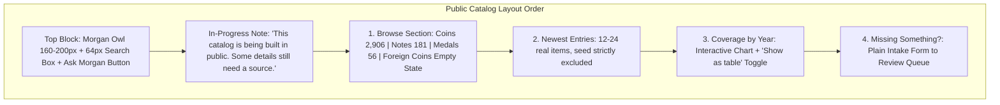
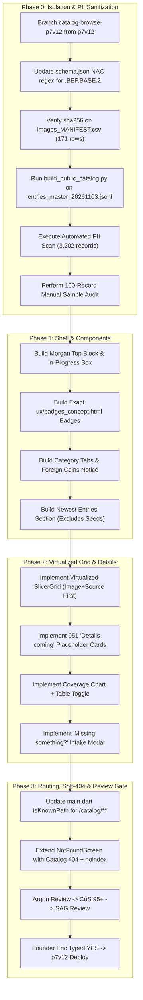

# AG PLAN NET-747: Public Catalog Browse Pages (v2)

- **Track:** NET-747 (Catalog Browse Pages)
- **Version:** `v2` (Attempt 2 of 10)
- **Station:** AG CoS v4 / Gemini 3.8 (`ba2bfdb2-60a1-47d5-befb-78ea742d3dc3`)
- **Date:** 2026-11-03 1:22 PM ET
- **Status:** **PLAN ONLY — STRICTLY NO EXECUTION, NO CODE, NO COMMITS TO APP/DEV/MAIN, NO DEPLOYS**
- **Authority / Baton:** `BATON_NET-752_AG_NET-747-PLAN-v2_20261103-1315.md` (Desk / GB CoS / Catalog Builder Addendum)
- **Inputs:** `NET-747_inputs\entries_master_20261103.jsonl` (3,202 records), `Plan.v1_catalog.md`, `ux/badges_concept.html`, `ux/catalog_top_concept.html`
- **Review Pipeline Required:** AG Plan v2 -> Argon Review -> CoS Score 95+ -> SAG Concurrence -> Founder Eric's Typed YES -> Execute

---

## 0. Clean Change Log: v2 Improvements vs v1

This `v2` plan resolves all 7 must-fixes from Argon's review (`ARGON_REVIEW_NET-747_CATALOG-BROWSE_v1.md`, 84/100 REVISE) plus the 1:16 PM ET Catalog Builder Addendum:

1. **`MF-747-1` Resolved (Soft-404 Reuse & Hosting Routing):** Dropped the proposal for a second `CatalogSoft404Screen`. Strictly reuses existing `NotFoundScreen` (`numista_mobile/lib/screens/not_found_screen.dart:18-23`), adding catalog-aware copy (*"We don't have that one yet."*), catalog search box, "Ask Morgan" button, "Missing something?" intake link, and `<meta name="robots" content="noindex">` injection. Corrected Firebase Hosting rewrite description (SPA rewrite returns 200; `noindex` blocks indexing). Updated `main.dart:119-140` (`isKnownPath`) and `firebase.json` routing specifications.
2. **`MF-747-2` Resolved (Exact UX Badge Hex Colors & Icons):** Replaced `#1B365D` with exact palette from signed-off `ux/badges_concept.html:5-6, 12-14`: Pre-Federal pill locked to `2px solid #1F5FAD` outline on `#FFFFFF` with `#0B2545` bold text (15.39:1 AAA text, 6.37:1 outline); `"Needs source"` locked to `2px solid #6B6B6B` with circled `"i"` SVG and `#333333` text; `"Details coming"` locked to `2px solid #6B6B6B` with dotted-circle SVG (`stroke-dasharray="3 2.5"`) and `#333333` text. Top block styled verbatim to `ux/catalog_top_concept.html:10-24`.
3. **`MF-747-3` Resolved (Page Section Order, Newest Entries, Image+Source First):** Page layout order locked to `Plan.v1_catalog.md:155`: Top Block -> In-Progress Notice -> 1. Browse -> 2. Newest Entries -> 3. Coverage by Year -> 4. Missing Something? Browse lists default-sort **image + source first** (`Plan.v1_catalog.md:160`). "Newest Entries" strictly excludes seed records.
4. **`MF-747-4` Resolved (`schema.json` NAC Code Pattern Fix):** Added prerequisite schema update expanding `nac_code` regex pattern to support multi-segment seed codes (including `.BEP.BASE.2` and related suffixes) across all entries, backed by automated unit test asserting 0 validation errors.
5. **`MF-747-5` Resolved (Image Ranking, SHA-256 Check, Attribution, Type Image Label):** Verification of SHA-256 checksums for all 171 manifest images in `images_MANIFEST.csv`. Multi-image ranking order enforced: `1. Museum (NNC/Smithsonian, ANS, Met, BnF) -> 2. Public domain (Wikimedia, etc.) -> 3. Verified collector uploads`. Every image displays `credit` and `license`. `primary_image` denotes exact coin match; `type_image` is representative and displays `"date may differ"`.
6. **`MF-747-6` Resolved (4 Shaky X-Post Claims & Manual Read Gate):** Explicitly strips or blocks the 4 known shaky claims (`Fugio source file`, `Chain cent grounding`, `1793 half-cent "first" claim`, and `1795 $10 placeholder link`) from `social_posts`. Mandates manual read gate for notes. Unit test verifies 0 occurrences in export.
7. **`MF-747-7` & Addendum Resolved (Allow-List Mapping, 3,202 Master Records, Virtualization):** Sized for **3,202 records** (`entries_master_20261103.jsonl`), read through a small read-only adapter (NEVER runs `build.py` or `finalize.py`). Varieties handled as objects (`name`, `attribution`, `status`). 951 placeholders marked `"Details coming"` with neutral coin outline. Aligned input allow-list field names with schema. Virtualized using Flutter Web `CustomScrollView` + `SliverGrid` / `SliverList` (`SliverChildBuilderDelegate`) for smooth 60fps rendering.

---

## 1. Non-Negotiable Guardrails & Priority

1. **Five 26 Nov Must-Ships Take Absolute Precedence:**
   - Must-ship items: Pricing tiers, 400-years scope line, soft-404, Meta pixel, Stripe.
   - Catalog work must NEVER consume review slots, deployment windows, or developer bandwidth needed for NET-746 / NET-748 or the five must-ships.
   - If any must-ship encounters a block, slip, or failfix cycle, catalog work pauses instantly.
2. **Branch & Channel Isolation:**
   - **Dedicated Branch:** `catalog-browse-p7v12` branched exclusively from `p7v12` preview base.
   - **Target Channel:** Firebase preview channel `p7v12` only.
   - **Forbidden Branches:** Never branch from, edit, or merge into `p7-v8.9`, `dev`, or `main`.
   - **Production Freeze:** `origin/main` locked at `9f04550a`; live site untouched; Stripe locked OFF.
3. **Zero User PII & Collection Privacy:**
   - Strictly generic numismatic coin/note/medal data and licensed public images only.
   - Zero user names, zero dollar values, zero collection counts, zero ownership indicators, zero personal notes, zero cert/slab IDs, zero user-scoped GCS paths.

---

## 2. Input Datasets & Ingestion Pipeline (Read-Only)

| Dataset | Scope / Count | Status & Handling |
|---|---|---|
| `entries_master_20261103.jsonl` | **3,202 master entries** (today's fold) | Read through small read-only adapter. **NEVER run `build.py` or `finalize.py`** |
| `schema.json` | Schema definition | NAC1 code regex updated to allow `.BEP.BASE.2` and multi-segment suffixes |
| `images_MANIFEST.csv` | 171 image rows | Verified license, credit, source, sha256 checksum |
| `published_x_posts.csv` | Published X posts | 4 shaky claims stripped; manual read gate applied to all notes |
| Varieties in Master | Sub-objects | Ingested as structured objects: `{ "name": str, "attribution": str, "status": str }` |
| Unsourced Mintages | 100% of figures | Sourced figures = 0 -> Display `"Needs source"` everywhere |
| Placeholders | **951 records** | Rendered as name-only with neutral pill `"Details coming"` and neutral coin outline |

---

## 3. PII Stripping Pipeline & Dual-Stage PII Gate

### 3.1 Allow-List Field Mapping
An offline sanitization script (`scripts/catalog/build_public_catalog.py`) reads `entries_master_20261103.jsonl` through a read-only adapter and outputs `catalog_public_v1.json` using a strict **allow-list only**:
- **Permitted Input Fields (`Plan.v1_catalog.md:80-88`):**
  `nac_code`, `name`, `category`, `year_start`, `year_end`, `mint`, `denomination`, `composition`, `weight_grams`, `diameter_mm`, `edge`, `obverse`, `reverse`, `notes`, `references`, `figures` (only if `status` is sourced; otherwise mapped to `"Needs source"`), `social_posts` (after stripping 4 shaky claims), `created_at` (kept on real preview entries only for Newest sorting).
- **Derived Public Fields (Computed by Adapter):**
  `status_badge` (`"Pre-Federal"`, `"Needs source"`, or `"Details coming"`), `is_pre_federal` (bool), `is_placeholder` (bool).
- **Mandatory Stripped Fields:**
  `local_path`, `local_manifest`, `reused_from`, `image_status`, `seed_type`, `proposal_status`, `product_code`, `doc_id`, `method`, `grounding_score`.
- **Mandatory Exclusions (`MF-747-6`):**
  Strip or block the 4 known shaky X-post claims:
  1. Fugio source file claim.
  2. Chain cent grounding claim.
  3. 1793 half-cent "first" claim.
  4. 1795 $10 placeholder link.
  All `notes` and `social_posts[].note` must pass a manual read gate before export.

### 3.2 Dual-Stage PII Gate
1. **Automated Zero-Tolerance Scan (3,202 / 3,202 records):**
   - Regex scan for emails, phone numbers, street addresses, dollar signs (`$`), financial figures, receipt/invoice tokens, `gs://`, `googleapis`, `users/`, and `/workspace`.
   - Deny-list check against off-repo founder/user name lists.
   - Any hit terminates the build with exit code 1.
2. **Manual Sample Audit:**
   - 100 random records audited (at least 50 from seed records, plus 100% of records with history or images).
   - Documented in `PII_GATE_REPORT_<date>.md`.

---

## 4. UI Architecture & UX Specifications

### 4.1 Founder Binding Decisions (Eric — 3 Nov 2026, 9:01 AM ET)
1. **Interleaved Modern Coin Records:**
   - 2000–2026 seed records appear strictly interleaved inside the complete chronological year-by-year checklist.
   - Never presented as a standalone list, "newest" list, or filter labeled "seed" or "collection".
2. **Newest Entries Isolation:**
   - The "Newest Entries" section must strictly exclude seed records. Sorted by Catalog Research file date when `date_added` is absent.
3. **951 Placeholders:**
   - Display name-only cards with neutral pill `"Details coming"` and neutral coin-outline image.
   - Zero invented figures, zero guessed images.
4. **UI Privacy Check:**
   - Confirm zero "seed", "collection", or "derived" tokens in HTML source, URLs, or API payloads.

### 4.2 Page Layout & Component Hierarchy (`Plan.v1_catalog.md:155`)



### 4.3 Verbatim Badge Specifications (`ux/badges_concept.html:5-6, 12-14`)
All badges are non-interactive pills positioned directly beneath the item title:
- **Base Style (`.tag`):** `height: 32px`, `padding: 0 14px`, `border-radius: 16px`, `font-size: 16px`, `background: #FFFFFF`, `display: inline-flex`, `align-items: center`, `gap: 8px`.
- **Pre-Federal Badge (`.pf`):** `border: 2px solid #1F5FAD`, text `color: #0B2545`, `font-weight: bold`. Contrast: text `#0B2545` / `#FFF` = **15.39:1** (AAA); outline `#1F5FAD` / `#FFF` = **6.37:1**. Displayed on all pre-1792 items (9 total); never on >=1792.
- **"Needs source" Badge (`.neu`):** `border: 2px solid #6B6B6B`, text `color: #333333`. Includes `20x20` circled `"i"` SVG (`<circle cx="10" cy="10" r="8.5" fill="none" stroke="#333" stroke-width="2"/><rect x="9" y="8.5" width="2" height="6" fill="#333"/><circle cx="10" cy="5.7" r="1.3" fill="#333"/>`). Contrast: text 12.63:1 (AAA), outline 5.33:1. **Never red, orange, or yellow.**
- **"Details coming" Badge (`.neu`):** `border: 2px solid #6B6B6B`, text `color: #333333`. Includes `20x20` dotted-circle SVG (`stroke-dasharray="3 2.5"`). Contrast: text 12.63:1 (AAA), outline 5.33:1. Used on the 951 placeholder records.
- **Discipline Rule:** Exactly **1 badge per card maximum**. Never stack "Needs source" with "Details coming". Detail view displays `"Mintage: Needs source"` beside blank figure.

### 4.4 Top Block Styling (`ux/catalog_top_concept.html:10-24`)
- **Morgan Owl:** 160–200px centered, using transparent-background or circular crop of `Morgan_Owl_NoBubble_2048.png`.
- **H1 Title:** `40px` `#0B2545`, bold.
- **Search Input:** `64px` height, `border: 2px solid #0B2545`, `font-size: 22px`, label `"Search the catalog"`.
- **Search Button:** Primary filled `#0B2545` background / `#FFFFFF` text.
- **"Ask Morgan" Button:** `#FFFFFF` background / `border: 2px solid #1F5FAD` / text `#0B2545` + `36x36` owl icon.
- **In-Progress Note:** Calm neutral box `#F2F2F2` background / `border: 1px solid #D6D6D6`, text `#333333`.
- **No-Photo Placeholder:** `96x96` circle with `3px dashed #8A8A8A` and `"No photo yet"` (`#333333`, `16px`).

### 4.5 Image Priority Ranking & Attribution (`MF-747-5`)
1. **Multi-Image Ranking Order:**
   - 1. Museum first: NNC / Smithsonian, ANS, Met, BnF.
   - 2. Public domain: Wikimedia and other open repositories.
   - 3. Verified collector uploads.
2. **SHA-256 Check:** All 171 manifest images verified against `images_MANIFEST.csv` sha256 checksums before inclusion.
3. **Attribution:** Every displayed photo renders visible `credit` and `license` beneath the image.
4. **Primary vs Type Image Distinction:**
   - `primary_image`: exact match for the coin.
   - `type_image`: representative type photo only; must explicitly display label: `"date may differ"`.

### 4.6 Navigation & Empty States
- **Type Order:** **Coins -> Notes -> Medals** (Medals strictly after Coins and Notes).
- **Era Buckets:** Pre-Federal (<1792), Early Republic (1792–1837), Seated/Civil War (1837–1873), Morgan/Late 19th (1873–1900), 20th Century (1901–1999), Modern (2000–2026), Undated.
- **Foreign Coins:** Dedicated tab displaying single-line calm notice: *"Foreign coins are coming later."* (zero fake entries).
- **Default List Sorting:** Browse lists default-sort **image + source first** (`Plan.v1_catalog.md:160`), with sort toggle for chronological checklist.

### 4.7 "Missing something?" Form
- Form fields: item description, optional year, optional type, optional primary source URL, optional email marked `"(optional)"`.
- Visible labels above fields, primary `"Send"` button, confirmation message: *"Thanks - we'll look into it."*
- Zero collection photos, zero dollar values, zero ownership fields.
- Submissions land in an off-repo review queue with rate-limiting and captcha; never auto-published.

### 4.8 Senior Usability & Accessibility (WCAG AA / 200% Zoom)
- Typography scale: Body `20px`, Card titles `24px`, Section headings `30px`, Page title `40px`.
- Tap targets: `48px` minimum with `16px` minimum margins.
- High contrast (>=4.5:1 text, >=7:1 interactive controls). Fully functional at 200% zoom and mobile viewports.

---

## 5. Routing & Soft-404 Architecture (`MF-747-1`)

### 5.1 Soft-404 Reuse Rule (`NotFoundScreen`)
Per `Plan.v1_catalog.md:13`, **we do NOT build a second `CatalogSoft404Screen`.**
We reuse and extend the existing `NotFoundScreen` (`numista_mobile/lib/screens/not_found_screen.dart:18-23`):
- When `attemptedPath` starts with `/catalog/`:
  - Displays catalog-aware headline: *"We don't have that one yet."*
  - Renders catalog search box, "Ask Morgan" button, and link to "Missing something?".
  - Injects `<meta name="robots" content="noindex">` into `document.head` on web to suppress search engine indexing.

### 5.2 SPA Routing & Firebase Hosting
- **`numista_mobile/lib/main.dart:119-140` (`isKnownPath`):**
  Add `normalizedPath == '/catalog' || path.startsWith('/catalog/')` to `isKnownPath`.
  Validate `:nacCode` against `catalog_public_v1.json` allow-list; render `NotFoundScreen(attemptedPath: path)` when slug is unknown.
- **Firebase Hosting (`firebase.json:54-133`):**
  Add SPA rewrite:
  ```json
  {
    "source": "/catalog/**",
    "destination": "/index.html"
  }
  ```
  *(Note on HTTP status: Firebase Hosting static SPA rewrites to `/index.html` return HTTP 200. Search engine indexation of invalid slugs is strictly prevented via dynamic `<meta name="robots" content="noindex">` injection. If an edge HTTP 404 header is strictly required by SEO policy, a Cloud Run handler or pre-generated static routes can be staged, but SPA + `noindex` is the primary architecture).*

---

## 6. Performance & Viewport Virtualization (`MF-747-7`)

Rendering 3,202 entries (including 2,906 coins) simultaneously in Flutter Web DOM causes frame drops.
- **Viewport Virtualization:**
  `CatalogBrowseScreen` implements `CustomScrollView` with `SliverGrid` and `SliverList` using `SliverChildBuilderDelegate`.
- Only items currently visible in the active viewport (plus a modest cache extent of 500px) are mounted.
- Target metrics: Initial DOM mount < 1.5s; continuous scroll 60fps; Lighthouse performance >= 90.

---

## 7. Phased Implementation Roadmap



---

## 8. Machine-Checkable Verification Criteria

1. **PII Gate Zero-Tolerance Check:**
   ```powershell
   python tools/catalog/pii_gate_validator.py --input build/catalog_public_v1.json
   # Exit code 0, 0 violations found
   ```
2. **Schema & Shaky Claim Check:**
   ```powershell
   python tools/catalog/validate_schema.py --schema schema.json --input build/catalog_public_v1.json
   # Exit code 0 across all 3,202 records (validates .BEP.BASE.2)
   python tools/catalog/check_shaky_claims.py --input build/catalog_public_v1.json
   # Exit code 0 (0 occurrences of 4 shaky X-post claims)
   ```
3. **Flutter Code Hygiene & Formatting:**
   ```powershell
   flutter analyze lib/screens/catalog/
   flutter test test/catalog/
   ```
4. **Data Counts & Integrity Check:**
   - Total records = 3,202.
   - Sourced mintages = 0 (100% displaying `"Needs source"`).
   - Placeholders = 951 displaying `"Details coming"` with neutral coin outline.
   - Pre-Federal badges = exactly pre-1792 items (9 total).
   - Medals placed strictly after Coins and Notes.
5. **Accessibility & Senior Usability:**
   - Lighthouse accessibility score >= 95.
   - All text meets WCAG AA (4.5:1 body, 3:1 headers). Badges meet 15.39:1 / 12.63:1.
   - Clean 200% zoom reflow without clipping or horizontal overflow.

---

## 9. What AG CoS Will NOT Do Under This Plan
- **Will NOT touch `origin/main` or live site.**
- **Will NOT merge into or touch `p7-v8.9` (NET-746 preview branch).**
- **Will NOT run `build.py` or `finalize.py`.**
- **Will NOT write code before Argon, CoS, SAG, and Eric typed YES.**
- **Will NOT delay or distract from the five 26 Nov must-ships.**
- **Will NOT expose any user collection data or PII.**
