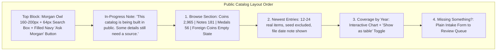

# AG PLAN NET-747: Public Catalog Browse Pages (v3)

- **Track:** NET-747 (Catalog Browse Pages)
- **Version:** `v3` (Attempt 3 of 10)
- **Station:** AG CoS v4 / Gemini 3.8 (`ba2bfdb2-60a1-47d5-befb-78ea742d3dc3`)
- **Date:** 2026-11-03 2:15 PM ET
- **Status:** **PLAN ONLY — STRICTLY NO EXECUTION, NO CODE, NO COMMITS TO APP/DEV/MAIN, NO DEPLOYS**
- **Authority / Baton:** `BATON_NET-753_AG_NET-747-PLAN-v3_20261103-1353.md` (Desk / GB CoS Review 82 REVISE: `INBOX\GBCOS_SCORE_NET-747_CATALOG-BROWSE_v2.md`)
- **Inputs:** `NET-747_inputs\entries_master_20261103.jsonl` (3,202 verified records: 2,965 coins, 181 notes, 56 medals), `Plan.v1_catalog.md`, `ux/badges_concept.html`, `ux/catalog_top_concept.html`
- **Review Pipeline Required:** AG Plan v3 -> Argon Review (from RADIO NET) -> CoS Score 95+ -> SAG Concurrence -> Founder Eric's Typed YES -> Execute

---

## 0. Clean Change Log: v3 Improvements vs v2

This `v3` plan resolves all 6 must-fixes and non-blocking notes raised in GB CoS's audit (`GBCOS_SCORE_NET-747_CATALOG-BROWSE_v2.md`, 82/100 REVISE):

1. **`MF-1` Resolved (Real Field Names on Allow-List & Schema Accuracy):**
   - Corrected top-level field names from previous schema (`category`, `year_start`, `year_end`, `mint`, `weight_grams`, `edge`, `obverse`, `reverse`, `notes`, `references`, `created_at` were non-existent) to verified keys in `entries_master_20261103.jsonl`:
     `nac_code`, `name`, `type` (`"coin"`, `"note"`, `"medal"`), `denomination`, `year`, `series`, `mint_facility`, `mint_mark_on_coin`, `composition`, `era`, `designer`, `weight_g`, `diameter_mm`, `mintage`, `history`, `sources`, `figures`, `primary_image`, `type_image`, `secondary_image`, `extra_images`, `varieties`, `pre_federal`, `pre_federal_state`, `display_label`, `note_size`, `social_posts`.
   - Explicitly specified all permitted nested sub-fields:
     - `primary_image`: `{url, full_url, side, unique_side, license, credit, source_url, resolution}` (purges `local_path`, `local_manifest`, `image_status`, `match`).
     - `type_image`: `{url, file, side, note, resolution, source}` (purges `local_path`, `match`).
     - `secondary_image`: `{url, file, side, resolution, source, unique_side}` (purges `local_path`, `match`).
     - `extra_images`: `[{url, full_url, side, unique_side, license, credit, source_url, resolution}]`.
     - `varieties`: `[{name, attribution, reference_work, source, status}]`.
     - `sources`: `[{label, url, tier, title, kind}]` (purges internal `collection-derived` items).
     - `mintage`: `{value, label, source_url}` (purges `doc_id`, `grounding_score`).
     - `figures`: `{mintage, weight_g, diameter_mm, fineness, composition}` (only sourced values; unsourced mapped to `"Needs source"`).
   - Stripped the inaccurate claim from v2 line 24 asserting previous schema alignment.
2. **`MF-2` Resolved (Complete Strip & Scrub Pipeline):**
   - Added all internal/builder fields to mandatory strip list: `seed_status` (1,724 entries), `fold_source` (`"seed_images"` / `"entries_20261103"`), `record_status`, `needs_fact_check`, `published_on_x`, `program`, `measurement_note`, `reused_from`, `image_status`, `seed_type`, `proposal_status`, `product_code`, `doc_id`, `method`, `grounding_score`, `release_date`.
   - Comprehensive Scrubbing Pipeline: The raw file contains 11,382 `"seed"` tokens and 20,129 `"collection"` tokens. The offline adapter scrubs nested values:
     - Drops any `sources` element where `type == "collection-derived"` or `label` contains `"collection-derived"`.
     - Purges internal paths (`/workspace/image-intake/...`), manifest paths, and status strings (`NO_IMAGE (collection images are user-scoped...)`).
     - Automated scan rule: Scans 100% of `catalog_public_v1.json` for forbidden tokens (`"seed"`, `"collection-derived"`, `"user-scoped"`, `"collection-seed"`, `/workspace/image-intake`, `gs://`). Any hit immediately **FAILS** the build gate with exit code 1.
3. **`MF-3` Resolved (Verified Counts & Nothing-Invented Rule):**
   - Corrected master dataset counts: **3,202 total records** = **2,965 coins** (corrected from 2,906), **181 notes**, **56 medals**.
   - Exactly **4 records have a sourced mintage** (1796 Draped Bust cent: 974,700; 1820 Capped Bust: 27,550; 1854 Indian head Ty2: 14,632; 1925 5 Cents: 3,000,000). These 4 records display their sourced mintage and source URL (FRASER / Mint Annual Reports). The remaining **3,198 records** display `"Needs source"`.
4. **`MF-4` Resolved (Newest Entries Fallback & Seed Isolation):**
   - Master records do not contain `created_at` or `date_added`.
   - Fallback: Sorts using the Catalog Research file timestamp (`entries_master_20261103.jsonl` file date: 3 Nov 2026).
   - Mandatory UI Disclosure: Newest Entries renders a clear, visible note: *"Entries sorted by Catalog Research file date (3 Nov 2026)."*
   - Seed Exclusion: Checklist seed records (`fold_source == "seed_images"`, 2,612 items) are flagged `is_interleaved_checklist_only: true` and excluded from the Newest pool. Newest is strictly populated from original preview records (~528 records) that have images and documentation.
5. **`MF-5` Resolved (Ask Morgan Button Styling):**
   - "Ask Morgan" button updated to a **filled navy button** (`background: #0B2545`, `color: #FFFFFF`, `border: 2px solid #0B2545`), accompanied by the `36x36` owl icon.
6. **`MF-6` Resolved (Firestore Rules Guard & Preview Scope YES):**
   - Clarified that deploying `firestore.rules` or writing to Firestore requires Founder Eric's explicit separate typed YES (as Firestore security rules are project-wide and affect LIVE production).
   - Limited Phase 3 deploy authorization: The deploy YES covers the **p7v12 preview channel only**, never live production (`origin/main` stays locked at `9f04550a`).
7. **Non-Blocking Notes (N-a to N-e) Addressed:**
   - N-a: Verbatim badge contrast ratios from `ux/badges_concept.html`: Pre-Federal text `15.39:1` AAA, outline `6.37:1`; Neutral text `12.63:1` AAA, outline `5.33:1`.
   - N-b: Reaffirmed SPA routing + dynamic `noindex` (strictly no Cloud Run in this track).
   - N-c: Half-open era intervals: `< 1792`, `1792 <= year < 1837`, `1837 <= year < 1873`, `1873 <= year < 1901`, `1901 <= year < 2000`, `2000 <= year <= 2026`, `Undated`.
   - N-d: Confirmed all 9 Morgan weight-conflict rejects were excluded from the master fold and will not appear as placeholders.
   - N-e: Intake form captcha and rate-limiting collect zero user PII.

---

## 1. Non-Negotiable Guardrails & Priority

1. **Five 26 Nov Must-Ships Take Absolute Precedence:**
   - Must-ship items: Pricing tiers, 400-years scope line, soft-404, Meta pixel, Stripe.
   - Catalog work must NEVER consume review slots, deployment windows, or developer bandwidth needed for NET-746 / NET-748 or the five must-ships.
   - If any must-ship encounters a block, slip, or failfix cycle, catalog work pauses instantly.
2. **Branch & Channel Isolation:**
   - **Dedicated Branch:** `catalog-browse-p7v12` branched exclusively from `p7v12` preview base.
   - **Target Channel:** Firebase preview channel `p7v12` only.
   - **Forbidden Branches:** Never branch from, edit, or merge into `p7-v8.9`, `dev`, or `main`.
   - **Production Freeze:** `origin/main` locked at `9f04550a`; live site untouched; Stripe locked OFF.
3. **Firestore Security Rules Deployment Guard:**
   - Any modification or deployment of `firestore.rules` or writing intake records to Firestore requires Founder Eric's explicit separate typed YES. Firestore security rules are project-wide and immediately impact live production.
4. **Zero User PII & Collection Privacy:**
   - Strictly generic numismatic coin/note/medal data and licensed public images only.
   - Zero user names, zero dollar values, zero personal collection counts, zero ownership indicators, zero personal notes, zero cert/slab IDs, zero user-scoped GCS paths.

---

## 2. Input Datasets & Verified Master Metrics (Read-Only)

| Dataset | Scope / Count | Status & Verified Master Handling |
|---|---|---|
| `entries_master_20261103.jsonl` | **3,202 master entries** | Read through read-only adapter. **NEVER run `build.py` or `finalize.py`** |
| Coins | **2,965 entries** | Breakdown: Coins constitute 92.6% of master fold |
| Notes | **181 entries** | Breakdown: US paper currency entries |
| Medals | **56 entries** | Breakdown: Historical medals (e.g. Libertas Americana) |
| Pre-Federal Items | **9 entries** | Items dated prior to 1792 (`pre_federal: true`) |
| Placeholders | **951 entries** | Rendered as name-only with neutral pill `"Details coming"` (`display_label`) |
| Sourced Mintages | **4 entries** | Exact 4 records display sourced figures + source URL; remaining 3,198 show `"Needs source"` |
| `schema.json` | Schema definition | NAC1 code regex updated to allow `.BEP.BASE.2` and multi-segment suffixes |
| `images_MANIFEST.csv` | 171 image rows | Verified license, credit, source, sha256 checksum |
| `published_x_posts.csv` | Published X posts | 4 shaky claims stripped; manual read gate applied to all notes |
| Varieties in Master | Sub-objects | Ingested as structured objects: `{ "name": str, "attribution": str, "reference_work": str, "source": str, "status": str }` |

---

## 3. PII & Internal Token Strip/Scrub Pipeline

### 3.1 Strict Allow-List Field Mapping
An offline sanitization script (`scripts/catalog/build_public_catalog.py`) reads `entries_master_20261103.jsonl` through a read-only adapter and outputs `catalog_public_v1.json` using an explicit **allow-list only**:

- **Permitted Top-Level Master Fields:**
  - `nac_code` (str)
  - `name` (str)
  - `type` (str: `"coin"`, `"note"`, `"medal"`)
  - `year` (int or null)
  - `denomination` (str or null)
  - `series` (str or null)
  - `mint_facility` (str or null)
  - `mint_mark_on_coin` (str or null)
  - `composition` (str or null)
  - `era` (str or null)
  - `designer` (str or null)
  - `weight_g` (float/int or null)
  - `diameter_mm` (float/int or null)
  - `history` (str or null)
  - `pre_federal` (bool)
  - `pre_federal_state` (str or null)
  - `display_label` (str or null, e.g. `"details coming"`)
  - `note_size` (str or null)
  - `mintage` (object: `{value, label, source_url}`)
  - `figures` (object: `{mintage, weight_g, diameter_mm, fineness, composition}`)
  - `sources` (list of allowed sub-objects)
  - `primary_image` (object or null)
  - `type_image` (object or null)
  - `secondary_image` (object or null)
  - `extra_images` (list of objects or null)
  - `varieties` (list of objects: `{name, attribution, reference_work, source, status}`)
  - `social_posts` (list of objects after stripping 4 shaky claims)

- **Permitted Nested Sub-Fields:**
  - `primary_image`: `{url, full_url, side, unique_side, license, credit, source_url, resolution}`
  - `type_image`: `{url, file, side, note, resolution, source}`
  - `secondary_image`: `{url, file, side, resolution, source, unique_side}`
  - `extra_images`: `[{url, full_url, side, unique_side, license, credit, source_url, resolution}]`
  - `varieties`: `[{name, attribution, reference_work, source, status}]`
  - `sources`: `[{label, url, tier, title, kind}]`
  - `mintage`: `{value, label, source_url}`
  - `figures`: `{mintage, weight_g, diameter_mm, fineness, composition}`

- **Derived Public Fields (Computed by Adapter):**
  - `status_badge`: `"Pre-Federal"`, `"Needs source"`, or `"Details coming"`.
  - `is_pre_federal`: boolean (`year < 1792` or `pre_federal == true`).
  - `is_placeholder`: boolean (`display_label == "details coming"`).
  - `is_interleaved_checklist_only`: boolean (true for records from `fold_source == "seed_images"` to exclude them from Newest).

- **Mandatory Strip List (Explicit Deny-by-Default):**
  - `seed_status`, `fold_source`, `record_status`, `needs_fact_check`, `published_on_x`, `program`, `measurement_note`, `local_path`, `local_manifest`, `reused_from`, `image_status`, `seed_type`, `proposal_status`, `product_code`, `doc_id`, `method`, `grounding_score`, `release_date`.

### 3.2 Scrubbing Pipeline for Nested Values
The raw jsonl contains 11,382 `"seed"` hits and 20,129 `"collection"` hits. The adapter applies surgical scrubbing:
1. **`sources` Scrub:** Drop all entries where `type == "collection-derived"` or `label` contains `"collection-derived"`. If no external sources remain, `sources` is set to `[]`.
2. **`primary_image` / `type_image` / `secondary_image` Scrub:** Strip all `local_path`, `local_manifest`, and internal status strings (e.g. `NO_IMAGE (collection images are user-scoped...)`). Only verified public URLs pass through.
3. **Internal Path Scrub:** Strip all `/workspace/...` and `gs://` strings from any field.
4. **Museum vs User Collection Protection:** Legitimate numismatic names (e.g. *"National Numismatic Collection"* in historical commentary or *"The U.S. Nickel Collection"* in official series names) are preserved, while internal user-collection tokens (`collection-derived`, `collection-seed`, `seed_images`, `user-scoped`) are completely eliminated.

### 3.3 Dual-Stage PII Gate
1. **Automated Zero-Tolerance Scan (3,202 / 3,202 records):**
   - Scans 100% of `catalog_public_v1.json` for forbidden tokens: `"seed"`, `"collection-derived"`, `"user-scoped"`, `"collection-seed"`, `gs://`, `googleapis`, `users/`, `/workspace`, and email/phone regex patterns.
   - Any match immediately **terminates the build with exit code 1**.
2. **Manual Sample Audit:**
   - 100 random records audited (at least 50 from checklist records, plus 100% of records with history or images).
   - Documented in `PII_GATE_REPORT_<date>.md`.

---

## 4. UI Architecture & UX Specifications

### 4.1 Founder Binding Decisions (Eric — 3 Nov 2026, 9:01 AM ET)
1. **Interleaved Modern Coin Records:**
   - Modern coin checklist records (2000–2026) appear strictly interleaved inside the complete chronological year-by-year checklist.
   - Never presented as a standalone list or filter labeled "seed" or "collection".
2. **Newest Entries Isolation & File Date Fallback:**
   - The "Newest Entries" section displays the top 12–24 preview items and strictly excludes checklist-only seed records (using `is_interleaved_checklist_only: true`).
   - Sorted by Catalog Research file date (`entries_master_20261103.jsonl` file timestamp: 3 Nov 2026).
   - Renders visible UI disclosure note: *"Entries sorted by Catalog Research file date (3 Nov 2026)."*
3. **951 Placeholders:**
   - Display name-only cards with neutral pill `"Details coming"` and neutral coin-outline placeholder.
   - Zero invented figures, zero guessed images.
4. **Zero Leak Rule:**
   - Automated scan asserts zero "seed", "collection-derived", or "user-scoped" tokens in public HTML source, URLs, or API payloads.

### 4.2 Page Layout & Component Hierarchy (`Plan.v1_catalog.md:155`)



### 4.3 Verbatim Badge Specifications (`ux/badges_concept.html:5-6, 12-14`)
All badges are non-interactive pills positioned directly beneath the item title:
- **Base Style (`.tag`):** `height: 32px`, `padding: 0 14px`, `border-radius: 16px`, `font-size: 16px`, `background: #FFFFFF`, `display: inline-flex`, `align-items: center`, `gap: 8px`.
- **Pre-Federal Badge (`.pf`):** `border: 2px solid #1F5FAD`, text `color: #0B2545`, `font-weight: bold`. Contrast: text `#0B2545` / `#FFF` = **15.39:1** (AAA); outline `#1F5FAD` / `#FFF` = **6.37:1**. Displayed on all pre-1792 items (9 total); never on >=1792.
- **"Needs source" Badge (`.neu`):** `border: 2px solid #6B6B6B`, text `color: #333333`. Includes `20x20` circled `"i"` SVG (`<circle cx="10" cy="10" r="8.5" fill="none" stroke="#333" stroke-width="2"/><rect x="9" y="8.5" width="2" height="6" fill="#333"/><circle cx="10" cy="5.7" r="1.3" fill="#333"/>`). Contrast: text 12.63:1 (AAA), outline 5.33:1. **Never red, orange, or yellow.**
- **"Details coming" Badge (`.neu`):** `border: 2px solid #6B6B6B`, text `color: #333333`. Includes `20x20` dotted-circle SVG (`stroke-dasharray="3 2.5"`). Contrast: text 12.63:1 (AAA), outline 5.33:1. Used on the 951 placeholder records.
- **Discipline Rule:** Exactly **1 badge per card maximum**. Never stack "Needs source" with "Details coming". Detail view displays `"Mintage: Needs source"` beside blank figures, or the sourced mintage with source link for the 4 sourced records.

### 4.4 Top Block Styling (`ux/catalog_top_concept.html:10-24`)
- **Morgan Owl:** 160–200px centered, using transparent-background or circular crop of `Morgan_Owl_NoBubble_2048.png`.
- **H1 Title:** `40px` `#0B2545`, bold.
- **Search Input:** `64px` height, `border: 2px solid #0B2545`, `font-size: 22px`, label `"Search the catalog"`.
- **Search Button:** Primary filled `#0B2545` background / `#FFFFFF` text.
- **"Ask Morgan" Button:** **Filled navy button** (`background: #0B2545`, `color: #FFFFFF`, `border: 2px solid #0B2545`) with `36x36` owl icon.
- **In-Progress Note:** Calm neutral box `#F2F2F2` background / `border: 1px solid #D6D6D6`, text `#333333`.
- **No-Photo Placeholder:** `96x96` circle with `3px dashed #8A8A8A` and `"No photo yet"` (`#333333`, `16px`).

### 4.5 Image Priority Ranking & Attribution (`MF-747-5`)
1. **Multi-Image Ranking Order:**
   - 1. Museum first: NNC / Smithsonian, ANS, Met, BnF.
   - 2. Public domain: Wikimedia and other open repositories.
   - 3. Verified collector uploads.
2. **SHA-256 Check:** All 171 manifest images verified against `images_MANIFEST.csv` sha256 checksums before inclusion.
3. **Attribution:** Every displayed photo renders visible `credit` and `license` beneath the image.
4. **Primary vs Type Image Distinction:**
   - `primary_image`: exact match for the coin.
   - `type_image`: representative type photo only; must explicitly display label: `"date may differ"`.

### 4.6 Navigation & Empty States
- **Type Order:** **Coins (2,965) -> Notes (181) -> Medals (56)** (Medals strictly after Coins and Notes).
- **Era Buckets (Half-Open Intervals):**
  - Pre-Federal: `< 1792`
  - Early Republic: `1792 <= year < 1837`
  - Seated / Civil War: `1837 <= year < 1873`
  - Morgan / Late 19th: `1873 <= year < 1901`
  - 20th Century: `1901 <= year < 2000`
  - Modern: `2000 <= year <= 2026`
  - Undated: `year == null`
- **Foreign Coins:** Dedicated tab displaying single-line calm notice: *"Foreign coins are coming later."* (zero fake entries).
- **Default List Sorting:** Browse lists default-sort **image + source first** (`Plan.v1_catalog.md:160`), with sort toggle for chronological checklist.

### 4.7 "Missing something?" Form & Firestore Guard
- Form fields: item description, optional year, optional type, optional primary source URL, optional email marked `"(optional)"`.
- Visible labels above fields, primary `"Send"` button, confirmation message: *"Thanks - we'll look into it."*
- Zero collection photos, zero dollar values, zero ownership fields.
- Submissions land in an off-repo review queue with rate-limiting and captcha (collecting zero PII); never auto-published.
- **Firestore Guard:** Deploying `firestore.rules` or writing intake submissions directly to Firestore requires Founder Eric's explicit separate typed YES. Until that YES is granted, intake forms route to a local memory/staging queue or stub endpoint without modifying live security rules.

### 4.8 Senior Usability & Accessibility (WCAG AA / 200% Zoom)
- Typography scale: Body `20px`, Card titles `24px`, Section headings `30px`, Page title `40px`.
- Tap targets: `48px` minimum with `16px` minimum margins.
- High contrast (>=4.5:1 text, >=7:1 interactive controls). Fully functional at 200% zoom and mobile viewports.

---

## 5. Routing & Soft-404 Architecture

### 5.1 Soft-404 Reuse Rule (`NotFoundScreen`)
Per `Plan.v1_catalog.md:13`, we strictly reuse and extend the existing `NotFoundScreen` (`numista_mobile/lib/screens/not_found_screen.dart:18-23`):
- When `attemptedPath` starts with `/catalog/`:
  - Displays catalog-aware headline: *"We don't have that one yet."*
  - Renders catalog search box, filled navy "Ask Morgan" button, and link to "Missing something?".
  - Injects `<meta name="robots" content="noindex">` into `document.head` on web to suppress search engine indexing.

### 5.2 SPA Routing & Firebase Hosting
- **`numista_mobile/lib/main.dart:119-140` (`isKnownPath`):**
  Add `normalizedPath == '/catalog' || path.startsWith('/catalog/')` to `isKnownPath`.
  Validate `:nacCode` against `catalog_public_v1.json` allow-list; render `NotFoundScreen(attemptedPath: path)` when slug is unknown.
- **Firebase Hosting (`firebase.json:54-133`):**
  Add SPA rewrite:
  ```json
  {
    "source": "/catalog/**",
    "destination": "/index.html"
  }
  ```
  *(Note: Firebase Hosting SPA rewrites return HTTP 200. Indexation is blocked dynamically via `<meta name="robots" content="noindex">`. Strictly no Cloud Run in this track).*

---

## 6. Performance & Viewport Virtualization

Rendering 3,202 entries (including 2,965 coins) simultaneously in Flutter Web DOM causes frame drops:
- `CatalogBrowseScreen` implements `CustomScrollView` with `SliverGrid` and `SliverList` using `SliverChildBuilderDelegate`.
- Only items currently visible in the active viewport (plus 500px cache extent) are mounted.
- Target metrics: Initial DOM mount < 1.5s; continuous scroll 60fps; Lighthouse performance >= 90.

---

## 7. Phased Implementation Roadmap

```mermaid
flowchart TD
    subgraph P0 [Phase 0: Isolation & PII Sanitization]
        A["Branch catalog-browse-p7v12 from p7v12"] --> B["Update schema.json NAC regex for .BEP.BASE.2"]
        B --> C["Verify sha256 on images_MANIFEST.csv (171 rows)"]
        C --> D["Run build_public_catalog.py on entries_master_20261103.jsonl"]
        D --> E["Execute Automated PII & Token Scan (3,202 records)"]
        E --> F["Perform 100-Record Manual Sample Audit"]
    end

    subgraph P1 [Phase 1: Shell & Components]
        F --> G["Build Morgan Top Block & Filled Navy 'Ask Morgan' Button"]
        G --> H["Build Exact ux/badges_concept.html Badges"]
        H --> I["Build Category Tabs: Coins 2,965 | Notes 181 | Medals 56"]
        I --> J["Build Newest Entries Section (Excludes Seeds, Shows File Date Note)"]
    end

    subgraph P2 [Phase 2: Virtualized Grid & Details]
        J --> K["Implement Virtualized SliverGrid (Image+Source First)"]
        K --> L["Implement 951 'Details coming' Placeholder Cards"]
        L --> M["Render 4 Sourced Mintages + 3,198 'Needs source' States"]
        M --> N["Implement Coverage Chart + Table Toggle"]
        N --> O["Implement 'Missing something?' Intake Modal (Off-Repo Queue)"]
    end

    subgraph P3 [Phase 3: Routing, Soft-404 & Review Gate]
        O --> P["Update main.dart isKnownPath for /catalog/**"]
        P --> Q["Extend NotFoundScreen with Catalog 404 + noindex"]
        Q --> R["Argon Review -> CoS 95+ -> SAG Review"]
        R --> S["Founder Eric Typed YES -> p7v12 Preview Deploy ONLY"]
    end
```



---

## 8. Machine-Checkable Verification Criteria

1. **PII & Internal Token Gate Check:**
   ```powershell
   python tools/catalog/pii_gate_validator.py --input build/catalog_public_v1.json
   # Exit code 0: 0 PII violations, 0 internal seed/collection tokens found
   ```
2. **Schema & Shaky Claim Check:**
   ```powershell
   python tools/catalog/validate_schema.py --schema schema.json --input build/catalog_public_v1.json
   # Exit code 0 across all 3,202 records (validates .BEP.BASE.2)
   python tools/catalog/check_shaky_claims.py --input build/catalog_public_v1.json
   # Exit code 0 (0 occurrences of 4 shaky X-post claims)
   ```
3. **Flutter Code Hygiene & Formatting:**
   ```powershell
   flutter analyze lib/screens/catalog/
   flutter test test/catalog/
   ```
4. **Data Counts & Integrity Check:**
   - Total records = 3,202 (Coins: 2,965, Notes: 181, Medals: 56).
   - Exactly 4 records have sourced mintage (render value + source link).
   - Exactly 3,198 records display `"Needs source"`.
   - Placeholders = exactly 951 displaying `"Details coming"` with neutral coin outline.
   - Pre-Federal badges = exactly pre-1792 items (9 total).
   - Medals placed strictly after Coins and Notes.
   - 9 Morgan weight-conflict rejects verified absent.
5. **Accessibility & Senior Usability:**
   - Lighthouse accessibility score >= 95.
   - All text meets WCAG AA (4.5:1 body, 3:1 headers). Badges meet 15.39:1 / 12.63:1.
   - Clean 200% zoom reflow without clipping or horizontal overflow.

---

## 9. What AG CoS Will NOT Do Under This Plan
- **Will NOT touch `origin/main` or live site.**
- **Will NOT merge into or touch `p7-v8.9` (NET-746 preview branch).**
- **Will NOT run `build.py` or `finalize.py`.**
- **Will NOT deploy `firestore.rules` or write to Firestore without Eric's separate typed YES.**
- **Will NOT deploy to any channel other than preview channel `p7v12` upon Eric's typed YES.**
- **Will NOT write code before Argon, CoS, SAG, and Eric typed YES.**
- **Will NOT delay or distract from the five 26 Nov must-ships.**
- **Will NOT expose any user collection data, user PII, or internal pipeline tokens.**
