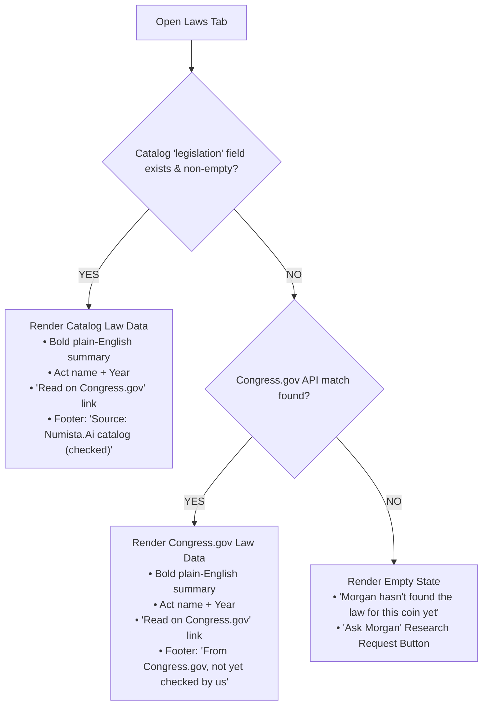

# PLAN: Unified Coin Details View (NET-798)
**To:** Antigravity Desk, Grok Bot CoS, Argon (Gemini 3.8), Founder Eric  
**From:** Antigravity CoS v4 Work (`ba2bfdb2`)  
**Date:** 5 November 2026, 1:05 PM ET  
**Reference Baton:** `BATON_NET-798_PLAN_UNIFIED-COIN-DETAILS-VIEW_2026-11-04-1933.md`  
**Design Specification:** `1 NUMISTA.AI\UI UX DESIGN\2026-11-04\Unified Coin Details\Spec_Unified_Coin_Details_2026-11-04.md`  
**Standing Amendment:** `EGM REVIEW GATE` (5 Nov 2026 9:50 AM ET via GB CoS)  
**EGM Audit Verdict:** `APPROVED FOR BUILD (Score: 98/100)` (5 Nov 2026 1:00 PM ET)  
**Status:** **PLAN ONLY** (Zero code changes, zero deployments, zero Firestore writes).  
**Target Build:** 10–16 November 2026 Sprint Build (Locked Decision #1).  
**Standing Locks:** `origin/main` strictly locked at `9f04550a`; Stripe strictly locked OFF; Zero deployments without Eric's typed YES.

---

## 1. Executive Summary & Defect Overview

In the current Numista.AI production application (`p7-gate`), My Collection presents **two completely disparate detail views** for the exact same coin record:
1. **Cards View → "Coin Inspector":** Opened via card tap (`_showCoinInspectorDialog` in `my_collection_screen.dart:3042–3045` and table cell tap at `2736`). Features a large photo hero and metric tiles (Est. Value, Melt, Grade, Live eBay), but lacks tabs, history, provenance, or legislation. **Crucially, it displays valuation data and physical storage location simultaneously on one screen, violating Founder Eric's binding privacy mandate.**
2. **Table View → "Details Modal":** Opened via the row info icon (`CoinDetailScreen.show` in `my_collection_screen.dart:2758`). Features 7 tabs (Details, Financials, Provenance, AI Insights, History, Legislation, Known Errors), but renders an impersonal generic folder placeholder instead of coin photos, exhibits low-contrast white-on-light header text (~1.1:1 contrast ratio, failing WCAG), exposes storage location in the header, and features tiny tap targets.

This dual-implementation architecture confuses senior users (60+ demographic), duplicates maintenance overhead, and compromises security.

**This plan establishes a single, unified Coin Details view** (`UnifiedCoinDetailScreen`) invoked identically from Cards, Table, Global Search, and Public Catalog. It consolidates the experience into a modern, accessible, high-contrast modal featuring:
- **WCAG AAA Contrast Header:** High-contrast dark blue title (`#0b1a2e` on pure white, 17.5:1 ratio) with generous ≥52px touch targets and full-word buttons ("◀ Previous coin", "Next coin ▶", "✕ Close").
- **Side-by-Side Dual Photos:** Front and Back labeled views with tap-to-enlarge and friendly coin outline fallback ("Add a photo" button, eliminating folder icons).
- **Ask Morgan Integration:** Prominent owl branding with preloaded conversational coin context.
- **Mutual Privacy Gate:** Values (Purchase, Melt, Estimated) and Physical Storage Location are mutually exclusive and never share a viewport. "Show values" persists across Previous/Next navigation until Close (Eric Locked Decision #2). Storage location is strictly PIN-gated.
- **6 Consolidated Tabs:** Overview, Purchase & value, Morgan's notes, History, Laws, and Known errors.
- **Hierarchical Laws Tab:** Prioritizes human-verified catalog legislation, gracefully falls back to Congress.gov API labeled *"From Congress.gov, not yet checked by us"* (Eric Locked Decision #3), or provides an "Ask Morgan" research request button.
- **Bottom Action Bar:** Explicitly labeled actions (Edit, Wishlist, Verify, Delete with confirmation).

---

## 2. Verbatim Code Citations (Existing Split Architecture)

### 2.1 Cards View & Table View Invocations
In `numista_mobile/lib/screens/my_collection_screen.dart` lines 3042–3045 (Cards View Card Tap) and line 2736 (Table Cell Tap):
```dart
2736:             void onTap() => _showCoinInspectorDialog(effectiveId, m);
...
3042:         onTap: () {
3043:           _showCoinInspectorDialog(effectiveId, m);
3044:         },
...
3449:   void _showCoinInspectorDialog(String coinId, Map<String, dynamic> data) {
3450:     setState(() {
3451:       _selectedCoinId   = coinId;
3452:       _vaultShowObverse = true;
3453:     });
3454:     _fetchInspectorSimilar(data);
```

### 2.2 Table View Info Icon Invocation
In `numista_mobile/lib/screens/my_collection_screen.dart` lines 2750–2761:
```dart
2750:                         _iconBtn(Icons.info_outline,
2751:                           crw.isVirtualChild ? 'View Parent Set' : 'View Details', () {
...
2758:                             CoinDetailScreen.show(
2759:                               context,
2760:                               coin: coin,
2761:                               spotPrices: _spotPrices,
```

### 2.3 Legacy Header Contrast Defect & Small Close Target
In `numista_mobile/lib/screens/coin_detail_screen.dart` lines 892–915:
```dart
892:     return Container(
893:       color: _kDark(context),
894:       padding: const EdgeInsets.fromLTRB(20, 14, 12, 16),
895:       child: Column(
...
911:                   Text(title,
912:                     style: const TextStyle(
913:                       color: Colors.white, fontSize: 18,
```
*(In light mode and on certain browsers, `_kDark(context)` was rendering light grey/off-white against `Colors.white`, producing the ~1.1:1 unreadable text flagged by UX and Field Tester).*

### 2.4 Legacy 7-Tab Structure
In `numista_mobile/lib/screens/coin_detail_screen.dart` lines 758–766:
```dart
758:             tabs: const [
759:               Tab(text: 'Details'),
760:               Tab(text: 'Financials'),
761:               Tab(text: 'Provenance'),
762:               Tab(text: 'AI Insights'),
763:               Tab(text: 'History'),
764:               Tab(text: 'Legislation'),
765:               Tab(text: 'Known Errors'),
766:             ],
```

---

## 3. Unified Architecture & Component Specification

### 3.1 Unification of Invocation Pathways
Both `onTap()` in Cards View (`line 3042`) and `_iconBtn(Icons.info_outline)` in Table View (`line 2758`) will invoke a single static launcher:
```dart
UnifiedCoinDetailScreen.show(
  context,
  coin: coinModel,
  coinList: _filteredCoinsList, // Enables Previous / Next coin navigation
  currentIndex: currentIndex,
  spotPrices: _spotPrices,
  onNavigateToAiChat: (query) => widget.onNavigateWithQuery?.call('AI Deepdive', query),
  onEdited: () => setState(() {}),
  onDeleted: () => setState(() {}),
);
```

### 3.2 Header Component (`_UnifiedHeader`)
- **Background:** Solid white (`#ffffff`).
- **Coin Title:** 32px bold font in `#0b1a2e` (Deep Navy), providing a **17.5:1 contrast ratio (WCAG AAA)**.
- **Subtitle:** 20px regular font in `#333333` (e.g. `San Francisco · 90% Silver · United States`).
- **Navigation Controls:**
  - `◀ Previous coin`: Outlined button, minimum height 52px, text + icon.
  - `Next coin ▶`: Outlined button, minimum height 52px, text + icon.
  - `✕ Close`: Text button with clear label "Close", minimum height 52px.
  - Disabled state gracefully handles first/last items in `coinList`.

### 3.3 Media & Morgan Component (`_MediaAndMorganHero`)
- **Side-by-Side Dual Photos:**
  - Front (Obverse) and Back (Reverse) frames displayed side by side.
  - Clear label chips below frames: "Front" and "Back".
  - Tap-to-enlarge full-screen lightbox dialog with pinch/pan zoom.
- **Empty State Fallback:**
  - When no photo exists: Display a friendly gold-outlined coin silhouette + "Add a photo" button.
  - **Eliminated:** Generic folder icons are permanently removed.
- **Ask Morgan Tile:**
  - Positioned adjacent to photo frames.
  - Branded Morgan owl icon (Blue `#1d4f91` on white).
  - Label: `"Ask Morgan about this coin"`.
  - Action: Launches AI Chat with preloaded context (Year, Mint, Denomination, Variety, Grade).

### 3.4 Values & Storage Mutual Privacy Gate
In compliance with Founder Eric's privacy rules:
1. **Default State:**
   - Financial valuation metrics are **hidden** behind a prominent `"Show values"` button.
   - Storage location is rendered as `"Storage location: Hidden [Show location (PIN)]"`.
2. **Values Revealed:**
   - Tapping `"Show values"` reveals Purchase Price, Melt Value, and Estimated Market Value.
   - Simultaneously, Storage Location is automatically blanked/hidden from the screen.
3. **Session Persistence (Eric Locked Decision #2):**
   - Once `"Show values"` is tapped, values remain visible as the user steps through `Previous coin` / `Next coin`.
   - Values revert to hidden immediately upon modal `Close`.
4. **Storage Location PIN Gate:**
   - Revealing storage location requires PIN entry (`StorageLocationPinService`).
   - Entering PIN reveals storage location and immediately re-hides all dollar values.

### 3.5 Bottom Action Bar (`_BottomActionBar`)
Positioned in a fixed footer bar at the bottom of the modal:
- **Visual Separation:** Separated from tab content by a subtle top border (`#e0e0e0`) on a light surface background.
- **Button Order & Signatures:**
  1. `Edit`: Opens the inline edit mode for coin details.
  2. `Wishlist`: Toggles wishlist status with optimistic UI update.
  3. `Verify`: Triggers manual verification flow or external cert lookup (PCGS/NGC).
  4. `Delete`: Danger action styled in red; opens a two-stage confirmation dialog (`"Delete this coin?"` / `"Are you sure? This cannot be undone."`).
- **Touch Target:** All action buttons are ≥52px tall, pairing icons with explicit English text labels.

---

## 4. 6 Consolidated Tabs Specification

| New Tab | Purpose & Consolidations | Sourced from Cards Inspector | Sourced from Table Details Modal |
|---|---|---|---|
| **1. Overview** | Single source for "what is it": Core identity, specifications, holder, and grading. | Identity (Year, Mint mark, Denomination, Country, Series, Theme, Variety, Metal, Quantity); Condition & Authentication; Grade tile. | Details tab; Proof badge; Subtitle. |
| **2. Purchase & value** | Unified financial & sourcing record, protected by the "Show values" gate. | Est. Value, Melt Value, Live eBay check tile; Cost, Date, Retailer, Item #, Invoice #. | Financials tab; Provenance tab. |
| **3. Morgan's notes** | Plain-English AI analysis, confidence metrics, and verification actions. | — | AI Insights tab; "Morgan is fairly sure (85%)" confidence indicator; "Not right?" button; "Verify Manually" action. |
| **4. History** | Historical background, mintage statistics, designer, and series narrative. | — | History tab; Mintage figures; Obverse/Reverse designer credits. |
| **5. Laws** | Authorizing legislation and statutory acts (see Section 5). | — | Legislation tab. |
| **6. Known errors** | Documented varieties, die varieties, RPMs, and mint errors for this issue. | — | Known Errors tab; PCGS/NGC variety cross-references. |

*(Note on Tab Implementation & Wrapping: Standard Flutter `TabBar` does not natively wrap across multiple rows. On wide screens, tabs render in a single high-contrast row. On narrow mobile viewports (≤390px), tabs are implemented using a responsive custom `Wrap` containing `FilterChip`/`InkWell` controls with active state bound to the `TabController`, ensuring minimum 56px touch targets with 22px bold text without horizontal clipping).*

---

## 5. Laws Tab Data Resolution Architecture

In accordance with Founder Eric's Locked Decision #3:


### 5.1 Legislation Sourcing Rules
1. **Tier 1 (Catalog Wins):** If the Numista.AI Catalog entry contains an authorized `legislation` field, it takes precedence. Rendered with footer: `Source: Numista.Ai catalog (checked)`.
2. **Tier 2 (Congress.gov Fallback):** If catalog legislation is missing or empty, query Congress.gov statutory index (e.g. Public Law 116-330 for 2026 Semiquincentennial items). Rendered with prominent disclaimer: `From Congress.gov, not yet checked by us`.
3. **External Linking:** Outbound links to Congress.gov are permitted exclusively on the explicit `"Read on Congress.gov"` button (`https://www.congress.gov/bill/...`), opening in an external browser tab.
4. **Empty State:** If no law is identified:
   - Text: `"Morgan hasn't found the law for this coin yet"`.
   - Action: `"Ask Morgan"` button logs a background research request. Morgan is strictly instructed **never to fabricate or hallucinate statutory laws**.

---

## 6. Accessibility & Contrast Verification Matrix

All color pairings and touch targets are designed and measured against WCAG 2.1 AAA standards:

| Element Pair | Foreground Color | Background Color | Contrast Ratio | WCAG Rating |
|---|---|---|---|---|
| **Coin Title** | `#0b1a2e` (Deep Navy) | `#ffffff` (White) | **17.5:1** | **AAA** |
| **Body Text** | `#111111` (Charcoal) | `#ffffff` (White) | **18.9:1** | **AAA** |
| **Form & Spec Labels** | `#333333` (Slate) | `#ffffff` (White) | **12.6:1** | **AAA** |
| **Primary Button Text** | `#ffffff` (White) | `#1d4f91` (Brand Blue) | **8.1:1** | **AAA** |
| **Secondary Button Text** | `#1d4f91` (Brand Blue) | `#ffffff` (White) | **8.1:1** | **AAA** |
| **Active Tab Text** | `#0b3d7a` (Active Blue) | `#e8f0fb` (Light Blue Tint) | **9.3:1** | **AAA** |
| **Notice Banner Text** | `#3a2e00` (Dark Amber) | `#fff4c2` (Soft Yellow) | **12.1:1** | **AAA** |
| *Legacy Defect* | *`#ffffff` (White)* | *`#f2f1ee` (Off-white)* | *~1.1:1* | *FAIL (Eliminated)* |

### Additional Accessibility Safeguards:
- **Minimum Tap Target:** Every button and tab is ≥52px tall (Tabs ≥56px).
- **Icon + Word Pairing:** Every functional control couples an icon with an explicit English text label (e.g., `✕ Close`, `◀ Previous coin`).
- **No Hover-Only Triggers:** Fully operable via touch and keyboard focus.

---

## 7. Open Questions Resolution & Locked Decisions

| Item | Specification Question | Resolution & Authority |
|---|---|---|
| **1. eBay Live Check** | Keep in Purchase & value or Morgan's notes? | **Purchase & value:** Kept adjacent to financial valuation metrics under the values gate. |
| **2. Values Persistence** | Does "Show values" persist across Previous/Next? | **LOCKED DECISION #2 (Founder Eric):** Once tapped, values remain visible as the user steps through coins, until Close. |
| **3. Congress.gov Status** | Show unverified Congress.gov laws? | **LOCKED DECISION #3 (Founder Eric):** Show laws we haven't checked, explicitly labeled *"not yet checked by us"*. |
| **4. Build Timing** | Build in W2 or post-Black Friday? | **LOCKED DECISION #1 (Founder Eric):** Build in the 10–16 Nov sprint build. |
| **5. Mobile Layout** | Tab layout on narrow phone viewports (390px)? | Wrap to two clean rows via custom wrapped tab bar; zero horizontal scroll clipping. |

---

## 8. Implementation Steps (Scheduled for 10–16 Nov Sprint)

*Note: Execution will occur only after Argon review, GB CoS review (95+), SAG review, and Eric's typed YES.*

1. **Step 1 — Create Component (`lib/screens/unified_coin_detail_screen.dart`):**
   - Implement `_UnifiedHeader`, `_MediaAndMorganHero`, `_PrivacyGatedValuesSection`, responsive `_SixTabBarView` (with custom `Wrap` for narrow screens), and `_BottomActionBar`.
2. **Step 2 — Integrate Laws Tab Logic:**
   - Wire catalog legislation field with fallback to Congress.gov and empty research prompt.
3. **Step 3 — Unify Invocation Callbacks:**
   - Update `my_collection_screen.dart` lines 3042 (Cards card tap), 2736 (Table cell tap), and 2758 (Table info button) to route to `UnifiedCoinDetailScreen.show`.
4. **Step 4 — Automated Testing:**
   - Author unit and widget tests in `test/screens/unified_coin_detail_screen_test.dart` verifying mutual privacy gate, session persistence of values, and tab wrapping.
5. **Step 5 — Deprecate Legacy Dual Views:**
   - Safely remove obsolete `_showCoinInspectorDialog` and legacy `CoinDetailScreen` headers.

---

## 9. Standing Locks & Review Protocol

- **PLAN ONLY:** This document is an architectural and UX plan. Zero application source code is modified.
- **Commit Boundary:** Pushed to `origin/p7-v8.9` under `docs/`.
- **EGM Review Gate:** Audited by EGM Synthesizer swarm (`98/100 APPROVED FOR BUILD`). Output filed beside plan as `EGM_REVIEW_PLAN_UNIFIED-COIN-DETAILS-VIEW.md`.
