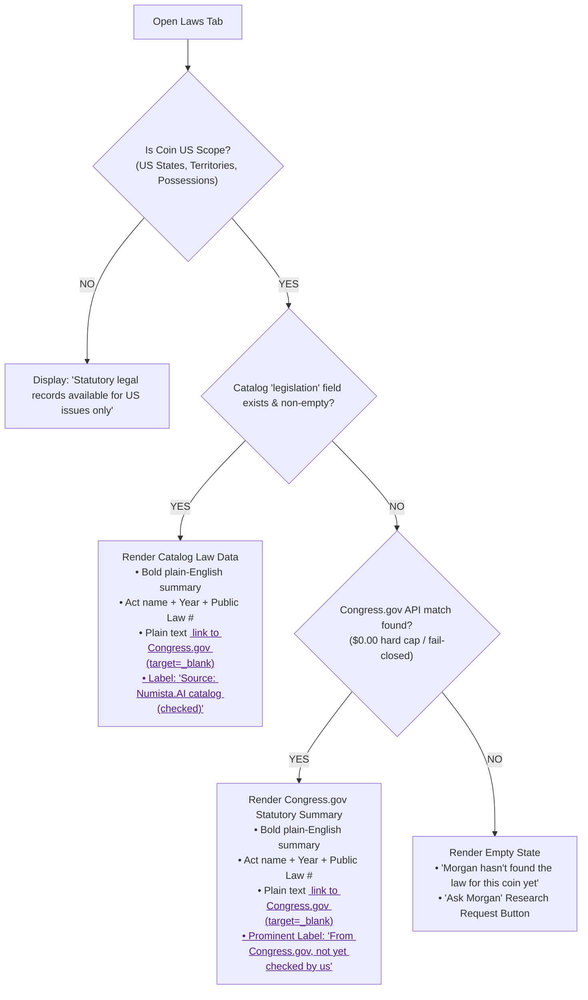

# PLAN: Unified Coin Details View v1.1 (NET-798 / BATON_NET-806)
**To:** Antigravity Desk, Grok Bot CoS, Argon (Gemini 3.8), Stand Alone Grok (SAG), Founder Eric  
**From:** Antigravity CoS v4 Work (`ba2bfdb2`)  
**Date:** 5 November 2026, 3:45 PM ET  
**Reference Batons:**
- `BATON_NET-806_REVISE_UNIFIED-COIN-DETAILS-VIEW_v1.1_PER-COS-86-SAG-61_2026-11-05-1455.md`
- `AMEND_BATON_NET-806_CONGRESS-GOV-ONLY_LAWS-TAB_2026-11-05-1444.md` (Eric Typed AMEND: Congress.gov links approved)
- `COS_SCORE_NET-798_UNIFIED-COIN-DETAILS-VIEW_20261105.md` (CoS 86 FAIL / SAG 61 FAIL on v1.0)
**Design Specification:** `1 NUMISTA.AI\UI UX DESIGN\2026-11-04\Unified Coin Details\Spec_Unified_Coin_Details_2026-11-04.md`  
**Status:** **PLAN ONLY** (Zero code modifications, zero deployments, zero Firestore writes/seeding).  
**Target Build:** 10–16 November 2026 Sprint Build (Founder Locked Decision #1; code freeze before 26 Nov 2026).  
**Standing Locks:** `origin/main` strictly locked at `9f04550a`; Stripe strictly locked OFF; Zero deployments without Eric's explicit typed YES.

---

## 1. Executive Summary & Problem Statement

In the current Numista.AI production application (`p7-gate`), My Collection presents **two completely disparate detail views** for the exact same coin record:
1. **Cards View → "Coin Inspector":** Opened via card tap (`my_collection_screen.dart:3044`), table cell tap (`2736`), and parent-set card container tap (`3122`). Features a photo hero and metric tiles, but lacks tabs, provenance, and legislation. **Critically, it co-displays financial valuation metrics (`data[_F.aiValue]` at lines 3850–3852) and physical storage location (`data[_F.storageLocation]` at lines 3996) simultaneously in the same viewport, violating Founder Eric's binding privacy mandate.**
2. **Table View → "Details Modal":** Opened via the row info icon (`CoinDetailScreen.show` at `2761` and `2773`). Features 7 tabs, but renders an impersonal generic folder placeholder instead of coin photos, exhibits low-contrast white-on-light header text (~1.1:1 contrast ratio, failing WCAG AAA), exposes storage location in the header, and features small touch targets.

This dual-implementation architecture confuses senior users (60+ demographic), duplicates maintenance overhead, and creates privacy vulnerabilities.

**This plan establishes a single, unified Coin Details view (`UnifiedCoinDetailScreen`)** that replaces the split pathways across Cards View, Table View, and Global Search, while providing a strictly sandboxed, redacted read-only view for unauthenticated Public Catalog / Guest sessions.

### Key Architectural Pillars in v1.1:
- **WCAG AAA Contrast Header:** High-contrast dark blue title (`#0b1a2e` on pure white `#ffffff`, 17.5:1 ratio) with generous ≥52px touch targets and full-word buttons (`◀ Previous coin`, `Next coin ▶`, `✕ Close`).
- **Side-by-Side Dual Photos:** Front and Back labeled views with tap-to-enlarge lightbox and friendly coin outline fallback ("Add a photo" button, eliminating folder icons).
- **Mutual Privacy Gate:** Values (Purchase, Melt, Estimated) and Physical Storage Location are mutually exclusive and never share a viewport. "Show values" persists across Previous/Next navigation until Close (Founder Locked Decision #2).
- **Physical Storage Location Security:** Dropped fictional `StorageLocationPinService`. Physical storage location is strictly hidden across all unified views and will remain hidden until a dedicated PIN architecture and security model receives a separate typed YES from Founder Eric.
- **Strict Public / Guest Mode Hide-List:** When launched from Public Catalog or unauthenticated sessions, all private financial, sourcing, storage, and ownership fields are completely redacted.
- **Pricing Hygiene:** Valuation source is strictly CDN CPG retail (`cpgRetail`). Zero wholesale prices. AI values clearly labeled as `"AI Estimate (Experimental)"`. Live eBay dropped as a valuation price tile.
- **Congress.gov-Only Laws Tab (Eric Typed AMEND):** Outbound links permitted *strictly* to Congress.gov via plain `<a href>` text links (`target=_blank`, `rel=noopener`). Zero PCGS/NGC links. Zero external images. Catalog legislation takes precedence; unchecked Congress.gov text is prominently labeled `"From Congress.gov, not yet checked by us"`. US-only scope. $0.00 spend cap.
- **Feature Flag, Preview Channel & Rollback:** Gated behind `kUnifiedCoinDetailsEnabled`. Legacy views are preserved during the 10–16 Nov build (not deleted in the same release). Flag-off restores legacy views instantly. Pinned rollback to `9f04550a`.
- **Firestore Writes Segregation:** Edit, Wishlist, Delete, and Ask Morgan research logging are Firestore writes and are segregated to a separate, subsequent typed YES.

---

## 2. Ground-Truth Verbatim Code Citations (`p7-v8.9`)

### 2.1 Table View Cell Tap (Call Site 1)
In `numista_mobile/lib/screens/my_collection_screen.dart` lines 2733–2736:
```dart
2733:             // For virtual children, inspector/detail navigate to parent
2734:             final effectiveId = crw.isVirtualChild ? (crw.parentDocId ?? crw.id) : crw.id;
2735: 
2736:             void onTap() => _showCoinInspectorDialog(effectiveId, m);
```

### 2.2 Table View Info Icon Invocations (Call Sites 2 & 3)
In `numista_mobile/lib/screens/my_collection_screen.dart` lines 2754–2776:
```dart
2754:                           if (crw.isVirtualChild) {
2755:                             final parentDoc = _cachedCoinsDocs
2756:                                 .where((d) => d.id == crw.parentDocId)
2757:                                 .firstOrNull;
2758:                             if (parentDoc == null) return; // parent missing — skip
2759:                             final parentData = (parentDoc.data() as Map<String, dynamic>?) ?? {};
2760:                             final coin = CoinModel.fromMap(parentData, parentDoc.id);
2761:                             CoinDetailScreen.show(
2762:                               context,
2763:                               coin: coin,
2764:                               spotPrices: _spotPrices,
...
2771:                           } else {
2772:                             final coin = CoinModel.fromMap(m, crw.id);
2773:                             CoinDetailScreen.show(
2774:                               context,
2775:                               coin: coin,
2776:                               spotPrices: _spotPrices,
```

### 2.3 Cards View Card Tap (Call Site 4)
In `numista_mobile/lib/screens/my_collection_screen.dart` lines 3041–3045:
```dart
3041:           child: InkWell(
3042:             onTap: () {
3043:               setState(() => _selectedCoinId = effectiveId);
3044:               _showCoinInspectorDialog(effectiveId, m);
3045:             },
```
*(Note: Line 3043 preserves selection state; line 3044 is the inspector invocation).*

### 2.4 Cards View Parent-Set Container Tap (Call Site 5)
In `numista_mobile/lib/screens/my_collection_screen.dart` lines 3118–3124:
```dart
3118:                         onTap: () {
3119:                           final parentId = m['parent_set_id'].toString();
3120:                           final parentDoc = _cachedCoinsDocs.where((d) => d.id == parentId).firstOrNull;
3121:                           if (parentDoc != null) {
3122:                             _showCoinInspectorDialog(parentDoc.id, parentDoc.data());
3123:                           }
3124:                         },
```
*(Crucial: In v1.0 this site was omitted, leaving a loophole where parent set clicks still launched the legacy inspector).*

### 2.5 Privacy Defect: Co-Display of Valuation & Physical Storage in Legacy Inspector
In `numista_mobile/lib/screens/my_collection_screen.dart` lines 3850–3852 (Est. Value) and line 3996 (Storage Location):
```dart
3850:       _metricTile('Est. Value',
3851:         data[_F.aiValue] != null && (data[_F.aiValue] as num) > 0
3852:             ? '\$' + (data[_F.aiValue] as num).toStringAsFixed(2)
...
3996:         ['Storage',        data[_F.storageLocation]?.toString()],
```
*(Both rendered simultaneously within the same dialog body of `_showCoinInspectorDialog`).*

### 2.6 Contrast Defect in Legacy Modal Header
In `numista_mobile/lib/screens/coin_detail_screen.dart`:
```dart
59: Color _kDark(BuildContext c) => _isDarkCtx(c) ? const Color(0xFF0B1120) : const Color(0xFFF4F4F2);
...
892:     return Container(
893:       color: _kDark(context),
894:       padding: const EdgeInsets.fromLTRB(20, 14, 12, 16),
...
918:                   Text(title,
919:                     style: const TextStyle(
920:                       color: Colors.white, fontSize: 18,
921:                       fontWeight: FontWeight.bold, height: 1.3),
922:                   ),
```
*(In light mode, `_kDark(context)` evaluates to light cream `#F4F4F2` [line 59], producing `Colors.white` text on `#F4F4F2` background, yielding an illegible ~1.1:1 contrast ratio).*

---

## 3. Unified Architecture & Component Specification

### 3.1 Unification of Invocation Pathways
All five invocation sites (2736, 2761, 2773, 3044, 3122) in `my_collection_screen.dart` will be routed through a centralized launcher:
```dart
UnifiedCoinDetailScreen.show(
  context,
  coin: coinModel,
  coinList: _filteredCoinsList, // Enables Previous / Next coin navigation
  currentIndex: currentIndex,
  spotPrices: _spotPrices,
  isPublicGuestMode: false,     // Authenticated user collection view
  onNavigateToAiChat: (query) => widget.onNavigateWithQuery?.call('AI Deepdive', query),
  onEdited: () => setState(() {}),
  onDeleted: () => setState(() {}),
);
```

### 3.2 Header Component (`_UnifiedHeader`)
- **Background:** Solid white (`#ffffff`).
- **Coin Title:** 32px bold font in `#0b1a2e` (Deep Navy), providing a **17.5:1 contrast ratio (WCAG AAA)**.
- **Subtitle:** 20px regular font in `#333333` (e.g., `San Francisco · 90% Silver · United States`).
- **Navigation Controls:**
  - `◀ Previous coin`: Outlined button, minimum height ≥52px, text + icon.
  - `Next coin ▶`: Outlined button, minimum height ≥52px, text + icon.
  - `✕ Close`: Text button with clear label "Close", minimum height ≥52px.
  - Disabled state gracefully handles boundary items (`currentIndex == 0` or `currentIndex == coinList.length - 1`).

### 3.3 Media & Morgan Component (`_MediaAndMorganHero`)
- **Side-by-Side Dual Photos:**
  - Front (Obverse) and Back (Reverse) frames displayed side by side.
  - First-party assets only; AI replicas allowed strictly inside labeled `ai_replica_images`, never primary or index.
  - Clear label chips below frames: "Front" and "Back".
  - Tap-to-enlarge full-screen lightbox dialog with pinch/pan zoom.
- **Empty State Fallback:**
  - When no photo exists: Display a friendly gold-outlined coin silhouette + "Add a photo" button.
  - Generic folder icons are permanently removed.
- **Ask Morgan Tile:**
  - Positioned adjacent to photo frames.
  - Branded Morgan owl icon (Blue `#1d4f91` on white).
  - Label: `"Ask Morgan about this coin"`.
  - Action: Launches AI Chat with preloaded context (Year, Mint, Denomination, Variety, Grade).

### 3.4 Values & Storage Mutual Privacy Gate
In compliance with Founder Eric's binding privacy rules:
1. **Default State:**
   - Financial valuation metrics are **hidden** behind a prominent `"Show values"` button.
   - Physical storage location is **hidden** by default.
2. **Values Revealed:**
   - Tapping `"Show values"` reveals Purchase Price, Melt Value, and CDN CPG Retail Estimated Market Value.
   - Physical Storage Location is strictly blanked/hidden from the screen.
3. **Session Persistence (Founder Locked Decision #2):**
   - Once `"Show values"` is tapped, values remain visible as the user steps through `Previous coin` / `Next coin`.
   - Values revert to hidden immediately upon modal `Close`.
4. **Physical Storage Location Security (Resolution of Must-Fix #1):**
   - Fictional `StorageLocationPinService` is completely removed from the architecture.
   - Physical storage location is **strictly suppressed** across all unified views.
   - It will remain hidden and inaccessible until a formal storage PIN architecture, crypto model, and UI design are separately specified, reviewed, and approved via Founder Eric's typed YES.
   - Under no circumstances will physical storage location and valuation figures ever share a viewport.

---

## 4. Strict Public / Guest Mode Specification (Must-Fix #3)

When `UnifiedCoinDetailScreen` is invoked from the **Public Catalog**, an unauthenticated session, or an external share link:
```dart
UnifiedCoinDetailScreen.show(
  context,
  coin: publicCatalogCoin,
  isPublicGuestMode: true, // STRICT GUEST SANDBOX
  ...
);
```

### 4.1 Strict Guest Hide-List
In Public / Guest mode (`isPublicGuestMode == true`), the following elements are **hard-suppressed and completely omitted from the widget tree**:
1. **Financial Metrics:** Purchase Price, Cost Basis, Purchase Date, and Invoice Number.
2. **Sourcing Data:** Retailer / Seller Name, Item Number, and Personal Reference Code.
3. **Physical Storage:** Physical Storage Location and any PIN reveal controls.
4. **Values Toggle:** The private `"Show values"` toggle button is completely hidden and disabled.
5. **Personal Notes:** Private user notes and collection annotations.
6. **Ownership Actions:** The Bottom Action Bar completely suppresses:
   - `Edit`
   - `Delete`
   - `Verify`
   - `Wishlist` (prompted to sign in instead)

### 4.2 Allowed Public Surface Data
Guests see exclusively verified reference catalog data:
- Coin Title, Specifications (Denomination, Year, Mint mark, Metal, Weight, Diameter, Fineness).
- Verified catalog imagery (front/back) with public attribution.
- CDN CPG Retail Price Guide figure (`cpgRetail`), or gold styled `'Valuation Pending'` chip if missing/zero.
- Morgan's educational notes and series history.
- Laws tab (statutory authorization).
- Known errors and variety listings.

---

## 5. Pricing & Valuation Hygiene (Must-Fix #4)

1. **Authorized Value Source:** Valuation metrics are sourced strictly and exclusively from **CDN CPG retail** (`cpgRetail`).
2. **No Wholesale Pricing:** Wholesale prices (e.g., dealer ask/bid or wholesale CDN sheets) are strictly excluded from display.
3. **AI Valuation Labeling:** AI-derived valuations must never be displayed as authoritative market prices or preferred over CDN CPG retail. If displayed, they must be explicitly labeled: `"AI Estimate (Experimental)"`.
4. **Live eBay Tile:** Dropped as a valuation price tile. Live eBay pricing is not a vetted price guide and must not appear as an authoritative price source on any public or unified surface.

---

## 6. Laws Tab Specification (Eric Typed AMEND 5 Nov 2:44 PM ET)

Founder Eric explicitly amended the Laws tab requirements:
> *"Laws tab MAY link out to Congress.gov ONLY. Overrides the SAG must-fix that said 'no Congress.gov hotlinks / in-app text only'. NO PCGS, NGC, or any other outbound links. Links must be plain `<a href>` with `target=_blank` and `rel=noopener`. No images may be loaded from Congress.gov (text/link only). Catalog still wins when we have checked law; unchecked Congress.gov text still uses the 'not yet checked by us' label."*

### 6.1 Legislation Sourcing Architecture


### 6.2 Implementation Rules for Laws Tab:
1. **Tier 1 (Catalog Wins):** If the Numista.AI Catalog entry contains an authorized `legislation` field, it takes precedence. Label: `Source: Numista.AI catalog (checked)`.
2. **Tier 2 (Congress.gov Fallback):** If catalog legislation is missing, query Congress.gov statutory index. Rendered with mandatory prominent disclaimer: `From Congress.gov, not yet checked by us`.
3. **Outbound Linking Rules:**
   - Permitted **exclusively** to `https://www.congress.gov/bill/...`.
   - Formatted strictly as plain `<a href>` text links with `target="_blank"` and `rel="noopener noreferrer"`.
   - **Strictly Prohibited:** Zero outbound links to PCGS, NGC, Greysheet, or any third-party coin service. NGC/PCGS cert lookups render in-app plain text citations only (`[cert no. redacted]`).
   - **Zero Hotlinked Images:** Zero images may be fetched or rendered from Congress.gov (text and plain links only).
4. **US-Only Scope:** Statutory legal records and Congress.gov queries apply strictly to coins, notes, and currency of current and former US states, territories, and possessions. Foreign coins bypass Congress.gov lookups entirely.
5. **Cost & Spend Hard Cap:** Congress.gov API calls run under a strict **$0.00 / capped budget**. Queries fail-closed (return empty state immediately on any API error, rate limit, or timeout). Zero paid API calls.

---

## 7. 6 Consolidated Tabs Specification

| Tab Name | Purpose & Consolidations | Sourced from Cards Inspector | Sourced from Table Details Modal | Guest Mode Visibility |
|---|---|---|---|---|
| **1. Overview** | Identity, specifications, holder, and grading. | Identity (Year, Mint, Denomination, Series, Metal, Quantity); Grade tile. | Details tab; Proof badge; Subtitle. | **Full** |
| **2. Purchase & value** | Sourcing & valuation, gated by "Show values". | CPG Retail Est. Value, Melt Value; Cost, Date, Retailer, Invoice #. | Financials tab; Provenance tab. | **Redacted** (Empty / hidden in guest mode) |
| **3. Morgan's notes** | AI analysis, confidence metrics, and verification tips. | — | AI Insights tab; "Morgan is fairly sure (85%)" indicator. | **Full** (Educational) |
| **4. History** | Historical narrative, mintage statistics, designer credits. | — | History tab; Mintage figures; Obverse/Reverse designers. | **Full** |
| **5. Laws** | Authorizing legislation (Catalog checked or Congress.gov labeled). | — | Legislation tab. | **Full** (Reference) |
| **6. Known errors** | Documented varieties, RPMs, and mint errors. | — | Known Errors tab; variety cross-references. | **Full** |

*(Responsive Tab Wrapping: On mobile viewports ≤390px, tabs render using a custom `Wrap` with `FilterChip`/`InkWell` controls bound to the `TabController`, guaranteeing ≥52px touch targets with 20px bold text without horizontal clipping).*

---

## 8. Bottom Action Bar & Firestore Writes Segregation (Must-Fix #6 & #7)

Positioned in a fixed footer bar at the bottom of the modal:
- **Button Signatures:**
  1. `Edit`: Opens coin edit dialog.
  2. `Wishlist`: Toggles wishlist status.
  3. `Verify`: Triggers in-app manual verification checklist.
  4. `Delete`: Opens two-stage confirmation dialog (`"Delete this coin?"` / `"Are you sure? This cannot be undone."`).
- **Segregation of Firestore Writes:**
  - `Edit`, `Wishlist`, `Delete`, and Ask Morgan `"research request"` logging are Firestore database mutations.
  - **In this plan, all Firestore-writing actions are gated behind a separate, subsequent typed YES from Founder Eric.**
  - The initial release of `UnifiedCoinDetailScreen` will operate in read-only inspection mode. Write buttons will either trigger existing legacy mutation callbacks (with zero schema/rules modifications) or display a disabled state until that separate YES is issued.
  - Zero Firestore rules changes, zero schema migrations, zero database seeding.

---

## 9. Rollback, Feature Flag, & Code Freeze (Must-Fix #5)

### 9.1 Feature Flag Configuration
In `numista_mobile/lib/config/feature_flags.dart`:
```dart
/// Feature flag governing the Unified Coin Details View rollout.
/// Defaults to true on development/staging; easily toggled false for instant rollback.
const bool kUnifiedCoinDetailsEnabled = true;
```

### 9.2 Non-Destructive Deployment (Preserving Legacy Views)
- **Do NOT delete legacy views:** `_showCoinInspectorDialog` and `CoinDetailScreen` will **not** be deleted or pruned during the 10–16 November build.
- If `kUnifiedCoinDetailsEnabled` is toggled to `false`, all five invocation sites immediately revert to legacy `_showCoinInspectorDialog` and `CoinDetailScreen.show` with zero downtime and zero deployment risk:
```dart
if (kUnifiedCoinDetailsEnabled) {
  UnifiedCoinDetailScreen.show(context, coin: coin, ...);
} else {
  _showCoinInspectorDialog(effectiveId, m);
}
```

### 9.3 Release Gates & Code Freeze
1. **Firebase Preview Channel:** Mandatory testing on an isolated Firebase Hosting preview channel before any merge to `dev`.
2. **Code Freeze:** Absolute code freeze on catalog and coin details code prior to the **26 November 2026 Thanksgiving ad launch**.
3. **Git Rollback Point:** Pinned baseline commit `9f04550a`. Revert command:
   ```bash
   git revert --no-commit HEAD...9f04550a
   ```

---

## 10. Automated Testing Strategy (Must-Fix #2, #3, #5)

Unit and widget tests authored in `numista_mobile/test/screens/unified_coin_detail_screen_test.dart`:
1. **Call Sites Coverage Test:** Verify that table cell tap (2736), info icon taps (2761, 2773), card tap (3044), and parent set card tap (3122) all route correctly to `UnifiedCoinDetailScreen.show`.
2. **Mutual Privacy Gate Test:**
   - Assert that financial values are hidden by default.
   - Assert that tapping `"Show values"` reveals Purchase, Melt, and CPG Retail values.
   - Assert that physical storage location is NEVER displayed when values are visible.
   - Assert that values remain visible when tapping `Next coin` and `Previous coin`.
   - Assert that values reset to hidden when modal is closed.
3. **Public / Guest Mode Hide-List Test:**
   - Instantiate with `isPublicGuestMode: true`.
   - Assert purchase price, cost, retailer, invoice, storage location, and private notes widgets are NOT in the widget tree.
   - Assert `"Show values"` toggle button is NOT present.
   - Assert Edit, Delete, Verify, and Wishlist buttons are NOT present.
4. **CPG Retail-Only Pricing Test:**
   - Assert valuation displays CDN `cpgRetail`.
   - Assert zero wholesale prices.
   - Assert missing/zero pricing renders styled gold `'Valuation Pending'` chip.
5. **Feature Flag Fallback Test:**
   - Set `kUnifiedCoinDetailsEnabled = false`.
   - Verify all invocation pathways fall back to legacy inspector and detail dialogs cleanly.

---

## 11. Multi-Agent Review Chain & Approvals
- **Author:** Antigravity CoS v4 Work (`ba2bfdb2`)
- **Reviewer 1:** Argon (`31035602-8cdd-403f-8b72-7280605f5100` — Gemini 3.8 Code & Data Auditor)
- **Reviewer 2:** Grok Bot Chief of Staff (Target: `>= 95 / 100`)
- **Reviewer 3:** Stand Alone Grok (SAG grok-4.7, Target: `>= 95 / 100`)
- **Final Gate:** Founder Eric typed **YES** prior to any build execution or deployment.
