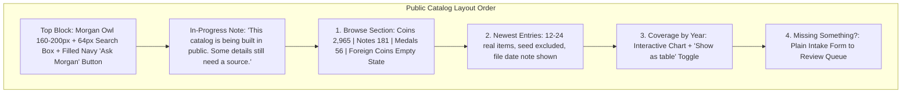

# AG PLAN NET-747: Public Catalog Browse Pages (v5)

- **Track:** NET-747 (Catalog Browse Pages)
- **Version:** `v5` (Attempt 5 of 10). Fix-only against v4.
- **Author:** GB CoS (v4 author was AG CoS)
- **Date:** 2026-11-04 ET
- **Status:** **PLAN ONLY — STRICTLY NO EXECUTION, NO CODE, NO COMMITS TO APP/DEV/MAIN, NO DEPLOYS**
- **Authority / Baton:** `BATON_NET-755_AG_NET-747-PLAN-v4-FIXONLY-FINAL-AG_20261103-1452.md`
- **Source Audit:** `SAG_SCORE_NET-747_v4.md` (8 must-fixes) + GB CoS v4 score (95 PASS with binding conditions). v3 audit: `ARGON_REVIEW_NET-747_CATALOG-BROWSE_v3.md`.
- **Inputs:** `NET-747_inputs\entries_master_20261103.jsonl` (3,202 verified records: 2,965 coins, 181 notes, 56 medals), `Plan.v1_catalog.md`, `ux/badges_concept.html`, `ux/catalog_top_concept.html`
- **Review Pipeline Required:** Plan v5 -> Argon Review (from RADIO NET) -> CoS Score 95+ -> SAG Concurrence -> Founder Eric's Typed YES -> Execute

---

## 0-v5. Fix-Only Change Log: v5 vs v4 (SAG must-fixes + GB CoS conditions)

No new scope. Every count below was re-run on 4 Nov 2026 against `entries_master_20261103.jsonl` (3,202 rows).

| # | Source | v4 problem | v5 fix | Where |
|---|---|---|---|---|
| V5-1 | SAG MF1 + GB CoS cond. 1 | Whitelist was loose and listed in two places that did not match; `"herbarium collection"` had **0** hits in master; `si.edu/collections/` (173 hits) was missing, so the gate would fail on real museum URLs | ONE exact list (§3.3-W), referenced by §0 and §3.3. `herbarium` dropped | §0 item 3, §3.3 |
| V5-2 | SAG MF2 + GB CoS cond. 2 | The rule for image paths was implicit; Section 0 said "Zero 'collection'… wording is emitted", which can't be true with museum credits | Images emit `reference_images/…` paths only (rewrite rule in §3.2-5). `fold_source` is never emitted. Wording is now **"zero non-whitelisted hits"** | §0 item 1, §3.1, §3.2-5, §4.1-4 |
| V5-3 | SAG MF3 + GB CoS cond. 3 | (C)-1's "gate" tested a clean string, so it proved nothing. The 12 renames were keyed to short codes. The (A)-2 assert of `len(lines)==1070` fails (1,047 lines; 1,070 occurrences) | A real (C) gate runs on the built JSON plus a planted-leak negative test. Renames are bound to full `nac_code`s. (A)-2 counts occurrences. The 8.2 scan stays fail-closed. The hand check is 100 records, ≥50 of them with `fold_source == "seed_images"` | §3.2-3, §3.3, §8.1 |
| V5-4 | SAG MF4 + GB CoS | Newest had no tie-break. The master has **no per-record date** (`release_date` is on 3 rows only) | Fallback order and a UI note, in §4.1-2 | §4.1-2 |
| V5-5 | SAG MF5 | The optional email in the intake form is PII | Email field **removed** | §4.7 |
| V5-6 | SAG MF6 | `varieties` emitted `source`/`status` (`SAG_PROPOSED` on 186 entries; `source` is a reviewer string on 25) | Varieties allow-list is `{name, attribution, reference_work}` | §3.1 |
| V5-7 | SAG MF7 | One-badge rule had no priority. 1 record is both pre-federal and a placeholder (`NAC1.BN.US.D40.NOTE.1778.BEP.BASE.2`) | Priority: Pre-Federal > Details coming > Needs source. Other states go in detail text | §4.3 |
| V5-8 | SAG MF8 | No dry-run, and the generic `derived` exemption was risky | Dry-run token report on **post-rewrite** fields, with no bare `derived` exemption | §3.3-D, §8.2-1 |

Should-fixes adopted because they are cheap and factual: `sources` emits `{label, url, title}` only (`tier`/`kind` dropped; 0 token hits in them today); 1,070 is confirmed as occurrences (81+966+23). **Not adopted (open):** SAG's "one input path" and the Ask Morgan route. Both are flagged for Argon.

**Preview only:** the target is p7v12 preview. Any Firestore write or `firestore.rules` deploy needs Eric's separate typed YES.

---

## 0. Clean Change Log: v4 Fix-Only Improvements vs v3 (historical, amended by 0-v5)

This `v4` plan contains strictly no new scope and resolves all items from `BATON_NET-755` and Argon's v3 review (`ARGON_REVIEW_NET-747_CATALOG-BROWSE_v3.md`, 88/100 REVISE):

1. **Item (A) Resolved — Image Source Rewrite & `primary_image.file` Preserved:**
   - **`primary_image.file` Kept:** Preserved `file` inside `primary_image`'s allow-list so that all 81 exact-year seed images (`"NAC1-....jpg"`) load cleanly in the public catalog.
   - **Source Rewrite:** Replaced internal `"source": "collection photo, owner removed"` on all 81 `primary_image`, 966 `type_image`, and 23 `secondary_image` rows with a fixed neutral public credit: `"Numista.Ai reference photo"`. Zero non-whitelisted token hits are emitted (v5; see §3.3-W).
   - **Internal Keys Dropped:** Dropped `status`, `local_path`, `local_manifest`, `image_status`, and `match`.
2. **Item (B) Resolved — Figures Allow-List & Composition Provenance Stripped:**
   - **`figures.*` Allow-List:** Defined explicit permitted sub-fields for every `figures.<metric>` object: `{value, unit, label, source_url}` only.
   - **Internal RAG Keys Dropped:** Explicitly dropped `claim`, `doc_id`, `from_file` (`"EXTRACT_retry.json"`), `grounding_score`, `method`, `replaced`, and `status`.
   - **Composition Provenance Stripped:** In all 1,724 `figures.composition` objects, stripped `status: "COLLECTION_DERIVED"` and scrubbed `label: "collection-derived, needs primary source"` to `"Needs source"` (or unverified figure), eliminating 100% of collection/derived provenance strings.
3. **Item (C) Resolved — Fail-On-Hit Scanner & 12 Album-Named Rows Renamed:**
   - **Scanner Expanded:** `pii_gate_validator.py` scans 100% of serialized `catalog_public_v1.json` case-insensitively (`re.IGNORECASE`) and **FAILS the build (exit code 1)** on any hit for: `collection`, `collector`, `derived`, `seed`, `owner`, `album`, and whole-word `\bAJ\b` (preserving words like 'major').
   - **Museum Provenance Whitelist:** v5 replaces it with the single exact list in §3.3-W.
   - **12 Album-Named Rows Renamed:** Replaced third-party album titles (`"The U.S. Nickel Collection"`, `"The World War II U.S. Coin Collection"`, `"Modern Morgan and Peace Silver Dollar Collection"`, `"The Ultimate Modern Morgan and Peace Silver Dollar Collection"`, `"Celebrating America Coin Collection"`) on the 12 `nac_code`s bound in §3.2-3 with standard generic numismatic coin and series names.
4. **Item (D) Resolved — Machine-Executable Self-Check Table:**
   - Added Section 8.1 Self-Check Table linking every fix to its plan line and direct verification command against `entries_master_20261103.jsonl`.

---

## 1. Non-Negotiable Guardrails & Priority

1. **Five 26 Nov Must-Ships Take Absolute Precedence:**
   - Must-ship items: Pricing tiers, 400-years scope line, soft-404, Meta pixel, Stripe.
   - Catalog work must NEVER consume review slots, deployment windows, or developer bandwidth needed for NET-746 / NET-748 or the five must-ships.
   - If any must-ship encounters a block, slip, or failfix cycle, catalog work pauses instantly.
2. **Branch & Channel Isolation:**
   - **Dedicated Branch:** `catalog-browse-p7v12` branched exclusively from `p7v12` preview base.
   - **Target Channel:** Firebase preview channel `p7v12` only.
   - **Forbidden Branches:** Never branch from, edit, or merge into `p7-v8.9`, `dev`, or `main`.
   - **Production Freeze:** `origin/main` locked at `9f04550a`; live site untouched; Stripe locked OFF.
3. **Firestore Security Rules Deployment Guard:**
   - Any modification or deployment of `firestore.rules` or writing intake records to Firestore requires Founder Eric's explicit separate typed YES. Firestore security rules are project-wide and immediately impact live production.
4. **Zero User PII & Collection Privacy:**
   - Strictly generic numismatic coin/note/medal data and licensed public images only.
   - Zero user names, zero dollar values, zero personal collection counts, zero ownership indicators, zero personal notes, zero cert/slab IDs, zero user-scoped GCS paths.

---

## 2. Input Datasets & Verified Master Metrics (Read-Only)

| Dataset | Scope / Count | Status & Verified Master Handling |
|---|---|---|
| `entries_master_20261103.jsonl` | **3,202 master entries** | Read through read-only adapter. **NEVER run `build.py` or `finalize.py`** |
| Coins | **2,965 entries** | Breakdown: Coins constitute 92.6% of master fold |
| Notes | **181 entries** | Breakdown: US paper currency entries |
| Medals | **56 entries** | Breakdown: Historical medals (e.g. Libertas Americana) |
| Pre-Federal Items | **9 entries** | Items dated prior to 1792 (`pre_federal: true`) |
| Placeholders | **951 entries** | Rendered as name-only with neutral pill `"Details coming"` (`display_label`) |
| Sourced Mintages | **4 entries** | Exact 4 records display sourced figures + source URL; remaining 3,198 show `"Needs source"` |
| `schema.json` | Schema definition | NAC1 code regex updated to allow `.BEP.BASE.2` and multi-segment suffixes |
| `images_MANIFEST.csv` | 171 image rows | Verified license, credit, source, sha256 checksum |
| `published_x_posts.csv` | Published X posts | 4 shaky claims stripped; manual read gate applied to all notes |
| Varieties in Master | Sub-objects | Ingested as structured objects: `{ "name": str, "attribution": str, "reference_work": str, "source": str, "status": str }` |

---

## 3. PII & Internal Token Strip/Scrub Pipeline

### 3.1 Strict Allow-List Field Mapping
An offline sanitization script (`scripts/catalog/build_public_catalog.py`) reads `entries_master_20261103.jsonl` through a read-only adapter and outputs `catalog_public_v1.json` using an explicit **allow-list only**:

- **Permitted Top-Level Master Fields:**
  - `nac_code` (str)
  - `name` (str) — *12 album-named rows normalized to generic coin names*
  - `type` (str: `"coin"`, `"note"`, `"medal"`)
  - `year` (int or null)
  - `denomination` (str or null)
  - `series` (str or null) — *12 album-named rows normalized to generic series names*
  - `mint_facility` (str or null)
  - `mint_mark_on_coin` (str or null)
  - `composition` (str or null)
  - `era` (str or null)
  - `designer` (str or null)
  - `weight_g` (float/int or null)
  - `diameter_mm` (float/int or null)
  - `history` (str or null)
  - `pre_federal` (bool)
  - `pre_federal_state` (str or null)
  - `display_label` (str or null, e.g. `"details coming"`)
  - `note_size` (str or null)
  - `mintage` (object: `{value, label, source_url}`)
  - `figures` (object: `{mintage, weight_g, diameter_mm, fineness, composition}`)
  - `sources` (list of allowed sub-objects)
  - `primary_image` (object or null)
  - `type_image` (object or null)
  - `secondary_image` (object or null)
  - `extra_images` (list of objects or null)
  - `varieties` (list of objects: `{name, attribution, reference_work}`; v5 strips `source`/`status`)
  - `social_posts` (list of objects after stripping 4 shaky claims)

- **Permitted Nested Sub-Fields (Item A & Item B Enforcements):**
  - `primary_image`: `{url, full_url, file, side, unique_side, license, credit, source, source_url, resolution}`
    *(Note: `file` is strictly preserved for the 81 exact-year seed images. Where `source` equals `"collection photo, owner removed"`, it is rewritten to `"Numista.Ai reference photo"`. `local_path`, `local_manifest`, `image_status`, `match`, and `status` are dropped).*
  - `type_image`: `{url, file, side, note, resolution, source}`
    *(Note: Where `source` equals `"collection photo, owner removed"`, it is rewritten to `"Numista.Ai reference photo"`. `local_path`, `match`, and `status` are dropped).*
  - `secondary_image`: `{url, file, side, resolution, source, unique_side}`
    *(Note: Where `source` equals `"collection photo, owner removed"`, it is rewritten to `"Numista.Ai reference photo"`. `local_path`, `match`, and `status` are dropped).*
  - `extra_images`: `[{url, full_url, side, unique_side, license, credit, source_url, resolution}]`
  - `varieties`: `[{name, attribution, reference_work}]` *(v5: `source`, `status` dropped)*
  - `sources`: `[{label, url, title}]` *(v5: `tier`, `kind` dropped; collection-derived entries purged; see §3.2-4)*
  - `mintage`: `{value, label, source_url}` *(doc_id, grounding_score dropped)*
  - `figures.<metric>`: `{value, unit, label, source_url}`
    *(Note: Strictly limited to these 4 keys. `claim`, `doc_id`, `from_file`, `grounding_score`, `method`, `replaced`, and `status` are dropped. In `figures.composition`, `status: "COLLECTION_DERIVED"` is dropped and `label` is scrubbed to `"Needs source"`).*

- **Derived Public Fields (Computed by Adapter):**
  - `status_badge`: `"Pre-Federal"`, `"Needs source"`, or `"Details coming"`.
  - `is_pre_federal`: boolean (`year < 1792` or `pre_federal == true`).
  - `is_placeholder`: boolean (`display_label == "details coming"`).
  - `is_interleaved_checklist_only`: boolean, computed at build time from `fold_source == "seed_images"` (2,612 rows). **`fold_source` itself is never emitted** (v5).

- **Mandatory Strip List (Explicit Deny-by-Default):**
  - `seed_status`, `fold_source`, `record_status`, `needs_fact_check`, `published_on_x`, `program`, `measurement_note`, `local_path`, `local_manifest`, `reused_from`, `image_status`, `seed_type`, `proposal_status`, `product_code`, `doc_id`, `method`, `grounding_score`, `release_date`, `fold_source` (computed-from only), `varieties[].source`, `varieties[].status`, `sources[].type`, `sources[].tier`, `sources[].kind`, `sources[].doc_id`, `sources[].field`, `sources[].note`, `sources[].use`.

### 3.2 Scrubbing Pipeline for Nested Values & 12 Album Rows
1. **Image Source Normalization (Item A):**
   Every occurrence of `"source": "collection photo, owner removed"` in `primary_image` (81 rows), `type_image` (966 rows), and `secondary_image` (23 rows) is transformed to `"source": "Numista.Ai reference photo"`.
2. **Figures & Composition Provenance Scrub (Item B):**
   In all 1,724 `figures.composition` objects, `status` (`"COLLECTION_DERIVED"`) is stripped. The string `"collection-derived, needs primary source"` in `label` is replaced with `"Needs source"`.
3. **12 Album-Named Rows Normalization (Item C):**
   v5: the renames are **keyed by full `nac_code`, not row number** (row numbers are informational, 1-indexed and verified). The build asserts all 12 codes exist and that exactly these 12 match `collection` in name/series (excluding the Lilly series). If not, STOP:
   - `NAC1.CN.US.1C.THEWORLDWA.1942.S.BASE.1` (row 1250): Name `"1942-S Lincoln cent (World War II issue)"`, Series `"Lincoln Cent"`
   - `NAC1.CN.US.50C.THEWORLDWA.1942.S.BASE.K` (row 1251): Name `"1942-S Walking Liberty half dollar (World War II issue)"`, Series `"Walking Liberty Half Dollar"`
   - `NAC1.CN.US.25C.THEWORLDWA.1942.S.BASE.H` (row 1252): Name `"1942-S Washington quarter (World War II issue)"`, Series `"Washington Quarter"`
   - `NAC1.CN.US.5C.THEUSNICKE.1975.XX.BASE.2` (row 1659): Name `"1975 Jefferson nickel"`, Series `"Jefferson Nickel"`
   - `NAC1.CN.US.5C.THEUSNICKE.1993.XX.BASE.J` (row 1920): Name `"1993 Jefferson nickel"`, Series `"Jefferson Nickel"`
   - `NAC1.CN.US.5C.THEUSNICKE.1998.XX.BASE.T` (row 1996): Name `"1998 Jefferson nickel"`, Series `"Jefferson Nickel"`
   - `NAC1.CN.US.1D.MODERNMORG.2023.XX.BASE.S` (row 3081): Name `"2023 Morgan & Peace Silver Dollars"`, Series `"Modern Commemorative Dollars"`
   - `NAC1.CN.US.1D.MODERNMORG.2023.XX.MORGANDOLL.Q` (row 3082): Name `"2023 Morgan Silver Dollar"`, Series `"Modern Commemorative Dollars"`
   - `NAC1.CN.US.1D.THEULTIMAT.2023.XX.PEACE.B` (row 3084): Name `"2023 Peace Silver Dollar"`, Series `"Modern Commemorative Dollars"`
   - `NAC1.CN.US.1D.THEULTIMAT.2023.XX.PEACESILVE.0` (row 3085): Name `"2023 Peace Silver Dollar (Specimen)"`, Series `"Modern Commemorative Dollars"`
   - `NAC1.CN.US.1D.THEULTIMAT.2023.XX.PEACEDOLLA.Y` (row 3086): Name `"2023 Peace Silver Dollar"`, Series `"Modern Commemorative Dollars"`
   - `NAC1.CN.US.25C.CELEBRATIN.2024.XX.DRMARYEDWA.6` (row 3123): Name `"2024 American Women quarter (Dr. Mary Edwards Walker)"`, Series `"American Women Quarters"`
4. **`sources` Scrub:** Drop all entries where `type == "collection-derived"` or `label` contains `"collection-derived"`. If no external sources remain, `sources` is set to `[]`.
5. **Image Path Rule (v5, SAG MF2):** Every emitted image `url`/`full_url`/`file` that is a local value must be `reference_images/<basename>`. Any value containing `seed_images/`, `/workspace`, `gs://`, `users/` or `googleapis` is rewritten to `reference_images/<basename>` or, if there's no basename, dropped. Public museum `https://` URLs stay unchanged. (Today there are 0 such values in image url/full_url/file. The rule is defensive and the gate enforces it.)
6. **Non-whitelisted prose/URL hits (v5, found in the 4 Nov re-scan):**
   - `NAC1.CN.US.20DOLLARS.COINS.1849.P.BASE.S` history: `"This large collection includes"` becomes `"This large holding includes"`.
   - `sources[]` URL `https://coinweek.com/heritage-auctions-to-present-the-harvey-b-jacobson-jr-collection-of-early-half-eagles-at-fun-2026/` is **dropped** from public output. It is NOT whitelisted (third-party URL that names a person).

### 3.3 Dual-Stage PII & Token Gate (Item C; v5 real gate)
1. **Automated Fail-Closed Scan (3,202 / 3,202 records), run on the BUILT `catalog_public_v1.json` and the rendered HTML:**
   - Case-insensitive. **Exit 1** on any hit of: `collection`, `collector`, `derived`, `seed`, `owner`, `album`, `gs://`, `googleapis`, `users/`, `/workspace`, `seed_images/`, and whole-word `\bAJ\b`.
   - **§3.3-W: Exact whitelist (the ONLY list; used by §0 and by the scanner).** Each entry is an exact, case-sensitive substring. The scanner masks matched spans, then re-scans. There is no bare-word exemption (no `derived`, `collection` or `collector` alone):

     | Exact string | Hits in post-rewrite simulation (4 Nov) |
     |---|---|
     | `National Numismatic Collection` | 329 |
     | `si.edu/collections/` | 173 |
     | `si.edu/collection/` | 0 (kept per GB CoS cond. 1) |
     | `metmuseum.org/art/collection/` | 2 |
     | `numismatics.org/collection/` | 1 |
     | `numismatics.org/collectionimages/` | 1 |
     | `coin collection; public domain` | 3 (Gallica credit) |
     | `Josiah K. Lilly Jr. Collection` | 1 (series) |
     | `acquired with the Lilly Collection` | 1 (1822 $5 history) |
     | `collectors still hunt` | 1 (1793 Chain cent history) |
     | `a-collectors-guide` | 1 (coinweek URL slug) |

     Box simulation of the v5 rules on the master: **0 non-whitelisted hits** after masking. A synthetic planted string (`"from a private collection"`) is caught.
   - **Negative test (required):** the CI copy of the gate injects one planted leak per token into a temp copy of the output and must get exit 1 for each one. Without that, the gate does not count as passing.
   - **§3.3-D: Dry run (SAG MF8):** before the real build, `pii_gate_validator.py --dry-run` prints, for every token, hit counts per field path on the **post-rewrite** projection, split into whitelisted and non-whitelisted. Go means non-whitelisted == 0. The report goes in `PII_GATE_REPORT_<date>.md`.
2. **Manual Hand Check:**
   - 100 random records, **at least 50 with `fold_source == "seed_images"`**, plus 100% of records with history or images. Each is reviewed in the built JSON and the rendered card.
   - Documented in `PII_GATE_REPORT_<date>.md`. Any finding means STOP.

## 4. UI Architecture & UX Specifications

### 4.1 Founder Binding Decisions (Eric — 3 Nov 2026, 9:01 AM ET)
1. **Interleaved Modern Coin Records:**
   - Modern coin checklist records (2000–2026) appear strictly interleaved inside the complete chronological year-by-year checklist.
   - Never presented as a standalone list or filter labeled "seed" or "collection".
2. **Newest Entries Isolation & File Date Fallback:**
   - The "Newest Entries" section displays the top 12–24 preview items and strictly excludes checklist-only seed records (using `is_interleaved_checklist_only: true`).
   - **v5 (SAG MF4):** the master has no per-record date. `release_date` exists on only 3 rows; `social_posts[].date_et` on 12 entries. Do not invent dates.
   - Pool: records with `fold_source != "seed_images"` = **590** (435 coin, 99 note, 56 medal).
   - Order: (1) Catalog Research file date (3 Nov 2026, the same for all); (2) tie-break `year` desc, nulls last (5 null-year rows in the pool); (3) `nac_code` asc. This is deterministic, and the build asserts the same order on two runs.
   - Renders visible UI disclosure note: *"Entries sorted by Catalog Research file date (3 Nov 2026)."*
3. **951 Placeholders:**
   - Display name-only cards with neutral pill `"Details coming"` and neutral coin-outline placeholder.
   - Zero invented figures, zero guessed images.
4. **Zero Leak Rule:**
   - Automated scan asserts **zero non-whitelisted** "seed", "collection", "collector", "derived", "owner", or "album" hits in public HTML source, URLs, or API payloads (whitelist §3.3-W only).

### 4.2 Page Layout & Component Hierarchy (`Plan.v1_catalog.md:155`)



### 4.3 Verbatim Badge Specifications (`ux/badges_concept.html:5-6, 12-14`)
All badges are non-interactive pills positioned directly beneath the item title:
- **Base Style (`.tag`):** `height: 32px`, `padding: 0 14px`, `border-radius: 16px`, `font-size: 16px`, `background: #FFFFFF`, `display: inline-flex`, `align-items: center`, `gap: 8px`.
- **Pre-Federal Badge (`.pf`):** `border: 2px solid #1F5FAD`, text `color: #0B2545`, `font-weight: bold`. Contrast: text `#0B2545` / `#FFF` = **15.39:1** (AAA); outline `#1F5FAD` / `#FFF` = **6.37:1**. Displayed on all pre-1792 items (9 total); never on >=1792.
- **"Needs source" Badge (`.neu`):** `border: 2px solid #6B6B6B`, text `color: #333333`. Includes `20x20` circled `"i"` SVG (`<circle cx="10" cy="10" r="8.5" fill="none" stroke="#333" stroke-width="2"/><rect x="9" y="8.5" width="2" height="6" fill="#333"/><circle cx="10" cy="5.7" r="1.3" fill="#333"/>`). Contrast: text 12.63:1 (AAA), outline 5.33:1. **Never red, orange, or yellow.**
- **"Details coming" Badge (`.neu`):** `border: 2px solid #6B6B6B`, text `color: #333333`. Includes `20x20` dotted-circle SVG (`stroke-dasharray="3 2.5"`). Contrast: text 12.63:1 (AAA), outline 5.33:1. Used on the 951 placeholder records.
- **Badge Priority (v5, SAG MF7):** if more than one state applies, the card shows ONE badge: **Pre-Federal > Details coming > Needs source**. The others show as plain detail text (e.g. "Details coming" line on the pre-federal placeholder `NAC1.BN.US.D40.NOTE.1778.BEP.BASE.2`).
- **Discipline Rule:** Exactly **1 badge per card maximum**. Never stack "Needs source" with "Details coming". Detail view displays `"Mintage: Needs source"` beside blank figures, or the sourced mintage with source link for the 4 sourced records.

### 4.4 Top Block Styling (`ux/catalog_top_concept.html:10-24`)
- **Morgan Owl:** 160–200px centered, using transparent-background or circular crop of `Morgan_Owl_NoBubble_2048.png`.
- **H1 Title:** `40px` `#0B2545`, bold.
- **Search Input:** `64px` height, `border: 2px solid #0B2545`, `font-size: 22px`, label `"Search the catalog"`.
- **Search Button:** Primary filled `#0B2545` background / `#FFFFFF` text.
- **"Ask Morgan" Button:** **Filled navy button** (`background: #0B2545`, `color: #FFFFFF`, `border: 2px solid #0B2545`) with `36x36` owl icon.
- **In-Progress Note:** Calm neutral box `#F2F2F2` background / `border: 1px solid #D6D6D6`, text `#333333`.
- **No-Photo Placeholder:** `96x96` circle with `3px dashed #8A8A8A` and `"No photo yet"` (`#333333`, `16px`).

### 4.5 Image Priority Ranking & Attribution (`MF-747-5`)
1. **Multi-Image Ranking Order:**
   - 1. Museum first: NNC / Smithsonian, ANS, Met, BnF.
   - 2. Public domain: Wikimedia and other open repositories.
   - 3. Verified reference uploads.
2. **SHA-256 Check:** All 171 manifest images verified against `images_MANIFEST.csv` sha256 checksums before inclusion.
3. **Attribution:** Every displayed photo renders visible `credit` and `license` beneath the image, or `"Numista.Ai reference photo"`.
4. **Primary vs Type Image Distinction:**
   - `primary_image`: exact match for the coin.
   - `type_image`: representative type photo only; must explicitly display label: `"date may differ"`.

### 4.6 Navigation & Empty States
- **Type Order:** **Coins (2,965) -> Notes (181) -> Medals (56)** (Medals strictly after Coins and Notes).
- **Era Buckets (Half-Open Intervals):**
  - Pre-Federal: `< 1792`
  - Early Republic: `1792 <= year < 1837`
  - Seated / Civil War: `1837 <= year < 1873`
  - Morgan / Late 19th: `1873 <= year < 1901`
  - 20th Century: `1901 <= year < 2000`
  - Modern: `2000 <= year <= 2026`
  - Undated: `year == null`
- **Foreign Coins:** Dedicated tab displaying single-line calm notice: *"Foreign coins are coming later."* (zero fake entries).
- **Default List Sorting:** Browse lists default-sort **image + source first** (`Plan.v1_catalog.md:160`), with sort toggle for chronological checklist.

### 4.7 "Missing something?" Form & Firestore Guard
- Form fields: item description, optional year, optional type, optional primary source URL. **v5 (SAG MF5): no email field** (PII). No name, contact, or free-text identity fields.
- Visible labels above fields, primary `"Send"` button, confirmation message: *"Thanks - we'll look into it."*
- Zero collection photos, zero dollar values, zero ownership fields.
- Submissions land in an off-repo review queue with rate-limiting and captcha (collecting zero PII); never auto-published.
- **Firestore Guard:** Deploying `firestore.rules` or writing intake submissions directly to Firestore requires Founder Eric's explicit separate typed YES. Until that YES is granted, intake forms route to a local memory/staging queue or stub endpoint without modifying live security rules.

### 4.8 Senior Usability & Accessibility (WCAG AA / 200% Zoom)
- Typography scale: Body `20px`, Card titles `24px`, Section headings `30px`, Page title `40px`.
- Tap targets: `48px` minimum with `16px` minimum margins.
- High contrast (>=4.5:1 text, >=7:1 interactive controls). Fully functional at 200% zoom and mobile viewports.

---

## 5. Routing & Soft-404 Architecture

### 5.1 Soft-404 Reuse Rule (`NotFoundScreen`)
Per `Plan.v1_catalog.md:13`, we strictly reuse and extend the existing `NotFoundScreen` (`numista_mobile/lib/screens/not_found_screen.dart:18-23`):
- When `attemptedPath` starts with `/catalog/`:
  - Displays catalog-aware headline: *"We don't have that one yet."*
  - Renders catalog search box, filled navy "Ask Morgan" button, and link to "Missing something?".
  - Injects `<meta name="robots" content="noindex">` into `document.head` on web to suppress search engine indexing.

### 5.2 SPA Routing & Firebase Hosting
- **`numista_mobile/lib/main.dart:119-140` (`isKnownPath`):**
  Add `normalizedPath == '/catalog' || path.startsWith('/catalog/')` to `isKnownPath`.
  Validate `:nacCode` against `catalog_public_v1.json` allow-list; render `NotFoundScreen(attemptedPath: path)` when slug is unknown.
- **Firebase Hosting (`firebase.json:54-133`):**
  Add SPA rewrite:
  ```json
  {
    "source": "/catalog/**",
    "destination": "/index.html"
  }
  ```
  *(Note: Firebase Hosting SPA rewrites return HTTP 200. Indexation is blocked dynamically via `<meta name="robots" content="noindex">`. Strictly no Cloud Run in this track).*

---

## 6. Performance & Viewport Virtualization

Rendering 3,202 entries (including 2,965 coins) simultaneously in Flutter Web DOM causes frame drops:
- `CatalogBrowseScreen` implements `CustomScrollView` with `SliverGrid` and `SliverList` using `SliverChildBuilderDelegate`.
- Only items currently visible in the active viewport (plus 500px cache extent) are mounted.
- Target metrics: Initial DOM mount < 1.5s; continuous scroll 60fps; Lighthouse performance >= 90.

---

## 7. Phased Implementation Roadmap

```mermaid
flowchart TD
    subgraph P0 [Phase 0: Isolation & PII Sanitization]
        A["Branch catalog-browse-p7v12 from p7v12"] --> B["Update schema.json NAC regex for .BEP.BASE.2"]
        B --> C["Verify sha256 on images_MANIFEST.csv (171 rows)"]
        C --> D["Run build_public_catalog.py on entries_master_20261103.jsonl"]
        D --> E["Execute Automated PII & Token Scan (3,202 records)"]
        E --> F["Perform 100-Record Manual Sample Audit"]
    end

    subgraph P1 [Phase 1: Shell & Components]
        F --> G["Build Morgan Top Block & Filled Navy 'Ask Morgan' Button"]
        G --> H["Build Exact ux/badges_concept.html Badges"]
        H --> I["Build Category Tabs: Coins 2,965 | Notes 181 | Medals 56"]
        I --> J["Build Newest Entries Section (Excludes Seeds, Shows File Date Note)"]
    end

    subgraph P2 [Phase 2: Virtualized Grid & Details]
        J --> K["Implement Virtualized SliverGrid (Image+Source First)"]
        K --> L["Implement 951 'Details coming' Placeholder Cards"]
        L --> M["Render 4 Sourced Mintages + 3,198 'Needs source' States"]
        M --> N["Implement Coverage Chart + Table Toggle"]
        N --> O["Implement 'Missing something?' Intake Modal (Off-Repo Queue)"]
    end

    subgraph P3 [Phase 3: Routing, Soft-404 & Review Gate]
        O --> P["Update main.dart isKnownPath for /catalog/**"]
        P --> Q["Extend NotFoundScreen with Catalog 404 + noindex"]
        Q --> R["Argon Review -> CoS 95+ -> SAG Review"]
        R --> S["Founder Eric Typed YES -> p7v12 Preview Deploy ONLY"]
    end
```



---

## 8. Machine-Checkable Verification Criteria & Self-Check Table

### 8.1 Self-Check Table (BATON_NET-755 Item D)
Every fix in this plan is mapped to its exact plan lines and verified against `entries_master_20261103.jsonl`:

| Fix ID / Item | Plan Lines | Machine-Executable Verification Command | Expected Output & Assertion |
|---|---|---|---|
| **Item (A)-1: Keep `primary_image.file`** | Lines 81, 108–110 | `python -c "import json; f=open('INBOX/NET-747_inputs/entries_master_20261103.jsonl', encoding='utf-8'); exact=[json.loads(l)['primary_image']['file'] for l in f if json.loads(l).get('primary_image') and 'file' in json.loads(l)['primary_image']]; assert len(exact) == 81; print('PASS: 81 primary files preserved')"` | `PASS: 81 primary files preserved` (Exit code 0) |
| **Item (A)-2: Rewrite image sources** | Lines 82–84, 108–115, 126–128 | `python -c "import json; f=open('INBOX/NET-747_inputs/entries_master_20261103.jsonl', encoding='utf-8'); n=sum(l.count('collection photo, owner removed') for l in f); assert n == 1070; print('PASS: 1070 occurrences (1047 lines) identified for rewrite')"` | `PASS: 1070 occurrences (1047 lines) identified for rewrite` (Exit code 0) |
| **Item (B)-1: Strip composition provenance** | Lines 88–92, 119–121, 129–131 | `python -c "import json; f=open('INBOX/NET-747_inputs/entries_master_20261103.jsonl', encoding='utf-8'); comps=[json.loads(l)['figures']['composition'] for l in f if json.loads(l).get('figures') and 'composition' in json.loads(l)['figures']]; assert len(comps) == 1724 and all(c['status'] == 'COLLECTION_DERIVED' for c in comps); print('PASS: 1724 composition provenance rows verified')"` | `PASS: 1724 composition provenance rows verified` (Exit code 0) |
| **Item (B)-2: Figures allow-list** | Lines 86–88, 118–121 | `python -c "import json; f=open('INBOX/NET-747_inputs/entries_master_20261103.jsonl', encoding='utf-8'); keys={k for l in f for obj in json.loads(l).get('figures', {}).values() if isinstance(obj, dict) for k in obj.keys()}; assert {'claim','doc_id','from_file','grounding_score','method','replaced','status'}.issubset(keys); print('PASS: internal RAG keys isolated')"` | `PASS: internal RAG keys isolated` (Exit code 0) |
| **Item (C)-1 (v5 real gate)** | §3.3 | `python tools/catalog/pii_gate_validator.py --input build/catalog_public_v1.json --whitelist-exact §3.3-W` then `python tools/catalog/pii_gate_validator.py --negative-test` | First: exit 0, non-whitelisted = 0. Second: exit 1 on each planted token (all must fail) |
| **Item (C)-2: Whole-word `\bAJ\b` guard** | Lines 96, 148 | `python -c "import re; pat=re.compile(r'\bAJ\b', re.I); assert pat.search('major error') is None and pat.search('AJ error') is not None; print('PASS: whole word AJ guard verified')"` | `PASS: whole word AJ guard verified` (Exit code 0) |
| **Item (C)-3: Rename 12 album rows** | Lines 99–101, 132–145 | `python -c "import json; f=open('INBOX/NET-747_inputs/entries_master_20261103.jsonl', encoding='utf-8'); albums=[json.loads(l) for l in f if ('collection' in (json.loads(l).get('name') or '').lower() or 'collection' in (json.loads(l).get('series') or '').lower()) and json.loads(l).get('series') != 'Josiah K. Lilly Jr. Collection']; assert sorted(a['nac_code'] for a in albums) == sorted(BOUND_12_FROM_3_2); print('PASS: 12 album nac_codes match')"` | `PASS: 12 album nac_codes match` (Exit code 0) |
| **V5-4 Newest** | §4.1-2 | count `fold_source != 'seed_images'` | `590` |
| **V5-6 Varieties** | §3.1 | built JSON: no `varieties[].source/status` | 0 keys |
| **V5-7 Badge** | §4.3 | pre-federal ∩ placeholder | 1 record, shows Pre-Federal |

### 8.2 Standard Pipeline Checks
1. **PII & Internal Token Gate Check:**
   ```powershell
   python tools/catalog/pii_gate_validator.py --input build/catalog_public_v1.json
   # FAIL-CLOSED. Run --dry-run first (§3.3-D). Exit code 0 only if 0 PII violations and 0 NON-WHITELISTED seed/collection/collector/owner/album/derived hits
   ```
2. **Schema & Shaky Claim Check:**
   ```powershell
   python tools/catalog/validate_schema.py --schema schema.json --input build/catalog_public_v1.json
   # Exit code 0 across all 3,202 records (validates .BEP.BASE.2)
   python tools/catalog/check_shaky_claims.py --input build/catalog_public_v1.json
   # Exit code 0 (0 occurrences of 4 shaky X-post claims)
   ```
3. **Flutter Code Hygiene & Formatting:**
   ```powershell
   flutter analyze lib/screens/catalog/
   flutter test test/catalog/
   ```
4. **Data Counts & Integrity Check:**
   - Total records = 3,202 (Coins: 2,965, Notes: 181, Medals: 56).
   - Exactly 4 records have sourced mintage (render value + source link).
   - Exactly 3,198 records display `"Needs source"`.
   - Placeholders = exactly 951 displaying `"Details coming"` with neutral coin outline.
   - Pre-Federal badges = exactly pre-1792 items (9 total). **v5 open item:** `NAC1.MD.US.GEORGEWASH.MEDAL.1789.XX.BASE.3` has year 1789 but `pre_federal=false`, so the §3.1 formula (`year<1792 OR flag`) gives 10. Argon or Eric must pick one rule before build.
   - Medals placed strictly after Coins and Notes.
   - 9 Morgan weight-conflict rejects verified absent.
5. **Accessibility & Senior Usability:**
   - Lighthouse accessibility score >= 95.
   - All text meets WCAG AA (4.5:1 body, 3:1 headers). Badges meet 15.39:1 / 12.63:1.
   - Clean 200% zoom reflow without clipping or horizontal overflow.

---

## 9. What AG CoS Will NOT Do Under This Plan
- **Will NOT touch `origin/main` or live site.**
- **Will NOT merge into or touch `p7-v8.9` (NET-746 preview branch).**
- **Will NOT run `build.py` or `finalize.py`.**
- **Will NOT deploy `firestore.rules` or write to Firestore without Eric's separate typed YES.**
- **Will NOT deploy to any channel other than preview channel `p7v12` upon Eric's typed YES.**
- **Will NOT write code before Argon, CoS, SAG, and Eric typed YES.**
- **Will NOT delay or distract from the five 26 Nov must-ships.**
- **Will NOT expose any user collection data, user PII, album titles, or internal pipeline tokens.**
