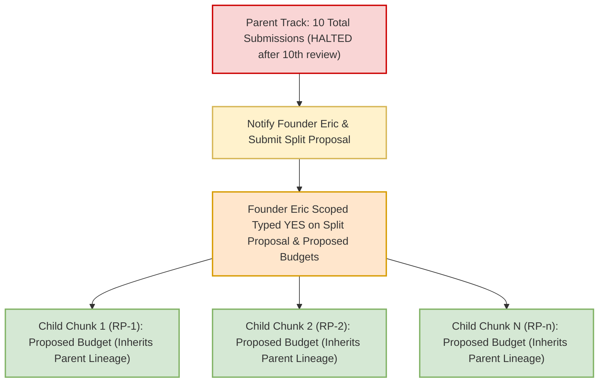
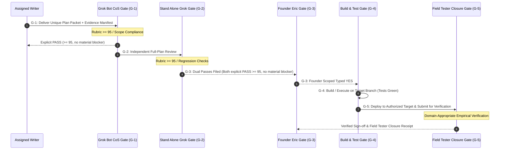
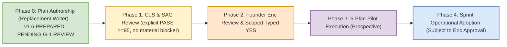
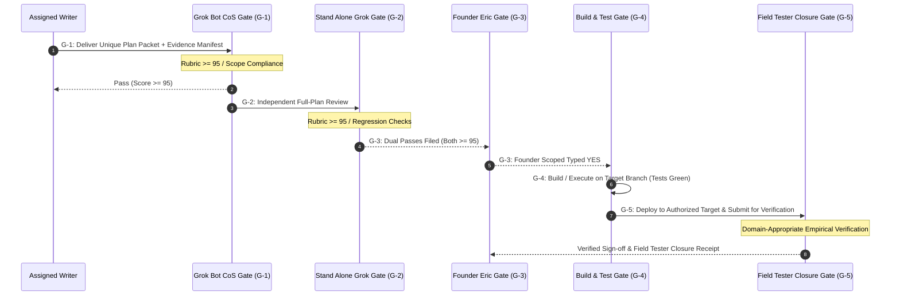
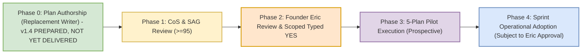

# SAG MANUAL FULL-PLAN REVIEW PACKET — RSI-CONTROLS Process Controls Plan v1.6

Prepared 2026-11-09 (America/New_York) by a documentation-only packet preparer. The preparer is not a plan writer, not a gate and not a scorer. This is a local file for manual upload by the owner into a fresh chat; nothing has been submitted anywhere.

## 1. What you are asked to do
- **Exact artifact under review:** A1, `PLAN_RSI-CONTROLS_PROCESS-CONTROLS_v1.6.md`, SHA-256 `626ede6a69314e432b07f6f355fb8f7e2a8b7b643518bb6e9c7ae79b2e92c58e`, 60976 bytes, 511 lines. Line anchors (L#) refer to A1's own lines (line 1 = first line after A1's BEGIN marker).
- **Review type:** a fresh, independent FULL-PLAN review of A1 as a whole. It is not a review of only the v1.5→v1.6 diff, and not a confirmation of any earlier score.
- **Pass bar:** an explicit PASS requires a score ≥95 AND no unresolved material or critical finding. A score ≥95 is not automatically a PASS; a REVISE at any score is acceptable if you find a material defect. No score or outcome is expected.
- **Material defects only.** Cosmetic or presentation points (for example, an extra closing parenthesis in a formula, or the "Rubric >= 95" notes in the Mermaid diagram) are non-scoring. List them separately if at all; they are not grounds for REVISE.

## 2. Status and honest distinctions
- **A4 (own CoS G-1 100/100 PLAN PASS on v1.6)** is the Chief of Staff's G-1 score only. It is NOT a SAG score, not a terminal dual pass, not evidence that the controls work, and it does not bind you.
- **Earlier scores do not transfer to v1.6.** v1.4's original CoS 100 was superseded for readiness. v1.4 then received CoS 99 REVISE (A10) and SAG 97 REVISE (A8), and v1.5 received own CoS 98 REVISE (A6). None of these is a v1.6 SAG review.
- **Plan-only:** A1 is a PLAN-ONLY specification. Its proposed watch/routine text (§8) and read-only schema are UNAPPLIED; nothing is active.
- **Source claims:** repository commits, paths and script citations are labeled writer-reported/unverified, and main-lock/Stripe-OFF are source-stated holds. Runtime adapters, live state, source verification, the external ledger and Eric's scoped typed YES are external prerequisites, not plan failures; do not require proof a plan review cannot have. Do still flag any claim presented as verified without support.
- **Counts:** v1.6 is replacement writer `GB-RSI-Replacement-20261109-A` try 3/4 and documented track submission 9/10, with no counter reset, no AG CoS v5 fifth try, and the historical residual caveat retained (A12). Your review is not a new plan attempt and grants no execution, activation, test, Field Tester, deploy or other permission.
- **Founder's controlling 4/10 rule (exact words, Antigravity Desk transcript position 1257, as recorded in A12 L15):**
  > "New Rule, if someone is still failing after 4 tries, somebody else take over. If NO ONE gets it right by 10 total attempts, you notify me and we break it down into smaller bite-size chunks."
- **A8 (prior SAG review)** is the owner's pasted text as a faithful visible-text transcription, not original transport bytes (see A9). A separately archived, truncated transcript export was NOT used as the review and is not included.

## 3. Two prior findings, for your independent judgment (not pre-decided)
1. **Pilot cohort start (raised by SAG 97 on v1.4, A8):** whether the pilot velocity metric's first counted packet is the first pilot-eligible packet, with parent/pre-pilot lineage kept for audit and cap accounting but excluded from pilot velocity. v1.5/v1.6 add SAG's exact sentence at A1 L352. Judge whether the cohort metric (L349–356) and rework populations (L360–376) are now coherent, and whether the separation from the 4/10 caps (L355, §4.2) holds.
2. **A scored ≥95 REVISE as a terminal non-pass (raised by own CoS 98 on v1.5, A6):** the earlier text let "both ≥95" count as PASS even when the verdict was REVISE. v1.6 adds a single Gate Verdict Definition (L142) and applies it in L144, L151, L172–173, L182–184, L200–203, L306–322, L350, L372 and L399–408. Judge whether a 99 REVISE + 97 REVISE now counts as exactly one terminal non-pass, whether explicit PASS ≥95 with no material blocker at both gates clears plan quality only, and whether a ≥95 REVISE on a 4th/10th try triggers the existing retirement/split with no extra attempt.

## 4. Whole-plan regression areas to cover
Exact founder 4/10 quote; formal delivery counts regardless of completeness (pre-delivery drafts exempt); exactly four terminal non-pass categories and pending ≠ failed with gate-owner recording; one count per packet (multi-review dedup); 4th-try retirement and 10th-review-then-halt, no 11th monolithic attempt, notify Eric and split; coherent cohort metric and rework-rate populations; track-approved scope and skips (no universal five-gate overlay), live Stripe OFF with track-scoped test mode; empirical Field Tester closure; rollback governance (non-toggleable 4/10, override audit, read-only schema, no instant restore, pilot ≠ adoption); evidence honesty. A5 (v1.5), A7 (diff) and A11 (v1.4) are regression references only.

## 5. Requested output (concise)
1. Integer score /100 and an explicit disposition: PASS or REVISE.
2. Material/critical findings only, each with A1 line numbers, why it is material, and the minimal fix (or "none").
3. Six one-line checks with anchors: (a) rule quote; (b) attempt counting; (c) gate verdict definition; (d) cohort/metric populations; (e) evidence honesty; (f) execution boundary and no regression versus prior safeguards.
4. Confirmation that you reviewed the full A1, with the exact A1 SHA-256 you reviewed.

## 6. Byte-exact embedding and extraction rule
Each artifact appears between a line `<<<BEGIN ARTIFACT id=… sha256=… bytes=… lines=… path=…>>>` and a line `<<<END ARTIFACT id=…>>>`. The artifact's exact bytes begin immediately after the newline that ends the BEGIN line and run for exactly `bytes` bytes; the END line begins immediately after them. No escaping or transformation was applied (UTF-8, LF). `lines` counts newline characters. There are exactly 12 artifacts.

| ID | Role | Source path | SHA-256 | Bytes | Lines |
|---|---|---|---|---|---|
| A1 | Plan v1.6 — EXACT ARTIFACT UNDER REVIEW | `/workspace/rsi/v16-verdict-repair/PLAN_RSI-CONTROLS_PROCESS-CONTROLS_v1.6.md` | `626ede6a69314e432b07f6f355fb8f7e2a8b7b643518bb6e9c7ae79b2e92c58e` | 60976 | 511 |
| A2 | Closure map v1.6 (writer's claims, not proof) | `/workspace/rsi/v16-verdict-repair/CLOSURE_MAP_RSI-CONTROLS_v1.6.md` | `c9b914a9bbfcf036a582e85067f567f56c676608b90b8bc9d683eb1f9c1129a1` | 3498 | 17 |
| A3 | Hash manifest v1.6 (writer's) | `/workspace/rsi/v16-verdict-repair/HASH_MANIFEST_RSI-CONTROLS_v1.6.md` | `17a2319b311d02c5eb6923405851b894789620cb4b583100e86d285173d1b88e` | 3042 | 26 |
| A4 | Own CoS G-1 record for v1.6 — 100/100 PLAN PASS (CoS G-1 only; NOT SAG) | `/workspace/rsi/COS_SCORE_RSI-CONTROLS_PROCESS-CONTROLS_v1.6_100_PLAN-PASS_20261109.md` | `15e6dd8005af9dd749785191551459152447dc941cdb2ac7c510dace7df9acf7` | 5633 | 26 |
| A5 | Plan v1.5 (regression reference only; NOT under review) | `/workspace/rsi/v15-cohort-repair/PLAN_RSI-CONTROLS_PROCESS-CONTROLS_v1.5.md` | `572e0dfb270881c76a1f0fb57808219994c5adca55e0e13c5790bfb8b7791d66` | 57989 | 508 |
| A6 | Own CoS G-1 record for v1.5 — 98/100 REVISE (verdict-definition finding) | `/workspace/rsi/COS_SCORE_RSI-CONTROLS_PROCESS-CONTROLS_v1.5_98_REVISE_20261109.md` | `febeb07923ea3d1e639a8e48149080db9d55bb3a01f4fcf14914f848e0ebd80a` | 4512 | 22 |
| A7 | Full unified diff v1.5 -> v1.6 | `/workspace/rsi/v16-verdict-repair/DIFF_PLAN_RSI-CONTROLS_v1.5-to-v1.6.diff` | `411067b91ce575ba986685a88310e61fb1226bad84dd7614e7f3d8bc0c205b64` | 35152 | 198 |
| A8 | Owner-pasted SAG review of v1.4 — 97/100 REVISE (faithful visible-text transcription; not original transport bytes) | `/workspace/rsi/primary-sag-v14-20261109/SAG_REVIEW_RSI-CONTROLS_v1.4_97_REVISE_OWNER-PASTE.md` | `521ee8b3a221bf7616202659013407fff7068c0c7266d9a50e3c9b634928fa9d` | 4547 | 26 |
| A9 | Provenance record for A8 | `/workspace/rsi/primary-sag-v14-20261109/PROVENANCE_OWNER-PASTE_t2445u.md` | `b12dc2d7ff557d628b7e1f4fc20a548cdb4d09db1654e2e63fa9713a306fdf8c` | 1734 | 5 |
| A10 | CoS correction for v1.4 — 99/100 REVISE after SAG (supersedes earlier v1.4 100) | `/workspace/rsi/COS_CORRECTION_RSI-CONTROLS_v1.4_99_REVISE_AFTER-SAG_20261109.md` | `b88a25aa89b3afa99910a5e1b0e13e60b307f7b2c16dbd8cd10a07bf60402288` | 3728 | 19 |
| A11 | Plan v1.4 (regression reference only; NOT under review) | `/workspace/rsi/v14-replacement/PLAN_RSI-CONTROLS_PROCESS-CONTROLS_v1.4.md` | `f07505baa3e3a93c06d2950fba21a3a44d766168b47b7eb219a2c619f1a2172f` | 56464 | 505 |
| A12 | CoS attempt-count adjudication | `/workspace/rsi/COS_ADJUDICATION_RSI-CONTROLS_ATTEMPT-COUNT_20261109.md` | `58afc1c682bcb4e2fdd71a8c710108d42e45832c6d07c4589330a58f5fc6fe78` | 4601 | 29 |


## A1 — Plan v1.6 — EXACT ARTIFACT UNDER REVIEW

<<<BEGIN ARTIFACT id=A1 sha256=626ede6a69314e432b07f6f355fb8f7e2a8b7b643518bb6e9c7ae79b2e92c58e bytes=60976 lines=511 path=/workspace/rsi/v16-verdict-repair/PLAN_RSI-CONTROLS_PROCESS-CONTROLS_v1.6.md>>>
# PLAN: RSI-CONTROLS Process Controls Specification v1.6 (Plan Only)

**Document Version:** 1.6 (bounded successor to immutable v1.5 SHA-256 `572e0dfb270881c76a1f0fb57808219994c5adca55e0e13c5790bfb8b7791d66`; repairs ONLY the CoS G1 98 REVISE MF1 gate-verdict-vs-numeric-score definition and its linked references; v1.5's SAG pilot-cohort sentence preserved byte-identical; all other substantive text unchanged)  
**Timestamp Provenance (Declarations & Meanings):**  
- **Artifact Header DTG (Box-Clock Authoring):** Monday, 9 November 2026 19:27 ET (`2026-11-09 19:27:00 -05:00`) [box clock of the replacement writer; v1.6 text-finalization time, not delivery time]  
- **Box-Copy Filesystem mtime:** Recorded on disk at container/box write time  
- **Watcher Recorded Receipt Time:** Logged by Task Master / watcher on container receipt detection  
- **Formal Delivery & Filing Time:** Recorded at formal delivery of this packet to the G-1 gate (Grok Bot CoS); this writer performs no external filing, commit, or push, and asserts no delivery time here  
*(Note: Timestamp differences across tiers reflect distinct observation points and recording clocks [e.g. authoring system clock vs. box copy vs. watcher detection vs. repository push] rather than clock fabrication; discrepancies are logged with their respective sources without asserting that all differences are inherently error-free pipeline events).*  
**Author:** Replacement writer `GB-RSI-Replacement-20261109-A` (Grok Bot executor subagent; distinct from prior author Antigravity Chief of Staff v5 `cfe23a7a-d721-44f9-b9d5-d2b74602b687` and distinct from the G-1 reviewer). Base text is AG CoS v5 v1.3 (unchanged sections retain that writer's text).  
**Track:** RSI-CONTROLS (Process & Quality Controls Blueprint)  
**Attempt Accounting:**  
- **Writer Attempt (GB-RSI-Replacement-20261109-A):** **3 of 4 (3/4)** for v1.6 — prospective; counted only upon actual formal return of this packet to G-1 (v1.4 = this writer's try 1/4: CoS G1 100 later corrected to 99 REVISE, SAG 97 REVISE; v1.5 = try 2/4: CoS G1 98 REVISE). Same replacement writer, NOT a new writer, NOT an Antigravity CoS v5 fifth try, no counter reset. AG CoS v5 completed its writer cap at its delivered try 4/4 (v1.3, CoS G1 94 REVISE) and is retired from this track only (not from unrelated work).  
- **Documented Track Attempt (prospective):** **9 of 10 (9/10)** upon actual formal return of v1.6 (v1.4 = 7/10; v1.5 = 8/10); no 11th monolithic attempt under §4.1; no counter reset and no claimed historical upper bound (adjudication residual caveat retained).  
- **Historical Provenance Rule & Residual Ledger:** Per Grok Bot CoS Adjudication `COS_ADJUDICATION_RSI-CONTROLS_ATTEMPT-COUNT_20261109.md`, the documented operating base is established from primary message records. Content-changed delivery attempts proven by primary messaging records (such as Founder Eric's primary delivery transcript/evidence) are counted as historical attempt events in the cumulative ledger even if original raw plan bytes were unrecovered on disk. Conversely, purely organizational containers, filesystem mirrors, ACK files, and repeated reviews of identical content do NOT constitute new submission events. The documented track lineage is: Attempt 1 & 2 (RSI Engineer primary-proven submissions), Attempt 3 (AG CoS v5 Plan v1.0, SHA `e3baac28...`, scored 86 REVISE), Attempt 4 (AG CoS v5 Plan v1.1, SHA `a41d273b...`, scored 89 REVISE), Attempt 5 (AG CoS v5 Plan v1.2, SHA `364f25f6...`, scored 92 REVISE), Attempt 6 (AG CoS v5 Plan v1.3, SHA `ada465220dd79efd8c946759e0ef28af8143b9de50cdc7578ebba31c7b573549`, scored 94 REVISE; writer cap reached), Attempt 7 (replacement writer Plan v1.4, SHA `f07505baa3e3a93c06d2950fba21a3a44d766168b47b7eb219a2c619f1a2172f`, CoS G1 99 REVISE after correction; SAG 97 REVISE), Attempt 8 (replacement writer Plan v1.5, SHA `572e0dfb270881c76a1f0fb57808219994c5adca55e0e13c5790bfb8b7791d66`, CoS G1 98 REVISE; no SAG review requested), and prospective Attempt 9 (this v1.6, replacement writer try 3/4, only upon actual formal return). If additional historical submissions are recovered from primary records, the ledger reconciles upward; counters never silently reset or discard history.  
**Authority Receipts:**  
1. **Founder Eric Primary Directive (Plan Preparation Context):** Cited (as in v1.3) to RSI Engineer transcript `b49b2d07-0b2a-41c8-934f-123ca099f23b` around position 6 (`speakerId` `cu:420206129`); Antigravity Desk reported independently verifying it and CoS G1 94 disposition (L31) accepts this citation as materially improved. This replacement writer did not re-read that transcript:  
   > *"Establishing metrics to demonstrate improvement is important, good job. Please implement this plan to get it to CoS."*  
   *(Scope: Authoring and revising the process-controls specification for CoS review only; all proposed changes remain strictly non-operational proposals until explicit typed YES).*  
2. **Founder Eric Primary 4/10 Governance Rule (exact words):** Antigravity Desk transcript position 1257, as directly read by the parent Chief of Staff and recorded in `COS_SCORE_RSI-CONTROLS_PROCESS-CONTROLS_v1.3_94_REVISE_REPLACE-WRITER_20261109.md` L27–28 and `COS_ADJUDICATION_RSI-CONTROLS_ATTEMPT-COUNT_20261109.md` L15 (this writer quotes that parent-direct-read record; no new transcript search):  
   > *"New Rule, if someone is still failing after 4 tries, somebody else take over. If NO ONE gets it right by 10 total attempts, you notify me and we break it down into smaller bite-size chunks."*  
   *(Correction: v1.3 L20–21 and L129 presented a paraphrase — "If a team fails 4 times, they're off the project. If no one gets it right after 10 tries, we stop and rethink." — as verified verbatim primary text. That paraphrase is withdrawn; it is not Eric's wording and it omitted the notify-Eric-and-split requirement. No actor-intent finding is made.)*  
3. **CoS-Attested Directive Relay:** Recorded in CoS chat (9 Nov 2026 15:11 EST, widget `t2405s9274` [CoS-Attested Relay, not independently verified as primary; the quoted text below is CoS-relayed wording, not a recovered widget object]):  
   > *"Yes, Antigravity may draft the existing process-controls plan only, without interrupting active work. No implementation or activation."*  
4. **Grok Bot Desk Baton:** `BATON_RSI-CONTROLS_AGCOS_REVISE_PROCESS-CONTROLS_v1.2-to-v1.3_20261109-1830.md` (Current SHA-256 `b7276dde8b982d2b9fe3d7eae3bbf0c5c26cbfa0e920a5233e504658baa25092`, superseding prior bytes `cbd21a48...` via correction receipt for transcript 1257 citation).  
5. **Grok Bot CoS G1 Disposition (prior):** `COS_SCORE_RSI-CONTROLS_PROCESS-CONTROLS_v1.2_92_REVISE_20261109.md` (92/100 REVISE).  
6. **Grok Bot CoS G1 Disposition (controlling for v1.4):** `COS_SCORE_RSI-CONTROLS_PROCESS-CONTROLS_v1.3_94_REVISE_REPLACE-WRITER_20261109.md` (94/100 REVISE; REPLACE WRITER; SHA-256 `1e6b0ae9beaaf69d94b90461fe96636552eec464db2f932a6e179069cfa71351`). Authorizes ONE different writer to prepare a bounded successor correcting MF1/MF3/MF4 only, preserving MF2/MF5/MF6.  
7. **CoS Attempt-Count Adjudication:** `COS_ADJUDICATION_RSI-CONTROLS_ATTEMPT-COUNT_20261109.md` (SHA-256 `58afc1c682bcb4e2fdd71a8c710108d42e45832c6d07c4589330a58f5fc6fe78`).  
8. **Independent Full-Plan SAG Review of v1.4:** 97/100 REVISE, one MATERIAL finding (pilot cohort start, v1.4 L346–347), no CRITICAL; supplied directly by Founder Eric in parent chat message t2445u (9 Nov 2026 ~7:16 PM EST), as recorded in item 9. The minimal sentence added in §7.2 is SAG's supplied wording. Owner-paste transcription archived by the parent CoS at `/workspace/rsi/primary-sag-v14-20261109/SAG_REVIEW_RSI-CONTROLS_v1.4_97_REVISE_OWNER-PASTE.md` (SHA-256 `521ee8b3a221bf7616202659013407fff7068c0c7266d9a50e3c9b634928fa9d`); per its provenance record (SHA-256 `b12dc2d7ff557d628b7e1f4fc20a548cdb4d09db1654e2e63fa9713a306fdf8c`) this is a faithful transcription of the visible owner message, not a claim of original transport-byte identity.  
9. **Grok Bot CoS Correction (controlling for v1.5; prior):** `COS_CORRECTION_RSI-CONTROLS_v1.4_99_REVISE_AFTER-SAG_20261109.md` (99/100 REVISE; SHA-256 `b88a25aa89b3afa99910a5e1b0e13e60b307f7b2c16dbd8cd10a07bf60402288`); supersedes the v1.4 100/100 readiness claim, which is preserved unchanged as history.  
10. **Grok Bot CoS G1 Disposition (controlling for v1.6):** `COS_SCORE_RSI-CONTROLS_PROCESS-CONTROLS_v1.5_98_REVISE_20261109.md` (98/100 REVISE; SHA-256 `febeb07923ea3d1e639a8e48149080db9d55bb3a01f4fcf14914f848e0ebd80a`). Closes the pilot-cohort finding; records one material MF1 counting defect (numeric $\ge 95$ shortcut vs. evaluated REVISE) that pre-dated v1.5; authorizes the same writer to repair only that definition and its linked references.  
**Baseline Working Branch:** `origin/p7-v8.9` at commit `1832543445104103ff3bbf17e7a271233f9f2207` [WRITER-REPORTED by AG CoS v5 in v1.3; UNVERIFIED — no existing receipt cited; not queried by this writer].  
**Review Cycle:** Assigned Writer Plan -> Grok Bot CoS Review (explicit PASS, $\ge 95$, no material blocker) -> Stand Alone Grok (SAG) Independent Review (explicit PASS, $\ge 95$, no material blocker) -> Founder Eric Scoped Typed YES.

---

## 0.1 Normative Evidence Citations & Pinned References

Rule 6a citation format (path, full 40-character commit SHA, line number, verbatim line) is applied below. **Evidence status (MF4 correction):** no existing receipt available to this writer binds items 5–8 to the bytes of the cited commit. Items 5–8 are therefore **WRITER-REPORTED / UNVERIFIED** results reported by AG CoS v5 in v1.3: a working-tree `Select-String`/`Test-Path` command string is not proof that the command ran, of its output, or of the pinned commit's bytes. This writer ran no source, git, account, or cloud check and asserts nothing beyond what is stated:

1. **Working Baseline Commit (`HEAD` of `origin/p7-v8.9`):**
   - Commit: `1832543445104103ff3bbf17e7a271233f9f2207`
   - Source: Pinned working tree baseline commit for current planning track [Writer-Asserted from git branch HEAD at authoring session].
2. **Repository Main Lock:**
   - Commit: `9f04550a45fa4da082ba8948c2d89a521a90fa45`
   - File / Ref: `.git/refs/heads/main`
   - Source: Standing Rule invariant and desk operational hold [Desk-Asserted Pinned Commit; ref lock maintained as operational boundary].
3. **Catalog Anchor Reference:**
   - Commit: `4d17ca5ef1f73c0e5f5c9dca3a96f00ab9a15235`
   - Source: Historical catalog anchor commit [Historical Catalog Anchor Citation].
4. **Prior Working Baseline Commit:**
   - Commit: `6fd0b7f329971ec6e01a88484a95842841cf5e14`
   - Source: Baseline commit delivering Plan v1.0 [Historical Baseline Citation].
5. **Image Index Script Entry Point:**
   - Path: `numista_backend/_scripts/build_image_index.py`
   - Commit: `1832543445104103ff3bbf17e7a271233f9f2207`
   - Line 450:
     ```python
     def main():
     ```
   - Evidence Status: **WRITER-REPORTED / UNVERIFIED.** AG CoS v5 reported a working-tree `Select-String -Path 'numista_backend/_scripts/build_image_index.py' -Pattern 'def main'` match. No linked receipt of the run or output exists in this packet, and a working-tree search does not establish the bytes of commit `1832543445104103ff3bbf17e7a271233f9f2207`.
6. **Currency Index Script Entry Point:**
   - Path: `numista_backend/_scripts/build_currency_image_index.py`
   - Commit: `1832543445104103ff3bbf17e7a271233f9f2207`
   - Line 230:
     ```python
     def main():
     ```
   - Evidence Status: **WRITER-REPORTED / UNVERIFIED.** AG CoS v5 reported a working-tree `Select-String -Path 'numista_backend/_scripts/build_currency_image_index.py' -Pattern 'def main'` match. No linked receipt of the run or output exists in this packet, and a working-tree search does not establish the bytes of commit `1832543445104103ff3bbf17e7a271233f9f2207`.
7. **Photo Promotion Script Entry Point:**
   - Path: `numista_backend/_scripts/promote_user_photos.py`
   - Commit: `1832543445104103ff3bbf17e7a271233f9f2207`
   - Line 133:
     ```python
     def main():
     ```
   - Evidence Status: **WRITER-REPORTED / UNVERIFIED.** AG CoS v5 reported a working-tree `Select-String -Path 'numista_backend/_scripts/promote_user_photos.py' -Pattern 'def main'` match. No linked receipt of the run or output exists in this packet, and a working-tree search does not establish the bytes of commit `1832543445104103ff3bbf17e7a271233f9f2207`.
8. **Legacy Reference Library Script Path (Reported Non-Existent; Unverified):**
   - Path: `numista_backend/scripts/reference_library`
   - Evidence Status: **WRITER-REPORTED / UNVERIFIED.** AG CoS v5 reported `Test-Path 'numista_backend/scripts/reference_library'` evaluating to `False` and the scripts residing under `numista_backend/_scripts/*`; no linked receipt exists in this packet.
9. **Prior Plan Artifacts (Digests):** SHA-256 values below match the box copies at `/workspace/rsi/PLAN_RSI-CONTROLS_PROCESS-CONTROLS_v1.{0,1,2}.md` (local document hashing by this writer, Nov 9 2026 ~18:56 ET; v1.2 also hashed by parent CoS per 94 disposition L10). The `docs/` repository paths and commit associations are **WRITER-REPORTED / UNVERIFIED** (not queried; v1.2 L262 had cited a different v1.0 commit, `a3ba7cb8`, unreconciled):
   - Plan v1.0: `docs/PLAN_RSI-CONTROLS_PROCESS-CONTROLS_v1.0.md` (332 lines)  
     SHA-256: `e3baac28299c9656356b7f60faa9e8d95b713e1b79c3fe9467b7499549d94009` (Commit `6fd0b7f329971ec6e01a88484a95842841cf5e14`)
   - Plan v1.1: `docs/PLAN_RSI-CONTROLS_PROCESS-CONTROLS_v1.1.md` (373 lines)  
     SHA-256: `a41d273b4d1fd44290544479a108d77b76330e0b1f2fdb37bc7c61efe435b54a` (Commit `20e23b5b34294b0fa9f87339b662611fc0273493`)
   - Plan v1.2: `docs/PLAN_RSI-CONTROLS_PROCESS-CONTROLS_v1.2.md` (465 content lines / 466 lines)  
     SHA-256: `364f25f6753cccf0f9edbc4559fa46daccc2d07178c868dbab4b088b38a2d34a` (Commit `859cdefc331ce60ce7becc4a6214ba48a733fe60`)

---

## 1. Operational Constraints & Standing Boundaries

> [!IMPORTANT]
> **Strict Standing Invariants (Always Enforced):**
> 1. **PLAN ONLY Mode:** Strictly zero code execution, zero production or preview deployments, zero live Firestore mutations, zero bot/watch prompt activations, and zero routine edits authorized under this document.
> 2. **Canonical Working Branch:** `origin/p7-v8.9` exclusively for this planning track. Zero merges, pushes, or checkouts targeting `origin/main`.
> 3. **Repository Locks:** `origin/main` strictly pinned and locked at commit `9f04550a45fa4da082ba8948c2d89a521a90fa45`.
> 4. **Stripe Production & Test-Mode Status:** Live Stripe billing is strictly **LOCKED OFF** across all environments. Stripe test-mode operations are governed strictly by applicable track-approved scope (e.g. NET-827 Stripe preview gate), and live billing activation remains strictly prohibited without explicit Founder Eric typed `YES`.
> 5. **Spend Controls:** Standing rule: **Alerts only, NEVER budget caps** ($20.00/month alert configured; hard spending caps prohibited).
> 6. **Stand-down Policy:** Nightly 03:00 AM ET stand-down remains in effect for Antigravity automated operations.
> 7. **Separation of Roles:** The assigned writer (for v1.4: `GB-RSI-Replacement-20261109-A`; formerly AG CoS v5) authors plan text only. Watch prompts (`ag-plan-handoff-watch`, `ag-plan-handoff-watch-evening`) are owned by Grok Bot CoS and cannot be modified without Founder Eric's typed YES.
> 8. **Founder Direct Authority Requirement:** Founder Eric's **OWN typed YES** is required for all execution, live deployments, watch prompt modifications, or split authoring budgets. Relay assertions alone are unmet without primary citation.
> 9. **Alignment with Track-Approved Scope & Permitted Skips:** This plan establishes general quality and attempt control standards; it strictly defers to track-approved scope. It does NOT impose an all-test Stripe lock on non-Stripe tracks, does NOT impose universal 5-gate/FT requirements on tracks with approved skips, does NOT impose universal 100% test overlays contradicting approved scopes, and prohibits reopening superseded repair plans.

---

## 2. Executive Summary & Problem Statement

### 2.1 The Problem: Rework Cascades & Attempt Ledger Drift
Between October 28 and November 8, 2026, the Numista.AI sprint experienced rework cascades across core tracks:
- **Track Attempt Growth:** Cumulative review submissions reached high counts before stabilization.
  - *Illustrative Historical Observations cited in sprint logs:* Track 810 ~8, Track 813 ~15, Track 814 ~13, Track 817 Cards ~12, Track 817 Images ~16. (These counts reflect raw historical log observations; official Task Master ledger reconciliation is an external dependency).
- **Attempt Miscounting:** Single delivered drafts were at times double-counted when evaluated across multiple review passes (e.g. CoS + SAG reviews on the exact same packet), inflating failure perceived counts without reflecting distinct submitted work packets.
- **Unverified Claims & Hallucinated Fixtures:** Earlier track plans cited paths that did not exist in the repository (e.g., `numista_backend/scripts/reference_library/*` cited in earlier drafts while actual repository paths were `numista_backend/_scripts/*`), causing downstream review rejections and stalled gates. *(Path status writer-reported/unverified; see EVD-08.)*
- **Document-Only Watch Reconciliation:** Attempt accounting must function seamlessly in document-only container/watch environments where git subcommands are unavailable, requiring immutable packet identity based on document content digests and commit metadata.
- **Missing Split Protocols:** Tracks approaching or exceeding 10 submissions continued looping through whole-plan rewrites without mandatory split triggers or clear chunk inheritance rules.

### 2.2 The Solution: Scopes A through G
This plan establishes a deterministic, machine-verifiable operational control system:
1. **Scope A:** Hard writer replacement policy strictly enforced as *"still failing after 4 tries"* / *"4 delivered tries still not right"*, with an unambiguous definition of terminal non-passing dispositions (evaluated FAIL/REVISE at any score, post-delivery withdrawal, post-delivery preflight SAY-AGAIN, terminal unscored) while preserving active pending reviews from premature retirement.
2. **Scope B:** 10-submission workstream trigger permitting the 10th review, then requiring Founder Eric notification and split proposals before further revisions, with explicitly proposed chunk inheritance semantics and explicit child budgets.
3. **Scope C:** Pinned-source evidence manifests and preflight verification using full 40-character SHAs and verbatim code-line citations (Rule 6a), distinguishing verified receipts from illustrative citations, and reconciling with document-only watch routines.
4. **Scope D:** Formal operational gates (ACK/Delivery, CoS Review, SAG Review, Founder Authorization, Execution & Field Tester Closure) governed strictly by track-approved scope and documented permitted skips, without extra bureaucratic approval tiers or contradictory policy overlays.
5. **Scope E:** A controlled 5-plan pilot framework with separate cohort accounting to measure packets-to-dual-pass per track/chunk (aspirational $\le 2$ delivered packets) and a terminal-packet rework rate, without polluting historical baselines or restarting completed work.
6. **Scope F:** Exact proposed insertion blocks for prompts and watch routines, explicitly marked unapplied, with honest rollback specifications, non-toggleable 4/10 safeguards, and immutable override audit trails.
7. **Scope G:** Domain-appropriate Field Tester empirical evidence for all beta issue resolutions on authorized targets prior to broad-retest recommendations.

---

## 3. Scope A: Writer Replacement & Attempt Accounting Policy

### 3.1 The 4-Failed-Tries Replacement Rule
Per Founder Eric's exact words (Antigravity Desk transcript position 1257, parent-direct-read; see Authority Receipt 2):
> *"New Rule, if someone is still failing after 4 tries, somebody else take over. If NO ONE gets it right by 10 total attempts, you notify me and we break it down into smaller bite-size chunks."*

1. **Definition of a Writer Attempt (Formal Delivered Submission):** A writer attempt is counted **upon formal delivery of a unique submission packet** (identified by immutable packet hash/manifest, utilizing commit metadata only to reconcile with document-only watch routines) by or for the assigned writer to the designated review gate (Grok Bot CoS or SAG) as a submission for review.
   - **Completeness-Independent:** Formal delivery alone determines whether a packet counts. Completeness, preflight result, and score do **NOT** determine whether a packet was delivered. A formally delivered packet that is incomplete, deficient, or rejected at preflight (SAY-AGAIN) is a delivered attempt and cannot be disowned as "never delivered" or "not complete."
   - **Pre-Delivery Drafts Exempt:** Working drafts not formally delivered to a review gate (including drafts inspected informally; see §6.3 item 3) are not attempts.
   - **One Pending Packet Per Writer Per Track:** While a writer's delivered packet is pending, delivering a replacement packet supersedes the pending one, which becomes a terminal non-passing disposition (post-delivery supersession) under item 2.
2. **Definition of Terminal Dispositions vs. Pending Review:**
   - **Active Pending Review State (Non-Terminal):** A delivered submission packet actively awaiting or undergoing review is in a non-terminal pending state. An active pending review does **NOT** constitute a failed attempt and does **NOT** prematurely retire a writer.
   - **Gate Verdict Definition (single definition used throughout this plan):** At each applicable plan-quality gate (G-1 CoS; G-2 SAG), a **gate PASS** requires all three: (i) the gate owner explicitly records disposition `PASS`, (ii) score $\ge 95/100$, and (iii) no unresolved material or critical blocker. A numeric score $\ge 95$ alone never establishes PASS. Any evaluated `FAIL` or `REVISE` is a non-pass regardless of numeric score, and any score $< 95$ always fails the bar. **Plan-quality PASS** (terminal PASS for a packet) means a gate PASS at every applicable plan-quality gate.
   - **Terminal Non-Passing Disposition:** A delivered attempt is terminal when review evaluation is completed or when the attempt is abandoned post-delivery. Exactly four terminal non-passing dispositions exist:
     1. **Evaluated FAIL/REVISE Verdict:** An applicable plan-quality gate records `FAIL` or `REVISE` (or any score $< 95/100$), regardless of numeric score — e.g. a scored 97 or 99 `REVISE` is a terminal non-pass.
     2. **Post-Delivery Withdrawal or Supersession:** Retracting, withdrawing, or superseding a delivered packet after formal delivery to a review gate.
     3. **Post-Delivery Preflight Rejection (SAY-AGAIN):** Rejection of a delivered packet during preflight screening for missing verbatim quotes, invalid paths, or broken citations.
     4. **Terminal Unscored / Abandoned Disposition:** A delivered packet closed without a score (e.g. abandoned by the writer, or closed by the gate owner without scoring).
   - **Declaring Owner:** Every terminal disposition (all four types and PASS) is recorded in writing by the **owner of the review gate the packet was delivered to** (G-1: Grok Bot CoS; G-2: SAG; see §6.2), in that gate's existing disposition record. A writer's withdrawal or supersession takes effect as a terminal non-pass when that gate owner records it. This plan adds no timeout and no new approval layer: until the gate owner records a terminal disposition, the packet remains **pending** and is reported as pending, never as failed.
3. **The "Still Failing After 4 Tries" / "4 Delivered Tries Still Not Right" Mandatory Handoff:**
   - The writer's delivered-attempt ordinal (1st–4th) is fixed at formal delivery; any terminal non-passing disposition recorded on that delivered attempt increments the writer's non-passing attempt counter for that track. Pending attempts carry their ordinal but are not non-passes.
   - **Mandatory Retirement Trigger:** Upon the gate owner's recording of a terminal non-passing disposition on a writer's 4th delivered attempt—whether through an evaluated FAIL/REVISE verdict at any score, a post-delivery withdrawal/supersession, a post-delivery preflight SAY-AGAIN rejection, or a terminal unscored disposition—the writer is immediately retired from that track.
   - **Zero Dependency on Numeric FAIL:** Writer retirement triggers consistently across all four terminal non-passing dispositions on Attempt 4; it does **NOT** require an explicit numeric `FAIL` score to enforce the cap.
   - **Immediate Reassignment:** The reviewing desk must immediately reassign the track by filing `BATON_<track>_REVISE_TO-NEW-WRITER_ATTEMPT1_PER-WRITER-CAP.md`.
   - **Anti-Evasion Restrictions:** A writer cannot evade retirement or erase attempt counts by renaming a document, re-badging a track, altering file headings, or withdrawing a packet after receipt.
   - **Consecutive Loophole Closed:** The rule is strictly cumulative non-passing delivered tries. Securing an intermediate CoS PASS does not erase previous failed attempts if a downstream required gate (e.g. SAG) returns a non-passing disposition.
4. **Persistent Counters Header:** Writer counters are tracked in the track's persistent status header *(illustrative example values only; not a record of any actual track)*:
   ```yaml
   track_id: "NET-814"
   active_writer: "cfe23a7a-d721-44f9-b9d5-d2b74602b687"
   writer_attempt: 2
   writer_max_attempts: 4
   workstream_cumulative_submissions: 5
   workstream_max_before_split: 10
   last_evaluated_packet_sha256: "a41d273b4d1fd44290544479a108d77b76330e0b1f2fdb37bc7c61efe435b54a"
   ```

### 3.2 Submission Dispositions & Counting Semantics
To eliminate accounting inflation, double-counting, and administrative loopholes, every packet is recorded with exactly one of six canonical dispositions (recorded by the gate owner per §3.1 item 2; PENDING is a non-terminal state, not a disposition):

| Disposition | Score / State | Counted as Delivered Writer Attempt? | Counted in Workstream Cumulative? | Operational Definition & Rules |
|---|---|---|---|---|
| **PASS** | Explicit `PASS` AND $\ge 95/100$ AND no unresolved material/critical blocker (§3.1 item 2) | **Yes** (Evaluated Attempt) | **Yes** | Advances to next gate. A packet is terminal PASS only when every applicable plan-quality gate (CoS and SAG) records a gate PASS; after a CoS-only pass it remains pending at G-2. Does NOT erase historical failed attempts if a downstream required gate subsequently rejects the packet. |
| **FAIL / REVISE** | Evaluated `FAIL`/`REVISE` at any score (any score $< 95/100$ is always FAIL/REVISE) | **Yes** (Terminal Non-Pass) | **Yes** | Evaluated non-pass verdict, including a scored $\ge 95$ REVISE with an unresolved material blocker. Returns baton to writer for revision (or triggers immediate writer replacement if this was the writer's 4th delivered try). |
| **SAY-AGAIN** | Citation / Preflight Rejection | **Yes** (Terminal Non-Pass) | **Yes** | Delivered packet rejected for missing verbatim code quotes, invalid paths, or broken citations. Counts as a delivered terminal non-passing attempt regardless of completeness; triggers writer replacement if on Attempt 4. |
| **WITHDRAWN (Pre-Delivery Only)** | N/A (Pre-review draft) | **No** (0 attempts) | **No** (0 attempts) | A draft retracted by the author **prior to formal delivery** to a review gate. Zero penalty. |
| **WITHDRAWN (Post-Delivery) / TERMINAL UNSCORED** | N/A (Delivered packet) | **Yes** (Terminal Non-Pass) | **Yes** (Delivered Attempt) | A delivered packet that is withdrawn, superseded, or abandoned after formal receipt. Does **NOT** erase history; counts as a terminal non-passing attempt; triggers writer replacement if on Attempt 4. |
| **GENUINE EXTERNAL HOLD** | Hold / External Prereq | **No** (0 new attempts) | **No** (0 new attempts) | A track paused due to an external hold (e.g., missing founder decision or upstream lock) where no plan defect exists. However, any subsequent submission with a **new document hash / fix** is counted as a new packet attempt. |

### 3.3 Multi-Review Deduplication & Historical Counting Rules
- **Rule of Single Submission Identity:** A single submission packet identified by its immutable packet hash/manifest (utilizing commit metadata only) can increment the writer and workstream attempt ledgers **at most once**, regardless of how many reviewers inspect it.
- **Side-Reviews & Dual Scoring:** If both Grok Bot CoS and an independent reviewer (SAG) evaluate the exact same delivered document hash:
  - If both record a gate PASS (§3.1 item 2), it counts as **1 PASS**. Both numeric scores $\ge 95$ alone never establish PASS.
  - If both record FAIL/REVISE (at any score), it counts as **1 FAIL** (deduplicated; exactly 1 writer non-passing try, NOT 2).
  - If reviewers split (e.g., CoS records 96 PASS while SAG records 97 REVISE or 86 FAIL), the non-pass governs (REVISE), recording exactly **1 evaluated attempt** (1 non-passing try on that packet), not 2.
- **Historical Primary-Message Counting Rule:** Content-changed delivery attempts established by primary messaging records (such as Founder Eric's primary delivery transcript/evidence) are counted as historical attempt events in the cumulative ledger even if original plan bytes are unrecovered on disk. Pure organizational containers, disk mirrors, ACK files, and repeated reviews of identical content do NOT constitute new submissions.
- **Denominator Definition:** In all quality metrics, the unit is the **unique delivered packet** (never review passes or inspection passes); rate denominators use only unique delivered packets that reached a terminal disposition within the stated reporting window and cohort (§7.3).

---

## 4. Scope B: Workstream 10-Submission Trigger & Split Inheritance

### 4.1 The 10-Total-Submission Split Mandate
Per Founder Eric's exact words:
> *"If NO ONE gets it right by 10 total attempts, you notify me and we break it down into smaller bite-size chunks."*

1. **Permit Tenth Attempt Evaluation:**
   - A rule that halts review at `submissions >= 10` before scoring the 10th attempt would prematurely block a passing plan.
   - Therefore, the **10th unique delivered submission MUST be permitted to undergo its full applicable review(s)** (G-1 CoS, G-2 SAG).
2. **Trigger Condition After 10th Attempt Evaluation:**
   - If, after completing review of the 10th total submission, the workstream is **still not right** (has not achieved required plan-quality pass: gate PASS at both CoS and SAG per §3.1 item 2), or terminates in any terminal non-passing disposition (evaluated FAIL/REVISE at any score, post-delivery withdrawal, post-delivery SAY-AGAIN preflight rejection, or terminal unscored disposition), all further monolithic single-packet revisions are **HARD HALTED**.
   - **Absolute Prohibition:** Neither CoS nor any desk writer may issue an 11th monolithic revision attempt on an un-split track.
3. **Distinguishing Plan-Quality Review Passes from Founder Execution Authorization:**
   - Achieving required plan-quality passes (gate PASS at CoS and SAG per §3.1 item 2) successfully completes the planning phase.
   - Waiting for Founder Eric's execution authorization (G-3), or Founder Eric declining or deferring execution for non-plan business reasons (e.g. schedule, budget, or scope reprioritization), is **NOT a plan failure** and does **NOT** increment attempt counters or trigger split.
4. **Mandatory Action on 10th Attempt Failure:**
   Upon failure of the 10th attempt to achieve plan-quality pass, CoS must immediately:
   - File `RADIO_NOTICE_ERIC_TRACK-CAP-REACHED_<track>_SPLIT-PROPOSAL_<DTG>.md`.
   - Update `WHOSE_TURN.md` across all copies to status `SPLIT_PENDING_ERIC_YES`.
   - Present a concrete decomposition proposal breaking the track into 2 to 6 independent, self-contained sub-packets (e.g., RP-1 through RP-n) with explicit proposed child budgets.

### 4.2 Proposed Counter Inheritance for Decomposed Chunks
When a monolithic workstream (which reached 10 attempts without pass) is split into child chunks, counter inheritance follows deterministic, conservative rules:



1. **Parent History Permanently Inherited:**
   - The parent workstream's cumulative total (10 attempts) is preserved in audit ledgers and is **never reset or erased**.
   - Child chunks permanently inherit their parent lineage.
2. **No Blanket Standing Reset & Explicit Proposed Child Budgets:**
   - Child chunks do **NOT** receive an automatic, standing 0/10 submission budget or blanket 4-try writer counters by default.
   - Any proposed authoring budgets (e.g., proposed 4 writer tries, proposed chunk split cap of 4 to 6 submissions) for child chunks are **explicitly proposed scopes awaiting Founder Eric's typed YES**.
3. **Proposed Lineage Metadata Block:**
   Every proposed child chunk document must carry an explicit inheritance lineage block:
   ```yaml
   lineage:
     parent_track: "NET-817"
     parent_cumulative_submissions_at_split: 10
     split_authority: "Founder Eric Scoped Typed YES (Pending Proposal)"
     chunk_id: "RP-1"
     chunk_proposed_writer_cap: 4
     chunk_proposed_submission_cap: 6
     parent_ledger_retained: true
   ```

---

## 5. Scope C: Pinned-Source Evidence Manifest & Preflight Verification

### 5.1 Verification Principles, Provenance & Watch Reconciliation
To prevent hallucinated file paths, stale commit cites, and unverified assumptions from entering review pipelines, all plans must provide an **Evidence Manifest & Preflight Certificate**:
1. **Full 40-Character Commit SHAs:** Every normative code reference must pin the exact 40-character git commit SHA. Abbreviated 7- or 8-character SHAs are prohibited in normative claims.
2. **Rule 6a Verbatim Code Quotation:** Every `file:line` citation must be accompanied by the exact verbatim source code line(s) as verified on disk. Unquoted line cites are invalid and must be rejected with `SAY-AGAIN`.
3. **Timestamp Provenance Definitions:**
   - **Header DTG:** The authoring box-clock timestamp when document text was finalized.
   - **Box-Copy mtime:** Filesystem modification timestamp when copied into container/box directories.
   - **Watcher Recorded Receipt Time:** Timestamp logged by Task Master or automated watcher on container receipt detection.
   - **Formal Delivery & Filing Time:** Formal baton delivery and git push timestamp.
   - Differences across these timestamps reflect distinct recording points and systems; discrepancies are recorded with their respective sources without asserting that all differences are inherently error-free pipeline events.
4. **Reconciliation with Document-Only Watch Routines:**
   - Watch routines in containerized environments often lack direct git binary access.
   - Therefore, submission packet identity is established via **immutable packet hash/manifest**, utilizing commit metadata only (e.g. document SHA-256 digest + commit SHA metadata recorded in document headers) rather than requiring live git command execution by watch routines.
5. **Grounding in Verified Receipts & Honest Labeling:**
   - Claims must be grounded in existing receipts that bind the specific claim; otherwise they are labeled `WRITER-REPORTED / UNVERIFIED` with their true limits. Where external evidence is unverified (such as raw historical sprint counts), it must be explicitly labeled `[Illustrative / Unverified]`.
   - Citations of git references and baseline commits must honestly distinguish verified disk states from standing operational constraints without asserting that `git rev-parse` proves remote branches are permanently locked.
   - Zero invented operational checks; zero unauthorized queries to manufacture receipts.

### 5.2 Evidence Manifest Table (Asserted, Writer-Reported, Box-Digest, and Illustrative Claims — no row is independently source-verified)

| Ref ID | Category | Repository Path / Object | Verbatim Code Quote / Value | Commit SHA / Source | Status & Verification Provenance |
|---|---|---|---|---|---|
| **EVD-01** | Main Lock | `.git/refs/heads/main` | `9f04550a45fa4da082ba8948c2d89a521a90fa45` | `9f04550a45fa4da082ba8948c2d89a521a90fa45` | **DESK-ASSERTED PINNED COMMIT:** Standing Rule invariant; operational boundary hold |
| **EVD-02** | Catalog Anchor | `origin/p7-v8.9` | `4d17ca5ef1f73c0e5f5c9dca3a96f00ab9a15235` | `4d17ca5ef1f73c0e5f5c9dca3a96f00ab9a15235` | **HISTORICAL ANCHOR CITATION:** Catalog anchor reference commit |
| **EVD-03** | Working Baseline | `origin/p7-v8.9` | `1832543445104103ff3bbf17e7a271233f9f2207` | `1832543445104103ff3bbf17e7a271233f9f2207` | **WRITER-ASSERTED BASELINE:** Pinned working tree baseline commit at authoring session |
| **EVD-04** | Image Index Script | `numista_backend/_scripts/build_image_index.py` | `def main():` (line 450) | `1832543445104103ff3bbf17e7a271233f9f2207` | **WRITER-REPORTED / UNVERIFIED:** AG CoS v5 reported a working-tree `Select-String` match; no linked receipt; does not establish pinned-commit bytes |
| **EVD-05** | Currency Index Script | `numista_backend/_scripts/build_currency_image_index.py` | `def main():` (line 230) | `1832543445104103ff3bbf17e7a271233f9f2207` | **WRITER-REPORTED / UNVERIFIED:** AG CoS v5 reported a working-tree `Select-String` match; no linked receipt; does not establish pinned-commit bytes |
| **EVD-06** | Photo Promotion Script | `numista_backend/_scripts/promote_user_photos.py` | `def main():` (line 133) | `1832543445104103ff3bbf17e7a271233f9f2207` | **WRITER-REPORTED / UNVERIFIED:** AG CoS v5 reported a working-tree `Select-String` match; no linked receipt; does not establish pinned-commit bytes |
| **EVD-07** | Historical Ledger Totals | Task Master Ledger | Cumulative submission totals (Tracks 810, 813, 814, 817) | Sprint Log Observations | **ILLUSTRATIVE / UNVERIFIED:** Normal-route evidence dependency pending external TM ledger reconciliation |
| **EVD-08** | Legacy Script Path | `numista_backend/scripts/reference_library` | Non-existent path | N/A | **WRITER-REPORTED / UNVERIFIED:** AG CoS v5 reported `Test-Path` False; no linked receipt |
| **EVD-09** | Plan v1.0 Digest | `docs/PLAN_RSI-CONTROLS_PROCESS-CONTROLS_v1.0.md` | `e3baac28299c9656356b7f60faa9e8d95b713e1b79c3fe9467b7499549d94009` | Commit `6fd0b7f329971ec6e01a88484a95842841cf5e14` | **BOX-COPY DIGEST MATCH** (332 lines): v1.4 writer hashed `/workspace/rsi/` copy; `docs/` path and commit binding WRITER-REPORTED / UNVERIFIED |
| **EVD-10** | Plan v1.1 Digest | `docs/PLAN_RSI-CONTROLS_PROCESS-CONTROLS_v1.1.md` | `a41d273b4d1fd44290544479a108d77b76330e0b1f2fdb37bc7c61efe435b54a` | Commit `20e23b5b34294b0fa9f87339b662611fc0273493` | **BOX-COPY DIGEST MATCH** (373 lines): v1.4 writer hashed `/workspace/rsi/` copy; `docs/` path and commit binding WRITER-REPORTED / UNVERIFIED |
| **EVD-11** | Plan v1.2 Digest | `docs/PLAN_RSI-CONTROLS_PROCESS-CONTROLS_v1.2.md` | `364f25f6753cccf0f9edbc4559fa46daccc2d07178c868dbab4b088b38a2d34a` | Commit `859cdefc331ce60ce7becc4a6214ba48a733fe60` | **BOX-COPY DIGEST MATCH** (465 content lines / 466 lines): v1.4 writer hashed `/workspace/rsi/` copy; `docs/` path and commit binding WRITER-REPORTED / UNVERIFIED |

---

## 6. Scope D: Operational Lifecycle & Gate Architecture

### 6.1 Formal Gates & Applicable Traversal
Workstreams traverse their applicable formal gates in strict sequence per track-approved scope and documented permitted skips (e.g. doc-only or plan-only tracks skip runtime deployment and Field Tester execution gates). No gate applicable to a track's approved scope may be bypassed without documented authorization, and skipping an inapplicable gate does not constitute empirical proof that an unresolved issue is resolved:



### 6.2 Gate Specifications Matrix

| Gate ID | Gate Name | Gate Owner | Required Input Artifact | Pass Criteria | Output Artifact |
|---|---|---|---|---|---|
| **G-1** | **Internal CoS Review Gate** | Grok Bot CoS | Delivered Plan Packet with Scope & Evidence Manifest (counted on formal delivery regardless of completeness; §3.1) | Explicit `PASS`; weighted rubric score $\ge 95/100$; zero unmitigated must-fixes (§3.1 item 2). | `COS_SCORE_<track>_v<ver>_<date>.md` |
| **G-2** | **SAG Independent Gate** | Stand Alone Grok | G-1 Passed Plan Packet (`For SAG/` mirror) | Explicit `PASS`; independent full-plan score $\ge 95/100$; zero unresolved material/critical or regression blockers (§3.1 item 2). | `SAG_SCORE_<track>_v<ver>_<score>_PASS_<date>.md` |
| **G-3** | **Founder Authorization Gate** | Founder Eric | G-1 & G-2 Pass Artifacts | Explicit typed `YES` scoped to exact feature/branch/target. | Founder Chat Record / Transcript Widget Cite |
| **G-4** | **Execution & Build Gate** | Assigned Engineer | G-3 Scoped Typed YES | Code builds green; track-specific automated test suite passes per track scope; pushed to target branch. | `DONE_BATON_<track>_EXECUTE_v<ver>.md` + Commit SHA |
| **G-5** | **Field Tester Closure Gate** | Field Tester | Authorized deployed target + Test Matrix | Domain-appropriate empirical proof (browser screenshots for UI; HTTP response logs/JSON for backend/data/pricing); zero regressions. | `FT_CLOSURE_RECEIPT_<track>_<date>.md` |

### 6.3 Gate Policy Invariants & Elimination of Contradictory Overlays
1. **Strict Deference to Track-Approved Scope:** Gates preserve each track's actual baseline and standing constraints. There is no universal p7-branch overlay, no universal all-test Stripe overlay on non-Stripe tracks, and no universal 5-gate/FT overlay on tracks with approved skips or alternative scopes.
2. **Authorized Stripe Test-Mode Operations:** Live Stripe billing remains locked OFF across all environments; Stripe test-mode operations are governed strictly by applicable track-approved scope (e.g. NET-827 Stripe preview gate), and live billing activation remains prohibited without explicit Founder Eric typed `YES`.
3. **Inspection $\ne$ Submit:** Merely inspecting or auditing a draft does not constitute an official submission or gate evaluation.
4. **No Automatic Preview Deploys:** Preview deployments require explicit authorization under the track's execution scope; they are not triggered automatically on plan completion.
5. **Track-Specific Test Suites:** Gate G-4 requires green automated tests as specified in the track's approved plan (not an invented universal "100%" or "10-of-10" threshold that contradicts approved track scope).
6. **No Reopening Superseded Repair Plans:** Completed or superseded repair packets remain closed; no recursive re-auditing of historical packages.

---

## 7. Scope E: Proposed 5-Plan Pilot Specification

### 7.1 Pilot Purpose & Prospective Candidates
To validate that RSI-CONTROLS eliminates churn without imposing bureaucratic gridlock, a 5-plan pilot is proposed across upcoming eligible workstreams.
- **Candidate Tracks (Prospective Next-Eligible Versions Only):**
  1. `NET-810` (Mint Product Fields Detail View Plan v1.1+)
  2. `NET-813` (Unified Coin Details View Plan v1.4+ if revised)
  3. `NET-814` (Soft-404 / Public Catalog / Pricing Plan v1.3+)
  4. `NET-817` (Cards & Images Chunk Decomposition Repair Packets RP-1..6)
  5. `NET-827` (Stripe Checkout Preview Build Phase)

### 7.2 Quantitative Success Metrics & Exact Definitions
1. **Revision Velocity Metric — Packets-to-Dual-Pass (Per Track or Approved Chunk):**
   $$\text{Packets-to-Dual-Pass}(k) = \text{count of successive unique delivered packets on track/chunk } k \text{ (all writers, lineage inherited) up to and including the first packet with a gate PASS at both CoS and SAG (explicit PASS,} \ge 95 \text{, no unresolved material/critical blocker; §3.1 item 2))$$
   - **Reporting Window & Cohort:** Each report states its window (start/end, ET) and cohort (historical or pilot, never pooled). Population = tracks/chunks in the cohort whose first counted packet was formally delivered within the window; status is taken as of window end.
   - **Pilot Cohort Start:** For the pilot cohort, the first counted packet is the first pilot-eligible delivered packet (next-eligible version or approved chunk) formally delivered within the window; parent/pre-pilot lineage is retained for audit and reported separately and is never included in the pilot Packets-to-Dual-Pass count.
   - **Outcome Classes (all reported, none dropped):** (a) **Dual-passed** — value reported, with distribution; (b) **Not yet passed** — reported as "not passed after $n$ delivered packets" (right-censored), never counted as success; (c) **Latest packet pending** — reported as pending, never as passed or failed; (d) **Historical disposition unknown** — reported as unknown, no value manufactured.
   - **Aspirational Target (pilot cohort only):** a track/chunk reaches dual pass within $\le 2$ delivered packets. Measured as (tracks/chunks dual-passed within $\le 2$ packets) over (tracks/chunks whose outcome versus that target is determined: dual-passed, or not passed after $\ge 2$ terminal packets); undetermined cases are listed separately. This is an aspiration, not a gate, cap, or pass condition.
   - Note: Review rounds per immutable packet are not used, because under §3.3 each revised packet is a new packet, so a per-packet round count cannot measure revision churn. This metric is distinct from, and does not alter, the 4-try writer cap or the 10-submission split limit.
2. **Preflight Accuracy:** $100\%$ of cited commit SHAs, file paths, and verbatim lines verified on disk at first submission.
3. **Zero False Writer Caps:** 0 writers replaced due to reviewer double-counting or multi-review duplication.
4. **Clean Handoff Latency:** Handoff transitions completed within $\le 30$ minutes of gate release (a proposed measure related to Miss Board item `MB-009`; proposing or reporting this metric does not itself resolve `MB-009`).

### 7.3 Separate Denominator Accounting & Rework Numerator Definitions
To ensure statistical integrity, metrics use one population per report: **unique terminal delivered packets** in an explicitly stated reporting window and cohort.
- **No Pilot Restart of Completed Work:** The pilot applies strictly prospectively to eligible versions. Completed authoring and superseded compositions are not restarted or re-scored under pilot rules.
- **Explicit Rework Rate Formulas:**
  - **Monolithic Historical Rework Rate:**
    $$\text{Historical Rework Rate} = \frac{\text{Historical Terminal Delivered Packets with Terminal Non-Passing Disposition}}{\text{Historical Terminal Delivered Packets (PASS + Terminal Non-Pass)}}$$
    *(Historical cohort only; tracked separately; never diluted by pilot data).*
  - **Pilot Execution Rework Rate:**
    $$\text{Pilot Rework Rate} = \frac{\text{Pilot Terminal Delivered Packets with Terminal Non-Passing Disposition}}{\text{Pilot Terminal Delivered Packets (PASS + Terminal Non-Pass)}}$$
    *(Pilot cohort only; calculated solely over prospective pilot packets).*
  - **Population, Numerator & Denominator Definitions:**
    - **Reporting Window:** Each report states its window (start/end, ET) and cohort. The population is the unique delivered packets in that cohort formally delivered within the window whose terminal disposition is recorded by the window end.
    - **Numerator:** Packets in that population with a terminal non-passing disposition (evaluated FAIL/REVISE at any score, post-delivery withdrawal/supersession, post-delivery preflight SAY-AGAIN rejection, or terminal unscored disposition).
    - **Denominator:** All packets in that same population — i.e. numerator packets plus packets whose terminal disposition is PASS (both required plan-quality passes). Completed reviews are not the unit; a packet reviewed by both CoS and SAG counts once (§3.3). The rate therefore cannot exceed 100%.
    - **Pending / Censored State:** Delivered packets without a recorded terminal disposition at window end are excluded from both numerator and denominator and reported as a separate pending count; they are never counted as failed.
    - **Historical Disposition Unknown:** Historical delivered packets whose terminal disposition is not recoverable from primary records are excluded from both numerator and denominator and reported as a separate "disposition unknown" count. No failure or pass is manufactured for them. (They still count as delivered attempts for §3/§4 cap accounting per the CoS adjudication; cap accounting and rework-rate reporting serve different purposes.)
- **Excluded Administrative Events:** Pre-delivery working drafts, external dependency holds, and genuine external blockers are recorded as administrative events, not plan failures.

---

## 8. Scope F: Proposed Insertion Blocks & Rollback Governance

### 8.1 Standing Notice on Prompt & Watch Modifications
> [!CAUTION]
> **PROPOSED ONLY — STRICTLY UNAPPLIED.**  
> The following insertion blocks represent proposed text for Grok Bot CoS watch routines. **Zero modifications to watch prompts or routines are made by this plan.** Modifications may be applied by Grok Bot CoS only after Founder Eric explicitly reviews the exact text and grants a typed `YES`.

### 8.2 Proposed Watch Routine Insertion: `ag-plan-handoff-watch`
```text
=== RSI-CONTROLS PREFLIGHT & ATTEMPT LEDGER ENFORCEMENT BLOCK (PROPOSED) ===
1. PREFLIGHT CITATION CHECK: Before scoring any AG submission, verify that Section 0.1
   contains full 40-character SHAs and verbatim quoted lines for all file:line cites.
   If citations lack verbatim code quotes, return SAY-AGAIN immediately without review
   (the delivered packet still counts as a delivered attempt; SAY-AGAIN is terminal).
2. ATTEMPT LEDGER DEDUPLICATION: Verify the submission via immutable packet hash/manifest,
   utilizing commit metadata only. If this exact document SHA was already evaluated by a peer
   or side-review, record score as corroborating review; DO NOT increment writer attempt.
3. WRITER CAP CHECK ("STILL FAILING AFTER 4 TRIES"): If the track attempt ledger shows
   4 delivered attempts by the current writer that ended in a terminal non-passing disposition
   (evaluated FAIL/REVISE at any score, post-delivery withdrawal, post-delivery SAY-AGAIN, or terminal unscored disposition),
   enforce mandatory writer retirement immediately and transition baton to
   BATON_<track>_REVISE_TO-NEW-WRITER_ATTEMPT1_PER-WRITER-CAP.md.
   (A REVISE/FAIL verdict is a non-pass at any score; scores >=95 alone never establish PASS.
   Delivery counts regardless of packet completeness; the gate owner records each terminal
   disposition; active pending review is non-terminal and does not retire a writer;
   numeric FAIL is not required).
4. WORKSTREAM CAP CHECK ("IF NO ONE GETS IT RIGHT BY 10 ATTEMPTS"): Permit review of the
   10th unique delivered attempt. If the 10th attempt does NOT achieve plan-quality pass (explicit
   PASS, >=95, no material blocker, at each applicable gate), or ends in a terminal non-passing disposition, HARD HALT all further monolithic revisions,
   set WHOSE_TURN to SPLIT_PENDING_ERIC_YES, notify Founder Eric, and file decomposition
   split proposal. NO 11th monolithic attempt permitted.
=== END RSI-CONTROLS BLOCK ===
```

### 8.3 Rollback Governance & Pilot Boundary Invariants
1. **Non-Toggleable 4/10 Safeguards:**
   - The 4-try writer retirement and 10-attempt workstream split triggers are strictly non-toggleable.
   - Configuration flags or rollback mechanisms **CANNOT** disable or bypass Founder Eric's mandatory 4-try writer retirement or 10-attempt split safeguards absent a new explicit Founder Eric directive.
2. **Override Audit Trail:**
   - In any emergency situation where an override is explicitly authorized by Founder Eric, an immutable audit trail entry must be filed (`RADIO_OVERRIDE_ERIC_<track>_<DTG>.md`) documenting the exact justification, founder widget reference, and scope.
3. **Proposed Configuration Schema (Read-Only Constraints):**
   - The proposed configuration specification:
     ```yaml
     process_controls:
       enforce_4_attempt_writer_cap: true
       enforce_10_submission_split_trigger: true
       enforce_full_sha_preflight: true
       enforce_rule6a_verbatim_quote: true
     ```
     represents declarative, read-only configuration constraints. They do **NOT** represent mechanical runtime toggles and do not constitute an active rollback system until adapter routines are implemented and verified.
4. **No Instant Restore Claim Without Adapter Evidence:**
   - This plan explicitly disclaims any claim of "instant restore" until mechanical rollback adapters are built, tested, and receipted under future authorized work.
5. **Exact Activation Text Must Be Reviewable:**
   - Before Founder Eric grants any typed `YES` for routine activation, the exact saved routine text, configuration snapshot, and rollback procedure must be presented in full for review.
6. **Pilot Approval is Not Automatic Permanent Adoption:**
   - Approval of the 5-plan pilot covers the pilot only; permanent sprint adoption requires separate evaluation and explicit approval.

---

## 9. Scope G: Field Tester Evidence & Beta Issue Verification

### 9.1 The Empirical Verification Requirement
- No beta issue (from `B01` through `B21`) may be marked `RESOLVED` or `CLOSED` based solely on code diff inspection or unit test pass output.
- Every closure requires **domain-appropriate empirical Field Tester proof** generated against the authorized verified target environment.

### 9.2 Domain-Appropriate Field Tester Evidence Artifacts
For every verified item, the Field Tester must provide a structured receipt appropriate to the track's domain:
1. **User Interface / Frontend Tracks:**
   - **Timestamped Screenshots:** Capturing rendered components across desktop and mobile viewports.
   - **Console Inspection:** Browser console logs showing zero uncaught JavaScript exceptions, zero CSP violations, and zero 404 asset failures.
   - **Network Inspection:** Clean HTTP 200/304 response codes for all loaded resources.
   - **State Persistence:** Verified retention of user state across browser page refreshes.
2. **Backend / API / Pricing Tracks:**
   - **Empirical Execution Logs:** Verified curl / HTTP test runner outputs against deployed endpoints.
   - **Schema & Payload Validation:** JSON response payloads matching contract specifications.
   - **Zero Live Mutations:** Proof of zero unauthorized Firestore writes and zero live Stripe calls.
3. **Data / Indexing Tracks:**
   - **Record Validation Logs:** Verification of indexed record counts and key schemas without live database destruction.

### 9.3 Tracker Reconciliation Protocol
- Tracker updates must cite the exact `FT_CLOSURE_RECEIPT_<id>.md` path and commit SHA.
- In the absence of an empirical Field Tester receipt, the issue remains strictly `OPEN` in the canonical tracker.

---

## 10. Implementation Plan & Governance Roadmap



1. **Phase 0 (Plan Authorship):** v1.0–v1.3 delivered by AG CoS v5 (`cfe23a7a`; writer cap reached at v1.3). v1.4 delivered by replacement writer `GB-RSI-Replacement-20261109-A` (try 1/4; CoS 99 REVISE, SAG 97 REVISE). v1.5 returned by the same writer (try 2/4; own CoS G1 98 REVISE; no SAG review requested). **Current readiness:** v1.6 prepared by the same writer at `/workspace/rsi/v16-verdict-repair/PLAN_RSI-CONTROLS_PROCESS-CONTROLS_v1.6.md`, pending G-1 review; it becomes a delivered attempt only upon formal return to the G-1 gate (Grok Bot CoS); any later external filing is a separate desk action.
2. **Phase 1 (Dual Review Gate):** Grok Bot CoS review (explicit PASS, $\ge 95$, no material blocker) followed by Stand Alone Grok independent review (explicit PASS, $\ge 95$, no material blocker).
3. **Phase 2 (Founder Approval):** Founder Eric reviews plan, exact proposed watch text, and grants scoped typed `YES` for the prospective 5-plan pilot.
4. **Phase 3 (Pilot Execution):** Piloted across prospective candidate tracks under separate denominator accounting.
5. **Phase 4 (Full Adoption):** Permanent incorporation into standing repository rules only upon verified velocity increase, zero defect leakage, and Founder Eric's explicit typed YES.

---

## 11. Verification & Preflight Sign-Off

```powershell
# v1.3 writer-reported preflight log (AG CoS v5, header clock 2026-11-09 18:40 ET)
# STATUS: WRITER-REPORTED / UNVERIFIED. Not re-run by the v1.4 writer; no linked receipt of
# any run or output exists in this packet. Retained only as a record of what was reported.
# 1. Pinned Main Ref: 9f04550a45fa4da082ba8948c2d89a521a90fa45 [Desk-Asserted Operational Hold]
# 2. Pinned Working Baseline: 1832543445104103ff3bbf17e7a271233f9f2207 [Writer-Asserted Baseline Commit]
# 3. Pinned Catalog Anchor: 4d17ca5ef1f73c0e5f5c9dca3a96f00ab9a15235 [Historical Catalog Anchor Citation]
# 4. Reported Repository Script Paths (unverified):
Test-Path "numista_backend/scripts/reference_library"               # -> False (writer-reported; UNVERIFIED)
Test-Path "numista_backend/_scripts/build_image_index.py"           # -> True (writer-reported; UNVERIFIED)
Test-Path "numista_backend/_scripts/build_currency_image_index.py"  # -> True (writer-reported; UNVERIFIED)
Test-Path "numista_backend/_scripts/promote_user_photos.py"         # -> True (writer-reported; UNVERIFIED)
# 5. Prior Plan File Hashes (box copies /workspace/rsi/PLAN_..._v1.{0,1,2}.md re-hashed by v1.4 writer; match):
# Plan v1.0 SHA-256: e3baac28299c9656356b7f60faa9e8d95b713e1b79c3fe9467b7499549d94009
# Plan v1.1 SHA-256: a41d273b4d1fd44290544479a108d77b76330e0b1f2fdb37bc7c61efe435b54a
# Plan v1.2 SHA-256: 364f25f6753cccf0f9edbc4559fa46daccc2d07178c868dbab4b088b38a2d34a
```

**Sign-off:**  
Replacement writer `GB-RSI-Replacement-20261109-A` — writer try 3/4; prospective documented track 9/10 upon actual formal return of v1.6. Not a CoS score, not SAG, not an approval.  
Monday, 9 November 2026 19:27 ET (`2026-11-09 19:27:00 -05:00`). Strict PLAN ONLY. No execution, routine, prompt, ledger, repository, or account change made or authorized.
<<<END ARTIFACT id=A1>>>

## A2 — Closure map v1.6 (writer's claims, not proof)

<<<BEGIN ARTIFACT id=A2 sha256=c9b914a9bbfcf036a582e85067f567f56c676608b90b8bc9d683eb1f9c1129a1 bytes=3498 lines=17 path=/workspace/rsi/v16-verdict-repair/CLOSURE_MAP_RSI-CONTROLS_v1.6.md>>>
# CLOSURE MAP: RSI-CONTROLS v1.5 -> v1.6 (same replacement writer)

**Writer:** GB-RSI-Replacement-20261109-A. Prospective writer try **3/4** and documented track **9/10**, counted only upon actual formal return to G-1. Same writer; not an AG CoS v5 fifth try; no reset; no 11th monolithic attempt; historical residual caveat retained.  
**Target:** `/workspace/rsi/v16-verdict-repair/PLAN_RSI-CONTROLS_PROCESS-CONTROLS_v1.6.md` (SHA-256 `626ede6a69314e432b07f6f355fb8f7e2a8b7b643518bb6e9c7ae79b2e92c58e`, 60976 bytes, 511 lines). The header DTG is the box time the v1.6 text was finalized, not a delivery time.  
**Base (unchanged):** v1.5 `572e0dfb270881c76a1f0fb57808219994c5adca55e0e13c5790bfb8b7791d66`.  
**Controlling:** own CoS G1 `COS_SCORE_RSI-CONTROLS_PROCESS-CONTROLS_v1.5_98_REVISE_20261109.md` (`febeb07923ea3d1e639a8e48149080db9d55bb3a01f4fcf14914f848e0ebd80a`), 98 REVISE, one material MF1 defect (−2).

| Finding | v1.6 repair | v1.6 lines | Status |
|---|---|---|---|
| **MF1 (CoS 98):** a numeric-only verdict shortcut. Evaluated non-pass was defined only as score <95, and "both ≥95 = 1 PASS". A scored ≥95 REVISE, such as v1.4's own CoS 99 REVISE and SAG 97 REVISE, could therefore be misread as a PASS or left uncounted, letting a 4th or 10th try escape the trigger. The defect pre-dated v1.5. | Added one **Gate Verdict Definition** (§3.1 item 2). A gate PASS requires explicit PASS, score ≥95, and no unresolved material or critical blocker. Any evaluated FAIL/REVISE is a non-pass at any score, and score <95 always fails. Plan-quality PASS means a gate PASS at every applicable plan-quality gate. Existing terminal category 1 is renamed "Evaluated FAIL/REVISE Verdict" (still exactly four categories). The same definition is applied to the linked references: Scope A summary L120; 4th-try trigger; PASS/REVISE table rows L172–173; dual-review dedup L182–184 (the non-pass governs a split); 10th-try trigger L200 and plan-pass L203; gate sequence diagram L306/L309; G-1/G-2 pass criteria L321–322; Packets-to-Dual-Pass formula L350; rework numerator L372; proposed watch block L399, L402, L407–408; Review Cycle L33; Phase 1 L469/L482. | L120, L142–151, L172–173, L182–184, L200–203, L306–309, L321–322, L350, L372, L399–408, L33, L469, L482 | REPAIR PROPOSED — PENDING G-1 |
| SAG pilot-cohort sentence (closed by CoS 98) | Preserved byte-identical (now L352). | L352 | CLOSED (preserved) |
| All other prior closures (MF2–MF6) | §0.1, §1, §2.1, §4.2, §5, §6.3, §7.1, §7.2's other bullets, §8.1, §8.3, §9 and §11 are byte-identical to v1.5 (checked locally). | — | UNCHANGED |

**Preserved by design (unchanged in substance):** pending ≠ failed; the existing gate-owner terminal record; one count per packet; the exact 4/10 quote; the pilot lineage/count split; no universal five-gate or test-mode overlay; external prerequisites are not plan deductions.  
**Nothing added:** no new gate, timeout, approval layer, fifth terminal category, source fact or activation.  
**Metadata:** version line; DTG; counters (3/4, 9/10); lineage (v1.5 = attempt 8, CoS 98 REVISE, no SAG review requested; v1.6 = prospective attempt 9); receipt 8 now cites the parent-archived owner-paste SAG review and its provenance; receipt 9 relabeled as prior; receipt 10 (CoS 98) added; Phase 0 current readiness (v1.5 own 98 REVISE, no SAG request, v1.6 pending G-1); sign-off.  
This map is not a score, not SAG, and not an approval. PLAN ONLY.
<<<END ARTIFACT id=A2>>>

## A3 — Hash manifest v1.6 (writer's)

<<<BEGIN ARTIFACT id=A3 sha256=17a2319b311d02c5eb6923405851b894789620cb4b583100e86d285173d1b88e bytes=3042 lines=26 path=/workspace/rsi/v16-verdict-repair/HASH_MANIFEST_RSI-CONTROLS_v1.6.md>>>
# HASH MANIFEST — RSI-CONTROLS v1.6 (GB-RSI-Replacement-20261109-A; prospective try 3/4, track 9/10)
Local Python hashing only. This manifest does not list its own hash. Nothing filed or sent.

## Outputs
| Path | SHA-256 | Bytes | Lines |
|---|---|---|---|
| `/workspace/rsi/v16-verdict-repair/PLAN_RSI-CONTROLS_PROCESS-CONTROLS_v1.6.md` | `626ede6a69314e432b07f6f355fb8f7e2a8b7b643518bb6e9c7ae79b2e92c58e` | 60976 | 511 |
| `/workspace/rsi/v16-verdict-repair/CLOSURE_MAP_RSI-CONTROLS_v1.6.md` | `c9b914a9bbfcf036a582e85067f567f56c676608b90b8bc9d683eb1f9c1129a1` | 3498 | 17 |
| `/workspace/rsi/v16-verdict-repair/DIFF_PLAN_RSI-CONTROLS_v1.5-to-v1.6.diff` | `411067b91ce575ba986685a88310e61fb1226bad84dd7614e7f3d8bc0c205b64` | 35152 | 198 |
| `/workspace/rsi/v16-verdict-repair/.build_v16.py` | `c42c31c8d49202c1c4f69cdbe517250a5402688ae2fcb58f00fbce3b55be4e97` | 13714 | 89 |

## Inputs (re-hashed; all unchanged)
| Path | SHA-256 | Bytes | Lines | Matches expected |
|---|---|---|---|---|
| `/workspace/rsi/v15-cohort-repair/PLAN_RSI-CONTROLS_PROCESS-CONTROLS_v1.5.md` | `572e0dfb270881c76a1f0fb57808219994c5adca55e0e13c5790bfb8b7791d66` | 57989 | 508 | YES |
| `/workspace/rsi/v15-cohort-repair/CLOSURE_MAP_RSI-CONTROLS_v1.5.md` | `33764aa652936022bf309d04358f954e37a213a81750ee3149b20476ef6352ab` | 2314 | 14 | YES |
| `/workspace/rsi/v15-cohort-repair/HASH_MANIFEST_RSI-CONTROLS_v1.5.md` | `d866b3f377296e710df6156438d4a1cdaa4def3c80de2279aca67684bf9c449e` | 3115 | 28 | YES |
| `/workspace/rsi/v15-cohort-repair/DIFF_PLAN_RSI-CONTROLS_v1.4-to-v1.5.diff` | `9159fa94a8f19cb661d005acbf39f1ec466132fe4a88cf5a5c7bffcbc7ecce8c` | 13886 | 73 | YES |
| `/workspace/rsi/v15-cohort-repair/ARCHIVE_BLOCKER_SAG-REVIEW_v1.4_t2445u_20261109.md` | `942e21c0c81ee25f9cd16bd9f74217be97e55a2c2961fd5b3dfb3828170dadbe` | 2044 | 16 | YES |
| `/workspace/rsi/COS_SCORE_RSI-CONTROLS_PROCESS-CONTROLS_v1.5_98_REVISE_20261109.md` | `febeb07923ea3d1e639a8e48149080db9d55bb3a01f4fcf14914f848e0ebd80a` | 4512 | 22 | YES |
| `/workspace/rsi/primary-sag-v14-20261109/SAG_REVIEW_RSI-CONTROLS_v1.4_97_REVISE_OWNER-PASTE.md` | `521ee8b3a221bf7616202659013407fff7068c0c7266d9a50e3c9b634928fa9d` | 4547 | 26 | YES |
| `/workspace/rsi/primary-sag-v14-20261109/PROVENANCE_OWNER-PASTE_t2445u.md` | `b12dc2d7ff557d628b7e1f4fc20a548cdb4d09db1654e2e63fa9713a306fdf8c` | 1734 | 5 | YES |
| `/workspace/rsi/COS_CORRECTION_RSI-CONTROLS_v1.4_99_REVISE_AFTER-SAG_20261109.md` | `b88a25aa89b3afa99910a5e1b0e13e60b307f7b2c16dbd8cd10a07bf60402288` | 3728 | 19 | YES |
| `/workspace/rsi/v14-replacement/PLAN_RSI-CONTROLS_PROCESS-CONTROLS_v1.4.md` | `f07505baa3e3a93c06d2950fba21a3a44d766168b47b7eb219a2c619f1a2172f` | 56464 | 505 | YES |
| `/workspace/rsi/COS_SCORE_RSI-CONTROLS_PROCESS-CONTROLS_v1.4_100_PLAN-PASS_20261109.md` | `8cf8910ab5f18f4c258b72904510fe55d1a2d1640ab06a6b2513af303fc50fcd` | 6890 | 42 | YES |
| `/workspace/rsi/COS_ADJUDICATION_RSI-CONTROLS_ATTEMPT-COUNT_20261109.md` | `58afc1c682bcb4e2fdd71a8c710108d42e45832c6d07c4589330a58f5fc6fe78` | 4601 | 29 | YES |
<<<END ARTIFACT id=A3>>>

## A4 — Own CoS G-1 record for v1.6 — 100/100 PLAN PASS (CoS G-1 only; NOT SAG)

<<<BEGIN ARTIFACT id=A4 sha256=15e6dd8005af9dd749785191551459152447dc941cdb2ac7c510dace7df9acf7 bytes=5633 lines=26 path=/workspace/rsi/COS_SCORE_RSI-CONTROLS_PROCESS-CONTROLS_v1.6_100_PLAN-PASS_20261109.md>>>
# Own CoS G-1 — RSI-CONTROLS v1.6 — 100/100 PLAN PASS
Recorded: 2026-11-09 07:31:53 PM EST
Disposition: explicit PASS at G-1 only. No unresolved material or critical finding in this full-plan document review. This is not SAG, a terminal dual-pass packet, effectiveness proof or execution permission.

## Reviewed exact artifact and coverage
- Plan: /workspace/rsi/v16-verdict-repair/PLAN_RSI-CONTROLS_PROCESS-CONTROLS_v1.6.md
- SHA-256: 626ede6a69314e432b07f6f355fb8f7e2a8b7b643518bb6e9c7ae79b2e92c58e; 60,976 bytes; 511 content lines.
- Closure: c9b914a9bbfcf036a582e85067f567f56c676608b90b8bc9d683eb1f9c1129a1; 3,498 bytes; 17 lines.
- Manifest: 17a2319b311d02c5eb6923405851b894789620cb4b583100e86d285173d1b88e; 3,042 bytes; 26 lines.
- Full v1.5-to-v1.6 diff: 411067b91ce575ba986685a88310e61fb1226bad84dd7614e7f3d8bc0c205b64; 35,152 bytes; 198 lines.
I personally read all 511 plan lines, 17 closure lines, 26 manifest lines and 198 diff lines. Independently verified all 16 manifest rows (4 outputs/12 inputs) for SHA, bytes and content-line counts, plus the manifest's own SHA. Independently reproduced the exact full unified-diff body with GNU diff -u. Python difflib initially selected different context alignment; GNU comparison resolves that checker discrepancy, not a packet defect. Verified 11 unchanged sections, the exact pilot-cohort sentence, and every other §7.2 bullet except the authorized verdict-formula change. No source/runtime query, product execution or tests.

## Material-finding review
MF1 CLOSED: L142 defines gate PASS as explicit PASS AND score>=95 AND no unresolved material/critical blocker. L144 includes any evaluated FAIL/REVISE at any score in the existing first terminal category; below95 always fails. L151 applies it to the fourth delivered try, with gate-owner recording and pending!=failed preserved at L148–150. Exactly four terminal non-pass categories, no new gate/timeout/approval layer.
L172–173 table and L182–184 dual-review dedup now reject the actual prior99REVISE+97REVISE counterexample as exactly ONE terminal non-pass; a PASS/REVISE split is governed by the non-pass, not a numeric-only comparison. Two explicit gate passes meeting the bar clear plan quality only; CoS-only PASS remains pending at SAG (L172).
The tenth-attempt/hard-halt rule L198–209 permits the tenth review, then requires no eleventh monolithic revision after terminal non-pass, notifyEric and a scoped split proposal; business-only founder deferral is not a plan failure. The linked gate diagram/matrix L306–322, metric L350, rework numerator L372, unapplied watch L399–408, ReviewCycle L33 and Phase1 L469/L482 use the same verdict definition.
MF3 pilot-start clarification remains CLOSED: exact SAG sentence at L352 separates pilot packets from earlier lineage retained for cap audit. Outcome classes L353, aspirational rather than gate target L354, terminal-packet numerator/denominator and pending/unknown exclusions L360–376 remain coherent, never review-count units or pooled cohorts.
MF4 honesty preserved: exact founder4/10 quote at L21/L134; source/baseline claims explicitly writer-reported, desk-asserted or unverified; prior digests bind box copies, not repository commit bytes. Owner SAG archive at L29 accurately states visible-owner transcription, not original transport-byte identity. Parent separately read its full26lines against the complete visible owner paste.
MF2/MF5/MF6 preserved: no universal 5-gate/test-mode/test-count overlays (L98/L103/L328–333); plan-only and unapplied watch (L95/L384–385); read-only schema, no unproven instant restore, exact-text activation requirement, pilot not permanent adoption (L414–435); empirical FieldTester proof for issue closure on authorized target (L439–461); scopedEricYES and later permissions remain separate (L482–485/L511). External live/source/ledger/adapter prerequisites remain unproven, not fabricated document failures.
No new material or critical regression found on this whole-plan read. Zero deductions across the six finding groups; own score100/100. Non-scoring report precision: writer return said30 removed lines; the actual full diff has34 removed,37 added across16hunks. Exact diff/plan bytes are correct; no cosmetic rewrite or extra attempt required.

## Accounting and current boundary
Actual formal v1.6 return is the SAME writer GB-RSI-Replacement-20261109-A try3/4 and documentedtrack9/10, not prospective anymore in this disposition. Header language was written before delivery and remains immutable. Historic residual caveat retained; no reset, AGfifth, double-counted review or11th attempt.
This own G-1 PASS completes only CoS review. No fresh SAG review of exactv1.6 has been requested or received; packet is PENDING G-2, not terminalPASS. Priorv1.4 own99REVISE/SAG97REVISE and v1.5 own98REVISE remain history; no old SAG score transfers to new bytes.
A fresh independent full-plan SAG review of this exact SHA with explicitPASS>=95 and no material/critical blocker would be next. No SAG/API/paid call, new revision assignment, other-agent message or filing is authorized by this record. Eric's actual scoped typedYES, exact activation text review and later applicable permissions are still separate; no routine/prompt/profile, repo/commit/rebase/push, source/account/cloud, tests/FT/deploy/spend or operational activation performed or authorized.
Separate local integrity/advisory verification is in progress; it is not an additional approval gate and cannot substitute for official SAG. Any later substantive finding must be considered transparently, not silently erase this record.
<<<END ARTIFACT id=A4>>>

## A5 — Plan v1.5 (regression reference only; NOT under review)

<<<BEGIN ARTIFACT id=A5 sha256=572e0dfb270881c76a1f0fb57808219994c5adca55e0e13c5790bfb8b7791d66 bytes=57989 lines=508 path=/workspace/rsi/v15-cohort-repair/PLAN_RSI-CONTROLS_PROCESS-CONTROLS_v1.5.md>>>
# PLAN: RSI-CONTROLS Process Controls Specification v1.5 (Plan Only)

**Document Version:** 1.5 (bounded successor to immutable v1.4 SHA-256 `f07505baa3e3a93c06d2950fba21a3a44d766168b47b7eb219a2c619f1a2172f`; adds ONE pilot-cohort-start sentence in §7.2 per SAG 97 REVISE material finding and CoS correction 99 REVISE; all other substantive text unchanged from v1.4)  
**Timestamp Provenance (Declarations & Meanings):**  
- **Artifact Header DTG (Box-Clock Authoring):** Monday, 9 November 2026 19:21 ET (`2026-11-09 19:21:00 -05:00`) [box clock of the replacement writer; v1.5 text-finalization time, not delivery time]  
- **Box-Copy Filesystem mtime:** Recorded on disk at container/box write time  
- **Watcher Recorded Receipt Time:** Logged by Task Master / watcher on container receipt detection  
- **Formal Delivery & Filing Time:** Recorded at formal delivery of this packet to the G-1 gate (Grok Bot CoS); this writer performs no external filing, commit, or push, and asserts no delivery time here  
*(Note: Timestamp differences across tiers reflect distinct observation points and recording clocks [e.g. authoring system clock vs. box copy vs. watcher detection vs. repository push] rather than clock fabrication; discrepancies are logged with their respective sources without asserting that all differences are inherently error-free pipeline events).*  
**Author:** Replacement writer `GB-RSI-Replacement-20261109-A` (Grok Bot executor subagent; distinct from prior author Antigravity Chief of Staff v5 `cfe23a7a-d721-44f9-b9d5-d2b74602b687` and distinct from the G-1 reviewer). Base text is AG CoS v5 v1.3 (unchanged sections retain that writer's text).  
**Track:** RSI-CONTROLS (Process & Quality Controls Blueprint)  
**Attempt Accounting:**  
- **Writer Attempt (GB-RSI-Replacement-20261109-A):** **2 of 4 (2/4)** for v1.5 — counted only upon actual formal return of this packet to G-1 (v1.4 was this writer's try 1/4: CoS G1 100 later corrected to 99 REVISE; SAG 97 REVISE). Same replacement writer, NOT a new writer, NOT an Antigravity CoS v5 fifth try, no counter reset. AG CoS v5 completed its writer cap at its delivered try 4/4 (v1.3, CoS G1 94 REVISE) and is retired from this track only (not from unrelated work).  
- **Documented Track Attempt (prospective):** **8 of 10 (8/10)** upon actual formal return of v1.5 (v1.4 = 7/10); no counter reset and no claimed historical upper bound (adjudication residual caveat retained).  
- **Historical Provenance Rule & Residual Ledger:** Per Grok Bot CoS Adjudication `COS_ADJUDICATION_RSI-CONTROLS_ATTEMPT-COUNT_20261109.md`, the documented operating base is established from primary message records. Content-changed delivery attempts proven by primary messaging records (such as Founder Eric's primary delivery transcript/evidence) are counted as historical attempt events in the cumulative ledger even if original raw plan bytes were unrecovered on disk. Conversely, purely organizational containers, filesystem mirrors, ACK files, and repeated reviews of identical content do NOT constitute new submission events. The documented track lineage is: Attempt 1 & 2 (RSI Engineer primary-proven submissions), Attempt 3 (AG CoS v5 Plan v1.0, SHA `e3baac28...`, scored 86 REVISE), Attempt 4 (AG CoS v5 Plan v1.1, SHA `a41d273b...`, scored 89 REVISE), Attempt 5 (AG CoS v5 Plan v1.2, SHA `364f25f6...`, scored 92 REVISE), Attempt 6 (AG CoS v5 Plan v1.3, SHA `ada465220dd79efd8c946759e0ef28af8143b9de50cdc7578ebba31c7b573549`, scored 94 REVISE; writer cap reached), Attempt 7 (replacement writer Plan v1.4, SHA `f07505baa3e3a93c06d2950fba21a3a44d766168b47b7eb219a2c619f1a2172f`, CoS G1 99 REVISE after correction; SAG 97 REVISE), and prospective Attempt 8 (this v1.5, replacement writer try 2/4, only upon actual formal return). If additional historical submissions are recovered from primary records, the ledger reconciles upward; counters never silently reset or discard history.  
**Authority Receipts:**  
1. **Founder Eric Primary Directive (Plan Preparation Context):** Cited (as in v1.3) to RSI Engineer transcript `b49b2d07-0b2a-41c8-934f-123ca099f23b` around position 6 (`speakerId` `cu:420206129`); Antigravity Desk reported independently verifying it and CoS G1 94 disposition (L31) accepts this citation as materially improved. This replacement writer did not re-read that transcript:  
   > *"Establishing metrics to demonstrate improvement is important, good job. Please implement this plan to get it to CoS."*  
   *(Scope: Authoring and revising the process-controls specification for CoS review only; all proposed changes remain strictly non-operational proposals until explicit typed YES).*  
2. **Founder Eric Primary 4/10 Governance Rule (exact words):** Antigravity Desk transcript position 1257, as directly read by the parent Chief of Staff and recorded in `COS_SCORE_RSI-CONTROLS_PROCESS-CONTROLS_v1.3_94_REVISE_REPLACE-WRITER_20261109.md` L27–28 and `COS_ADJUDICATION_RSI-CONTROLS_ATTEMPT-COUNT_20261109.md` L15 (this writer quotes that parent-direct-read record; no new transcript search):  
   > *"New Rule, if someone is still failing after 4 tries, somebody else take over. If NO ONE gets it right by 10 total attempts, you notify me and we break it down into smaller bite-size chunks."*  
   *(Correction: v1.3 L20–21 and L129 presented a paraphrase — "If a team fails 4 times, they're off the project. If no one gets it right after 10 tries, we stop and rethink." — as verified verbatim primary text. That paraphrase is withdrawn; it is not Eric's wording and it omitted the notify-Eric-and-split requirement. No actor-intent finding is made.)*  
3. **CoS-Attested Directive Relay:** Recorded in CoS chat (9 Nov 2026 15:11 EST, widget `t2405s9274` [CoS-Attested Relay, not independently verified as primary; the quoted text below is CoS-relayed wording, not a recovered widget object]):  
   > *"Yes, Antigravity may draft the existing process-controls plan only, without interrupting active work. No implementation or activation."*  
4. **Grok Bot Desk Baton:** `BATON_RSI-CONTROLS_AGCOS_REVISE_PROCESS-CONTROLS_v1.2-to-v1.3_20261109-1830.md` (Current SHA-256 `b7276dde8b982d2b9fe3d7eae3bbf0c5c26cbfa0e920a5233e504658baa25092`, superseding prior bytes `cbd21a48...` via correction receipt for transcript 1257 citation).  
5. **Grok Bot CoS G1 Disposition (prior):** `COS_SCORE_RSI-CONTROLS_PROCESS-CONTROLS_v1.2_92_REVISE_20261109.md` (92/100 REVISE).  
6. **Grok Bot CoS G1 Disposition (controlling for v1.4):** `COS_SCORE_RSI-CONTROLS_PROCESS-CONTROLS_v1.3_94_REVISE_REPLACE-WRITER_20261109.md` (94/100 REVISE; REPLACE WRITER; SHA-256 `1e6b0ae9beaaf69d94b90461fe96636552eec464db2f932a6e179069cfa71351`). Authorizes ONE different writer to prepare a bounded successor correcting MF1/MF3/MF4 only, preserving MF2/MF5/MF6.  
7. **CoS Attempt-Count Adjudication:** `COS_ADJUDICATION_RSI-CONTROLS_ATTEMPT-COUNT_20261109.md` (SHA-256 `58afc1c682bcb4e2fdd71a8c710108d42e45832c6d07c4589330a58f5fc6fe78`).  
8. **Independent Full-Plan SAG Review of v1.4:** 97/100 REVISE, one MATERIAL finding (pilot cohort start, v1.4 L346–347), no CRITICAL; supplied directly by Founder Eric in parent chat message t2445u (9 Nov 2026 ~7:16 PM EST), as recorded in item 9. The minimal sentence added in §7.2 is SAG's supplied wording.  
9. **Grok Bot CoS Correction (controlling for v1.5):** `COS_CORRECTION_RSI-CONTROLS_v1.4_99_REVISE_AFTER-SAG_20261109.md` (99/100 REVISE; SHA-256 `b88a25aa89b3afa99910a5e1b0e13e60b307f7b2c16dbd8cd10a07bf60402288`); supersedes the v1.4 100/100 readiness claim, which is preserved unchanged as history.  
**Baseline Working Branch:** `origin/p7-v8.9` at commit `1832543445104103ff3bbf17e7a271233f9f2207` [WRITER-REPORTED by AG CoS v5 in v1.3; UNVERIFIED — no existing receipt cited; not queried by this writer].  
**Review Cycle:** Assigned Writer Plan -> Grok Bot CoS Review ($\ge 95$) -> Stand Alone Grok (SAG) Independent Review ($\ge 95$) -> Founder Eric Scoped Typed YES.

---

## 0.1 Normative Evidence Citations & Pinned References

Rule 6a citation format (path, full 40-character commit SHA, line number, verbatim line) is applied below. **Evidence status (MF4 correction):** no existing receipt available to this writer binds items 5–8 to the bytes of the cited commit. Items 5–8 are therefore **WRITER-REPORTED / UNVERIFIED** results reported by AG CoS v5 in v1.3: a working-tree `Select-String`/`Test-Path` command string is not proof that the command ran, of its output, or of the pinned commit's bytes. This writer ran no source, git, account, or cloud check and asserts nothing beyond what is stated:

1. **Working Baseline Commit (`HEAD` of `origin/p7-v8.9`):**
   - Commit: `1832543445104103ff3bbf17e7a271233f9f2207`
   - Source: Pinned working tree baseline commit for current planning track [Writer-Asserted from git branch HEAD at authoring session].
2. **Repository Main Lock:**
   - Commit: `9f04550a45fa4da082ba8948c2d89a521a90fa45`
   - File / Ref: `.git/refs/heads/main`
   - Source: Standing Rule invariant and desk operational hold [Desk-Asserted Pinned Commit; ref lock maintained as operational boundary].
3. **Catalog Anchor Reference:**
   - Commit: `4d17ca5ef1f73c0e5f5c9dca3a96f00ab9a15235`
   - Source: Historical catalog anchor commit [Historical Catalog Anchor Citation].
4. **Prior Working Baseline Commit:**
   - Commit: `6fd0b7f329971ec6e01a88484a95842841cf5e14`
   - Source: Baseline commit delivering Plan v1.0 [Historical Baseline Citation].
5. **Image Index Script Entry Point:**
   - Path: `numista_backend/_scripts/build_image_index.py`
   - Commit: `1832543445104103ff3bbf17e7a271233f9f2207`
   - Line 450:
     ```python
     def main():
     ```
   - Evidence Status: **WRITER-REPORTED / UNVERIFIED.** AG CoS v5 reported a working-tree `Select-String -Path 'numista_backend/_scripts/build_image_index.py' -Pattern 'def main'` match. No linked receipt of the run or output exists in this packet, and a working-tree search does not establish the bytes of commit `1832543445104103ff3bbf17e7a271233f9f2207`.
6. **Currency Index Script Entry Point:**
   - Path: `numista_backend/_scripts/build_currency_image_index.py`
   - Commit: `1832543445104103ff3bbf17e7a271233f9f2207`
   - Line 230:
     ```python
     def main():
     ```
   - Evidence Status: **WRITER-REPORTED / UNVERIFIED.** AG CoS v5 reported a working-tree `Select-String -Path 'numista_backend/_scripts/build_currency_image_index.py' -Pattern 'def main'` match. No linked receipt of the run or output exists in this packet, and a working-tree search does not establish the bytes of commit `1832543445104103ff3bbf17e7a271233f9f2207`.
7. **Photo Promotion Script Entry Point:**
   - Path: `numista_backend/_scripts/promote_user_photos.py`
   - Commit: `1832543445104103ff3bbf17e7a271233f9f2207`
   - Line 133:
     ```python
     def main():
     ```
   - Evidence Status: **WRITER-REPORTED / UNVERIFIED.** AG CoS v5 reported a working-tree `Select-String -Path 'numista_backend/_scripts/promote_user_photos.py' -Pattern 'def main'` match. No linked receipt of the run or output exists in this packet, and a working-tree search does not establish the bytes of commit `1832543445104103ff3bbf17e7a271233f9f2207`.
8. **Legacy Reference Library Script Path (Reported Non-Existent; Unverified):**
   - Path: `numista_backend/scripts/reference_library`
   - Evidence Status: **WRITER-REPORTED / UNVERIFIED.** AG CoS v5 reported `Test-Path 'numista_backend/scripts/reference_library'` evaluating to `False` and the scripts residing under `numista_backend/_scripts/*`; no linked receipt exists in this packet.
9. **Prior Plan Artifacts (Digests):** SHA-256 values below match the box copies at `/workspace/rsi/PLAN_RSI-CONTROLS_PROCESS-CONTROLS_v1.{0,1,2}.md` (local document hashing by this writer, Nov 9 2026 ~18:56 ET; v1.2 also hashed by parent CoS per 94 disposition L10). The `docs/` repository paths and commit associations are **WRITER-REPORTED / UNVERIFIED** (not queried; v1.2 L262 had cited a different v1.0 commit, `a3ba7cb8`, unreconciled):
   - Plan v1.0: `docs/PLAN_RSI-CONTROLS_PROCESS-CONTROLS_v1.0.md` (332 lines)  
     SHA-256: `e3baac28299c9656356b7f60faa9e8d95b713e1b79c3fe9467b7499549d94009` (Commit `6fd0b7f329971ec6e01a88484a95842841cf5e14`)
   - Plan v1.1: `docs/PLAN_RSI-CONTROLS_PROCESS-CONTROLS_v1.1.md` (373 lines)  
     SHA-256: `a41d273b4d1fd44290544479a108d77b76330e0b1f2fdb37bc7c61efe435b54a` (Commit `20e23b5b34294b0fa9f87339b662611fc0273493`)
   - Plan v1.2: `docs/PLAN_RSI-CONTROLS_PROCESS-CONTROLS_v1.2.md` (465 content lines / 466 lines)  
     SHA-256: `364f25f6753cccf0f9edbc4559fa46daccc2d07178c868dbab4b088b38a2d34a` (Commit `859cdefc331ce60ce7becc4a6214ba48a733fe60`)

---

## 1. Operational Constraints & Standing Boundaries

> [!IMPORTANT]
> **Strict Standing Invariants (Always Enforced):**
> 1. **PLAN ONLY Mode:** Strictly zero code execution, zero production or preview deployments, zero live Firestore mutations, zero bot/watch prompt activations, and zero routine edits authorized under this document.
> 2. **Canonical Working Branch:** `origin/p7-v8.9` exclusively for this planning track. Zero merges, pushes, or checkouts targeting `origin/main`.
> 3. **Repository Locks:** `origin/main` strictly pinned and locked at commit `9f04550a45fa4da082ba8948c2d89a521a90fa45`.
> 4. **Stripe Production & Test-Mode Status:** Live Stripe billing is strictly **LOCKED OFF** across all environments. Stripe test-mode operations are governed strictly by applicable track-approved scope (e.g. NET-827 Stripe preview gate), and live billing activation remains strictly prohibited without explicit Founder Eric typed `YES`.
> 5. **Spend Controls:** Standing rule: **Alerts only, NEVER budget caps** ($20.00/month alert configured; hard spending caps prohibited).
> 6. **Stand-down Policy:** Nightly 03:00 AM ET stand-down remains in effect for Antigravity automated operations.
> 7. **Separation of Roles:** The assigned writer (for v1.4: `GB-RSI-Replacement-20261109-A`; formerly AG CoS v5) authors plan text only. Watch prompts (`ag-plan-handoff-watch`, `ag-plan-handoff-watch-evening`) are owned by Grok Bot CoS and cannot be modified without Founder Eric's typed YES.
> 8. **Founder Direct Authority Requirement:** Founder Eric's **OWN typed YES** is required for all execution, live deployments, watch prompt modifications, or split authoring budgets. Relay assertions alone are unmet without primary citation.
> 9. **Alignment with Track-Approved Scope & Permitted Skips:** This plan establishes general quality and attempt control standards; it strictly defers to track-approved scope. It does NOT impose an all-test Stripe lock on non-Stripe tracks, does NOT impose universal 5-gate/FT requirements on tracks with approved skips, does NOT impose universal 100% test overlays contradicting approved scopes, and prohibits reopening superseded repair plans.

---

## 2. Executive Summary & Problem Statement

### 2.1 The Problem: Rework Cascades & Attempt Ledger Drift
Between October 28 and November 8, 2026, the Numista.AI sprint experienced rework cascades across core tracks:
- **Track Attempt Growth:** Cumulative review submissions reached high counts before stabilization.
  - *Illustrative Historical Observations cited in sprint logs:* Track 810 ~8, Track 813 ~15, Track 814 ~13, Track 817 Cards ~12, Track 817 Images ~16. (These counts reflect raw historical log observations; official Task Master ledger reconciliation is an external dependency).
- **Attempt Miscounting:** Single delivered drafts were at times double-counted when evaluated across multiple review passes (e.g. CoS + SAG reviews on the exact same packet), inflating failure perceived counts without reflecting distinct submitted work packets.
- **Unverified Claims & Hallucinated Fixtures:** Earlier track plans cited paths that did not exist in the repository (e.g., `numista_backend/scripts/reference_library/*` cited in earlier drafts while actual repository paths were `numista_backend/_scripts/*`), causing downstream review rejections and stalled gates. *(Path status writer-reported/unverified; see EVD-08.)*
- **Document-Only Watch Reconciliation:** Attempt accounting must function seamlessly in document-only container/watch environments where git subcommands are unavailable, requiring immutable packet identity based on document content digests and commit metadata.
- **Missing Split Protocols:** Tracks approaching or exceeding 10 submissions continued looping through whole-plan rewrites without mandatory split triggers or clear chunk inheritance rules.

### 2.2 The Solution: Scopes A through G
This plan establishes a deterministic, machine-verifiable operational control system:
1. **Scope A:** Hard writer replacement policy strictly enforced as *"still failing after 4 tries"* / *"4 delivered tries still not right"*, with an unambiguous definition of terminal non-passing dispositions (numeric $< 95$, post-delivery withdrawal, post-delivery preflight SAY-AGAIN, terminal unscored) while preserving active pending reviews from premature retirement.
2. **Scope B:** 10-submission workstream trigger permitting the 10th review, then requiring Founder Eric notification and split proposals before further revisions, with explicitly proposed chunk inheritance semantics and explicit child budgets.
3. **Scope C:** Pinned-source evidence manifests and preflight verification using full 40-character SHAs and verbatim code-line citations (Rule 6a), distinguishing verified receipts from illustrative citations, and reconciling with document-only watch routines.
4. **Scope D:** Formal operational gates (ACK/Delivery, CoS Review, SAG Review, Founder Authorization, Execution & Field Tester Closure) governed strictly by track-approved scope and documented permitted skips, without extra bureaucratic approval tiers or contradictory policy overlays.
5. **Scope E:** A controlled 5-plan pilot framework with separate cohort accounting to measure packets-to-dual-pass per track/chunk (aspirational $\le 2$ delivered packets) and a terminal-packet rework rate, without polluting historical baselines or restarting completed work.
6. **Scope F:** Exact proposed insertion blocks for prompts and watch routines, explicitly marked unapplied, with honest rollback specifications, non-toggleable 4/10 safeguards, and immutable override audit trails.
7. **Scope G:** Domain-appropriate Field Tester empirical evidence for all beta issue resolutions on authorized targets prior to broad-retest recommendations.

---

## 3. Scope A: Writer Replacement & Attempt Accounting Policy

### 3.1 The 4-Failed-Tries Replacement Rule
Per Founder Eric's exact words (Antigravity Desk transcript position 1257, parent-direct-read; see Authority Receipt 2):
> *"New Rule, if someone is still failing after 4 tries, somebody else take over. If NO ONE gets it right by 10 total attempts, you notify me and we break it down into smaller bite-size chunks."*

1. **Definition of a Writer Attempt (Formal Delivered Submission):** A writer attempt is counted **upon formal delivery of a unique submission packet** (identified by immutable packet hash/manifest, utilizing commit metadata only to reconcile with document-only watch routines) by or for the assigned writer to the designated review gate (Grok Bot CoS or SAG) as a submission for review.
   - **Completeness-Independent:** Formal delivery alone determines whether a packet counts. Completeness, preflight result, and score do **NOT** determine whether a packet was delivered. A formally delivered packet that is incomplete, deficient, or rejected at preflight (SAY-AGAIN) is a delivered attempt and cannot be disowned as "never delivered" or "not complete."
   - **Pre-Delivery Drafts Exempt:** Working drafts not formally delivered to a review gate (including drafts inspected informally; see §6.3 item 3) are not attempts.
   - **One Pending Packet Per Writer Per Track:** While a writer's delivered packet is pending, delivering a replacement packet supersedes the pending one, which becomes a terminal non-passing disposition (post-delivery supersession) under item 2.
2. **Definition of Terminal Dispositions vs. Pending Review:**
   - **Active Pending Review State (Non-Terminal):** A delivered submission packet actively awaiting or undergoing review is in a non-terminal pending state. An active pending review does **NOT** constitute a failed attempt and does **NOT** prematurely retire a writer.
   - **Terminal Non-Passing Disposition:** A delivered attempt is terminal when review evaluation is completed or when the attempt is abandoned post-delivery. Exactly four terminal non-passing dispositions exist:
     1. **Evaluated Score Below Threshold:** An official evaluation score $< 95/100$ (disposition `FAIL` or `REVISE`).
     2. **Post-Delivery Withdrawal or Supersession:** Retracting, withdrawing, or superseding a delivered packet after formal delivery to a review gate.
     3. **Post-Delivery Preflight Rejection (SAY-AGAIN):** Rejection of a delivered packet during preflight screening for missing verbatim quotes, invalid paths, or broken citations.
     4. **Terminal Unscored / Abandoned Disposition:** A delivered packet closed without a score (e.g. abandoned by the writer, or closed by the gate owner without scoring).
   - **Declaring Owner:** Every terminal disposition (all four types and PASS) is recorded in writing by the **owner of the review gate the packet was delivered to** (G-1: Grok Bot CoS; G-2: SAG; see §6.2), in that gate's existing disposition record. A writer's withdrawal or supersession takes effect as a terminal non-pass when that gate owner records it. This plan adds no timeout and no new approval layer: until the gate owner records a terminal disposition, the packet remains **pending** and is reported as pending, never as failed.
3. **The "Still Failing After 4 Tries" / "4 Delivered Tries Still Not Right" Mandatory Handoff:**
   - The writer's delivered-attempt ordinal (1st–4th) is fixed at formal delivery; any terminal non-passing disposition recorded on that delivered attempt increments the writer's non-passing attempt counter for that track. Pending attempts carry their ordinal but are not non-passes.
   - **Mandatory Retirement Trigger:** Upon the gate owner's recording of a terminal non-passing disposition on a writer's 4th delivered attempt—whether through an official score $< 95$, a post-delivery withdrawal/supersession, a post-delivery preflight SAY-AGAIN rejection, or a terminal unscored disposition—the writer is immediately retired from that track.
   - **Zero Dependency on Numeric FAIL:** Writer retirement triggers consistently across all four terminal non-passing dispositions on Attempt 4; it does **NOT** require an explicit numeric `FAIL` score to enforce the cap.
   - **Immediate Reassignment:** The reviewing desk must immediately reassign the track by filing `BATON_<track>_REVISE_TO-NEW-WRITER_ATTEMPT1_PER-WRITER-CAP.md`.
   - **Anti-Evasion Restrictions:** A writer cannot evade retirement or erase attempt counts by renaming a document, re-badging a track, altering file headings, or withdrawing a packet after receipt.
   - **Consecutive Loophole Closed:** The rule is strictly cumulative non-passing delivered tries. Securing an intermediate CoS PASS does not erase previous failed attempts if a downstream required gate (e.g. SAG) returns a non-passing disposition.
4. **Persistent Counters Header:** Writer counters are tracked in the track's persistent status header *(illustrative example values only; not a record of any actual track)*:
   ```yaml
   track_id: "NET-814"
   active_writer: "cfe23a7a-d721-44f9-b9d5-d2b74602b687"
   writer_attempt: 2
   writer_max_attempts: 4
   workstream_cumulative_submissions: 5
   workstream_max_before_split: 10
   last_evaluated_packet_sha256: "a41d273b4d1fd44290544479a108d77b76330e0b1f2fdb37bc7c61efe435b54a"
   ```

### 3.2 Submission Dispositions & Counting Semantics
To eliminate accounting inflation, double-counting, and administrative loopholes, every packet is recorded with exactly one of six canonical dispositions (recorded by the gate owner per §3.1 item 2; PENDING is a non-terminal state, not a disposition):

| Disposition | Score / State | Counted as Delivered Writer Attempt? | Counted in Workstream Cumulative? | Operational Definition & Rules |
|---|---|---|---|---|
| **PASS** | $\ge 95/100$ | **Yes** (Evaluated Attempt) | **Yes** | Advances to next gate. A packet is terminal PASS only when all required plan-quality gates (CoS $\ge 95$ and SAG $\ge 95$) pass; after a CoS-only pass it remains pending at G-2. Does NOT erase historical failed attempts if a downstream required gate subsequently rejects the packet. |
| **FAIL / REVISE** | $< 95/100$ | **Yes** (Terminal Non-Pass) | **Yes** | Official evaluation score below threshold. Returns baton to writer for revision (or triggers immediate writer replacement if this was the writer's 4th delivered try). |
| **SAY-AGAIN** | Citation / Preflight Rejection | **Yes** (Terminal Non-Pass) | **Yes** | Delivered packet rejected for missing verbatim code quotes, invalid paths, or broken citations. Counts as a delivered terminal non-passing attempt regardless of completeness; triggers writer replacement if on Attempt 4. |
| **WITHDRAWN (Pre-Delivery Only)** | N/A (Pre-review draft) | **No** (0 attempts) | **No** (0 attempts) | A draft retracted by the author **prior to formal delivery** to a review gate. Zero penalty. |
| **WITHDRAWN (Post-Delivery) / TERMINAL UNSCORED** | N/A (Delivered packet) | **Yes** (Terminal Non-Pass) | **Yes** (Delivered Attempt) | A delivered packet that is withdrawn, superseded, or abandoned after formal receipt. Does **NOT** erase history; counts as a terminal non-passing attempt; triggers writer replacement if on Attempt 4. |
| **GENUINE EXTERNAL HOLD** | Hold / External Prereq | **No** (0 new attempts) | **No** (0 new attempts) | A track paused due to an external hold (e.g., missing founder decision or upstream lock) where no plan defect exists. However, any subsequent submission with a **new document hash / fix** is counted as a new packet attempt. |

### 3.3 Multi-Review Deduplication & Historical Counting Rules
- **Rule of Single Submission Identity:** A single submission packet identified by its immutable packet hash/manifest (utilizing commit metadata only) can increment the writer and workstream attempt ledgers **at most once**, regardless of how many reviewers inspect it.
- **Side-Reviews & Dual Scoring:** If both Grok Bot CoS and an independent reviewer (SAG) evaluate the exact same delivered document hash:
  - If both score $\ge 95$, it counts as **1 PASS**.
  - If both score $< 95$, it counts as **1 FAIL** (deduplicated; exactly 1 writer non-passing try, NOT 2).
  - If reviewers split (e.g., CoS scores 96 PASS, SAG scores 86 FAIL), the conservative score governs gate disposition (REVISE), recording exactly **1 evaluated attempt** (1 non-passing try on that packet), not 2.
- **Historical Primary-Message Counting Rule:** Content-changed delivery attempts established by primary messaging records (such as Founder Eric's primary delivery transcript/evidence) are counted as historical attempt events in the cumulative ledger even if original plan bytes are unrecovered on disk. Pure organizational containers, disk mirrors, ACK files, and repeated reviews of identical content do NOT constitute new submissions.
- **Denominator Definition:** In all quality metrics, the unit is the **unique delivered packet** (never review passes or inspection passes); rate denominators use only unique delivered packets that reached a terminal disposition within the stated reporting window and cohort (§7.3).

---

## 4. Scope B: Workstream 10-Submission Trigger & Split Inheritance

### 4.1 The 10-Total-Submission Split Mandate
Per Founder Eric's exact words:
> *"If NO ONE gets it right by 10 total attempts, you notify me and we break it down into smaller bite-size chunks."*

1. **Permit Tenth Attempt Evaluation:**
   - A rule that halts review at `submissions >= 10` before scoring the 10th attempt would prematurely block a passing plan.
   - Therefore, the **10th unique delivered submission MUST be permitted to undergo its full applicable review(s)** (G-1 CoS, G-2 SAG).
2. **Trigger Condition After 10th Attempt Evaluation:**
   - If, after completing review of the 10th total submission, the workstream is **still not right** (has not achieved required plan-quality pass: CoS $\ge 95$ AND SAG $\ge 95$), or terminates in any terminal non-passing disposition (score $< 95$, post-delivery withdrawal, post-delivery SAY-AGAIN preflight rejection, or terminal unscored disposition), all further monolithic single-packet revisions are **HARD HALTED**.
   - **Absolute Prohibition:** Neither CoS nor any desk writer may issue an 11th monolithic revision attempt on an un-split track.
3. **Distinguishing Plan-Quality Review Passes from Founder Execution Authorization:**
   - Achieving required plan-quality passes (CoS $\ge 95$ + SAG $\ge 95$) successfully completes the planning phase.
   - Waiting for Founder Eric's execution authorization (G-3), or Founder Eric declining or deferring execution for non-plan business reasons (e.g. schedule, budget, or scope reprioritization), is **NOT a plan failure** and does **NOT** increment attempt counters or trigger split.
4. **Mandatory Action on 10th Attempt Failure:**
   Upon failure of the 10th attempt to achieve plan-quality pass, CoS must immediately:
   - File `RADIO_NOTICE_ERIC_TRACK-CAP-REACHED_<track>_SPLIT-PROPOSAL_<DTG>.md`.
   - Update `WHOSE_TURN.md` across all copies to status `SPLIT_PENDING_ERIC_YES`.
   - Present a concrete decomposition proposal breaking the track into 2 to 6 independent, self-contained sub-packets (e.g., RP-1 through RP-n) with explicit proposed child budgets.

### 4.2 Proposed Counter Inheritance for Decomposed Chunks
When a monolithic workstream (which reached 10 attempts without pass) is split into child chunks, counter inheritance follows deterministic, conservative rules:


1. **Parent History Permanently Inherited:**
   - The parent workstream's cumulative total (10 attempts) is preserved in audit ledgers and is **never reset or erased**.
   - Child chunks permanently inherit their parent lineage.
2. **No Blanket Standing Reset & Explicit Proposed Child Budgets:**
   - Child chunks do **NOT** receive an automatic, standing 0/10 submission budget or blanket 4-try writer counters by default.
   - Any proposed authoring budgets (e.g., proposed 4 writer tries, proposed chunk split cap of 4 to 6 submissions) for child chunks are **explicitly proposed scopes awaiting Founder Eric's typed YES**.
3. **Proposed Lineage Metadata Block:**
   Every proposed child chunk document must carry an explicit inheritance lineage block:
   ```yaml
   lineage:
     parent_track: "NET-817"
     parent_cumulative_submissions_at_split: 10
     split_authority: "Founder Eric Scoped Typed YES (Pending Proposal)"
     chunk_id: "RP-1"
     chunk_proposed_writer_cap: 4
     chunk_proposed_submission_cap: 6
     parent_ledger_retained: true
   ```

---

## 5. Scope C: Pinned-Source Evidence Manifest & Preflight Verification

### 5.1 Verification Principles, Provenance & Watch Reconciliation
To prevent hallucinated file paths, stale commit cites, and unverified assumptions from entering review pipelines, all plans must provide an **Evidence Manifest & Preflight Certificate**:
1. **Full 40-Character Commit SHAs:** Every normative code reference must pin the exact 40-character git commit SHA. Abbreviated 7- or 8-character SHAs are prohibited in normative claims.
2. **Rule 6a Verbatim Code Quotation:** Every `file:line` citation must be accompanied by the exact verbatim source code line(s) as verified on disk. Unquoted line cites are invalid and must be rejected with `SAY-AGAIN`.
3. **Timestamp Provenance Definitions:**
   - **Header DTG:** The authoring box-clock timestamp when document text was finalized.
   - **Box-Copy mtime:** Filesystem modification timestamp when copied into container/box directories.
   - **Watcher Recorded Receipt Time:** Timestamp logged by Task Master or automated watcher on container receipt detection.
   - **Formal Delivery & Filing Time:** Formal baton delivery and git push timestamp.
   - Differences across these timestamps reflect distinct recording points and systems; discrepancies are recorded with their respective sources without asserting that all differences are inherently error-free pipeline events.
4. **Reconciliation with Document-Only Watch Routines:**
   - Watch routines in containerized environments often lack direct git binary access.
   - Therefore, submission packet identity is established via **immutable packet hash/manifest**, utilizing commit metadata only (e.g. document SHA-256 digest + commit SHA metadata recorded in document headers) rather than requiring live git command execution by watch routines.
5. **Grounding in Verified Receipts & Honest Labeling:**
   - Claims must be grounded in existing receipts that bind the specific claim; otherwise they are labeled `WRITER-REPORTED / UNVERIFIED` with their true limits. Where external evidence is unverified (such as raw historical sprint counts), it must be explicitly labeled `[Illustrative / Unverified]`.
   - Citations of git references and baseline commits must honestly distinguish verified disk states from standing operational constraints without asserting that `git rev-parse` proves remote branches are permanently locked.
   - Zero invented operational checks; zero unauthorized queries to manufacture receipts.

### 5.2 Evidence Manifest Table (Asserted, Writer-Reported, Box-Digest, and Illustrative Claims — no row is independently source-verified)

| Ref ID | Category | Repository Path / Object | Verbatim Code Quote / Value | Commit SHA / Source | Status & Verification Provenance |
|---|---|---|---|---|---|
| **EVD-01** | Main Lock | `.git/refs/heads/main` | `9f04550a45fa4da082ba8948c2d89a521a90fa45` | `9f04550a45fa4da082ba8948c2d89a521a90fa45` | **DESK-ASSERTED PINNED COMMIT:** Standing Rule invariant; operational boundary hold |
| **EVD-02** | Catalog Anchor | `origin/p7-v8.9` | `4d17ca5ef1f73c0e5f5c9dca3a96f00ab9a15235` | `4d17ca5ef1f73c0e5f5c9dca3a96f00ab9a15235` | **HISTORICAL ANCHOR CITATION:** Catalog anchor reference commit |
| **EVD-03** | Working Baseline | `origin/p7-v8.9` | `1832543445104103ff3bbf17e7a271233f9f2207` | `1832543445104103ff3bbf17e7a271233f9f2207` | **WRITER-ASSERTED BASELINE:** Pinned working tree baseline commit at authoring session |
| **EVD-04** | Image Index Script | `numista_backend/_scripts/build_image_index.py` | `def main():` (line 450) | `1832543445104103ff3bbf17e7a271233f9f2207` | **WRITER-REPORTED / UNVERIFIED:** AG CoS v5 reported a working-tree `Select-String` match; no linked receipt; does not establish pinned-commit bytes |
| **EVD-05** | Currency Index Script | `numista_backend/_scripts/build_currency_image_index.py` | `def main():` (line 230) | `1832543445104103ff3bbf17e7a271233f9f2207` | **WRITER-REPORTED / UNVERIFIED:** AG CoS v5 reported a working-tree `Select-String` match; no linked receipt; does not establish pinned-commit bytes |
| **EVD-06** | Photo Promotion Script | `numista_backend/_scripts/promote_user_photos.py` | `def main():` (line 133) | `1832543445104103ff3bbf17e7a271233f9f2207` | **WRITER-REPORTED / UNVERIFIED:** AG CoS v5 reported a working-tree `Select-String` match; no linked receipt; does not establish pinned-commit bytes |
| **EVD-07** | Historical Ledger Totals | Task Master Ledger | Cumulative submission totals (Tracks 810, 813, 814, 817) | Sprint Log Observations | **ILLUSTRATIVE / UNVERIFIED:** Normal-route evidence dependency pending external TM ledger reconciliation |
| **EVD-08** | Legacy Script Path | `numista_backend/scripts/reference_library` | Non-existent path | N/A | **WRITER-REPORTED / UNVERIFIED:** AG CoS v5 reported `Test-Path` False; no linked receipt |
| **EVD-09** | Plan v1.0 Digest | `docs/PLAN_RSI-CONTROLS_PROCESS-CONTROLS_v1.0.md` | `e3baac28299c9656356b7f60faa9e8d95b713e1b79c3fe9467b7499549d94009` | Commit `6fd0b7f329971ec6e01a88484a95842841cf5e14` | **BOX-COPY DIGEST MATCH** (332 lines): v1.4 writer hashed `/workspace/rsi/` copy; `docs/` path and commit binding WRITER-REPORTED / UNVERIFIED |
| **EVD-10** | Plan v1.1 Digest | `docs/PLAN_RSI-CONTROLS_PROCESS-CONTROLS_v1.1.md` | `a41d273b4d1fd44290544479a108d77b76330e0b1f2fdb37bc7c61efe435b54a` | Commit `20e23b5b34294b0fa9f87339b662611fc0273493` | **BOX-COPY DIGEST MATCH** (373 lines): v1.4 writer hashed `/workspace/rsi/` copy; `docs/` path and commit binding WRITER-REPORTED / UNVERIFIED |
| **EVD-11** | Plan v1.2 Digest | `docs/PLAN_RSI-CONTROLS_PROCESS-CONTROLS_v1.2.md` | `364f25f6753cccf0f9edbc4559fa46daccc2d07178c868dbab4b088b38a2d34a` | Commit `859cdefc331ce60ce7becc4a6214ba48a733fe60` | **BOX-COPY DIGEST MATCH** (465 content lines / 466 lines): v1.4 writer hashed `/workspace/rsi/` copy; `docs/` path and commit binding WRITER-REPORTED / UNVERIFIED |

---

## 6. Scope D: Operational Lifecycle & Gate Architecture

### 6.1 Formal Gates & Applicable Traversal
Workstreams traverse their applicable formal gates in strict sequence per track-approved scope and documented permitted skips (e.g. doc-only or plan-only tracks skip runtime deployment and Field Tester execution gates). No gate applicable to a track's approved scope may be bypassed without documented authorization, and skipping an inapplicable gate does not constitute empirical proof that an unresolved issue is resolved:



### 6.2 Gate Specifications Matrix

| Gate ID | Gate Name | Gate Owner | Required Input Artifact | Pass Criteria | Output Artifact |
|---|---|---|---|---|---|
| **G-1** | **Internal CoS Review Gate** | Grok Bot CoS | Delivered Plan Packet with Scope & Evidence Manifest (counted on formal delivery regardless of completeness; §3.1) | Weighted rubric score $\ge 95/100$; zero unmitigated must-fixes. | `COS_SCORE_<track>_v<ver>_<date>.md` |
| **G-2** | **SAG Independent Gate** | Stand Alone Grok | G-1 Passed Plan Packet (`For SAG/` mirror) | Independent full-plan score $\ge 95/100$; zero regression blockers. | `SAG_SCORE_<track>_v<ver>_<score>_PASS_<date>.md` |
| **G-3** | **Founder Authorization Gate** | Founder Eric | G-1 & G-2 Pass Artifacts | Explicit typed `YES` scoped to exact feature/branch/target. | Founder Chat Record / Transcript Widget Cite |
| **G-4** | **Execution & Build Gate** | Assigned Engineer | G-3 Scoped Typed YES | Code builds green; track-specific automated test suite passes per track scope; pushed to target branch. | `DONE_BATON_<track>_EXECUTE_v<ver>.md` + Commit SHA |
| **G-5** | **Field Tester Closure Gate** | Field Tester | Authorized deployed target + Test Matrix | Domain-appropriate empirical proof (browser screenshots for UI; HTTP response logs/JSON for backend/data/pricing); zero regressions. | `FT_CLOSURE_RECEIPT_<track>_<date>.md` |

### 6.3 Gate Policy Invariants & Elimination of Contradictory Overlays
1. **Strict Deference to Track-Approved Scope:** Gates preserve each track's actual baseline and standing constraints. There is no universal p7-branch overlay, no universal all-test Stripe overlay on non-Stripe tracks, and no universal 5-gate/FT overlay on tracks with approved skips or alternative scopes.
2. **Authorized Stripe Test-Mode Operations:** Live Stripe billing remains locked OFF across all environments; Stripe test-mode operations are governed strictly by applicable track-approved scope (e.g. NET-827 Stripe preview gate), and live billing activation remains prohibited without explicit Founder Eric typed `YES`.
3. **Inspection $\ne$ Submit:** Merely inspecting or auditing a draft does not constitute an official submission or gate evaluation.
4. **No Automatic Preview Deploys:** Preview deployments require explicit authorization under the track's execution scope; they are not triggered automatically on plan completion.
5. **Track-Specific Test Suites:** Gate G-4 requires green automated tests as specified in the track's approved plan (not an invented universal "100%" or "10-of-10" threshold that contradicts approved track scope).
6. **No Reopening Superseded Repair Plans:** Completed or superseded repair packets remain closed; no recursive re-auditing of historical packages.

---

## 7. Scope E: Proposed 5-Plan Pilot Specification

### 7.1 Pilot Purpose & Prospective Candidates
To validate that RSI-CONTROLS eliminates churn without imposing bureaucratic gridlock, a 5-plan pilot is proposed across upcoming eligible workstreams.
- **Candidate Tracks (Prospective Next-Eligible Versions Only):**
  1. `NET-810` (Mint Product Fields Detail View Plan v1.1+)
  2. `NET-813` (Unified Coin Details View Plan v1.4+ if revised)
  3. `NET-814` (Soft-404 / Public Catalog / Pricing Plan v1.3+)
  4. `NET-817` (Cards & Images Chunk Decomposition Repair Packets RP-1..6)
  5. `NET-827` (Stripe Checkout Preview Build Phase)

### 7.2 Quantitative Success Metrics & Exact Definitions
1. **Revision Velocity Metric — Packets-to-Dual-Pass (Per Track or Approved Chunk):**
   $$\text{Packets-to-Dual-Pass}(k) = \text{count of successive unique delivered packets on track/chunk } k \text{ (all writers, lineage inherited) up to and including the first packet with both required plan-quality passes (CoS} \ge 95 \text{ and SAG} \ge 95)$$
   - **Reporting Window & Cohort:** Each report states its window (start/end, ET) and cohort (historical or pilot, never pooled). Population = tracks/chunks in the cohort whose first counted packet was formally delivered within the window; status is taken as of window end.
   - **Pilot Cohort Start:** For the pilot cohort, the first counted packet is the first pilot-eligible delivered packet (next-eligible version or approved chunk) formally delivered within the window; parent/pre-pilot lineage is retained for audit and reported separately and is never included in the pilot Packets-to-Dual-Pass count.
   - **Outcome Classes (all reported, none dropped):** (a) **Dual-passed** — value reported, with distribution; (b) **Not yet passed** — reported as "not passed after $n$ delivered packets" (right-censored), never counted as success; (c) **Latest packet pending** — reported as pending, never as passed or failed; (d) **Historical disposition unknown** — reported as unknown, no value manufactured.
   - **Aspirational Target (pilot cohort only):** a track/chunk reaches dual pass within $\le 2$ delivered packets. Measured as (tracks/chunks dual-passed within $\le 2$ packets) over (tracks/chunks whose outcome versus that target is determined: dual-passed, or not passed after $\ge 2$ terminal packets); undetermined cases are listed separately. This is an aspiration, not a gate, cap, or pass condition.
   - Note: Review rounds per immutable packet are not used, because under §3.3 each revised packet is a new packet, so a per-packet round count cannot measure revision churn. This metric is distinct from, and does not alter, the 4-try writer cap or the 10-submission split limit.
2. **Preflight Accuracy:** $100\%$ of cited commit SHAs, file paths, and verbatim lines verified on disk at first submission.
3. **Zero False Writer Caps:** 0 writers replaced due to reviewer double-counting or multi-review duplication.
4. **Clean Handoff Latency:** Handoff transitions completed within $\le 30$ minutes of gate release (a proposed measure related to Miss Board item `MB-009`; proposing or reporting this metric does not itself resolve `MB-009`).

### 7.3 Separate Denominator Accounting & Rework Numerator Definitions
To ensure statistical integrity, metrics use one population per report: **unique terminal delivered packets** in an explicitly stated reporting window and cohort.
- **No Pilot Restart of Completed Work:** The pilot applies strictly prospectively to eligible versions. Completed authoring and superseded compositions are not restarted or re-scored under pilot rules.
- **Explicit Rework Rate Formulas:**
  - **Monolithic Historical Rework Rate:**
    $$\text{Historical Rework Rate} = \frac{\text{Historical Terminal Delivered Packets with Terminal Non-Passing Disposition}}{\text{Historical Terminal Delivered Packets (PASS + Terminal Non-Pass)}}$$
    *(Historical cohort only; tracked separately; never diluted by pilot data).*
  - **Pilot Execution Rework Rate:**
    $$\text{Pilot Rework Rate} = \frac{\text{Pilot Terminal Delivered Packets with Terminal Non-Passing Disposition}}{\text{Pilot Terminal Delivered Packets (PASS + Terminal Non-Pass)}}$$
    *(Pilot cohort only; calculated solely over prospective pilot packets).*
  - **Population, Numerator & Denominator Definitions:**
    - **Reporting Window:** Each report states its window (start/end, ET) and cohort. The population is the unique delivered packets in that cohort formally delivered within the window whose terminal disposition is recorded by the window end.
    - **Numerator:** Packets in that population with a terminal non-passing disposition (official evaluation score $< 95$, post-delivery withdrawal/supersession, post-delivery preflight SAY-AGAIN rejection, or terminal unscored disposition).
    - **Denominator:** All packets in that same population — i.e. numerator packets plus packets whose terminal disposition is PASS (both required plan-quality passes). Completed reviews are not the unit; a packet reviewed by both CoS and SAG counts once (§3.3). The rate therefore cannot exceed 100%.
    - **Pending / Censored State:** Delivered packets without a recorded terminal disposition at window end are excluded from both numerator and denominator and reported as a separate pending count; they are never counted as failed.
    - **Historical Disposition Unknown:** Historical delivered packets whose terminal disposition is not recoverable from primary records are excluded from both numerator and denominator and reported as a separate "disposition unknown" count. No failure or pass is manufactured for them. (They still count as delivered attempts for §3/§4 cap accounting per the CoS adjudication; cap accounting and rework-rate reporting serve different purposes.)
- **Excluded Administrative Events:** Pre-delivery working drafts, external dependency holds, and genuine external blockers are recorded as administrative events, not plan failures.

---

## 8. Scope F: Proposed Insertion Blocks & Rollback Governance

### 8.1 Standing Notice on Prompt & Watch Modifications
> [!CAUTION]
> **PROPOSED ONLY — STRICTLY UNAPPLIED.**  
> The following insertion blocks represent proposed text for Grok Bot CoS watch routines. **Zero modifications to watch prompts or routines are made by this plan.** Modifications may be applied by Grok Bot CoS only after Founder Eric explicitly reviews the exact text and grants a typed `YES`.

### 8.2 Proposed Watch Routine Insertion: `ag-plan-handoff-watch`
```text
=== RSI-CONTROLS PREFLIGHT & ATTEMPT LEDGER ENFORCEMENT BLOCK (PROPOSED) ===
1. PREFLIGHT CITATION CHECK: Before scoring any AG submission, verify that Section 0.1
   contains full 40-character SHAs and verbatim quoted lines for all file:line cites.
   If citations lack verbatim code quotes, return SAY-AGAIN immediately without review
   (the delivered packet still counts as a delivered attempt; SAY-AGAIN is terminal).
2. ATTEMPT LEDGER DEDUPLICATION: Verify the submission via immutable packet hash/manifest,
   utilizing commit metadata only. If this exact document SHA was already evaluated by a peer
   or side-review, record score as corroborating review; DO NOT increment writer attempt.
3. WRITER CAP CHECK ("STILL FAILING AFTER 4 TRIES"): If the track attempt ledger shows
   4 delivered attempts by the current writer that ended in a terminal non-passing disposition
   (score < 95, post-delivery withdrawal, post-delivery SAY-AGAIN, or terminal unscored disposition),
   enforce mandatory writer retirement immediately and transition baton to
   BATON_<track>_REVISE_TO-NEW-WRITER_ATTEMPT1_PER-WRITER-CAP.md.
   (Delivery counts regardless of packet completeness; the gate owner records each terminal
   disposition; active pending review is non-terminal and does not retire a writer;
   numeric FAIL is not required).
4. WORKSTREAM CAP CHECK ("IF NO ONE GETS IT RIGHT BY 10 ATTEMPTS"): Permit review of the
   10th unique delivered attempt. If the 10th attempt does NOT achieve plan-quality pass (>=95),
   or ends in a terminal non-passing disposition, HARD HALT all further monolithic revisions,
   set WHOSE_TURN to SPLIT_PENDING_ERIC_YES, notify Founder Eric, and file decomposition
   split proposal. NO 11th monolithic attempt permitted.
=== END RSI-CONTROLS BLOCK ===
```

### 8.3 Rollback Governance & Pilot Boundary Invariants
1. **Non-Toggleable 4/10 Safeguards:**
   - The 4-try writer retirement and 10-attempt workstream split triggers are strictly non-toggleable.
   - Configuration flags or rollback mechanisms **CANNOT** disable or bypass Founder Eric's mandatory 4-try writer retirement or 10-attempt split safeguards absent a new explicit Founder Eric directive.
2. **Override Audit Trail:**
   - In any emergency situation where an override is explicitly authorized by Founder Eric, an immutable audit trail entry must be filed (`RADIO_OVERRIDE_ERIC_<track>_<DTG>.md`) documenting the exact justification, founder widget reference, and scope.
3. **Proposed Configuration Schema (Read-Only Constraints):**
   - The proposed configuration specification:
     ```yaml
     process_controls:
       enforce_4_attempt_writer_cap: true
       enforce_10_submission_split_trigger: true
       enforce_full_sha_preflight: true
       enforce_rule6a_verbatim_quote: true
     ```
     represents declarative, read-only configuration constraints. They do **NOT** represent mechanical runtime toggles and do not constitute an active rollback system until adapter routines are implemented and verified.
4. **No Instant Restore Claim Without Adapter Evidence:**
   - This plan explicitly disclaims any claim of "instant restore" until mechanical rollback adapters are built, tested, and receipted under future authorized work.
5. **Exact Activation Text Must Be Reviewable:**
   - Before Founder Eric grants any typed `YES` for routine activation, the exact saved routine text, configuration snapshot, and rollback procedure must be presented in full for review.
6. **Pilot Approval is Not Automatic Permanent Adoption:**
   - Approval of the 5-plan pilot covers the pilot only; permanent sprint adoption requires separate evaluation and explicit approval.

---

## 9. Scope G: Field Tester Evidence & Beta Issue Verification

### 9.1 The Empirical Verification Requirement
- No beta issue (from `B01` through `B21`) may be marked `RESOLVED` or `CLOSED` based solely on code diff inspection or unit test pass output.
- Every closure requires **domain-appropriate empirical Field Tester proof** generated against the authorized verified target environment.

### 9.2 Domain-Appropriate Field Tester Evidence Artifacts
For every verified item, the Field Tester must provide a structured receipt appropriate to the track's domain:
1. **User Interface / Frontend Tracks:**
   - **Timestamped Screenshots:** Capturing rendered components across desktop and mobile viewports.
   - **Console Inspection:** Browser console logs showing zero uncaught JavaScript exceptions, zero CSP violations, and zero 404 asset failures.
   - **Network Inspection:** Clean HTTP 200/304 response codes for all loaded resources.
   - **State Persistence:** Verified retention of user state across browser page refreshes.
2. **Backend / API / Pricing Tracks:**
   - **Empirical Execution Logs:** Verified curl / HTTP test runner outputs against deployed endpoints.
   - **Schema & Payload Validation:** JSON response payloads matching contract specifications.
   - **Zero Live Mutations:** Proof of zero unauthorized Firestore writes and zero live Stripe calls.
3. **Data / Indexing Tracks:**
   - **Record Validation Logs:** Verification of indexed record counts and key schemas without live database destruction.

### 9.3 Tracker Reconciliation Protocol
- Tracker updates must cite the exact `FT_CLOSURE_RECEIPT_<id>.md` path and commit SHA.
- In the absence of an empirical Field Tester receipt, the issue remains strictly `OPEN` in the canonical tracker.

---

## 10. Implementation Plan & Governance Roadmap


1. **Phase 0 (Plan Authorship):** v1.0–v1.3 delivered by AG CoS v5 (`cfe23a7a`; writer cap reached at v1.3). v1.4 delivered by replacement writer `GB-RSI-Replacement-20261109-A` (try 1/4; CoS 99 REVISE, SAG 97 REVISE). v1.5 prepared by the same writer at `/workspace/rsi/v15-cohort-repair/PLAN_RSI-CONTROLS_PROCESS-CONTROLS_v1.5.md`; it becomes a delivered attempt only upon formal return to the G-1 gate (Grok Bot CoS); any later external filing is a separate desk action.
2. **Phase 1 (Dual Review Gate):** Grok Bot CoS review ($\ge 95$) followed by Stand Alone Grok independent review ($\ge 95$).
3. **Phase 2 (Founder Approval):** Founder Eric reviews plan, exact proposed watch text, and grants scoped typed `YES` for the prospective 5-plan pilot.
4. **Phase 3 (Pilot Execution):** Piloted across prospective candidate tracks under separate denominator accounting.
5. **Phase 4 (Full Adoption):** Permanent incorporation into standing repository rules only upon verified velocity increase, zero defect leakage, and Founder Eric's explicit typed YES.

---

## 11. Verification & Preflight Sign-Off

```powershell
# v1.3 writer-reported preflight log (AG CoS v5, header clock 2026-11-09 18:40 ET)
# STATUS: WRITER-REPORTED / UNVERIFIED. Not re-run by the v1.4 writer; no linked receipt of
# any run or output exists in this packet. Retained only as a record of what was reported.
# 1. Pinned Main Ref: 9f04550a45fa4da082ba8948c2d89a521a90fa45 [Desk-Asserted Operational Hold]
# 2. Pinned Working Baseline: 1832543445104103ff3bbf17e7a271233f9f2207 [Writer-Asserted Baseline Commit]
# 3. Pinned Catalog Anchor: 4d17ca5ef1f73c0e5f5c9dca3a96f00ab9a15235 [Historical Catalog Anchor Citation]
# 4. Reported Repository Script Paths (unverified):
Test-Path "numista_backend/scripts/reference_library"               # -> False (writer-reported; UNVERIFIED)
Test-Path "numista_backend/_scripts/build_image_index.py"           # -> True (writer-reported; UNVERIFIED)
Test-Path "numista_backend/_scripts/build_currency_image_index.py"  # -> True (writer-reported; UNVERIFIED)
Test-Path "numista_backend/_scripts/promote_user_photos.py"         # -> True (writer-reported; UNVERIFIED)
# 5. Prior Plan File Hashes (box copies /workspace/rsi/PLAN_..._v1.{0,1,2}.md re-hashed by v1.4 writer; match):
# Plan v1.0 SHA-256: e3baac28299c9656356b7f60faa9e8d95b713e1b79c3fe9467b7499549d94009
# Plan v1.1 SHA-256: a41d273b4d1fd44290544479a108d77b76330e0b1f2fdb37bc7c61efe435b54a
# Plan v1.2 SHA-256: 364f25f6753cccf0f9edbc4559fa46daccc2d07178c868dbab4b088b38a2d34a
```

**Sign-off:**  
Replacement writer `GB-RSI-Replacement-20261109-A` — writer try 2/4; prospective documented track 8/10 upon actual formal return of v1.5. Not a CoS score, not SAG, not an approval.  
Monday, 9 November 2026 19:21 ET (`2026-11-09 19:21:00 -05:00`). Strict PLAN ONLY. No execution, routine, prompt, ledger, repository, or account change made or authorized.
<<<END ARTIFACT id=A5>>>

## A6 — Own CoS G-1 record for v1.5 — 98/100 REVISE (verdict-definition finding)

<<<BEGIN ARTIFACT id=A6 sha256=febeb07923ea3d1e639a8e48149080db9d55bb3a01f4fcf14914f848e0ebd80a bytes=4512 lines=22 path=/workspace/rsi/COS_SCORE_RSI-CONTROLS_PROCESS-CONTROLS_v1.5_98_REVISE_20261109.md>>>
# Own CoS G1 — RSI-CONTROLS v1.5 — 98/100 REVISE
Recorded: 2026-11-09 07:24:55 PM EST
Scorer: Chief of Staff. Full-plan judgment, not SAG; PLAN ONLY.

## Exact packet and own coverage
Plan /workspace/rsi/v15-cohort-repair/PLAN_RSI-CONTROLS_PROCESS-CONTROLS_v1.5.md SHA256572e0dfb270881c76a1f0fb57808219994c5adca55e0e13c5790bfb8b7791d66,57989bytes,508contentlines. Closure33764aa652936022bf309d04358f954e37a213a81750ee3149b20476ef6352ab; manifestd866b3f377296e710df6156438d4a1cdaa4def3c80de2279aca67684bf9c449e; diff9159fa94a8f19cb661d005acbf39f1ec466132fe4a88cf5a5c7bffcbc7ecce8c.
I personally read all508planlines, all14closurelines, all28manifestlines and all73difflines. Independently checked all16manifest input/output hashes, exactSAGcohortsentence and12preservedsections; §7.2 is otherwise byte-identical. No source/runtime query or test.
Actualformalreturn = samewriter GB-RSI-Replacement-20261109-A try2/4, documentedtrack8/10, historicalresidual retained. This review is not another submission.

## Prior finding CLOSED
MF3 pilotvelocitycohort-start clarification is correctly inserted atL350 using SAG's exact supplied sentence. It excludes historical/parent packets from pilotvelocity while retaining auditlineage and cap accounting; no restart/reset. Coherent reworkpacket populations and other prior closures remain preserved. No cosmetic deduction or new runtime-proof demand.

## One newly detected material counting defect — MF1, minus2
L142 defines the evaluated terminal non-pass solely as score<95. L149 repeats that threshold in the fourth-try trigger. L170–171 define PASS/REVISE numerically; L180 expressly says if both reviewers score>=95 it counts1PASS. L198/L201/L348/L370 and proposedwatchL397/L404 carry the same score-only shortcut. This conflicts with G1L319 requiring zero unmitigated must-fixes and the actual requirement that a material REVISE cannot clear either review gate even above95.
Concrete counterexample already in this workstream: v1.4 received ownCoS99REVISE and SAG97REVISE. The L180 numeric condition is true for both, yet neither is a PASS. Under the enumerated four-terminal-type text, a scored>=95REVISE is neither evaluated-below95 nor unscored/preflight rejection/withdrawal. It can therefore be wrongly classified PASS or omitted from cap/rework failure accounting until a later supersession. On a fourth/tenth delivered try this can bypass immediate retirement/split. This is correctness/permission-gate/counting integrity, not cosmetic polish, and it was present beforev1.5; I missed it in prior reviews.
Minimal semantic repair: an evaluated FAIL/REVISE is terminal non-passing regardless of numeric score; any score<95 always fails the quality bar. PASS requires each applicable reviewer to explicitly record PASS, score>=95 and no unresolved material/critical blocker. Both numeric scores>=95 alone never establish PASS. Apply this SAME definition consistently to the existing terminal category, table, dual-review dedup, fourth/tenth triggers, metric PASS/numerator and proposedwatch text. Keep exactlyonepacketcount, pending!=failed, no new gate/timeout/approval layer. A purely deferred business decision/externalhold is still not a plan defect.
All other prior closures remain; source-unverified labels and gates/Stripe/FT/rollback boundaries intact. NoCRITICAL finding. Score98 does NOT pass because this material defect remains.

## Next owner and exact authorized action
Same replacementwriter prepares immutablev1.6 repairing only this evaluated-verdict-vs-score definition and its linked references, preserving the completedpilotfix. Necessary identity/lineage/closure/manifest metadata only. Upon actualformalreturn, prospectivewriter3/4 and documentedtrack9/10; do not alter counts during preparation. NoAGfifth/noreset; original4/10quote intact. Preserve allv1.5/prior records. No additional cosmetic changes.
Then designated ownCoS full-planreview and fresh manual full-planSAG>=95/no material blocker on exactsuccessor. No paid/API/externalSAGsubmission. Eric's actual scopedtypedYES and applicable later permissions remain separate. No source/account/cloudqueries, tests/FT, repo/commit/rebase/push/deploy/spend, activation or routine/prompt/profile changes.
The failed worker archive is not a failed SAG review; parent can access the current actualownerpaste. Its verbatim preservation is a separate evidence task, not another attempt or execution prerequisite invented by this score. No claim an archive is saved until verified.
<<<END ARTIFACT id=A6>>>

## A7 — Full unified diff v1.5 -> v1.6

<<<BEGIN ARTIFACT id=A7 sha256=411067b91ce575ba986685a88310e61fb1226bad84dd7614e7f3d8bc0c205b64 bytes=35152 lines=198 path=/workspace/rsi/v16-verdict-repair/DIFF_PLAN_RSI-CONTROLS_v1.5-to-v1.6.diff>>>
--- ../v15-cohort-repair/PLAN_RSI-CONTROLS_PROCESS-CONTROLS_v1.5.md	2026-11-09 19:21:38.341389146 -0500
+++ PLAN_RSI-CONTROLS_PROCESS-CONTROLS_v1.6.md	2026-11-09 19:27:48.838001603 -0500
@@ -1,8 +1,8 @@
-# PLAN: RSI-CONTROLS Process Controls Specification v1.5 (Plan Only)
+# PLAN: RSI-CONTROLS Process Controls Specification v1.6 (Plan Only)
 
-**Document Version:** 1.5 (bounded successor to immutable v1.4 SHA-256 `f07505baa3e3a93c06d2950fba21a3a44d766168b47b7eb219a2c619f1a2172f`; adds ONE pilot-cohort-start sentence in §7.2 per SAG 97 REVISE material finding and CoS correction 99 REVISE; all other substantive text unchanged from v1.4)  
+**Document Version:** 1.6 (bounded successor to immutable v1.5 SHA-256 `572e0dfb270881c76a1f0fb57808219994c5adca55e0e13c5790bfb8b7791d66`; repairs ONLY the CoS G1 98 REVISE MF1 gate-verdict-vs-numeric-score definition and its linked references; v1.5's SAG pilot-cohort sentence preserved byte-identical; all other substantive text unchanged)  
 **Timestamp Provenance (Declarations & Meanings):**  
-- **Artifact Header DTG (Box-Clock Authoring):** Monday, 9 November 2026 19:21 ET (`2026-11-09 19:21:00 -05:00`) [box clock of the replacement writer; v1.5 text-finalization time, not delivery time]  
+- **Artifact Header DTG (Box-Clock Authoring):** Monday, 9 November 2026 19:27 ET (`2026-11-09 19:27:00 -05:00`) [box clock of the replacement writer; v1.6 text-finalization time, not delivery time]  
 - **Box-Copy Filesystem mtime:** Recorded on disk at container/box write time  
 - **Watcher Recorded Receipt Time:** Logged by Task Master / watcher on container receipt detection  
 - **Formal Delivery & Filing Time:** Recorded at formal delivery of this packet to the G-1 gate (Grok Bot CoS); this writer performs no external filing, commit, or push, and asserts no delivery time here  
@@ -10,9 +10,9 @@
 **Author:** Replacement writer `GB-RSI-Replacement-20261109-A` (Grok Bot executor subagent; distinct from prior author Antigravity Chief of Staff v5 `cfe23a7a-d721-44f9-b9d5-d2b74602b687` and distinct from the G-1 reviewer). Base text is AG CoS v5 v1.3 (unchanged sections retain that writer's text).  
 **Track:** RSI-CONTROLS (Process & Quality Controls Blueprint)  
 **Attempt Accounting:**  
-- **Writer Attempt (GB-RSI-Replacement-20261109-A):** **2 of 4 (2/4)** for v1.5 — counted only upon actual formal return of this packet to G-1 (v1.4 was this writer's try 1/4: CoS G1 100 later corrected to 99 REVISE; SAG 97 REVISE). Same replacement writer, NOT a new writer, NOT an Antigravity CoS v5 fifth try, no counter reset. AG CoS v5 completed its writer cap at its delivered try 4/4 (v1.3, CoS G1 94 REVISE) and is retired from this track only (not from unrelated work).  
-- **Documented Track Attempt (prospective):** **8 of 10 (8/10)** upon actual formal return of v1.5 (v1.4 = 7/10); no counter reset and no claimed historical upper bound (adjudication residual caveat retained).  
-- **Historical Provenance Rule & Residual Ledger:** Per Grok Bot CoS Adjudication `COS_ADJUDICATION_RSI-CONTROLS_ATTEMPT-COUNT_20261109.md`, the documented operating base is established from primary message records. Content-changed delivery attempts proven by primary messaging records (such as Founder Eric's primary delivery transcript/evidence) are counted as historical attempt events in the cumulative ledger even if original raw plan bytes were unrecovered on disk. Conversely, purely organizational containers, filesystem mirrors, ACK files, and repeated reviews of identical content do NOT constitute new submission events. The documented track lineage is: Attempt 1 & 2 (RSI Engineer primary-proven submissions), Attempt 3 (AG CoS v5 Plan v1.0, SHA `e3baac28...`, scored 86 REVISE), Attempt 4 (AG CoS v5 Plan v1.1, SHA `a41d273b...`, scored 89 REVISE), Attempt 5 (AG CoS v5 Plan v1.2, SHA `364f25f6...`, scored 92 REVISE), Attempt 6 (AG CoS v5 Plan v1.3, SHA `ada465220dd79efd8c946759e0ef28af8143b9de50cdc7578ebba31c7b573549`, scored 94 REVISE; writer cap reached), Attempt 7 (replacement writer Plan v1.4, SHA `f07505baa3e3a93c06d2950fba21a3a44d766168b47b7eb219a2c619f1a2172f`, CoS G1 99 REVISE after correction; SAG 97 REVISE), and prospective Attempt 8 (this v1.5, replacement writer try 2/4, only upon actual formal return). If additional historical submissions are recovered from primary records, the ledger reconciles upward; counters never silently reset or discard history.  
+- **Writer Attempt (GB-RSI-Replacement-20261109-A):** **3 of 4 (3/4)** for v1.6 — prospective; counted only upon actual formal return of this packet to G-1 (v1.4 = this writer's try 1/4: CoS G1 100 later corrected to 99 REVISE, SAG 97 REVISE; v1.5 = try 2/4: CoS G1 98 REVISE). Same replacement writer, NOT a new writer, NOT an Antigravity CoS v5 fifth try, no counter reset. AG CoS v5 completed its writer cap at its delivered try 4/4 (v1.3, CoS G1 94 REVISE) and is retired from this track only (not from unrelated work).  
+- **Documented Track Attempt (prospective):** **9 of 10 (9/10)** upon actual formal return of v1.6 (v1.4 = 7/10; v1.5 = 8/10); no 11th monolithic attempt under §4.1; no counter reset and no claimed historical upper bound (adjudication residual caveat retained).  
+- **Historical Provenance Rule & Residual Ledger:** Per Grok Bot CoS Adjudication `COS_ADJUDICATION_RSI-CONTROLS_ATTEMPT-COUNT_20261109.md`, the documented operating base is established from primary message records. Content-changed delivery attempts proven by primary messaging records (such as Founder Eric's primary delivery transcript/evidence) are counted as historical attempt events in the cumulative ledger even if original raw plan bytes were unrecovered on disk. Conversely, purely organizational containers, filesystem mirrors, ACK files, and repeated reviews of identical content do NOT constitute new submission events. The documented track lineage is: Attempt 1 & 2 (RSI Engineer primary-proven submissions), Attempt 3 (AG CoS v5 Plan v1.0, SHA `e3baac28...`, scored 86 REVISE), Attempt 4 (AG CoS v5 Plan v1.1, SHA `a41d273b...`, scored 89 REVISE), Attempt 5 (AG CoS v5 Plan v1.2, SHA `364f25f6...`, scored 92 REVISE), Attempt 6 (AG CoS v5 Plan v1.3, SHA `ada465220dd79efd8c946759e0ef28af8143b9de50cdc7578ebba31c7b573549`, scored 94 REVISE; writer cap reached), Attempt 7 (replacement writer Plan v1.4, SHA `f07505baa3e3a93c06d2950fba21a3a44d766168b47b7eb219a2c619f1a2172f`, CoS G1 99 REVISE after correction; SAG 97 REVISE), Attempt 8 (replacement writer Plan v1.5, SHA `572e0dfb270881c76a1f0fb57808219994c5adca55e0e13c5790bfb8b7791d66`, CoS G1 98 REVISE; no SAG review requested), and prospective Attempt 9 (this v1.6, replacement writer try 3/4, only upon actual formal return). If additional historical submissions are recovered from primary records, the ledger reconciles upward; counters never silently reset or discard history.  
 **Authority Receipts:**  
 1. **Founder Eric Primary Directive (Plan Preparation Context):** Cited (as in v1.3) to RSI Engineer transcript `b49b2d07-0b2a-41c8-934f-123ca099f23b` around position 6 (`speakerId` `cu:420206129`); Antigravity Desk reported independently verifying it and CoS G1 94 disposition (L31) accepts this citation as materially improved. This replacement writer did not re-read that transcript:  
    > *"Establishing metrics to demonstrate improvement is important, good job. Please implement this plan to get it to CoS."*  
@@ -26,10 +26,11 @@
 5. **Grok Bot CoS G1 Disposition (prior):** `COS_SCORE_RSI-CONTROLS_PROCESS-CONTROLS_v1.2_92_REVISE_20261109.md` (92/100 REVISE).  
 6. **Grok Bot CoS G1 Disposition (controlling for v1.4):** `COS_SCORE_RSI-CONTROLS_PROCESS-CONTROLS_v1.3_94_REVISE_REPLACE-WRITER_20261109.md` (94/100 REVISE; REPLACE WRITER; SHA-256 `1e6b0ae9beaaf69d94b90461fe96636552eec464db2f932a6e179069cfa71351`). Authorizes ONE different writer to prepare a bounded successor correcting MF1/MF3/MF4 only, preserving MF2/MF5/MF6.  
 7. **CoS Attempt-Count Adjudication:** `COS_ADJUDICATION_RSI-CONTROLS_ATTEMPT-COUNT_20261109.md` (SHA-256 `58afc1c682bcb4e2fdd71a8c710108d42e45832c6d07c4589330a58f5fc6fe78`).  
-8. **Independent Full-Plan SAG Review of v1.4:** 97/100 REVISE, one MATERIAL finding (pilot cohort start, v1.4 L346–347), no CRITICAL; supplied directly by Founder Eric in parent chat message t2445u (9 Nov 2026 ~7:16 PM EST), as recorded in item 9. The minimal sentence added in §7.2 is SAG's supplied wording.  
-9. **Grok Bot CoS Correction (controlling for v1.5):** `COS_CORRECTION_RSI-CONTROLS_v1.4_99_REVISE_AFTER-SAG_20261109.md` (99/100 REVISE; SHA-256 `b88a25aa89b3afa99910a5e1b0e13e60b307f7b2c16dbd8cd10a07bf60402288`); supersedes the v1.4 100/100 readiness claim, which is preserved unchanged as history.  
+8. **Independent Full-Plan SAG Review of v1.4:** 97/100 REVISE, one MATERIAL finding (pilot cohort start, v1.4 L346–347), no CRITICAL; supplied directly by Founder Eric in parent chat message t2445u (9 Nov 2026 ~7:16 PM EST), as recorded in item 9. The minimal sentence added in §7.2 is SAG's supplied wording. Owner-paste transcription archived by the parent CoS at `/workspace/rsi/primary-sag-v14-20261109/SAG_REVIEW_RSI-CONTROLS_v1.4_97_REVISE_OWNER-PASTE.md` (SHA-256 `521ee8b3a221bf7616202659013407fff7068c0c7266d9a50e3c9b634928fa9d`); per its provenance record (SHA-256 `b12dc2d7ff557d628b7e1f4fc20a548cdb4d09db1654e2e63fa9713a306fdf8c`) this is a faithful transcription of the visible owner message, not a claim of original transport-byte identity.  
+9. **Grok Bot CoS Correction (controlling for v1.5; prior):** `COS_CORRECTION_RSI-CONTROLS_v1.4_99_REVISE_AFTER-SAG_20261109.md` (99/100 REVISE; SHA-256 `b88a25aa89b3afa99910a5e1b0e13e60b307f7b2c16dbd8cd10a07bf60402288`); supersedes the v1.4 100/100 readiness claim, which is preserved unchanged as history.  
+10. **Grok Bot CoS G1 Disposition (controlling for v1.6):** `COS_SCORE_RSI-CONTROLS_PROCESS-CONTROLS_v1.5_98_REVISE_20261109.md` (98/100 REVISE; SHA-256 `febeb07923ea3d1e639a8e48149080db9d55bb3a01f4fcf14914f848e0ebd80a`). Closes the pilot-cohort finding; records one material MF1 counting defect (numeric $\ge 95$ shortcut vs. evaluated REVISE) that pre-dated v1.5; authorizes the same writer to repair only that definition and its linked references.  
 **Baseline Working Branch:** `origin/p7-v8.9` at commit `1832543445104103ff3bbf17e7a271233f9f2207` [WRITER-REPORTED by AG CoS v5 in v1.3; UNVERIFIED — no existing receipt cited; not queried by this writer].  
-**Review Cycle:** Assigned Writer Plan -> Grok Bot CoS Review ($\ge 95$) -> Stand Alone Grok (SAG) Independent Review ($\ge 95$) -> Founder Eric Scoped Typed YES.
+**Review Cycle:** Assigned Writer Plan -> Grok Bot CoS Review (explicit PASS, $\ge 95$, no material blocker) -> Stand Alone Grok (SAG) Independent Review (explicit PASS, $\ge 95$, no material blocker) -> Founder Eric Scoped Typed YES.
 
 ---
 
@@ -116,7 +117,7 @@
 
 ### 2.2 The Solution: Scopes A through G
 This plan establishes a deterministic, machine-verifiable operational control system:
-1. **Scope A:** Hard writer replacement policy strictly enforced as *"still failing after 4 tries"* / *"4 delivered tries still not right"*, with an unambiguous definition of terminal non-passing dispositions (numeric $< 95$, post-delivery withdrawal, post-delivery preflight SAY-AGAIN, terminal unscored) while preserving active pending reviews from premature retirement.
+1. **Scope A:** Hard writer replacement policy strictly enforced as *"still failing after 4 tries"* / *"4 delivered tries still not right"*, with an unambiguous definition of terminal non-passing dispositions (evaluated FAIL/REVISE at any score, post-delivery withdrawal, post-delivery preflight SAY-AGAIN, terminal unscored) while preserving active pending reviews from premature retirement.
 2. **Scope B:** 10-submission workstream trigger permitting the 10th review, then requiring Founder Eric notification and split proposals before further revisions, with explicitly proposed chunk inheritance semantics and explicit child budgets.
 3. **Scope C:** Pinned-source evidence manifests and preflight verification using full 40-character SHAs and verbatim code-line citations (Rule 6a), distinguishing verified receipts from illustrative citations, and reconciling with document-only watch routines.
 4. **Scope D:** Formal operational gates (ACK/Delivery, CoS Review, SAG Review, Founder Authorization, Execution & Field Tester Closure) governed strictly by track-approved scope and documented permitted skips, without extra bureaucratic approval tiers or contradictory policy overlays.
@@ -138,15 +139,16 @@
    - **One Pending Packet Per Writer Per Track:** While a writer's delivered packet is pending, delivering a replacement packet supersedes the pending one, which becomes a terminal non-passing disposition (post-delivery supersession) under item 2.
 2. **Definition of Terminal Dispositions vs. Pending Review:**
    - **Active Pending Review State (Non-Terminal):** A delivered submission packet actively awaiting or undergoing review is in a non-terminal pending state. An active pending review does **NOT** constitute a failed attempt and does **NOT** prematurely retire a writer.
+   - **Gate Verdict Definition (single definition used throughout this plan):** At each applicable plan-quality gate (G-1 CoS; G-2 SAG), a **gate PASS** requires all three: (i) the gate owner explicitly records disposition `PASS`, (ii) score $\ge 95/100$, and (iii) no unresolved material or critical blocker. A numeric score $\ge 95$ alone never establishes PASS. Any evaluated `FAIL` or `REVISE` is a non-pass regardless of numeric score, and any score $< 95$ always fails the bar. **Plan-quality PASS** (terminal PASS for a packet) means a gate PASS at every applicable plan-quality gate.
    - **Terminal Non-Passing Disposition:** A delivered attempt is terminal when review evaluation is completed or when the attempt is abandoned post-delivery. Exactly four terminal non-passing dispositions exist:
-     1. **Evaluated Score Below Threshold:** An official evaluation score $< 95/100$ (disposition `FAIL` or `REVISE`).
+     1. **Evaluated FAIL/REVISE Verdict:** An applicable plan-quality gate records `FAIL` or `REVISE` (or any score $< 95/100$), regardless of numeric score — e.g. a scored 97 or 99 `REVISE` is a terminal non-pass.
      2. **Post-Delivery Withdrawal or Supersession:** Retracting, withdrawing, or superseding a delivered packet after formal delivery to a review gate.
      3. **Post-Delivery Preflight Rejection (SAY-AGAIN):** Rejection of a delivered packet during preflight screening for missing verbatim quotes, invalid paths, or broken citations.
      4. **Terminal Unscored / Abandoned Disposition:** A delivered packet closed without a score (e.g. abandoned by the writer, or closed by the gate owner without scoring).
    - **Declaring Owner:** Every terminal disposition (all four types and PASS) is recorded in writing by the **owner of the review gate the packet was delivered to** (G-1: Grok Bot CoS; G-2: SAG; see §6.2), in that gate's existing disposition record. A writer's withdrawal or supersession takes effect as a terminal non-pass when that gate owner records it. This plan adds no timeout and no new approval layer: until the gate owner records a terminal disposition, the packet remains **pending** and is reported as pending, never as failed.
 3. **The "Still Failing After 4 Tries" / "4 Delivered Tries Still Not Right" Mandatory Handoff:**
    - The writer's delivered-attempt ordinal (1st–4th) is fixed at formal delivery; any terminal non-passing disposition recorded on that delivered attempt increments the writer's non-passing attempt counter for that track. Pending attempts carry their ordinal but are not non-passes.
-   - **Mandatory Retirement Trigger:** Upon the gate owner's recording of a terminal non-passing disposition on a writer's 4th delivered attempt—whether through an official score $< 95$, a post-delivery withdrawal/supersession, a post-delivery preflight SAY-AGAIN rejection, or a terminal unscored disposition—the writer is immediately retired from that track.
+   - **Mandatory Retirement Trigger:** Upon the gate owner's recording of a terminal non-passing disposition on a writer's 4th delivered attempt—whether through an evaluated FAIL/REVISE verdict at any score, a post-delivery withdrawal/supersession, a post-delivery preflight SAY-AGAIN rejection, or a terminal unscored disposition—the writer is immediately retired from that track.
    - **Zero Dependency on Numeric FAIL:** Writer retirement triggers consistently across all four terminal non-passing dispositions on Attempt 4; it does **NOT** require an explicit numeric `FAIL` score to enforce the cap.
    - **Immediate Reassignment:** The reviewing desk must immediately reassign the track by filing `BATON_<track>_REVISE_TO-NEW-WRITER_ATTEMPT1_PER-WRITER-CAP.md`.
    - **Anti-Evasion Restrictions:** A writer cannot evade retirement or erase attempt counts by renaming a document, re-badging a track, altering file headings, or withdrawing a packet after receipt.
@@ -167,8 +169,8 @@
 
 | Disposition | Score / State | Counted as Delivered Writer Attempt? | Counted in Workstream Cumulative? | Operational Definition & Rules |
 |---|---|---|---|---|
-| **PASS** | $\ge 95/100$ | **Yes** (Evaluated Attempt) | **Yes** | Advances to next gate. A packet is terminal PASS only when all required plan-quality gates (CoS $\ge 95$ and SAG $\ge 95$) pass; after a CoS-only pass it remains pending at G-2. Does NOT erase historical failed attempts if a downstream required gate subsequently rejects the packet. |
-| **FAIL / REVISE** | $< 95/100$ | **Yes** (Terminal Non-Pass) | **Yes** | Official evaluation score below threshold. Returns baton to writer for revision (or triggers immediate writer replacement if this was the writer's 4th delivered try). |
+| **PASS** | Explicit `PASS` AND $\ge 95/100$ AND no unresolved material/critical blocker (§3.1 item 2) | **Yes** (Evaluated Attempt) | **Yes** | Advances to next gate. A packet is terminal PASS only when every applicable plan-quality gate (CoS and SAG) records a gate PASS; after a CoS-only pass it remains pending at G-2. Does NOT erase historical failed attempts if a downstream required gate subsequently rejects the packet. |
+| **FAIL / REVISE** | Evaluated `FAIL`/`REVISE` at any score (any score $< 95/100$ is always FAIL/REVISE) | **Yes** (Terminal Non-Pass) | **Yes** | Evaluated non-pass verdict, including a scored $\ge 95$ REVISE with an unresolved material blocker. Returns baton to writer for revision (or triggers immediate writer replacement if this was the writer's 4th delivered try). |
 | **SAY-AGAIN** | Citation / Preflight Rejection | **Yes** (Terminal Non-Pass) | **Yes** | Delivered packet rejected for missing verbatim code quotes, invalid paths, or broken citations. Counts as a delivered terminal non-passing attempt regardless of completeness; triggers writer replacement if on Attempt 4. |
 | **WITHDRAWN (Pre-Delivery Only)** | N/A (Pre-review draft) | **No** (0 attempts) | **No** (0 attempts) | A draft retracted by the author **prior to formal delivery** to a review gate. Zero penalty. |
 | **WITHDRAWN (Post-Delivery) / TERMINAL UNSCORED** | N/A (Delivered packet) | **Yes** (Terminal Non-Pass) | **Yes** (Delivered Attempt) | A delivered packet that is withdrawn, superseded, or abandoned after formal receipt. Does **NOT** erase history; counts as a terminal non-passing attempt; triggers writer replacement if on Attempt 4. |
@@ -177,9 +179,9 @@
 ### 3.3 Multi-Review Deduplication & Historical Counting Rules
 - **Rule of Single Submission Identity:** A single submission packet identified by its immutable packet hash/manifest (utilizing commit metadata only) can increment the writer and workstream attempt ledgers **at most once**, regardless of how many reviewers inspect it.
 - **Side-Reviews & Dual Scoring:** If both Grok Bot CoS and an independent reviewer (SAG) evaluate the exact same delivered document hash:
-  - If both score $\ge 95$, it counts as **1 PASS**.
-  - If both score $< 95$, it counts as **1 FAIL** (deduplicated; exactly 1 writer non-passing try, NOT 2).
-  - If reviewers split (e.g., CoS scores 96 PASS, SAG scores 86 FAIL), the conservative score governs gate disposition (REVISE), recording exactly **1 evaluated attempt** (1 non-passing try on that packet), not 2.
+  - If both record a gate PASS (§3.1 item 2), it counts as **1 PASS**. Both numeric scores $\ge 95$ alone never establish PASS.
+  - If both record FAIL/REVISE (at any score), it counts as **1 FAIL** (deduplicated; exactly 1 writer non-passing try, NOT 2).
+  - If reviewers split (e.g., CoS records 96 PASS while SAG records 97 REVISE or 86 FAIL), the non-pass governs (REVISE), recording exactly **1 evaluated attempt** (1 non-passing try on that packet), not 2.
 - **Historical Primary-Message Counting Rule:** Content-changed delivery attempts established by primary messaging records (such as Founder Eric's primary delivery transcript/evidence) are counted as historical attempt events in the cumulative ledger even if original plan bytes are unrecovered on disk. Pure organizational containers, disk mirrors, ACK files, and repeated reviews of identical content do NOT constitute new submissions.
 - **Denominator Definition:** In all quality metrics, the unit is the **unique delivered packet** (never review passes or inspection passes); rate denominators use only unique delivered packets that reached a terminal disposition within the stated reporting window and cohort (§7.3).
 
@@ -195,10 +197,10 @@
    - A rule that halts review at `submissions >= 10` before scoring the 10th attempt would prematurely block a passing plan.
    - Therefore, the **10th unique delivered submission MUST be permitted to undergo its full applicable review(s)** (G-1 CoS, G-2 SAG).
 2. **Trigger Condition After 10th Attempt Evaluation:**
-   - If, after completing review of the 10th total submission, the workstream is **still not right** (has not achieved required plan-quality pass: CoS $\ge 95$ AND SAG $\ge 95$), or terminates in any terminal non-passing disposition (score $< 95$, post-delivery withdrawal, post-delivery SAY-AGAIN preflight rejection, or terminal unscored disposition), all further monolithic single-packet revisions are **HARD HALTED**.
+   - If, after completing review of the 10th total submission, the workstream is **still not right** (has not achieved required plan-quality pass: gate PASS at both CoS and SAG per §3.1 item 2), or terminates in any terminal non-passing disposition (evaluated FAIL/REVISE at any score, post-delivery withdrawal, post-delivery SAY-AGAIN preflight rejection, or terminal unscored disposition), all further monolithic single-packet revisions are **HARD HALTED**.
    - **Absolute Prohibition:** Neither CoS nor any desk writer may issue an 11th monolithic revision attempt on an un-split track.
 3. **Distinguishing Plan-Quality Review Passes from Founder Execution Authorization:**
-   - Achieving required plan-quality passes (CoS $\ge 95$ + SAG $\ge 95$) successfully completes the planning phase.
+   - Achieving required plan-quality passes (gate PASS at CoS and SAG per §3.1 item 2) successfully completes the planning phase.
    - Waiting for Founder Eric's execution authorization (G-3), or Founder Eric declining or deferring execution for non-plan business reasons (e.g. schedule, budget, or scope reprioritization), is **NOT a plan failure** and does **NOT** increment attempt counters or trigger split.
 4. **Mandatory Action on 10th Attempt Failure:**
    Upon failure of the 10th attempt to achieve plan-quality pass, CoS must immediately:
@@ -301,10 +303,10 @@
 
     W->>GBC: G-1: Deliver Unique Plan Packet + Evidence Manifest
     Note over GBC: Rubric >= 95 / Scope Compliance
-    GBC-->>W: Pass (Score >= 95)
+    GBC-->>W: Explicit PASS (>= 95, no material blocker)
     GBC->>SAG: G-2: Independent Full-Plan Review
     Note over SAG: Rubric >= 95 / Regression Checks
-    SAG-->>E: G-3: Dual Passes Filed (Both >= 95)
+    SAG-->>E: G-3: Dual Passes Filed (Both explicit PASS >= 95, no material blocker)
     E-->>EX: G-3: Founder Scoped Typed YES
     EX->>EX: G-4: Build / Execute on Target Branch (Tests Green)
     EX->>FT: G-5: Deploy to Authorized Target & Submit for Verification
@@ -316,8 +318,8 @@
 
 | Gate ID | Gate Name | Gate Owner | Required Input Artifact | Pass Criteria | Output Artifact |
 |---|---|---|---|---|---|
-| **G-1** | **Internal CoS Review Gate** | Grok Bot CoS | Delivered Plan Packet with Scope & Evidence Manifest (counted on formal delivery regardless of completeness; §3.1) | Weighted rubric score $\ge 95/100$; zero unmitigated must-fixes. | `COS_SCORE_<track>_v<ver>_<date>.md` |
-| **G-2** | **SAG Independent Gate** | Stand Alone Grok | G-1 Passed Plan Packet (`For SAG/` mirror) | Independent full-plan score $\ge 95/100$; zero regression blockers. | `SAG_SCORE_<track>_v<ver>_<score>_PASS_<date>.md` |
+| **G-1** | **Internal CoS Review Gate** | Grok Bot CoS | Delivered Plan Packet with Scope & Evidence Manifest (counted on formal delivery regardless of completeness; §3.1) | Explicit `PASS`; weighted rubric score $\ge 95/100$; zero unmitigated must-fixes (§3.1 item 2). | `COS_SCORE_<track>_v<ver>_<date>.md` |
+| **G-2** | **SAG Independent Gate** | Stand Alone Grok | G-1 Passed Plan Packet (`For SAG/` mirror) | Explicit `PASS`; independent full-plan score $\ge 95/100$; zero unresolved material/critical or regression blockers (§3.1 item 2). | `SAG_SCORE_<track>_v<ver>_<score>_PASS_<date>.md` |
 | **G-3** | **Founder Authorization Gate** | Founder Eric | G-1 & G-2 Pass Artifacts | Explicit typed `YES` scoped to exact feature/branch/target. | Founder Chat Record / Transcript Widget Cite |
 | **G-4** | **Execution & Build Gate** | Assigned Engineer | G-3 Scoped Typed YES | Code builds green; track-specific automated test suite passes per track scope; pushed to target branch. | `DONE_BATON_<track>_EXECUTE_v<ver>.md` + Commit SHA |
 | **G-5** | **Field Tester Closure Gate** | Field Tester | Authorized deployed target + Test Matrix | Domain-appropriate empirical proof (browser screenshots for UI; HTTP response logs/JSON for backend/data/pricing); zero regressions. | `FT_CLOSURE_RECEIPT_<track>_<date>.md` |
@@ -345,7 +347,7 @@
 
 ### 7.2 Quantitative Success Metrics & Exact Definitions
 1. **Revision Velocity Metric — Packets-to-Dual-Pass (Per Track or Approved Chunk):**
-   $$\text{Packets-to-Dual-Pass}(k) = \text{count of successive unique delivered packets on track/chunk } k \text{ (all writers, lineage inherited) up to and including the first packet with both required plan-quality passes (CoS} \ge 95 \text{ and SAG} \ge 95)$$
+   $$\text{Packets-to-Dual-Pass}(k) = \text{count of successive unique delivered packets on track/chunk } k \text{ (all writers, lineage inherited) up to and including the first packet with a gate PASS at both CoS and SAG (explicit PASS,} \ge 95 \text{, no unresolved material/critical blocker; §3.1 item 2))$$
    - **Reporting Window & Cohort:** Each report states its window (start/end, ET) and cohort (historical or pilot, never pooled). Population = tracks/chunks in the cohort whose first counted packet was formally delivered within the window; status is taken as of window end.
    - **Pilot Cohort Start:** For the pilot cohort, the first counted packet is the first pilot-eligible delivered packet (next-eligible version or approved chunk) formally delivered within the window; parent/pre-pilot lineage is retained for audit and reported separately and is never included in the pilot Packets-to-Dual-Pass count.
    - **Outcome Classes (all reported, none dropped):** (a) **Dual-passed** — value reported, with distribution; (b) **Not yet passed** — reported as "not passed after $n$ delivered packets" (right-censored), never counted as success; (c) **Latest packet pending** — reported as pending, never as passed or failed; (d) **Historical disposition unknown** — reported as unknown, no value manufactured.
@@ -367,7 +369,7 @@
     *(Pilot cohort only; calculated solely over prospective pilot packets).*
   - **Population, Numerator & Denominator Definitions:**
     - **Reporting Window:** Each report states its window (start/end, ET) and cohort. The population is the unique delivered packets in that cohort formally delivered within the window whose terminal disposition is recorded by the window end.
-    - **Numerator:** Packets in that population with a terminal non-passing disposition (official evaluation score $< 95$, post-delivery withdrawal/supersession, post-delivery preflight SAY-AGAIN rejection, or terminal unscored disposition).
+    - **Numerator:** Packets in that population with a terminal non-passing disposition (evaluated FAIL/REVISE at any score, post-delivery withdrawal/supersession, post-delivery preflight SAY-AGAIN rejection, or terminal unscored disposition).
     - **Denominator:** All packets in that same population — i.e. numerator packets plus packets whose terminal disposition is PASS (both required plan-quality passes). Completed reviews are not the unit; a packet reviewed by both CoS and SAG counts once (§3.3). The rate therefore cannot exceed 100%.
     - **Pending / Censored State:** Delivered packets without a recorded terminal disposition at window end are excluded from both numerator and denominator and reported as a separate pending count; they are never counted as failed.
     - **Historical Disposition Unknown:** Historical delivered packets whose terminal disposition is not recoverable from primary records are excluded from both numerator and denominator and reported as a separate "disposition unknown" count. No failure or pass is manufactured for them. (They still count as delivered attempts for §3/§4 cap accounting per the CoS adjudication; cap accounting and rework-rate reporting serve different purposes.)
@@ -394,15 +396,16 @@
    or side-review, record score as corroborating review; DO NOT increment writer attempt.
 3. WRITER CAP CHECK ("STILL FAILING AFTER 4 TRIES"): If the track attempt ledger shows
    4 delivered attempts by the current writer that ended in a terminal non-passing disposition
-   (score < 95, post-delivery withdrawal, post-delivery SAY-AGAIN, or terminal unscored disposition),
+   (evaluated FAIL/REVISE at any score, post-delivery withdrawal, post-delivery SAY-AGAIN, or terminal unscored disposition),
    enforce mandatory writer retirement immediately and transition baton to
    BATON_<track>_REVISE_TO-NEW-WRITER_ATTEMPT1_PER-WRITER-CAP.md.
-   (Delivery counts regardless of packet completeness; the gate owner records each terminal
+   (A REVISE/FAIL verdict is a non-pass at any score; scores >=95 alone never establish PASS.
+   Delivery counts regardless of packet completeness; the gate owner records each terminal
    disposition; active pending review is non-terminal and does not retire a writer;
    numeric FAIL is not required).
 4. WORKSTREAM CAP CHECK ("IF NO ONE GETS IT RIGHT BY 10 ATTEMPTS"): Permit review of the
-   10th unique delivered attempt. If the 10th attempt does NOT achieve plan-quality pass (>=95),
-   or ends in a terminal non-passing disposition, HARD HALT all further monolithic revisions,
+   10th unique delivered attempt. If the 10th attempt does NOT achieve plan-quality pass (explicit
+   PASS, >=95, no material blocker, at each applicable gate), or ends in a terminal non-passing disposition, HARD HALT all further monolithic revisions,
    set WHOSE_TURN to SPLIT_PENDING_ERIC_YES, notify Founder Eric, and file decomposition
    split proposal. NO 11th monolithic attempt permitted.
 === END RSI-CONTROLS BLOCK ===
@@ -463,7 +466,7 @@
 
 ```mermaid
 flowchart LR
-    P0["Phase 0: Plan Authorship (Replacement Writer) - v1.5 PREPARED, NOT YET RETURNED"] --> P1["Phase 1: CoS & SAG Review (>=95)"]
+    P0["Phase 0: Plan Authorship (Replacement Writer) - v1.6 PREPARED, PENDING G-1 REVIEW"] --> P1["Phase 1: CoS & SAG Review (explicit PASS >=95, no material blocker)"]
     P1 --> P2["Phase 2: Founder Eric Review & Scoped Typed YES"]
     P2 --> P3["Phase 3: 5-Plan Pilot Execution (Prospective)"]
     P3 --> P4["Phase 4: Sprint Operational Adoption (Subject to Eric Approval)"]
@@ -475,8 +478,8 @@
     style P4 fill:#dae8fc,stroke:#6c8ebf,stroke-width:2px
 ```
 
-1. **Phase 0 (Plan Authorship):** v1.0–v1.3 delivered by AG CoS v5 (`cfe23a7a`; writer cap reached at v1.3). v1.4 delivered by replacement writer `GB-RSI-Replacement-20261109-A` (try 1/4; CoS 99 REVISE, SAG 97 REVISE). v1.5 prepared by the same writer at `/workspace/rsi/v15-cohort-repair/PLAN_RSI-CONTROLS_PROCESS-CONTROLS_v1.5.md`; it becomes a delivered attempt only upon formal return to the G-1 gate (Grok Bot CoS); any later external filing is a separate desk action.
-2. **Phase 1 (Dual Review Gate):** Grok Bot CoS review ($\ge 95$) followed by Stand Alone Grok independent review ($\ge 95$).
+1. **Phase 0 (Plan Authorship):** v1.0–v1.3 delivered by AG CoS v5 (`cfe23a7a`; writer cap reached at v1.3). v1.4 delivered by replacement writer `GB-RSI-Replacement-20261109-A` (try 1/4; CoS 99 REVISE, SAG 97 REVISE). v1.5 returned by the same writer (try 2/4; own CoS G1 98 REVISE; no SAG review requested). **Current readiness:** v1.6 prepared by the same writer at `/workspace/rsi/v16-verdict-repair/PLAN_RSI-CONTROLS_PROCESS-CONTROLS_v1.6.md`, pending G-1 review; it becomes a delivered attempt only upon formal return to the G-1 gate (Grok Bot CoS); any later external filing is a separate desk action.
+2. **Phase 1 (Dual Review Gate):** Grok Bot CoS review (explicit PASS, $\ge 95$, no material blocker) followed by Stand Alone Grok independent review (explicit PASS, $\ge 95$, no material blocker).
 3. **Phase 2 (Founder Approval):** Founder Eric reviews plan, exact proposed watch text, and grants scoped typed `YES` for the prospective 5-plan pilot.
 4. **Phase 3 (Pilot Execution):** Piloted across prospective candidate tracks under separate denominator accounting.
 5. **Phase 4 (Full Adoption):** Permanent incorporation into standing repository rules only upon verified velocity increase, zero defect leakage, and Founder Eric's explicit typed YES.
@@ -504,5 +507,5 @@
 ```
 
 **Sign-off:**  
-Replacement writer `GB-RSI-Replacement-20261109-A` — writer try 2/4; prospective documented track 8/10 upon actual formal return of v1.5. Not a CoS score, not SAG, not an approval.  
-Monday, 9 November 2026 19:21 ET (`2026-11-09 19:21:00 -05:00`). Strict PLAN ONLY. No execution, routine, prompt, ledger, repository, or account change made or authorized.
+Replacement writer `GB-RSI-Replacement-20261109-A` — writer try 3/4; prospective documented track 9/10 upon actual formal return of v1.6. Not a CoS score, not SAG, not an approval.  
+Monday, 9 November 2026 19:27 ET (`2026-11-09 19:27:00 -05:00`). Strict PLAN ONLY. No execution, routine, prompt, ledger, repository, or account change made or authorized.
<<<END ARTIFACT id=A7>>>

## A8 — Owner-pasted SAG review of v1.4 — 97/100 REVISE (faithful visible-text transcription; not original transport bytes)

<<<BEGIN ARTIFACT id=A8 sha256=521ee8b3a221bf7616202659013407fff7068c0c7266d9a50e3c9b634928fa9d bytes=4547 lines=26 path=/workspace/rsi/primary-sag-v14-20261109/SAG_REVIEW_RSI-CONTROLS_v1.4_97_REVISE_OWNER-PASTE.md>>>
**SAG Independent Full-Plan Review — RSI-CONTROLS Process Controls Plan v1.4**

**Score: 97/100**  
**Disposition: REVISE** (one material finding; otherwise strong; no CRITICAL)

Reviewed the full A1 document (505 lines) as a whole. A1 SHA-256 reviewed: `f07505baa3e3a93c06d2950fba21a3a44d766168b47b7eb219a2c619f1a2172f`.

### Material Findings
**MATERIAL — Pilot velocity metric cohort-start ambiguity (metric validity)**  
- Anchors: A1 L346–347 (Packets-to-Dual-Pass formula counting “all writers, lineage inherited” + population = tracks/chunks “whose first counted packet was formally delivered within the window”), cross-referenced with §7.1 L337–342 (named candidates all have pre-pilot history: NET-810 v1.1+, NET-813 v1.4+, NET-814 v1.3+, NET-817 RP chunks), §7.3 L357/L364 (prospective-only language), L350 (metric distinct from 4/10 caps), and §4.2 L226–231 (parent lineage inheritance for chunks).  
- Why material: The primary improvement metric (the one the founder asked for) has an undefined start point on the exact pilot candidates named in the plan. A literal reading of “first counted packet” + “lineage inherited” can exclude every named ongoing track from the pilot population (empty set) or pull pre-pilot history into pilot velocity (contradicting the never-pooled / prospective rules). This makes the metric non-reproducible without an extra interpretation step. Cap accounting and rework-rate populations in §7.3 are cleaner; this one is not.  
- Minimal fix: Add one clarifying sentence at L347 (or immediately after the formula): “For the pilot cohort, the first counted packet is the first pilot-eligible delivered packet (next-eligible version or approved chunk) formally delivered within the window; parent/pre-pilot lineage is retained for audit and reported separately and is never included in the pilot Packets-to-Dual-Pass count.”

No other material or CRITICAL findings. The rest of the plan is tight.

### Explicit Checks
(a) Exact 4/10 rule is quoted correctly (L21 and L131 match the controlling Desk 1257 wording) and operative rules are consistent: writer retired after 4 terminal non-passing delivered tries (L146–147, §3.1 item 3), 10th review is permitted then hard halt with no 11th monolithic attempt (L190–200, §4.1 item 2), notify Eric + split proposal required (L201–205).  
(b) Attempt counting, terminal dispositions, and pending ≠ failed have no loophole: formal delivery alone counts (completeness/preflight/score independent, L133–134); four explicit terminal non-passing types (L141–143); gate owner records them and unrecorded stays pending (L144); supersession/withdrawal/SAY-AGAIN/unscored all trigger on the 4th (L146–147, table §3.2); one pending packet rule is a consequence of supersession, not a new gate.  
(c) Metric populations are coherent except for the pilot velocity cohort-start ambiguity noted above; rework-rate populations (L356–370) are clean (unique terminal delivered packets, pending excluded both sides, historical-unknown excluded, rate ≤100%).  
(d) No unverified fact is presented as verified: EVD-04–06/08 and script paths labeled WRITER-REPORTED/UNVERIFIED with true limits (L274–278, §0.1 items 5–8, §11 L487–496); baseline and main-lock honestly desk-asserted or writer-asserted (L271–273); prior-plan digests limited to box-copy matches (L279–281); illustrative counts labeled as such (L109, EVD-07).  
(e) Nothing implies execution, activation, or permission beyond plan-only: strict PLAN ONLY invariants (L92 and header), UNAPPLIED banner on watch text (L379–380), read-only schema (L414–423), Phase 2–4 gated on Eric scoped typed YES (L477–479), sign-off disclaims any change (L505).  
(f) No regression versus v1.3 safeguards: Stripe live OFF + track-scoped test-mode preserved (L95, L325); applicable gates and permitted skips (not universal 5-gate) preserved (§6.1, §6.3); empirical beta evidence required (Scope G); 4/10 non-toggleable (L410–411); override audit required (L412–413); schema read-only (L414–423); no instant-restore claim (L424–425); pilot ≠ permanent adoption (L428–429).

Non-scoring precision only (not scored, not blocking): §2.2 L120 still lists “ACK/Delivery” among gates while §6.2 matrix is G-1..G-5; L257 generic “git push” filing-time wording; §8.2 L385 “any AG submission” (replacement writer is not AG).

This review is independent, grants no execution/activation/permission of any kind, and is not a new plan attempt.
<<<END ARTIFACT id=A8>>>

## A9 — Provenance record for A8

<<<BEGIN ARTIFACT id=A9 sha256=b12dc2d7ff557d628b7e1f4fc20a548cdb4d09db1654e2e63fa9713a306fdf8c bytes=1734 lines=5 path=/workspace/rsi/primary-sag-v14-20261109/PROVENANCE_OWNER-PASTE_t2445u.md>>>
# Provenance — actual Eric-supplied SAG v1.4 review
Source: Eric's own current-chat message t2445u, timestamp9November2026~7:16PMEST, Chief of Staff chat. Parent directly sees the complete primary paste and copied the full review text into SAG_REVIEW_RSI-CONTROLS_v1.4_97_REVISE_OWNER-PASTE.md. His preceding question is stored separately in ERIC_QUESTION_t2445u.txt; it is not part of SAG's review.
Review file: SHA256 521ee8b3a221bf7616202659013407fff7068c0c7266d9a50e3c9b634928fa9d, 4547 bytes, 26 content lines. UTF-8/LF with a final newline added for the archive. This is a verbatim content transcription of the full visible owner paste, NOT a byte-identity claim against inaccessible original transport bytes or an external SAG service query. Parent must verify the saved full text against the visible owner message before claiming verification.
Parent SearchTranscripts found the primary owner message at position9415; parent ReadTranscript(in=session,around9415,limit1) succeeded but returned a visibly middle-ellipsized text export. That TRUNCATED export is retained separately only for provenance; it is NOT represented as the complete review and was NOT used to reconstruct its omitted paragraphs. The complete review is available in the parent's present owner message context.
Status: actual review97/100 REVISE on v1.4 SHA f07505baa3e3a93c06d2950fba21a3a44d766168b47b7eb219a2c619f1a2172f, one MATERIALpilotcohortfinding, noCRITICAL. No execution permission, no new plan attempt. This resolves the worker's main-chat-access archive limitation only; the immutable earlier ARCHIVE_BLOCKER remains a truthful historical record of that worker's attempt. Parent G1's later counting finding is separate, not a quote from SAG.
<<<END ARTIFACT id=A9>>>

## A10 — CoS correction for v1.4 — 99/100 REVISE after SAG (supersedes earlier v1.4 100)

<<<BEGIN ARTIFACT id=A10 sha256=b88a25aa89b3afa99910a5e1b0e13e60b307f7b2c16dbd8cd10a07bf60402288 bytes=3728 lines=19 path=/workspace/rsi/COS_CORRECTION_RSI-CONTROLS_v1.4_99_REVISE_AFTER-SAG_20261109.md>>>
# CoS correction — RSI-CONTROLS v1.4 — 99/100 REVISE
Recorded: 2026-11-09 07:19:15 PM EST
Decision owner: Chief of Staff. PLAN ONLY; no implementation or operational permission.

## Primary source and revised G1 judgment
Eric directly supplied the full independent SAG review in his7:16PMEST message t2445u on9November2026. It expressly reviews all505lines of A1 SHA256 f07505baa3e3a93c06d2950fba21a3a44d766168b47b7eb219a2c619f1a2172f and concludes97/100 REVISE, one MATERIAL finding, noCRITICAL. This is the actual owner-supplied full review, not a peer approval claim. It grants no execution authority and is not a new plan attempt.
I accept SAG's material finding. My prior100/100 PLANPASS record and subsequent nonmaterial advisory adjudication are preserved as historical artifacts, but their assertion that all material findings were closed is superseded for current readiness. I should have required the cohort-start clarification. Revised ownCoS G1 score is99/100 REVISE (one-point MF3 deduction); SAG's separate score remains97/100 REVISE. Neither>=95 score overcomes an unresolved material finding.

## One material fix; no cosmetic revision
A1L346–347 leaves the first counted pilot packet ambiguous against inherited lineage on named ongoing pilot candidates. Although§7.1/§7.3 are prospective andL350 separates metrics from cap accounting, an operator should not need my interpretation to reproduce this improvement metric. Undefined cohort start affects correctness/execution of measurement, not just wording style. All other prior closures/safeguards are preserved; noCRITICAL or new permission defect found.
Exact minimal sentence supplied by SAG: "For the pilot cohort, the first counted packet is the first pilot-eligible delivered packet (next-eligible version or approved chunk) formally delivered within the window; parent/pre-pilot lineage is retained for audit and reported separately and is never included in the pilot Packets-to-Dual-Pass count."

## Next owner, action and completion evidence
Same replacementwriter GB-RSI-Replacement-20261109-A prepares immutablev1.5 with this single substantive sentence plus necessary identity/version/lineage/closure/manifest metadata. On actual formalreturn it becomes writertry2/4 and documentedtrack8/10, not an AGv5 fifth try and not a counterreset. Preparatory work and supporting records are not new attempts.
Preserve exactv1.4 plan/closure/manifest, prior100score SHA8cf8910ab5f18f4c258b72904510fe55d1a2d1640ab06a6b2513af303fc50fcd, advisory and both prior adjudications. Archive Eric's actual complete SAG review with provenance, not a summary pretending to be the original. No rewriting evidence history.
Required completion evidence: returned exactv1.5 planhash, bounded diff, closuremap and manifest; designated ownCoS full-plan review, then fresh independent full-planSAG>=95/no material blocker on exactv1.5. No automatic SAG rewrite and no submission/API request here. Actual scopedEric typedYES and applicable later permissions remain separate; no activation/prompt/routine/profile/code/source/account/cloud/query/test/FT/deploy/commit/rebase/push/spend authority.

## Latest AG report is not current approval
Eric's7:17PMEST AGCoS report in t2446u predates knowledge of this SAG97REVISE and cannot establish current gate clearance. Claimed git actions, main/Stripe runtime states and unrelated-track statuses are attributed reports only, not verified by this correction. NET-816 intake was already completed read-only with verification/FT blocked; old whole-plan scores do not displace later full-composition dispositions. Do not treat the pasted report as permission to run anything, restart passed work, or relaunch retired AG drafting.
<<<END ARTIFACT id=A10>>>

## A11 — Plan v1.4 (regression reference only; NOT under review)

<<<BEGIN ARTIFACT id=A11 sha256=f07505baa3e3a93c06d2950fba21a3a44d766168b47b7eb219a2c619f1a2172f bytes=56464 lines=505 path=/workspace/rsi/v14-replacement/PLAN_RSI-CONTROLS_PROCESS-CONTROLS_v1.4.md>>>
# PLAN: RSI-CONTROLS Process Controls Specification v1.4 (Plan Only)

**Document Version:** 1.4 (bounded successor to immutable v1.3; repairs CoS G1 94 REVISE MF1/MF3/MF4 only)  
**Timestamp Provenance (Declarations & Meanings):**  
- **Artifact Header DTG (Box-Clock Authoring):** Monday, 9 November 2026 18:59 ET (`2026-11-09 18:59:00 -05:00`) [box clock of the replacement writer; text-finalization time, not delivery time]  
- **Box-Copy Filesystem mtime:** Recorded on disk at container/box write time  
- **Watcher Recorded Receipt Time:** Logged by Task Master / watcher on container receipt detection  
- **Formal Delivery & Filing Time:** Recorded at formal delivery of this packet to the G-1 gate (Grok Bot CoS); this writer performs no external filing, commit, or push, and asserts no delivery time here  
*(Note: Timestamp differences across tiers reflect distinct observation points and recording clocks [e.g. authoring system clock vs. box copy vs. watcher detection vs. repository push] rather than clock fabrication; discrepancies are logged with their respective sources without asserting that all differences are inherently error-free pipeline events).*  
**Author:** Replacement writer `GB-RSI-Replacement-20261109-A` (Grok Bot executor subagent; distinct from prior author Antigravity Chief of Staff v5 `cfe23a7a-d721-44f9-b9d5-d2b74602b687` and distinct from the G-1 reviewer). Base text is AG CoS v5 v1.3 (unchanged sections retain that writer's text).  
**Track:** RSI-CONTROLS (Process & Quality Controls Blueprint)  
**Attempt Accounting:**  
- **Writer Attempt (GB-RSI-Replacement-20261109-A):** **1 of 4 (1/4)** — counted only upon actual formal delivery of this packet to G-1; a new and different writer, NOT an Antigravity CoS v5 fifth try. AG CoS v5 completed its writer cap at its delivered try 4/4 (v1.3, CoS G1 94 REVISE) and is retired from this track only (not from unrelated work).  
- **Documented Track Attempt (prospective):** **7 of 10 (7/10)** upon actual first formal delivery; no counter reset and no claimed historical upper bound (adjudication residual caveat retained).  
- **Historical Provenance Rule & Residual Ledger:** Per Grok Bot CoS Adjudication `COS_ADJUDICATION_RSI-CONTROLS_ATTEMPT-COUNT_20261109.md`, the documented operating base is established from primary message records. Content-changed delivery attempts proven by primary messaging records (such as Founder Eric's primary delivery transcript/evidence) are counted as historical attempt events in the cumulative ledger even if original raw plan bytes were unrecovered on disk. Conversely, purely organizational containers, filesystem mirrors, ACK files, and repeated reviews of identical content do NOT constitute new submission events. The documented track lineage is: Attempt 1 & 2 (RSI Engineer primary-proven submissions), Attempt 3 (AG CoS v5 Plan v1.0, SHA `e3baac28...`, scored 86 REVISE), Attempt 4 (AG CoS v5 Plan v1.1, SHA `a41d273b...`, scored 89 REVISE), Attempt 5 (AG CoS v5 Plan v1.2, SHA `364f25f6...`, scored 92 REVISE), Attempt 6 (AG CoS v5 Plan v1.3, SHA `ada465220dd79efd8c946759e0ef28af8143b9de50cdc7578ebba31c7b573549`, scored 94 REVISE; writer cap reached), and prospective Attempt 7 (this v1.4, replacement writer try 1/4, only upon actual delivery). If additional historical submissions are recovered from primary records, the ledger reconciles upward; counters never silently reset or discard history.  
**Authority Receipts:**  
1. **Founder Eric Primary Directive (Plan Preparation Context):** Cited (as in v1.3) to RSI Engineer transcript `b49b2d07-0b2a-41c8-934f-123ca099f23b` around position 6 (`speakerId` `cu:420206129`); Antigravity Desk reported independently verifying it and CoS G1 94 disposition (L31) accepts this citation as materially improved. This replacement writer did not re-read that transcript:  
   > *"Establishing metrics to demonstrate improvement is important, good job. Please implement this plan to get it to CoS."*  
   *(Scope: Authoring and revising the process-controls specification for CoS review only; all proposed changes remain strictly non-operational proposals until explicit typed YES).*  
2. **Founder Eric Primary 4/10 Governance Rule (exact words):** Antigravity Desk transcript position 1257, as directly read by the parent Chief of Staff and recorded in `COS_SCORE_RSI-CONTROLS_PROCESS-CONTROLS_v1.3_94_REVISE_REPLACE-WRITER_20261109.md` L27–28 and `COS_ADJUDICATION_RSI-CONTROLS_ATTEMPT-COUNT_20261109.md` L15 (this writer quotes that parent-direct-read record; no new transcript search):  
   > *"New Rule, if someone is still failing after 4 tries, somebody else take over. If NO ONE gets it right by 10 total attempts, you notify me and we break it down into smaller bite-size chunks."*  
   *(Correction: v1.3 L20–21 and L129 presented a paraphrase — "If a team fails 4 times, they're off the project. If no one gets it right after 10 tries, we stop and rethink." — as verified verbatim primary text. That paraphrase is withdrawn; it is not Eric's wording and it omitted the notify-Eric-and-split requirement. No actor-intent finding is made.)*  
3. **CoS-Attested Directive Relay:** Recorded in CoS chat (9 Nov 2026 15:11 EST, widget `t2405s9274` [CoS-Attested Relay, not independently verified as primary; the quoted text below is CoS-relayed wording, not a recovered widget object]):  
   > *"Yes, Antigravity may draft the existing process-controls plan only, without interrupting active work. No implementation or activation."*  
4. **Grok Bot Desk Baton:** `BATON_RSI-CONTROLS_AGCOS_REVISE_PROCESS-CONTROLS_v1.2-to-v1.3_20261109-1830.md` (Current SHA-256 `b7276dde8b982d2b9fe3d7eae3bbf0c5c26cbfa0e920a5233e504658baa25092`, superseding prior bytes `cbd21a48...` via correction receipt for transcript 1257 citation).  
5. **Grok Bot CoS G1 Disposition (prior):** `COS_SCORE_RSI-CONTROLS_PROCESS-CONTROLS_v1.2_92_REVISE_20261109.md` (92/100 REVISE).  
6. **Grok Bot CoS G1 Disposition (controlling for this revision):** `COS_SCORE_RSI-CONTROLS_PROCESS-CONTROLS_v1.3_94_REVISE_REPLACE-WRITER_20261109.md` (94/100 REVISE; REPLACE WRITER; SHA-256 `1e6b0ae9beaaf69d94b90461fe96636552eec464db2f932a6e179069cfa71351`). Authorizes ONE different writer to prepare a bounded successor correcting MF1/MF3/MF4 only, preserving MF2/MF5/MF6.  
7. **CoS Attempt-Count Adjudication:** `COS_ADJUDICATION_RSI-CONTROLS_ATTEMPT-COUNT_20261109.md` (SHA-256 `58afc1c682bcb4e2fdd71a8c710108d42e45832c6d07c4589330a58f5fc6fe78`).  
**Baseline Working Branch:** `origin/p7-v8.9` at commit `1832543445104103ff3bbf17e7a271233f9f2207` [WRITER-REPORTED by AG CoS v5 in v1.3; UNVERIFIED — no existing receipt cited; not queried by this writer].  
**Review Cycle:** Assigned Writer Plan -> Grok Bot CoS Review ($\ge 95$) -> Stand Alone Grok (SAG) Independent Review ($\ge 95$) -> Founder Eric Scoped Typed YES.

---

## 0.1 Normative Evidence Citations & Pinned References

Rule 6a citation format (path, full 40-character commit SHA, line number, verbatim line) is applied below. **Evidence status (MF4 correction):** no existing receipt available to this writer binds items 5–8 to the bytes of the cited commit. Items 5–8 are therefore **WRITER-REPORTED / UNVERIFIED** results reported by AG CoS v5 in v1.3: a working-tree `Select-String`/`Test-Path` command string is not proof that the command ran, of its output, or of the pinned commit's bytes. This writer ran no source, git, account, or cloud check and asserts nothing beyond what is stated:

1. **Working Baseline Commit (`HEAD` of `origin/p7-v8.9`):**
   - Commit: `1832543445104103ff3bbf17e7a271233f9f2207`
   - Source: Pinned working tree baseline commit for current planning track [Writer-Asserted from git branch HEAD at authoring session].
2. **Repository Main Lock:**
   - Commit: `9f04550a45fa4da082ba8948c2d89a521a90fa45`
   - File / Ref: `.git/refs/heads/main`
   - Source: Standing Rule invariant and desk operational hold [Desk-Asserted Pinned Commit; ref lock maintained as operational boundary].
3. **Catalog Anchor Reference:**
   - Commit: `4d17ca5ef1f73c0e5f5c9dca3a96f00ab9a15235`
   - Source: Historical catalog anchor commit [Historical Catalog Anchor Citation].
4. **Prior Working Baseline Commit:**
   - Commit: `6fd0b7f329971ec6e01a88484a95842841cf5e14`
   - Source: Baseline commit delivering Plan v1.0 [Historical Baseline Citation].
5. **Image Index Script Entry Point:**
   - Path: `numista_backend/_scripts/build_image_index.py`
   - Commit: `1832543445104103ff3bbf17e7a271233f9f2207`
   - Line 450:
     ```python
     def main():
     ```
   - Evidence Status: **WRITER-REPORTED / UNVERIFIED.** AG CoS v5 reported a working-tree `Select-String -Path 'numista_backend/_scripts/build_image_index.py' -Pattern 'def main'` match. No linked receipt of the run or output exists in this packet, and a working-tree search does not establish the bytes of commit `1832543445104103ff3bbf17e7a271233f9f2207`.
6. **Currency Index Script Entry Point:**
   - Path: `numista_backend/_scripts/build_currency_image_index.py`
   - Commit: `1832543445104103ff3bbf17e7a271233f9f2207`
   - Line 230:
     ```python
     def main():
     ```
   - Evidence Status: **WRITER-REPORTED / UNVERIFIED.** AG CoS v5 reported a working-tree `Select-String -Path 'numista_backend/_scripts/build_currency_image_index.py' -Pattern 'def main'` match. No linked receipt of the run or output exists in this packet, and a working-tree search does not establish the bytes of commit `1832543445104103ff3bbf17e7a271233f9f2207`.
7. **Photo Promotion Script Entry Point:**
   - Path: `numista_backend/_scripts/promote_user_photos.py`
   - Commit: `1832543445104103ff3bbf17e7a271233f9f2207`
   - Line 133:
     ```python
     def main():
     ```
   - Evidence Status: **WRITER-REPORTED / UNVERIFIED.** AG CoS v5 reported a working-tree `Select-String -Path 'numista_backend/_scripts/promote_user_photos.py' -Pattern 'def main'` match. No linked receipt of the run or output exists in this packet, and a working-tree search does not establish the bytes of commit `1832543445104103ff3bbf17e7a271233f9f2207`.
8. **Legacy Reference Library Script Path (Reported Non-Existent; Unverified):**
   - Path: `numista_backend/scripts/reference_library`
   - Evidence Status: **WRITER-REPORTED / UNVERIFIED.** AG CoS v5 reported `Test-Path 'numista_backend/scripts/reference_library'` evaluating to `False` and the scripts residing under `numista_backend/_scripts/*`; no linked receipt exists in this packet.
9. **Prior Plan Artifacts (Digests):** SHA-256 values below match the box copies at `/workspace/rsi/PLAN_RSI-CONTROLS_PROCESS-CONTROLS_v1.{0,1,2}.md` (local document hashing by this writer, Nov 9 2026 ~18:56 ET; v1.2 also hashed by parent CoS per 94 disposition L10). The `docs/` repository paths and commit associations are **WRITER-REPORTED / UNVERIFIED** (not queried; v1.2 L262 had cited a different v1.0 commit, `a3ba7cb8`, unreconciled):
   - Plan v1.0: `docs/PLAN_RSI-CONTROLS_PROCESS-CONTROLS_v1.0.md` (332 lines)  
     SHA-256: `e3baac28299c9656356b7f60faa9e8d95b713e1b79c3fe9467b7499549d94009` (Commit `6fd0b7f329971ec6e01a88484a95842841cf5e14`)
   - Plan v1.1: `docs/PLAN_RSI-CONTROLS_PROCESS-CONTROLS_v1.1.md` (373 lines)  
     SHA-256: `a41d273b4d1fd44290544479a108d77b76330e0b1f2fdb37bc7c61efe435b54a` (Commit `20e23b5b34294b0fa9f87339b662611fc0273493`)
   - Plan v1.2: `docs/PLAN_RSI-CONTROLS_PROCESS-CONTROLS_v1.2.md` (465 content lines / 466 lines)  
     SHA-256: `364f25f6753cccf0f9edbc4559fa46daccc2d07178c868dbab4b088b38a2d34a` (Commit `859cdefc331ce60ce7becc4a6214ba48a733fe60`)

---

## 1. Operational Constraints & Standing Boundaries

> [!IMPORTANT]
> **Strict Standing Invariants (Always Enforced):**
> 1. **PLAN ONLY Mode:** Strictly zero code execution, zero production or preview deployments, zero live Firestore mutations, zero bot/watch prompt activations, and zero routine edits authorized under this document.
> 2. **Canonical Working Branch:** `origin/p7-v8.9` exclusively for this planning track. Zero merges, pushes, or checkouts targeting `origin/main`.
> 3. **Repository Locks:** `origin/main` strictly pinned and locked at commit `9f04550a45fa4da082ba8948c2d89a521a90fa45`.
> 4. **Stripe Production & Test-Mode Status:** Live Stripe billing is strictly **LOCKED OFF** across all environments. Stripe test-mode operations are governed strictly by applicable track-approved scope (e.g. NET-827 Stripe preview gate), and live billing activation remains strictly prohibited without explicit Founder Eric typed `YES`.
> 5. **Spend Controls:** Standing rule: **Alerts only, NEVER budget caps** ($20.00/month alert configured; hard spending caps prohibited).
> 6. **Stand-down Policy:** Nightly 03:00 AM ET stand-down remains in effect for Antigravity automated operations.
> 7. **Separation of Roles:** The assigned writer (for v1.4: `GB-RSI-Replacement-20261109-A`; formerly AG CoS v5) authors plan text only. Watch prompts (`ag-plan-handoff-watch`, `ag-plan-handoff-watch-evening`) are owned by Grok Bot CoS and cannot be modified without Founder Eric's typed YES.
> 8. **Founder Direct Authority Requirement:** Founder Eric's **OWN typed YES** is required for all execution, live deployments, watch prompt modifications, or split authoring budgets. Relay assertions alone are unmet without primary citation.
> 9. **Alignment with Track-Approved Scope & Permitted Skips:** This plan establishes general quality and attempt control standards; it strictly defers to track-approved scope. It does NOT impose an all-test Stripe lock on non-Stripe tracks, does NOT impose universal 5-gate/FT requirements on tracks with approved skips, does NOT impose universal 100% test overlays contradicting approved scopes, and prohibits reopening superseded repair plans.

---

## 2. Executive Summary & Problem Statement

### 2.1 The Problem: Rework Cascades & Attempt Ledger Drift
Between October 28 and November 8, 2026, the Numista.AI sprint experienced rework cascades across core tracks:
- **Track Attempt Growth:** Cumulative review submissions reached high counts before stabilization.
  - *Illustrative Historical Observations cited in sprint logs:* Track 810 ~8, Track 813 ~15, Track 814 ~13, Track 817 Cards ~12, Track 817 Images ~16. (These counts reflect raw historical log observations; official Task Master ledger reconciliation is an external dependency).
- **Attempt Miscounting:** Single delivered drafts were at times double-counted when evaluated across multiple review passes (e.g. CoS + SAG reviews on the exact same packet), inflating failure perceived counts without reflecting distinct submitted work packets.
- **Unverified Claims & Hallucinated Fixtures:** Earlier track plans cited paths that did not exist in the repository (e.g., `numista_backend/scripts/reference_library/*` cited in earlier drafts while actual repository paths were `numista_backend/_scripts/*`), causing downstream review rejections and stalled gates. *(Path status writer-reported/unverified; see EVD-08.)*
- **Document-Only Watch Reconciliation:** Attempt accounting must function seamlessly in document-only container/watch environments where git subcommands are unavailable, requiring immutable packet identity based on document content digests and commit metadata.
- **Missing Split Protocols:** Tracks approaching or exceeding 10 submissions continued looping through whole-plan rewrites without mandatory split triggers or clear chunk inheritance rules.

### 2.2 The Solution: Scopes A through G
This plan establishes a deterministic, machine-verifiable operational control system:
1. **Scope A:** Hard writer replacement policy strictly enforced as *"still failing after 4 tries"* / *"4 delivered tries still not right"*, with an unambiguous definition of terminal non-passing dispositions (numeric $< 95$, post-delivery withdrawal, post-delivery preflight SAY-AGAIN, terminal unscored) while preserving active pending reviews from premature retirement.
2. **Scope B:** 10-submission workstream trigger permitting the 10th review, then requiring Founder Eric notification and split proposals before further revisions, with explicitly proposed chunk inheritance semantics and explicit child budgets.
3. **Scope C:** Pinned-source evidence manifests and preflight verification using full 40-character SHAs and verbatim code-line citations (Rule 6a), distinguishing verified receipts from illustrative citations, and reconciling with document-only watch routines.
4. **Scope D:** Formal operational gates (ACK/Delivery, CoS Review, SAG Review, Founder Authorization, Execution & Field Tester Closure) governed strictly by track-approved scope and documented permitted skips, without extra bureaucratic approval tiers or contradictory policy overlays.
5. **Scope E:** A controlled 5-plan pilot framework with separate cohort accounting to measure packets-to-dual-pass per track/chunk (aspirational $\le 2$ delivered packets) and a terminal-packet rework rate, without polluting historical baselines or restarting completed work.
6. **Scope F:** Exact proposed insertion blocks for prompts and watch routines, explicitly marked unapplied, with honest rollback specifications, non-toggleable 4/10 safeguards, and immutable override audit trails.
7. **Scope G:** Domain-appropriate Field Tester empirical evidence for all beta issue resolutions on authorized targets prior to broad-retest recommendations.

---

## 3. Scope A: Writer Replacement & Attempt Accounting Policy

### 3.1 The 4-Failed-Tries Replacement Rule
Per Founder Eric's exact words (Antigravity Desk transcript position 1257, parent-direct-read; see Authority Receipt 2):
> *"New Rule, if someone is still failing after 4 tries, somebody else take over. If NO ONE gets it right by 10 total attempts, you notify me and we break it down into smaller bite-size chunks."*

1. **Definition of a Writer Attempt (Formal Delivered Submission):** A writer attempt is counted **upon formal delivery of a unique submission packet** (identified by immutable packet hash/manifest, utilizing commit metadata only to reconcile with document-only watch routines) by or for the assigned writer to the designated review gate (Grok Bot CoS or SAG) as a submission for review.
   - **Completeness-Independent:** Formal delivery alone determines whether a packet counts. Completeness, preflight result, and score do **NOT** determine whether a packet was delivered. A formally delivered packet that is incomplete, deficient, or rejected at preflight (SAY-AGAIN) is a delivered attempt and cannot be disowned as "never delivered" or "not complete."
   - **Pre-Delivery Drafts Exempt:** Working drafts not formally delivered to a review gate (including drafts inspected informally; see §6.3 item 3) are not attempts.
   - **One Pending Packet Per Writer Per Track:** While a writer's delivered packet is pending, delivering a replacement packet supersedes the pending one, which becomes a terminal non-passing disposition (post-delivery supersession) under item 2.
2. **Definition of Terminal Dispositions vs. Pending Review:**
   - **Active Pending Review State (Non-Terminal):** A delivered submission packet actively awaiting or undergoing review is in a non-terminal pending state. An active pending review does **NOT** constitute a failed attempt and does **NOT** prematurely retire a writer.
   - **Terminal Non-Passing Disposition:** A delivered attempt is terminal when review evaluation is completed or when the attempt is abandoned post-delivery. Exactly four terminal non-passing dispositions exist:
     1. **Evaluated Score Below Threshold:** An official evaluation score $< 95/100$ (disposition `FAIL` or `REVISE`).
     2. **Post-Delivery Withdrawal or Supersession:** Retracting, withdrawing, or superseding a delivered packet after formal delivery to a review gate.
     3. **Post-Delivery Preflight Rejection (SAY-AGAIN):** Rejection of a delivered packet during preflight screening for missing verbatim quotes, invalid paths, or broken citations.
     4. **Terminal Unscored / Abandoned Disposition:** A delivered packet closed without a score (e.g. abandoned by the writer, or closed by the gate owner without scoring).
   - **Declaring Owner:** Every terminal disposition (all four types and PASS) is recorded in writing by the **owner of the review gate the packet was delivered to** (G-1: Grok Bot CoS; G-2: SAG; see §6.2), in that gate's existing disposition record. A writer's withdrawal or supersession takes effect as a terminal non-pass when that gate owner records it. This plan adds no timeout and no new approval layer: until the gate owner records a terminal disposition, the packet remains **pending** and is reported as pending, never as failed.
3. **The "Still Failing After 4 Tries" / "4 Delivered Tries Still Not Right" Mandatory Handoff:**
   - The writer's delivered-attempt ordinal (1st–4th) is fixed at formal delivery; any terminal non-passing disposition recorded on that delivered attempt increments the writer's non-passing attempt counter for that track. Pending attempts carry their ordinal but are not non-passes.
   - **Mandatory Retirement Trigger:** Upon the gate owner's recording of a terminal non-passing disposition on a writer's 4th delivered attempt—whether through an official score $< 95$, a post-delivery withdrawal/supersession, a post-delivery preflight SAY-AGAIN rejection, or a terminal unscored disposition—the writer is immediately retired from that track.
   - **Zero Dependency on Numeric FAIL:** Writer retirement triggers consistently across all four terminal non-passing dispositions on Attempt 4; it does **NOT** require an explicit numeric `FAIL` score to enforce the cap.
   - **Immediate Reassignment:** The reviewing desk must immediately reassign the track by filing `BATON_<track>_REVISE_TO-NEW-WRITER_ATTEMPT1_PER-WRITER-CAP.md`.
   - **Anti-Evasion Restrictions:** A writer cannot evade retirement or erase attempt counts by renaming a document, re-badging a track, altering file headings, or withdrawing a packet after receipt.
   - **Consecutive Loophole Closed:** The rule is strictly cumulative non-passing delivered tries. Securing an intermediate CoS PASS does not erase previous failed attempts if a downstream required gate (e.g. SAG) returns a non-passing disposition.
4. **Persistent Counters Header:** Writer counters are tracked in the track's persistent status header *(illustrative example values only; not a record of any actual track)*:
   ```yaml
   track_id: "NET-814"
   active_writer: "cfe23a7a-d721-44f9-b9d5-d2b74602b687"
   writer_attempt: 2
   writer_max_attempts: 4
   workstream_cumulative_submissions: 5
   workstream_max_before_split: 10
   last_evaluated_packet_sha256: "a41d273b4d1fd44290544479a108d77b76330e0b1f2fdb37bc7c61efe435b54a"
   ```

### 3.2 Submission Dispositions & Counting Semantics
To eliminate accounting inflation, double-counting, and administrative loopholes, every packet is recorded with exactly one of six canonical dispositions (recorded by the gate owner per §3.1 item 2; PENDING is a non-terminal state, not a disposition):

| Disposition | Score / State | Counted as Delivered Writer Attempt? | Counted in Workstream Cumulative? | Operational Definition & Rules |
|---|---|---|---|---|
| **PASS** | $\ge 95/100$ | **Yes** (Evaluated Attempt) | **Yes** | Advances to next gate. A packet is terminal PASS only when all required plan-quality gates (CoS $\ge 95$ and SAG $\ge 95$) pass; after a CoS-only pass it remains pending at G-2. Does NOT erase historical failed attempts if a downstream required gate subsequently rejects the packet. |
| **FAIL / REVISE** | $< 95/100$ | **Yes** (Terminal Non-Pass) | **Yes** | Official evaluation score below threshold. Returns baton to writer for revision (or triggers immediate writer replacement if this was the writer's 4th delivered try). |
| **SAY-AGAIN** | Citation / Preflight Rejection | **Yes** (Terminal Non-Pass) | **Yes** | Delivered packet rejected for missing verbatim code quotes, invalid paths, or broken citations. Counts as a delivered terminal non-passing attempt regardless of completeness; triggers writer replacement if on Attempt 4. |
| **WITHDRAWN (Pre-Delivery Only)** | N/A (Pre-review draft) | **No** (0 attempts) | **No** (0 attempts) | A draft retracted by the author **prior to formal delivery** to a review gate. Zero penalty. |
| **WITHDRAWN (Post-Delivery) / TERMINAL UNSCORED** | N/A (Delivered packet) | **Yes** (Terminal Non-Pass) | **Yes** (Delivered Attempt) | A delivered packet that is withdrawn, superseded, or abandoned after formal receipt. Does **NOT** erase history; counts as a terminal non-passing attempt; triggers writer replacement if on Attempt 4. |
| **GENUINE EXTERNAL HOLD** | Hold / External Prereq | **No** (0 new attempts) | **No** (0 new attempts) | A track paused due to an external hold (e.g., missing founder decision or upstream lock) where no plan defect exists. However, any subsequent submission with a **new document hash / fix** is counted as a new packet attempt. |

### 3.3 Multi-Review Deduplication & Historical Counting Rules
- **Rule of Single Submission Identity:** A single submission packet identified by its immutable packet hash/manifest (utilizing commit metadata only) can increment the writer and workstream attempt ledgers **at most once**, regardless of how many reviewers inspect it.
- **Side-Reviews & Dual Scoring:** If both Grok Bot CoS and an independent reviewer (SAG) evaluate the exact same delivered document hash:
  - If both score $\ge 95$, it counts as **1 PASS**.
  - If both score $< 95$, it counts as **1 FAIL** (deduplicated; exactly 1 writer non-passing try, NOT 2).
  - If reviewers split (e.g., CoS scores 96 PASS, SAG scores 86 FAIL), the conservative score governs gate disposition (REVISE), recording exactly **1 evaluated attempt** (1 non-passing try on that packet), not 2.
- **Historical Primary-Message Counting Rule:** Content-changed delivery attempts established by primary messaging records (such as Founder Eric's primary delivery transcript/evidence) are counted as historical attempt events in the cumulative ledger even if original plan bytes are unrecovered on disk. Pure organizational containers, disk mirrors, ACK files, and repeated reviews of identical content do NOT constitute new submissions.
- **Denominator Definition:** In all quality metrics, the unit is the **unique delivered packet** (never review passes or inspection passes); rate denominators use only unique delivered packets that reached a terminal disposition within the stated reporting window and cohort (§7.3).

---

## 4. Scope B: Workstream 10-Submission Trigger & Split Inheritance

### 4.1 The 10-Total-Submission Split Mandate
Per Founder Eric's exact words:
> *"If NO ONE gets it right by 10 total attempts, you notify me and we break it down into smaller bite-size chunks."*

1. **Permit Tenth Attempt Evaluation:**
   - A rule that halts review at `submissions >= 10` before scoring the 10th attempt would prematurely block a passing plan.
   - Therefore, the **10th unique delivered submission MUST be permitted to undergo its full applicable review(s)** (G-1 CoS, G-2 SAG).
2. **Trigger Condition After 10th Attempt Evaluation:**
   - If, after completing review of the 10th total submission, the workstream is **still not right** (has not achieved required plan-quality pass: CoS $\ge 95$ AND SAG $\ge 95$), or terminates in any terminal non-passing disposition (score $< 95$, post-delivery withdrawal, post-delivery SAY-AGAIN preflight rejection, or terminal unscored disposition), all further monolithic single-packet revisions are **HARD HALTED**.
   - **Absolute Prohibition:** Neither CoS nor any desk writer may issue an 11th monolithic revision attempt on an un-split track.
3. **Distinguishing Plan-Quality Review Passes from Founder Execution Authorization:**
   - Achieving required plan-quality passes (CoS $\ge 95$ + SAG $\ge 95$) successfully completes the planning phase.
   - Waiting for Founder Eric's execution authorization (G-3), or Founder Eric declining or deferring execution for non-plan business reasons (e.g. schedule, budget, or scope reprioritization), is **NOT a plan failure** and does **NOT** increment attempt counters or trigger split.
4. **Mandatory Action on 10th Attempt Failure:**
   Upon failure of the 10th attempt to achieve plan-quality pass, CoS must immediately:
   - File `RADIO_NOTICE_ERIC_TRACK-CAP-REACHED_<track>_SPLIT-PROPOSAL_<DTG>.md`.
   - Update `WHOSE_TURN.md` across all copies to status `SPLIT_PENDING_ERIC_YES`.
   - Present a concrete decomposition proposal breaking the track into 2 to 6 independent, self-contained sub-packets (e.g., RP-1 through RP-n) with explicit proposed child budgets.

### 4.2 Proposed Counter Inheritance for Decomposed Chunks
When a monolithic workstream (which reached 10 attempts without pass) is split into child chunks, counter inheritance follows deterministic, conservative rules:


1. **Parent History Permanently Inherited:**
   - The parent workstream's cumulative total (10 attempts) is preserved in audit ledgers and is **never reset or erased**.
   - Child chunks permanently inherit their parent lineage.
2. **No Blanket Standing Reset & Explicit Proposed Child Budgets:**
   - Child chunks do **NOT** receive an automatic, standing 0/10 submission budget or blanket 4-try writer counters by default.
   - Any proposed authoring budgets (e.g., proposed 4 writer tries, proposed chunk split cap of 4 to 6 submissions) for child chunks are **explicitly proposed scopes awaiting Founder Eric's typed YES**.
3. **Proposed Lineage Metadata Block:**
   Every proposed child chunk document must carry an explicit inheritance lineage block:
   ```yaml
   lineage:
     parent_track: "NET-817"
     parent_cumulative_submissions_at_split: 10
     split_authority: "Founder Eric Scoped Typed YES (Pending Proposal)"
     chunk_id: "RP-1"
     chunk_proposed_writer_cap: 4
     chunk_proposed_submission_cap: 6
     parent_ledger_retained: true
   ```

---

## 5. Scope C: Pinned-Source Evidence Manifest & Preflight Verification

### 5.1 Verification Principles, Provenance & Watch Reconciliation
To prevent hallucinated file paths, stale commit cites, and unverified assumptions from entering review pipelines, all plans must provide an **Evidence Manifest & Preflight Certificate**:
1. **Full 40-Character Commit SHAs:** Every normative code reference must pin the exact 40-character git commit SHA. Abbreviated 7- or 8-character SHAs are prohibited in normative claims.
2. **Rule 6a Verbatim Code Quotation:** Every `file:line` citation must be accompanied by the exact verbatim source code line(s) as verified on disk. Unquoted line cites are invalid and must be rejected with `SAY-AGAIN`.
3. **Timestamp Provenance Definitions:**
   - **Header DTG:** The authoring box-clock timestamp when document text was finalized.
   - **Box-Copy mtime:** Filesystem modification timestamp when copied into container/box directories.
   - **Watcher Recorded Receipt Time:** Timestamp logged by Task Master or automated watcher on container receipt detection.
   - **Formal Delivery & Filing Time:** Formal baton delivery and git push timestamp.
   - Differences across these timestamps reflect distinct recording points and systems; discrepancies are recorded with their respective sources without asserting that all differences are inherently error-free pipeline events.
4. **Reconciliation with Document-Only Watch Routines:**
   - Watch routines in containerized environments often lack direct git binary access.
   - Therefore, submission packet identity is established via **immutable packet hash/manifest**, utilizing commit metadata only (e.g. document SHA-256 digest + commit SHA metadata recorded in document headers) rather than requiring live git command execution by watch routines.
5. **Grounding in Verified Receipts & Honest Labeling:**
   - Claims must be grounded in existing receipts that bind the specific claim; otherwise they are labeled `WRITER-REPORTED / UNVERIFIED` with their true limits. Where external evidence is unverified (such as raw historical sprint counts), it must be explicitly labeled `[Illustrative / Unverified]`.
   - Citations of git references and baseline commits must honestly distinguish verified disk states from standing operational constraints without asserting that `git rev-parse` proves remote branches are permanently locked.
   - Zero invented operational checks; zero unauthorized queries to manufacture receipts.

### 5.2 Evidence Manifest Table (Asserted, Writer-Reported, Box-Digest, and Illustrative Claims — no row is independently source-verified)

| Ref ID | Category | Repository Path / Object | Verbatim Code Quote / Value | Commit SHA / Source | Status & Verification Provenance |
|---|---|---|---|---|---|
| **EVD-01** | Main Lock | `.git/refs/heads/main` | `9f04550a45fa4da082ba8948c2d89a521a90fa45` | `9f04550a45fa4da082ba8948c2d89a521a90fa45` | **DESK-ASSERTED PINNED COMMIT:** Standing Rule invariant; operational boundary hold |
| **EVD-02** | Catalog Anchor | `origin/p7-v8.9` | `4d17ca5ef1f73c0e5f5c9dca3a96f00ab9a15235` | `4d17ca5ef1f73c0e5f5c9dca3a96f00ab9a15235` | **HISTORICAL ANCHOR CITATION:** Catalog anchor reference commit |
| **EVD-03** | Working Baseline | `origin/p7-v8.9` | `1832543445104103ff3bbf17e7a271233f9f2207` | `1832543445104103ff3bbf17e7a271233f9f2207` | **WRITER-ASSERTED BASELINE:** Pinned working tree baseline commit at authoring session |
| **EVD-04** | Image Index Script | `numista_backend/_scripts/build_image_index.py` | `def main():` (line 450) | `1832543445104103ff3bbf17e7a271233f9f2207` | **WRITER-REPORTED / UNVERIFIED:** AG CoS v5 reported a working-tree `Select-String` match; no linked receipt; does not establish pinned-commit bytes |
| **EVD-05** | Currency Index Script | `numista_backend/_scripts/build_currency_image_index.py` | `def main():` (line 230) | `1832543445104103ff3bbf17e7a271233f9f2207` | **WRITER-REPORTED / UNVERIFIED:** AG CoS v5 reported a working-tree `Select-String` match; no linked receipt; does not establish pinned-commit bytes |
| **EVD-06** | Photo Promotion Script | `numista_backend/_scripts/promote_user_photos.py` | `def main():` (line 133) | `1832543445104103ff3bbf17e7a271233f9f2207` | **WRITER-REPORTED / UNVERIFIED:** AG CoS v5 reported a working-tree `Select-String` match; no linked receipt; does not establish pinned-commit bytes |
| **EVD-07** | Historical Ledger Totals | Task Master Ledger | Cumulative submission totals (Tracks 810, 813, 814, 817) | Sprint Log Observations | **ILLUSTRATIVE / UNVERIFIED:** Normal-route evidence dependency pending external TM ledger reconciliation |
| **EVD-08** | Legacy Script Path | `numista_backend/scripts/reference_library` | Non-existent path | N/A | **WRITER-REPORTED / UNVERIFIED:** AG CoS v5 reported `Test-Path` False; no linked receipt |
| **EVD-09** | Plan v1.0 Digest | `docs/PLAN_RSI-CONTROLS_PROCESS-CONTROLS_v1.0.md` | `e3baac28299c9656356b7f60faa9e8d95b713e1b79c3fe9467b7499549d94009` | Commit `6fd0b7f329971ec6e01a88484a95842841cf5e14` | **BOX-COPY DIGEST MATCH** (332 lines): v1.4 writer hashed `/workspace/rsi/` copy; `docs/` path and commit binding WRITER-REPORTED / UNVERIFIED |
| **EVD-10** | Plan v1.1 Digest | `docs/PLAN_RSI-CONTROLS_PROCESS-CONTROLS_v1.1.md` | `a41d273b4d1fd44290544479a108d77b76330e0b1f2fdb37bc7c61efe435b54a` | Commit `20e23b5b34294b0fa9f87339b662611fc0273493` | **BOX-COPY DIGEST MATCH** (373 lines): v1.4 writer hashed `/workspace/rsi/` copy; `docs/` path and commit binding WRITER-REPORTED / UNVERIFIED |
| **EVD-11** | Plan v1.2 Digest | `docs/PLAN_RSI-CONTROLS_PROCESS-CONTROLS_v1.2.md` | `364f25f6753cccf0f9edbc4559fa46daccc2d07178c868dbab4b088b38a2d34a` | Commit `859cdefc331ce60ce7becc4a6214ba48a733fe60` | **BOX-COPY DIGEST MATCH** (465 content lines / 466 lines): v1.4 writer hashed `/workspace/rsi/` copy; `docs/` path and commit binding WRITER-REPORTED / UNVERIFIED |

---

## 6. Scope D: Operational Lifecycle & Gate Architecture

### 6.1 Formal Gates & Applicable Traversal
Workstreams traverse their applicable formal gates in strict sequence per track-approved scope and documented permitted skips (e.g. doc-only or plan-only tracks skip runtime deployment and Field Tester execution gates). No gate applicable to a track's approved scope may be bypassed without documented authorization, and skipping an inapplicable gate does not constitute empirical proof that an unresolved issue is resolved:


### 6.2 Gate Specifications Matrix

| Gate ID | Gate Name | Gate Owner | Required Input Artifact | Pass Criteria | Output Artifact |
|---|---|---|---|---|---|
| **G-1** | **Internal CoS Review Gate** | Grok Bot CoS | Delivered Plan Packet with Scope & Evidence Manifest (counted on formal delivery regardless of completeness; §3.1) | Weighted rubric score $\ge 95/100$; zero unmitigated must-fixes. | `COS_SCORE_<track>_v<ver>_<date>.md` |
| **G-2** | **SAG Independent Gate** | Stand Alone Grok | G-1 Passed Plan Packet (`For SAG/` mirror) | Independent full-plan score $\ge 95/100$; zero regression blockers. | `SAG_SCORE_<track>_v<ver>_<score>_PASS_<date>.md` |
| **G-3** | **Founder Authorization Gate** | Founder Eric | G-1 & G-2 Pass Artifacts | Explicit typed `YES` scoped to exact feature/branch/target. | Founder Chat Record / Transcript Widget Cite |
| **G-4** | **Execution & Build Gate** | Assigned Engineer | G-3 Scoped Typed YES | Code builds green; track-specific automated test suite passes per track scope; pushed to target branch. | `DONE_BATON_<track>_EXECUTE_v<ver>.md` + Commit SHA |
| **G-5** | **Field Tester Closure Gate** | Field Tester | Authorized deployed target + Test Matrix | Domain-appropriate empirical proof (browser screenshots for UI; HTTP response logs/JSON for backend/data/pricing); zero regressions. | `FT_CLOSURE_RECEIPT_<track>_<date>.md` |

### 6.3 Gate Policy Invariants & Elimination of Contradictory Overlays
1. **Strict Deference to Track-Approved Scope:** Gates preserve each track's actual baseline and standing constraints. There is no universal p7-branch overlay, no universal all-test Stripe overlay on non-Stripe tracks, and no universal 5-gate/FT overlay on tracks with approved skips or alternative scopes.
2. **Authorized Stripe Test-Mode Operations:** Live Stripe billing remains locked OFF across all environments; Stripe test-mode operations are governed strictly by applicable track-approved scope (e.g. NET-827 Stripe preview gate), and live billing activation remains prohibited without explicit Founder Eric typed `YES`.
3. **Inspection $\ne$ Submit:** Merely inspecting or auditing a draft does not constitute an official submission or gate evaluation.
4. **No Automatic Preview Deploys:** Preview deployments require explicit authorization under the track's execution scope; they are not triggered automatically on plan completion.
5. **Track-Specific Test Suites:** Gate G-4 requires green automated tests as specified in the track's approved plan (not an invented universal "100%" or "10-of-10" threshold that contradicts approved track scope).
6. **No Reopening Superseded Repair Plans:** Completed or superseded repair packets remain closed; no recursive re-auditing of historical packages.

---

## 7. Scope E: Proposed 5-Plan Pilot Specification

### 7.1 Pilot Purpose & Prospective Candidates
To validate that RSI-CONTROLS eliminates churn without imposing bureaucratic gridlock, a 5-plan pilot is proposed across upcoming eligible workstreams.
- **Candidate Tracks (Prospective Next-Eligible Versions Only):**
  1. `NET-810` (Mint Product Fields Detail View Plan v1.1+)
  2. `NET-813` (Unified Coin Details View Plan v1.4+ if revised)
  3. `NET-814` (Soft-404 / Public Catalog / Pricing Plan v1.3+)
  4. `NET-817` (Cards & Images Chunk Decomposition Repair Packets RP-1..6)
  5. `NET-827` (Stripe Checkout Preview Build Phase)

### 7.2 Quantitative Success Metrics & Exact Definitions
1. **Revision Velocity Metric — Packets-to-Dual-Pass (Per Track or Approved Chunk):**
   $$\text{Packets-to-Dual-Pass}(k) = \text{count of successive unique delivered packets on track/chunk } k \text{ (all writers, lineage inherited) up to and including the first packet with both required plan-quality passes (CoS} \ge 95 \text{ and SAG} \ge 95)$$
   - **Reporting Window & Cohort:** Each report states its window (start/end, ET) and cohort (historical or pilot, never pooled). Population = tracks/chunks in the cohort whose first counted packet was formally delivered within the window; status is taken as of window end.
   - **Outcome Classes (all reported, none dropped):** (a) **Dual-passed** — value reported, with distribution; (b) **Not yet passed** — reported as "not passed after $n$ delivered packets" (right-censored), never counted as success; (c) **Latest packet pending** — reported as pending, never as passed or failed; (d) **Historical disposition unknown** — reported as unknown, no value manufactured.
   - **Aspirational Target (pilot cohort only):** a track/chunk reaches dual pass within $\le 2$ delivered packets. Measured as (tracks/chunks dual-passed within $\le 2$ packets) over (tracks/chunks whose outcome versus that target is determined: dual-passed, or not passed after $\ge 2$ terminal packets); undetermined cases are listed separately. This is an aspiration, not a gate, cap, or pass condition.
   - Note: Review rounds per immutable packet are not used, because under §3.3 each revised packet is a new packet, so a per-packet round count cannot measure revision churn. This metric is distinct from, and does not alter, the 4-try writer cap or the 10-submission split limit.
2. **Preflight Accuracy:** $100\%$ of cited commit SHAs, file paths, and verbatim lines verified on disk at first submission.
3. **Zero False Writer Caps:** 0 writers replaced due to reviewer double-counting or multi-review duplication.
4. **Clean Handoff Latency:** Handoff transitions completed within $\le 30$ minutes of gate release (a proposed measure related to Miss Board item `MB-009`; proposing or reporting this metric does not itself resolve `MB-009`).

### 7.3 Separate Denominator Accounting & Rework Numerator Definitions
To ensure statistical integrity, metrics use one population per report: **unique terminal delivered packets** in an explicitly stated reporting window and cohort.
- **No Pilot Restart of Completed Work:** The pilot applies strictly prospectively to eligible versions. Completed authoring and superseded compositions are not restarted or re-scored under pilot rules.
- **Explicit Rework Rate Formulas:**
  - **Monolithic Historical Rework Rate:**
    $$\text{Historical Rework Rate} = \frac{\text{Historical Terminal Delivered Packets with Terminal Non-Passing Disposition}}{\text{Historical Terminal Delivered Packets (PASS + Terminal Non-Pass)}}$$
    *(Historical cohort only; tracked separately; never diluted by pilot data).*
  - **Pilot Execution Rework Rate:**
    $$\text{Pilot Rework Rate} = \frac{\text{Pilot Terminal Delivered Packets with Terminal Non-Passing Disposition}}{\text{Pilot Terminal Delivered Packets (PASS + Terminal Non-Pass)}}$$
    *(Pilot cohort only; calculated solely over prospective pilot packets).*
  - **Population, Numerator & Denominator Definitions:**
    - **Reporting Window:** Each report states its window (start/end, ET) and cohort. The population is the unique delivered packets in that cohort formally delivered within the window whose terminal disposition is recorded by the window end.
    - **Numerator:** Packets in that population with a terminal non-passing disposition (official evaluation score $< 95$, post-delivery withdrawal/supersession, post-delivery preflight SAY-AGAIN rejection, or terminal unscored disposition).
    - **Denominator:** All packets in that same population — i.e. numerator packets plus packets whose terminal disposition is PASS (both required plan-quality passes). Completed reviews are not the unit; a packet reviewed by both CoS and SAG counts once (§3.3). The rate therefore cannot exceed 100%.
    - **Pending / Censored State:** Delivered packets without a recorded terminal disposition at window end are excluded from both numerator and denominator and reported as a separate pending count; they are never counted as failed.
    - **Historical Disposition Unknown:** Historical delivered packets whose terminal disposition is not recoverable from primary records are excluded from both numerator and denominator and reported as a separate "disposition unknown" count. No failure or pass is manufactured for them. (They still count as delivered attempts for §3/§4 cap accounting per the CoS adjudication; cap accounting and rework-rate reporting serve different purposes.)
- **Excluded Administrative Events:** Pre-delivery working drafts, external dependency holds, and genuine external blockers are recorded as administrative events, not plan failures.

---

## 8. Scope F: Proposed Insertion Blocks & Rollback Governance

### 8.1 Standing Notice on Prompt & Watch Modifications
> [!CAUTION]
> **PROPOSED ONLY — STRICTLY UNAPPLIED.**  
> The following insertion blocks represent proposed text for Grok Bot CoS watch routines. **Zero modifications to watch prompts or routines are made by this plan.** Modifications may be applied by Grok Bot CoS only after Founder Eric explicitly reviews the exact text and grants a typed `YES`.

### 8.2 Proposed Watch Routine Insertion: `ag-plan-handoff-watch`
```text
=== RSI-CONTROLS PREFLIGHT & ATTEMPT LEDGER ENFORCEMENT BLOCK (PROPOSED) ===
1. PREFLIGHT CITATION CHECK: Before scoring any AG submission, verify that Section 0.1
   contains full 40-character SHAs and verbatim quoted lines for all file:line cites.
   If citations lack verbatim code quotes, return SAY-AGAIN immediately without review
   (the delivered packet still counts as a delivered attempt; SAY-AGAIN is terminal).
2. ATTEMPT LEDGER DEDUPLICATION: Verify the submission via immutable packet hash/manifest,
   utilizing commit metadata only. If this exact document SHA was already evaluated by a peer
   or side-review, record score as corroborating review; DO NOT increment writer attempt.
3. WRITER CAP CHECK ("STILL FAILING AFTER 4 TRIES"): If the track attempt ledger shows
   4 delivered attempts by the current writer that ended in a terminal non-passing disposition
   (score < 95, post-delivery withdrawal, post-delivery SAY-AGAIN, or terminal unscored disposition),
   enforce mandatory writer retirement immediately and transition baton to
   BATON_<track>_REVISE_TO-NEW-WRITER_ATTEMPT1_PER-WRITER-CAP.md.
   (Delivery counts regardless of packet completeness; the gate owner records each terminal
   disposition; active pending review is non-terminal and does not retire a writer;
   numeric FAIL is not required).
4. WORKSTREAM CAP CHECK ("IF NO ONE GETS IT RIGHT BY 10 ATTEMPTS"): Permit review of the
   10th unique delivered attempt. If the 10th attempt does NOT achieve plan-quality pass (>=95),
   or ends in a terminal non-passing disposition, HARD HALT all further monolithic revisions,
   set WHOSE_TURN to SPLIT_PENDING_ERIC_YES, notify Founder Eric, and file decomposition
   split proposal. NO 11th monolithic attempt permitted.
=== END RSI-CONTROLS BLOCK ===
```

### 8.3 Rollback Governance & Pilot Boundary Invariants
1. **Non-Toggleable 4/10 Safeguards:**
   - The 4-try writer retirement and 10-attempt workstream split triggers are strictly non-toggleable.
   - Configuration flags or rollback mechanisms **CANNOT** disable or bypass Founder Eric's mandatory 4-try writer retirement or 10-attempt split safeguards absent a new explicit Founder Eric directive.
2. **Override Audit Trail:**
   - In any emergency situation where an override is explicitly authorized by Founder Eric, an immutable audit trail entry must be filed (`RADIO_OVERRIDE_ERIC_<track>_<DTG>.md`) documenting the exact justification, founder widget reference, and scope.
3. **Proposed Configuration Schema (Read-Only Constraints):**
   - The proposed configuration specification:
     ```yaml
     process_controls:
       enforce_4_attempt_writer_cap: true
       enforce_10_submission_split_trigger: true
       enforce_full_sha_preflight: true
       enforce_rule6a_verbatim_quote: true
     ```
     represents declarative, read-only configuration constraints. They do **NOT** represent mechanical runtime toggles and do not constitute an active rollback system until adapter routines are implemented and verified.
4. **No Instant Restore Claim Without Adapter Evidence:**
   - This plan explicitly disclaims any claim of "instant restore" until mechanical rollback adapters are built, tested, and receipted under future authorized work.
5. **Exact Activation Text Must Be Reviewable:**
   - Before Founder Eric grants any typed `YES` for routine activation, the exact saved routine text, configuration snapshot, and rollback procedure must be presented in full for review.
6. **Pilot Approval is Not Automatic Permanent Adoption:**
   - Approval of the 5-plan pilot covers the pilot only; permanent sprint adoption requires separate evaluation and explicit approval.

---

## 9. Scope G: Field Tester Evidence & Beta Issue Verification

### 9.1 The Empirical Verification Requirement
- No beta issue (from `B01` through `B21`) may be marked `RESOLVED` or `CLOSED` based solely on code diff inspection or unit test pass output.
- Every closure requires **domain-appropriate empirical Field Tester proof** generated against the authorized verified target environment.

### 9.2 Domain-Appropriate Field Tester Evidence Artifacts
For every verified item, the Field Tester must provide a structured receipt appropriate to the track's domain:
1. **User Interface / Frontend Tracks:**
   - **Timestamped Screenshots:** Capturing rendered components across desktop and mobile viewports.
   - **Console Inspection:** Browser console logs showing zero uncaught JavaScript exceptions, zero CSP violations, and zero 404 asset failures.
   - **Network Inspection:** Clean HTTP 200/304 response codes for all loaded resources.
   - **State Persistence:** Verified retention of user state across browser page refreshes.
2. **Backend / API / Pricing Tracks:**
   - **Empirical Execution Logs:** Verified curl / HTTP test runner outputs against deployed endpoints.
   - **Schema & Payload Validation:** JSON response payloads matching contract specifications.
   - **Zero Live Mutations:** Proof of zero unauthorized Firestore writes and zero live Stripe calls.
3. **Data / Indexing Tracks:**
   - **Record Validation Logs:** Verification of indexed record counts and key schemas without live database destruction.

### 9.3 Tracker Reconciliation Protocol
- Tracker updates must cite the exact `FT_CLOSURE_RECEIPT_<id>.md` path and commit SHA.
- In the absence of an empirical Field Tester receipt, the issue remains strictly `OPEN` in the canonical tracker.

---

## 10. Implementation Plan & Governance Roadmap



1. **Phase 0 (Plan Authorship):** v1.0–v1.3 delivered by AG CoS v5 (`cfe23a7a`; writer cap reached at v1.3). v1.4 prepared by replacement writer `GB-RSI-Replacement-20261109-A` at `/workspace/rsi/v14-replacement/PLAN_RSI-CONTROLS_PROCESS-CONTROLS_v1.4.md`; it becomes a delivered attempt only upon formal submission to the G-1 gate (Grok Bot CoS); any later external filing is a separate desk action.
2. **Phase 1 (Dual Review Gate):** Grok Bot CoS review ($\ge 95$) followed by Stand Alone Grok independent review ($\ge 95$).
3. **Phase 2 (Founder Approval):** Founder Eric reviews plan, exact proposed watch text, and grants scoped typed `YES` for the prospective 5-plan pilot.
4. **Phase 3 (Pilot Execution):** Piloted across prospective candidate tracks under separate denominator accounting.
5. **Phase 4 (Full Adoption):** Permanent incorporation into standing repository rules only upon verified velocity increase, zero defect leakage, and Founder Eric's explicit typed YES.

---

## 11. Verification & Preflight Sign-Off

```powershell
# v1.3 writer-reported preflight log (AG CoS v5, header clock 2026-11-09 18:40 ET)
# STATUS: WRITER-REPORTED / UNVERIFIED. Not re-run by the v1.4 writer; no linked receipt of
# any run or output exists in this packet. Retained only as a record of what was reported.
# 1. Pinned Main Ref: 9f04550a45fa4da082ba8948c2d89a521a90fa45 [Desk-Asserted Operational Hold]
# 2. Pinned Working Baseline: 1832543445104103ff3bbf17e7a271233f9f2207 [Writer-Asserted Baseline Commit]
# 3. Pinned Catalog Anchor: 4d17ca5ef1f73c0e5f5c9dca3a96f00ab9a15235 [Historical Catalog Anchor Citation]
# 4. Reported Repository Script Paths (unverified):
Test-Path "numista_backend/scripts/reference_library"               # -> False (writer-reported; UNVERIFIED)
Test-Path "numista_backend/_scripts/build_image_index.py"           # -> True (writer-reported; UNVERIFIED)
Test-Path "numista_backend/_scripts/build_currency_image_index.py"  # -> True (writer-reported; UNVERIFIED)
Test-Path "numista_backend/_scripts/promote_user_photos.py"         # -> True (writer-reported; UNVERIFIED)
# 5. Prior Plan File Hashes (box copies /workspace/rsi/PLAN_..._v1.{0,1,2}.md re-hashed by v1.4 writer; match):
# Plan v1.0 SHA-256: e3baac28299c9656356b7f60faa9e8d95b713e1b79c3fe9467b7499549d94009
# Plan v1.1 SHA-256: a41d273b4d1fd44290544479a108d77b76330e0b1f2fdb37bc7c61efe435b54a
# Plan v1.2 SHA-256: 364f25f6753cccf0f9edbc4559fa46daccc2d07178c868dbab4b088b38a2d34a
```

**Sign-off:**  
Replacement writer `GB-RSI-Replacement-20261109-A` — writer try 1/4; prospective documented track 7/10 upon actual first formal delivery. Not a CoS score, not SAG, not an approval.  
Monday, 9 November 2026 18:59 ET (`2026-11-09 18:59:00 -05:00`). Strict PLAN ONLY. No execution, routine, prompt, ledger, repository, or account change made or authorized.
<<<END ARTIFACT id=A11>>>

## A12 — CoS attempt-count adjudication

<<<BEGIN ARTIFACT id=A12 sha256=58afc1c682bcb4e2fdd71a8c710108d42e45832c6d07c4589330a58f5fc6fe78 bytes=4601 lines=29 path=/workspace/rsi/COS_ADJUDICATION_RSI-CONTROLS_ATTEMPT-COUNT_20261109.md>>>
# CoS adjudication — RSI-CONTROLS attempt-count reconciliation
Recorded: 2026-11-09 04:54:45 PM EST
Decision owner: Chief of Staff. Documentation and bounded plan drafting only.

## Decision
The count-only HOLD in the v1.1 disposition is resolved on the recovered evidence. Adopt a documented track-wide base of FOUR submitted states, not an assertion of a fully proven historical upper bound. No counters reset. Historical missing bytes do not erase a documented revised submission.

- RSI Engineer: two delivered tries: initial proposal, CoS 88 REVISE; revised same Page explicitly resubmitted, no score recovered, later superseded.
- AG CoS v5: two delivered tries: v1.0, CoS 86 REVISE; v1.1, CoS 89 REVISE.
- Four documented track submissions; three scored reviews. Same-Page identity does not merge content-changed resubmissions. Three document containers is not three attempts.
- A bounded v1.2 would be AGv5 try THREE of FOUR, documented track try FIVE of TEN. Reserve that next slot; do not count a draft as delivered until actual delivery. If further historical submissions are found, reconcile upward before any later routing; never silently reset or discard history.
- AGv5 has not exhausted its four tries. If its fourth delivered try still fails the required plan-quality reviews, replace that writer. At the tenth track-wide delivered attempt, review that attempt, then if still not right notify Eric and stop for smaller scoped chunks. No eleventh attempt. A wait for Eric's execution decision after plan-quality passes is not a failed plan or a fresh try.

## Authority and primary checks
Parent directly read Eric's own instruction in Antigravity Desk transcript around position 1257: "New Rule, if someone is still failing after 4 tries, somebody else take over. If NO ONE gets it right by 10 total attempts, you notify me and we break it down into smaller bite-size chunks."
Parent directly read RSI Engineer transcript around position 10: initial delivery for review, CoS 88 REVISE with "Send v2 back to me", and same-Page revised submission enumerating additions with "Please re-review". Both submissions belong to this controls workstream. These are primary delivery-message receipts, not recovered historical raw Page bytes.
Task Master evidence fully read: /workspace/task-master-rsi-controls-adjudication-evidence-20261109.md (70 content lines).
Existing official v1.1 disposition fully read: /workspace/rsi/COS_SCORE_RSI-CONTROLS_PROCESS-CONTROLS_v1.1_89_REVISE_G1_HOLD-COUNT_20261109.md (51 content lines).
Parent previously fully reviewed and hash-verified the two AG plans; no new plan review or source query was performed for this adjudication.

## Residual limits and timestamp precision
Historical initial Page bytes and exact-second proposal timestamps are not recovered. Laptop-only history was not inspected in this reconciliation; no additional submission was evidenced in the bounded search. Four is the documented operating base, not proof that no other delivery exists. This disclosed residual is not itself evidence that either cap was reached.
Artifact header, box-copy mtime, watch-reported delivery, and actual filing are separate timestamp meanings. The old record's word "contradict" must not be read as an adjudicated clock error or proof of fabrication. MF4 still requires evidence receipts and timestamp provenance; no malice or fabricated execution is found. Original score files remain unchanged.

## Next authorized action and evidence
Owner: Antigravity Desk for immutable filing and bounded revision baton to the existing AG CoS v5 writer under the already authorized plan-only workstream; no new operational authority.
Scope: repair v1.1's six must-fix groups and listed precision defects; include this count adjudication, acknowledge primary-message evidence for historical edited-Page deliveries, and preserve all prior artifacts. No new live checks to manufacture receipts. Unsupported factual examples must be labeled illustrative or blocked.
Completion evidence: dated immutable adjudication/baton receipt and a delivered exact v1.2 plan plus closure map/manifest, explicitly labeled AGv5 try3/4 and documented track try5/10 with historical residual caveat. Filing or sending is not writer acceptance or completed revision.
CoS 89 REVISE remains the v1.1 score. No replacement score, SAG pass, Eric implementation YES, activation, routine edit, source/cloud/account query, tests, Field Tester authorization, deployment, spend, or live change. Main and Stripe holds remain as stated in the existing disposition. Other workstreams unchanged.
<<<END ARTIFACT id=A12>>>

<<<END OF PACKET>>>
