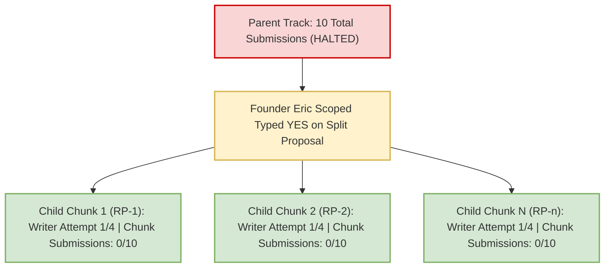
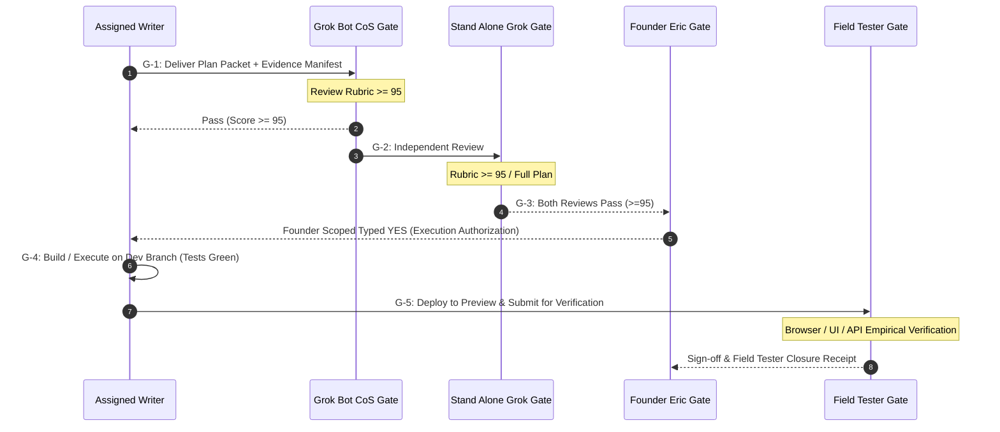
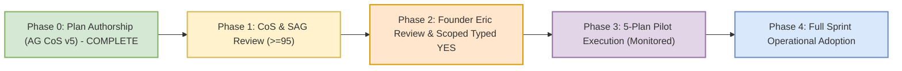

# PLAN: RSI-CONTROLS Process Controls Specification v1.0 (Plan Only)

**Document Version:** 1.0  
**Date:** Monday, 9 November 2026 ~15:45 ET  
**Author:** Antigravity Chief of Staff v5 (`cfe23a7a-d721-44f9-b9d5-d2b74602b687`)  
**Track:** RSI-CONTROLS (Process & Quality Controls Blueprint)  
**Attempt:** AG CoS v5 Attempt 1 on this track  
**Authority:** Grok Bot Desk routing release `ROUTING_RELEASE_RSI-CONTROLS_PLAN-ONLY_AUTHORITY-RECEIPT_to-AGCOS-V5_cfe23a7a_20261109-1514.md` citing Founder Eric verbatim directive (CoS chat, 9 Nov 2026 15:11 EST, widget `t2405s9274`):  
> *"Yes, Antigravity may draft the existing process-controls plan only, without interrupting active work. No implementation or activation."*  
**Baseline Branch:** `origin/p7-v8.9` at commit `9c940715`.  
**Review Cycle:** AG CoS Plan -> Grok Bot CoS Review ($\ge 95$) -> Stand Alone Grok (SAG) Independent Review ($\ge 95$) -> Founder Eric Scoped Typed YES.

---

## 1. Operational Constraints & Standing Boundaries

> [!IMPORTANT]
> **Strict Invariants (Always Enforced):**
> 1. **PLAN ONLY Mode:** Strictly zero code execution, zero production or preview deployments, zero live Firestore mutations, zero bot/watch prompt activations, and zero routine edits authorized under this document.
> 2. **Canonical Target Branch:** `origin/p7-v8.9` exclusively. Zero merges or pushes to `origin/main`.
> 3. **Repository Locks:** `origin/main` strictly pinned and locked at commit `9f04550a45fa4da082ba8948c2d89a521a90fa45`.
> 4. **Stripe Production Status:** Stripe billing is strictly **LOCKED OFF** across all production and test environments.
> 5. **Spend Controls:** Standing rule: **Alerts only, NEVER budget caps** ($20.00/month alert configured; hard spending caps prohibited).
> 6. **Stand-down Policy:** Nightly 03:00 AM ET stand-down remains in effect for Antigravity automated operations.
> 7. **Separation of Roles:** AG CoS v5 authors plan text only. Watch prompts (`ag-plan-handoff-watch`, `ag-plan-handoff-watch-evening`) are owned by Grok Bot CoS and cannot be modified without Founder Eric's typed YES.

---

## 2. Executive Summary & Problem Statement

### 2.1 The Problem: Rework Cascades & Attempt Ledger Drift
Between October 28 and November 8, 2026, the Numista.AI sprint experienced multiple high-rework cascades across core tracks:
- **Track Attempt Growth:** Cumulative review submissions reached extreme counts before stabilization (e.g., historical totals: Track 810 = 8, Track 813 = 15, Track 814 = 13, Track 817 Cards = 12, Track 817 Images = 16).
- **Attempt Miscounting:** Single failed drafts were frequently double-counted when evaluated by multiple reviewers or side-channels, inflating perceived failure counts without reflecting distinct submitted work packets.
- **Unverified Claims & Hallucinated Fixtures:** Plans cited paths that did not exist in the repository (e.g., `numista_backend/scripts/reference_library/*` cited in earlier drafts while actual repository paths were `numista_backend/_scripts/*`), causing downstream review failures and stalled gates.
- **Ambiguous Gate Transitions:** Work moved between authoring, review, and execution without standardized, machine-checkable evidence artifacts, leading to Miss Board issues (such as `MB-009`: desk idle after handoff).
- **Missing Split Protocols:** Tracks approaching or exceeding 10 submissions continued looping through whole-plan rewrites without mandatory split triggers or clear chunk inheritance rules.

### 2.2 The Solution: Scopes A through G
This plan establishes a comprehensive, deterministic, machine-verifiable operational control system:
1. **Scope A:** Hard writer replacement policy after 4 failed submissions with persistent counters and unambiguous disposition rules.
2. **Scope B:** 10-submission workstream trigger requiring Founder Eric notification and split proposals before further revisions, with deterministic chunk inheritance semantics.
3. **Scope C:** Pinned-source evidence manifests and preflight verification using full 40-character SHAs and verbatim code-line citations (Rule 6a).
4. **Scope D:** Five distinct operational gates (ACK, Review, Approval, Execution, Field Tester Closure) with explicit owners and entry/exit criteria.
5. **Scope E:** A controlled 5-plan pilot framework with separate denominator accounting to measure velocity and defect reduction without polluting historical baselines.
6. **Scope F:** Exact proposed insertion blocks for prompts and watch routines, with proof of non-activation and mechanical rollback capture.
7. **Scope G:** Mandatory Field Tester empirical evidence for all beta issue resolutions prior to broad-retest recommendations.

---

## 3. Scope A: Writer Replacement & Attempt Accounting Policy

### 3.1 The 4-Failed-Submissions Replacement Rule
Per Founder Eric's standing directive:
> *"If someone is still failing after 4 tries, somebody else take over."*

1. **Definition of a Writer Attempt:** A writer attempt is counted **only upon formal delivery of a complete submission packet** by an assigned writer to the designated review gate (Grok Bot CoS or SAG).
2. **Threshold:** If an individual writer accumulates **4 consecutive FAIL dispositions** on a single assigned track, that writer is **immediately retired from that track**.
3. **Mandatory Handoff:** The track baton must transition to `BATON_<track>_REVISE_TO-NEW-WRITER_ATTEMPT1_PER-WRITER-CAP.md`. The retired writer is prohibited from re-submitting on that specific track unless explicitly re-authorized by Founder Eric.
4. **Persistent Counters:** Writer counters are tracked in the track's persistent status header:
   ```yaml
   track_id: "NET-814"
   active_writer: "cfe23a7a-d721-44f9-b9d5-d2b74602b687"
   writer_attempt: 2
   writer_max_attempts: 4
   workstream_cumulative_submissions: 13
   workstream_max_before_split: 10
   ```

### 3.2 Submission Dispositions & Counting Semantics
To eliminate accounting inflation and double-counting, every review must assign exactly one of four canonical dispositions:

| Disposition | Score Range | Increments Writer Attempt? | Increments Workstream Cumulative? | Operational Effect |
|---|---|---|---|---|
| **PASS** | $95 - 100$ | **Yes** (Terminal Pass) | **Yes** | Advances to next gate (SAG review or Founder Approval). Resets consecutive writer failure streak. |
| **FAIL** | $0 - 94$ | **Yes** (Failure) | **Yes** | Returns baton to writer for revision (or writer replacement if attempt count $= 4$). |
| **WITHDRAWN** | N/A (Pre-review) | **No** | **No** | Writer retracts submission prior to review evaluation due to self-identified defect. Zero penalty. |
| **BLOCKED** | N/A (Hold/Prereq) | **No** | **No** | Reviewer or writer halts track due to external dependency, upstream lock, or missing founder decision. |

### 3.3 Multi-Review Deduplication Rules
- **Rule of Single Submission Identity:** A single submission packet identified by its git commit SHA and document SHA-256 hash can increment the writer and workstream attempt ledgers **at most once**, regardless of how many reviewers inspect it.
- **Side-Reviews & Dual Scoring:** If both Grok Bot CoS and an intermediate peer (or side reviewer) evaluate the same submission:
  - If both score $\ge 95$, it counts as **1 PASS**.
  - If both score $< 95$, it counts as **1 FAIL** (not 2 fails).
  - If reviewers disagree (e.g., CoS scores 96 PASS, SAG scores 86 FAIL), the conservative score governs the gate disposition, but it records **1 evaluated submission**, not 2.

---

## 4. Scope B: Workstream 10-Submission Trigger & Split Inheritance

### 4.1 The 10-Total-Submission Split Mandate
Per Founder Eric's standing directive:
> *"If NO ONE gets it right by 10 total attempts, you notify me and we break it down into smaller bite-size chunks."*

1. **Trigger Condition:** When `workstream_cumulative_submissions >= 10` across all writers on a given feature or workstream, all further single-packet revisions are **HARD HALTED**.
2. **Prohibition:** Neither CoS nor any desk writer may issue an 11th monolithic revision attempt on an un-split track.
3. **Mandatory Action:** CoS must immediately:
   - File `RADIO_NOTICE_ERIC_TRACK-CAP-REACHED_<track>_SPLIT-PROPOSAL_<DTG>.md`.
   - Update `WHOSE_TURN.md` to status `SPLIT_PENDING_ERIC_YES`.
   - Present a concrete decomposition proposal breaking the track into 2 to 6 independent, self-contained sub-packets (e.g., RP-1 through RP-n).

### 4.2 Counter Inheritance for Decomposed Chunks
When a monolithic workstream (which reached $\ge 10$ attempts) is split into child chunks, counter inheritance must follow deterministic rules:



1. **Historical Ledger Preservation:** The parent workstream's cumulative total (e.g., 10 attempts) is preserved in historical audit ledgers and never erased.
2. **Child Chunk Fresh Authoring Ledger:** Each decomposed child chunk (e.g., RP-1, RP-2) receives an independent writer attempt limit ($1 \le \text{Attempt} \le 4$) and an independent chunk split cap ($\text{Limit} = 10$).
3. **Inheritance Metadata:** Every child chunk document must carry an explicit inheritance lineage block:
   ```yaml
   lineage:
     parent_track: "NET-780 / NET-817"
     parent_cumulative_submissions_at_split: 12
     split_authority: "Founder Eric Scoped Typed YES"
     split_date: "2026-11-08"
     chunk_id: "RP-1"
     chunk_writer_attempt: 1
     chunk_writer_cap: 4
     chunk_cumulative_submissions: 1
     chunk_submission_cap: 10
   ```
4. **Concrete Historical Example:**
   - Monolithic NET-817 accumulated 12 attempts across cards and images.
   - Decomposed into 6 repair packets: RP-1 (Cards schema), RP-2 (Catalog image URL resolution), RP-3 (Coin detail image layout), RP-4 (Promote user photos), RP-5 (Currency index sync), RP-6 (Field Tester validation).
   - Each repair packet begins at Attempt 1 of 4 for its assigned writer, preventing false writer-cap retirements caused by inherited monolithic churn.

---

## 5. Scope C: Pinned-Source Evidence Manifest & Preflight Verification

### 5.1 Verification Principles
To prevent hallucinated file paths, stale commit cites, and unverified assumptions from entering review pipelines, all plans must provide an unambiguous **Evidence Manifest & Preflight Certificate**.

### 5.2 Mandatory Evidence Rules
1. **Full 40-Character Commit SHAs:** Every code reference must pin the exact 40-character git commit SHA. Abbreviated 7- or 8-character SHAs are prohibited in normative claims.
2. **Rule 6a Verbatim Code Quotation:** Every `file:line` citation must be accompanied by the exact verbatim source code line(s) as verified on disk. Unquoted line cites are invalid and must be rejected with `SAY-AGAIN`.
3. **Machine-Checkable Preflight Execution:** Authors must execute read-only git commands (`git rev-parse`, `git show`, `git ls-tree`, `Test-Path`) to certify that every cited path, function, or symbol exists before filing the plan.

### 5.3 Evidence Manifest Template
Every plan must embed Section 0.1 formatted as follows:

| Ref ID | Claim / Object | Repository Path | Line Cite | Verbatim Code Quote | Full Commit SHA | Verification Command & Result |
|---|---|---|---|---|---|---|
| **EVD-01** | Main Lock | `.git/refs/heads/main` | N/A | `9f04550a45fa4da082ba8948c2d89a521a90fa45` | `9f04550a45fa4da082ba8948c2d89a521a90fa45` | `git rev-parse 9f04550a...` $\rightarrow$ MATCH |
| **EVD-02** | Catalog Anchor | `origin/p7-v8.9` | N/A | `4d17ca5ef1f73c0e5f5c9dca3a96f00ab9a15235` | `4d17ca5ef1f73c0e5f5c9dca3a96f00ab9a15235` | `git rev-parse 4d17ca5e` $\rightarrow$ MATCH |
| **EVD-03** | Stripe Routes | `numista_backend/payment_routes.py` | L42 | `@payment_bp.route('/create-checkout-session', methods=['POST'])` | `9c94071536b3541c88d22de6122d2077e68c92de` | `git show 9c940715:numista_backend/payment_routes.py` $\rightarrow$ MATCH |

### 5.4 Case Study: The Unsupported Reference Library Path
- **Defect:** Monolithic plans repeatedly asserted that image assets were built using scripts in `numista_backend/scripts/reference_library/*`.
- **Preflight Audit:**
  ```powershell
  Test-Path "numista_backend/scripts/reference_library" # -> FALSE
  Test-Path "numista_backend/_scripts/build_image_index.py" # -> TRUE
  Test-Path "numista_backend/_scripts/build_currency_image_index.py" # -> TRUE
  Test-Path "numista_backend/_scripts/promote_user_photos.py" # -> TRUE
  ```
- **Rule Enforcement:** Under RSI-CONTROLS, any plan asserting the existence of `numista_backend/scripts/reference_library` without a verified `git ls-tree` proof is rejected at the ACK Gate before entering review.

---

## 6. Scope D: Operational Lifecycle & Gate Architecture

### 6.1 The 5 Formal Gates
Every workstream must traverse five distinct gates in strict sequence. No gate may be bypassed.



### 6.2 Gate Specifications Matrix

| Gate ID | Gate Name | Gate Owner | Required Input Artifact | Pass Criteria | Output Artifact |
|---|---|---|---|---|---|
| **G-1** | **Internal CoS Review Gate** | Grok Bot CoS | Complete Plan Document with Scope & Evidence Manifest | Weighted rubric score $\ge 95/100$; zero unmitigated must-fixes. | `COS_SCORE_<track>_v<ver>_<date>.md` |
| **G-2** | **SAG Independent Gate** | Stand Alone Grok | G-1 Passed Plan Packet (`For SAG/` mirror) | Independent score $\ge 95/100$; zero regression blockers. | `SAG_SCORE_<track>_v<ver>_<score>_PASS_<date>.md` |
| **G-3** | **Founder Authorization Gate** | Founder Eric | G-1 & G-2 Pass Artifacts | Explicit typed `YES` scoped to exact feature branch and preview target. | Founder Chat Record / Transcript Widget Cite |
| **G-4** | **Execution & Build Gate** | Assigned Engineer | G-3 Scoped Typed YES | Code builds green; unit/integration tests pass 10/10; pushed to `p7-v8.9`. | `DONE_BATON_<track>_EXECUTE_v<ver>.md` + Commit SHA |
| **G-5** | **Field Tester Closure Gate** | Field Tester (Human/Agent) | Deployed preview URL + Test Matrix | Empirical browser screenshots, HTTP response logs, zero regressions. | `FT_CLOSURE_RECEIPT_<track>_<date>.md` |

---

## 7. Scope E: Proposed 5-Plan Pilot Specification

### 7.1 Pilot Purpose & Candidates
To validate that RSI-CONTROLS eliminates churn without imposing bureaucratic gridlock, a 5-plan pilot is proposed across the next eligible workstreams.
- **Candidate Tracks:**
  1. `NET-810` (Mint Product Fields Detail View)
  2. `NET-813` (Unified Coin Details View)
  3. `NET-814` (Soft-404 / Public Catalog / Pricing Plan)
  4. `NET-817` (Cards & Images Chunk Decomposition / Repair Packets)
  5. `NET-827` (Stripe Checkout Preview Build Phase)

### 7.2 Quantitative Success Metrics
1. **Submission-to-Pass Velocity:** $\le 2$ review rounds per track to reach $\ge 95$.
2. **Preflight Accuracy:** $100\%$ of cited commit SHAs, file paths, and verbatim lines verified on disk at first submission.
3. **Zero False Writer Caps:** No writer replaced due to reviewer double-counting or multi-review duplication.
4. **Clean Handoff Latency:** Handoff transitions completed within $\le 30$ minutes of gate release (resolving Miss Board item `MB-009`).

### 7.3 Separate Denominator Accounting
To ensure statistical integrity, metrics during the pilot must separate denominators cleanly:
- $\text{Monolithic Historical Rework Rate} = \frac{\text{Pre-Pilot Failed Submissions}}{\text{Pre-Pilot Total Reviews}}$ (Tracked separately; never diluted).
- $\text{Pilot Execution Rework Rate} = \frac{\text{Pilot Revisions}}{\text{Pilot Total Submissions}}$ (Calculated solely over pilot work packets).
- **Excluded from Denominators:** Withdrawn drafts, external dependency blocks, and pre-review format rejections are recorded as administrative events, not engineering failures.

---

## 8. Scope F: Proposed Insertion Blocks & Rollback Governance

### 8.1 Standing Notice on Prompt & Watch Modifications
> [!CAUTION]
> **PROPOSED ONLY — STRICTLY UNAPPLIED.**
> The following insertion blocks represent proposed text for Grok Bot CoS watch routines. **Zero modifications to watch prompts or routines are made by this plan.** Modifications may be applied by Grok Bot CoS only after Founder Eric explicitly reviews and grants a typed `YES`.

### 8.2 Proposed Watch Routine Insertion: `ag-plan-handoff-watch`
```text
=== RSI-CONTROLS PREFLIGHT & ATTEMPT LEDGER ENFORCEMENT BLOCK (PROPOSED) ===
1. PREFLIGHT CITATION CHECK: Before scoring any AG submission, verify that Section 0.1
   contains full 40-character SHAs and verbatim quoted lines for all file:line cites.
   If citations lack verbatim code quotes, return SAY-AGAIN immediately without review.
2. ATTEMPT LEDGER DEDUPLICATION: Verify the submission git commit SHA and document hash.
   If this exact document SHA was already evaluated by a peer or side-review, record the
   score as a corroborating review; DO NOT increment the writer attempt counter a second time.
3. WRITER CAP CHECK: If the track attempt ledger shows 4 consecutive FAIL dispositions
   by the current writer, enforce mandatory writer retirement and transition baton to
   BATON_<track>_REVISE_TO-NEW-WRITER.
4. WORKSTREAM CAP CHECK: If total unique delivered submissions on this workstream reach 10,
   HALT review, set WHOSE_TURN to SPLIT_PENDING_ERIC_YES, and file split notification to Eric.
=== END RSI-CONTROLS BLOCK ===
```

### 8.3 Mechanical Rollback Capture
If any automated watch routine or process control introduces deadlock or false blocks:
1. **Single-Variable Revert:** Each control rule is guarded by an independent boolean configuration flag in watch headers:
   ```yaml
   process_controls:
     enforce_4_attempt_writer_cap: true
     enforce_10_submission_split_trigger: true
     enforce_full_sha_preflight: true
     enforce_rule6a_verbatim_quote: true
   ```
2. **Instant Rollback:** Setting any flag to `false` restores the prior operational state without modifying codebase branches or deployment assets.
3. **Audit Trail:** Every rollback or override must be recorded in `RADIO_OVERRIDE_<rule>_<date>.md` citing Founder Eric's authorization.

---

## 9. Scope G: Field Tester Evidence & Beta Issue Verification

### 9.1 The Empirical Verification Requirement
- No beta issue (from `B01` through `B21`) may be marked `RESOLVED` or `CLOSED` based solely on code diff inspection or unit test pass output.
- Every closure requires **empirical Field Tester proof** generated against the live preview environment (`p7-gate`).

### 9.2 Required Field Tester Evidence Artifacts
For every verified item, the Field Tester must provide a structured receipt:
1. **Timestamped Browser Screenshot:** Capturing the rendered component on desktop and mobile viewports with network tab showing clean HTTP 200/304 requests.
2. **Live URL & Query Parameters:** Exact reproduction URL (e.g., `https://preview-catalog.numista.ai/#/catalog?country=US&year=1921`).
3. **Console & Error Log Inspection:** Console output showing zero uncaught JavaScript exceptions, zero CSP violations, and zero 404 image asset failures.
4. **State Persistence Verification:** Confirmation that user modifications (e.g., coin additions, filters, checklist edits) persist across browser page reloads.

### 9.3 Tracker Reconciliation Protocol
- Tracker updates must cite the exact `FT_CLOSURE_RECEIPT_<id>.md` path.
- In the absence of an empirical Field Tester receipt, the issue remains strictly `OPEN` in the canonical tracker.

---

## 10. Implementation Plan & Governance Roadmap



1. **Phase 0 (Plan Authorship):** Delivered by AG CoS v5 (`cfe23a7a`) at `docs/PLAN_RSI-CONTROLS_PROCESS-CONTROLS_v1.0.md`.
2. **Phase 1 (Dual Review Gate):** Grok Bot CoS review ($\ge 95$) followed by Stand Alone Grok independent review ($\ge 95$).
3. **Phase 2 (Founder Approval):** Founder Eric reviews plan and grants scoped typed `YES` for the 5-plan pilot.
4. **Phase 3 (Pilot Execution):** Piloted across candidate tracks (NET-810, 813, 814, 817, 827) under separate denominator accounting.
5. **Phase 4 (Full Adoption):** Permanent incorporation into standing repository rules upon verified velocity increase and zero defect leakage.

---

## 11. Verification & Preflight Sign-Off

```powershell
# Preflight execution audit log (Box clock: 2026-11-09 15:34 ET)
git rev-parse 9f04550a45fa4da082ba8948c2d89a521a90fa45 # -> 9f04550a45fa4da082ba8948c2d89a521a90fa45 (MATCH)
git rev-parse 4d17ca5e                                   # -> 4d17ca5ef1f73c0e5f5c9dca3a96f00ab9a15235 (MATCH)
git rev-parse b0b05808                                   # -> b0b058087f1492244a0c0b769e126b38ac1ba06c (MATCH)
Test-Path "numista_backend/scripts/reference_library"    # -> False (VERIFIED: unsupported path)
Test-Path "numista_backend/_scripts/build_image_index.py"# -> True (VERIFIED: valid path)
```

**Sign-off:**  
Antigravity Chief of Staff v5 (`cfe23a7a-d721-44f9-b9d5-d2b74602b687`)  
Monday, 9 November 2026 ~15:45 ET. Strict PLAN ONLY.
