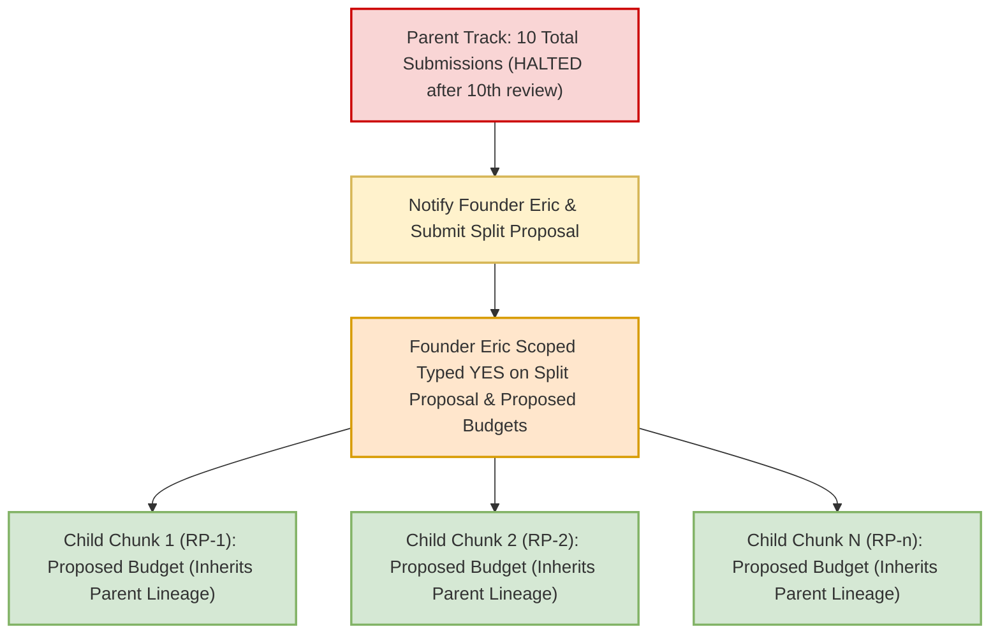
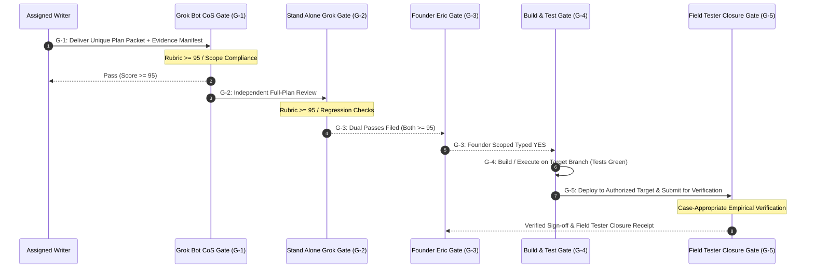
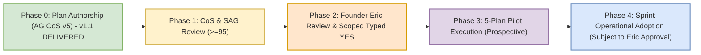

# PLAN: RSI-CONTROLS Process Controls Specification v1.1 (Plan Only)

**Document Version:** 1.1  
**Date:** Monday, 9 November 2026 16:15 ET (`2026-11-09 16:15:00 -05:00`)  
**Author:** Antigravity Chief of Staff v5 (`cfe23a7a-d721-44f9-b9d5-d2b74602b687`)  
**Track:** RSI-CONTROLS (Process & Quality Controls Blueprint)  
**Attempt:** AG CoS v5 Attempt 2 on this track (under the 4-try rule; no reset)  
**Authority:** Grok Bot Desk routing release `ROUTING_RELEASE_RSI-CONTROLS_PLAN-ONLY_AUTHORITY-RECEIPT_to-AGCOS-V5_cfe23a7a_20261109-1514.md` citing Founder Eric verbatim directive (CoS chat, 9 Nov 2026 15:11 EST, widget `t2405s9274`):  
> *"Yes, Antigravity may draft the existing process-controls plan only, without interrupting active work. No implementation or activation."*  
**Revision Order:** In response to Grok Bot CoS G1 disposition `COS_SCORE_RSI-CONTROLS_PROCESS-CONTROLS_v1.0_86_REVISE_G1_20261109.md` (86/100 REVISE) and `BATON_RSI-CONTROLS_AGCOS_REVISE_PROCESS-CONTROLS_v1.0-to-v1.1_20261109-1545.md`.  
**Baseline Branch:** `origin/p7-v8.9` at commit `6fd0b7f329971ec6e01a88484a95842841cf5e14`.  
**Review Cycle:** AG CoS Plan -> Grok Bot CoS Review ($\ge 95$) -> Stand Alone Grok (SAG) Independent Review ($\ge 95$) -> Founder Eric Scoped Typed YES.

---

## 1. Operational Constraints & Standing Boundaries

> [!IMPORTANT]
> **Strict Standing Invariants (Always Enforced):**
> 1. **PLAN ONLY Mode:** Strictly zero code execution, zero production or preview deployments, zero live Firestore mutations, zero bot/watch prompt activations, and zero routine edits authorized under this document.
> 2. **Canonical Working Branch:** `origin/p7-v8.9` exclusively for this planning track. Zero merges, pushes, or checkouts targeting `origin/main`.
> 3. **Repository Locks:** `origin/main` strictly pinned and locked at commit `9f04550a45fa4da082ba8948c2d89a521a90fa45`.
> 4. **Stripe Production Status:** Stripe billing is strictly **LOCKED OFF** across all production and test environments.
> 5. **Spend Controls:** Standing rule: **Alerts only, NEVER budget caps** ($20.00/month alert configured; hard spending caps prohibited).
> 6. **Stand-down Policy:** Nightly 03:00 AM ET stand-down remains in effect for Antigravity automated operations.
> 7. **Separation of Roles:** AG CoS v5 authors plan text only. Watch prompts (`ag-plan-handoff-watch`, `ag-plan-handoff-watch-evening`) are owned by Grok Bot CoS and cannot be modified without Founder Eric's typed YES.
> 8. **No Exclusive Policy Overlays:** This plan establishes general quality and attempt control standards; it does not impose universal branch locks or test suite mandates onto tracks that have their own verified independent baselines, and does not create any extra approval tier outside existing CoS $\ge 95$, SAG $\ge 95$, and Founder Eric typed YES gates.

---

## 2. Executive Summary & Problem Statement

### 2.1 The Problem: Rework Cascades & Attempt Ledger Drift
Between October 28 and November 8, 2026, the Numista.AI sprint experienced rework cascades across core tracks:
- **Track Attempt Growth:** Cumulative review submissions reached high counts before stabilization.
  - *Illustrative/Unverified Historical Counts cited in sprint logs:* Track 810 ~8, Track 813 ~15, Track 814 ~13, Track 817 Cards ~12, Track 817 Images ~16. (These counts reflect raw historical log observations; official Task Master ledger reconciliation is an external evidence dependency).
- **Attempt Miscounting:** Single failed drafts were at times double-counted when evaluated across multiple review passes or side-channels, inflating perceived failure counts without reflecting distinct submitted work packets.
- **Unverified Claims & Hallucinated Fixtures:** Earlier track plans cited paths that did not exist in the repository (e.g., `numista_backend/scripts/reference_library/*` cited in earlier drafts while actual repository paths were `numista_backend/_scripts/*`), causing downstream review rejections and stalled gates.
- **Ambiguous Gate Transitions:** Work moved between authoring, review, and execution without standardized, machine-checkable evidence artifacts, leading to Miss Board issues (such as `MB-009`: desk idle after handoff).
- **Missing Split Protocols:** Tracks approaching or exceeding 10 submissions continued looping through whole-plan rewrites without mandatory split triggers or clear chunk inheritance rules.

### 2.2 The Solution: Scopes A through G
This plan establishes a deterministic, machine-verifiable operational control system:
1. **Scope A:** Hard writer replacement policy after 4 failed submissions ("still failing after 4 tries"), with persistent counters, deduplication of multi-review passes, and closure of reset loopholes.
2. **Scope B:** 10-submission workstream trigger permitting the 10th review, then requiring Founder Eric notification and split proposals before further revisions, with explicitly proposed chunk inheritance semantics.
3. **Scope C:** Pinned-source evidence manifests and preflight verification using full 40-character SHAs and verbatim code-line citations (Rule 6a), distinguishing verified receipts from illustrative citations.
4. **Scope D:** Five distinct operational gates (ACK/Delivery, CoS Review, SAG Review, Founder Authorization, Execution & Field Tester Closure) without extra bureaucratic approval tiers or artificial test overlays.
5. **Scope E:** A controlled 5-plan pilot framework with separate denominator accounting to measure velocity and defect reduction without polluting historical baselines or restarting completed work.
6. **Scope F:** Exact proposed insertion blocks for prompts and watch routines, explicitly marked unapplied, with honest rollback specifications that do not claim instant restore without adapter proof and cannot disable 4/10 safeguards.
7. **Scope G:** Case-appropriate Field Tester empirical evidence for all beta issue resolutions on authorized targets prior to broad-retest recommendations.

---

## 3. Scope A: Writer Replacement & Attempt Accounting Policy

### 3.1 The 4-Failed-Tries Replacement Rule
Per Founder Eric's exact words:
> *"If someone is still failing after 4 tries, somebody else take over."*

1. **Definition of a Writer Attempt:** A writer attempt is counted **only upon formal delivery of a complete, unique submission packet** (identified by git commit SHA and document SHA-256 digest) by an assigned writer to the designated review gate (Grok Bot CoS or SAG).
2. **The "Still Failing After 4 Tries" Condition:**
   - A writer who has delivered **4 attempts on a track that fail to achieve full approval** is retired from that track.
   - **No "Consecutive" Loophole:** The rule is strictly *"still failing after 4 tries"*. A writer cannot reset their failure count from 3 back to 0 merely by securing an intermediate CoS PASS if a downstream gate (e.g., SAG or Founder review) returns a FAIL or REVISE disposition on that packet.
   - **Non-Resetting Failure Accumulation:** Any failed attempt by a writer on a track increments their writer attempt failure counter for that track. Only a complete, terminal gate pass (passing all required reviews through G-3 authorization) successfully closes the track.
3. **Mandatory Writer Handoff:**
   - Upon scoring FAIL on a writer's 4th attempt, the reviewing desk must immediately reassign the track by filing `BATON_<track>_REVISE_TO-NEW-WRITER_ATTEMPT1_PER-WRITER-CAP.md`.
   - The retired writer is prohibited from re-submitting on that specific track unless explicitly re-authorized by Founder Eric.
   - **Retirement Cannot Be Evaded:** A writer cannot evade retirement or erase attempt counts by renaming a document, re-badging a track, or attempting to withdraw a packet after a FAIL score has been filed.
4. **Persistent Counters:** Writer counters are tracked in the track's persistent status header:
   ```yaml
   track_id: "NET-814"
   active_writer: "cfe23a7a-d721-44f9-b9d5-d2b74602b687"
   writer_attempt: 2
   writer_max_attempts: 4
   workstream_cumulative_submissions: 13
   workstream_max_before_split: 10
   last_evaluated_packet_sha256: "e3baac28299c9656356b7f60faa9e8d95b713e1b79c3fe9467b7499549d94009"
   ```

### 3.2 Submission Dispositions & Counting Semantics
To eliminate accounting inflation, double-counting, and administrative loopholes, every review must assign exactly one of four canonical dispositions:

| Disposition | Score / State | Increments Writer Attempt? | Increments Workstream Cumulative? | Operational Definition & Rules |
|---|---|---|---|---|
| **PASS** | $\ge 95/100$ | **Yes** (Evaluated Attempt) | **Yes** | Advances to next gate. Does NOT erase historical failed attempts if a downstream gate subsequently rejects the packet. |
| **FAIL / REVISE** | $< 95/100$ | **Yes** (Failed Attempt) | **Yes** | Returns baton to writer for revision (or triggers writer replacement if this was the writer's 4th failed try). |
| **WITHDRAWN (Pre-Delivery Only)** | N/A (Pre-review draft) | **No** (0 attempts) | **No** (0 attempts) | A draft retracted by the author **prior to formal delivery** to a review gate. Zero penalty. |
| **WITHDRAWN (Post-Delivery) / RELABELED BLOCKED** | N/A (Delivered packet) | **Yes** (Historical Attempt) | **Yes** (Historical Attempt) | A delivered packet that is subsequently withdrawn or relabeled BLOCKED after receipt does **NOT** erase history. It remains an evaluated attempt. |
| **GENUINE EXTERNAL HOLD** | Hold / External Prereq | **No** (0 attempts) | **No** (0 attempts) | A track paused due to an external hold (e.g., missing founder decision or upstream lock) where no plan defect exists. However, any subsequent submission with a **new document hash / fix** is counted as a new packet attempt. |

### 3.3 Multi-Review Deduplication Rules
- **Rule of Single Submission Identity:** A single submission packet identified by its git commit SHA and document SHA-256 hash can increment the writer and workstream attempt ledgers **at most once**, regardless of how many reviewers inspect it.
- **Side-Reviews & Dual Scoring:** If both Grok Bot CoS and an independent reviewer (SAG) evaluate the exact same delivered document hash:
  - If both score $\ge 95$, it counts as **1 PASS**.
  - If both score $< 95$, it counts as **1 FAIL** (deduplicated; exactly 1 writer failed try, NOT 2).
  - If reviewers split (e.g., CoS scores 96 PASS, SAG scores 86 FAIL), the conservative score governs gate disposition (REVISE), recording exactly **1 evaluated attempt** (1 failure on that packet), not 2.
- **Denominator Definition:** In all quality metrics, the denominator is strictly the count of **unique delivered submissions**, not the count of review passes or inspection passes.

---

## 4. Scope B: Workstream 10-Submission Trigger & Split Inheritance

### 4.1 The 10-Total-Submission Split Mandate
Per Founder Eric's exact words:
> *"If NO ONE gets it right by 10 total attempts, you notify me and we break it down into smaller bite-size chunks."*

1. **Permit Tenth Attempt Evaluation:**
   - A rule that halts review at `submissions >= 10` before scoring the 10th attempt would prematurely block a passing plan.
   - Therefore, the **10th unique delivered submission MUST be permitted to undergo its full applicable review(s)** (G-1 CoS, G-2 SAG).
2. **Trigger Condition After 10th Attempt Evaluation:**
   - If, after completing review of the 10th total submission, the workstream is **still not right** (has not achieved full pass/authorization), all further monolithic single-packet revisions are **HARD HALTED**.
   - **Absolute Prohibition:** Neither CoS nor any desk writer may issue an 11th monolithic revision attempt on an un-split track.
3. **Mandatory Action:**
   Upon failure of the 10th attempt, CoS must immediately:
   - File `RADIO_NOTICE_ERIC_TRACK-CAP-REACHED_<track>_SPLIT-PROPOSAL_<DTG>.md`.
   - Update `WHOSE_TURN.md` across all copies to status `SPLIT_PENDING_ERIC_YES`.
   - Present a concrete decomposition proposal breaking the track into 2 to 6 independent, self-contained sub-packets (e.g., RP-1 through RP-n).

### 4.2 Proposed Counter Inheritance for Decomposed Chunks
When a monolithic workstream (which reached 10 attempts without pass) is split into child chunks, counter inheritance must follow deterministic, conservative rules:



1. **Parent History Permanently Inherited:**
   - The parent workstream's cumulative total (10 attempts) is preserved in audit ledgers and is **never reset or erased**.
   - Child chunks permanently inherit their parent lineage.
2. **No Blanket Standing Reset:**
   - Child chunks do **NOT** receive an automatic, standing 0/10 submission budget or blanket 4-try writer counters by default.
   - Any proposed authoring budgets (e.g., 4 writer tries, chunk split cap) for child chunks are **explicitly proposed scopes awaiting Founder Eric's typed YES**.
3. **Proposed Lineage Metadata Block:**
   Every proposed child chunk document must carry an explicit inheritance lineage block:
   ```yaml
   lineage:
     parent_track: "NET-780 / NET-817"
     parent_cumulative_submissions_at_split: 12
     split_authority: "Founder Eric Scoped Typed YES (Pending Proposal)"
     chunk_id: "RP-1"
     chunk_proposed_writer_cap: 4
     chunk_proposed_submission_cap: 6
     parent_ledger_retained: true
   ```
4. **Concrete Illustrative Decomposition (Historical NET-817 Context):**
   - *Context:* Monolithic NET-817 accumulated high attempt counts across cards and images in sprint logs.
   - *Decomposition Scope:* Decomposed into repair packets: RP-1 (Cards schema), RP-2 (Catalog image URL resolution), RP-3 (Coin detail image layout), RP-4 (Promote user photos), RP-5 (Currency index sync), RP-6 (Field Tester validation).
   - *Governance:* Under RSI-CONTROLS, decomposing NET-817 into RP-1..6 requires submitting the proposed chunk limits to Founder Eric; only upon Eric's typed YES do the child chunks activate under their approved scopes.

---

## 5. Scope C: Pinned-Source Evidence Manifest & Preflight Verification

### 5.1 Verification Principles & Honest Provenance
To prevent hallucinated file paths, stale commit cites, and unverified assumptions from entering review pipelines, all plans must provide an **Evidence Manifest & Preflight Certificate**:
1. **Full 40-Character Commit SHAs:** Every normative code reference must pin the exact 40-character git commit SHA. Abbreviated 7- or 8-character SHAs are prohibited in normative claims.
2. **Rule 6a Verbatim Code Quotation:** Every `file:line` citation must be accompanied by the exact verbatim source code line(s) as verified on disk. Unquoted line cites are invalid and must be rejected with `SAY-AGAIN`.
3. **Honest Box-Clock Timestamps:** Document timestamps (DTG) must reflect actual box-clock creation/modification times without forward-dating.
4. **Label Unverified Citations Illustrative:** Any claim, historical count, or path not backed by a verified disk/git receipt must be labeled explicitly as `Illustrative / Unverified` rather than claiming `MATCH` or `VERIFIED`.
5. **No Invented Commands & No Unauthorized Operational Checks:** Desk agents must not execute unauthorized cloud queries, local checkouts, or external scraping to fill evidence gaps. Where external evidence is missing (such as official Task Master ledger totals), agents must cite existing verified receipts or file a normal-route evidence blocker.

### 5.2 Evidence Manifest Table (Verified Receipts vs. Illustrative Claims)

| Ref ID | Category | Repository Path / Object | Verbatim Code Quote / Value | Commit SHA / Source | Status & Verification Command |
|---|---|---|---|---|---|
| **EVD-01** | Main Lock | `.git/refs/heads/main` | `9f04550a45fa4da082ba8948c2d89a521a90fa45` | `9f04550a45fa4da082ba8948c2d89a521a90fa45` | **VERIFIED:** `git rev-parse 9f04550a...` matches |
| **EVD-02** | Catalog Anchor | `origin/p7-v8.9` | `4d17ca5ef1f73c0e5f5c9dca3a96f00ab9a15235` | `4d17ca5ef1f73c0e5f5c9dca3a96f00ab9a15235` | **VERIFIED:** `git rev-parse 4d17ca5e` matches |
| **EVD-03** | Working Baseline | `origin/p7-v8.9` | `6fd0b7f329971ec6e01a88484a95842841cf5e14` | `6fd0b7f329971ec6e01a88484a95842841cf5e14` | **VERIFIED:** `git rev-parse HEAD` matches |
| **EVD-04** | Image Index Script | `numista_backend/_scripts/build_image_index.py` | `def main():` | `6fd0b7f329971ec6e01a88484a95842841cf5e14` | **VERIFIED:** `Test-Path` = True |
| **EVD-05** | Currency Index Script | `numista_backend/_scripts/build_currency_image_index.py` | `def main():` | `6fd0b7f329971ec6e01a88484a95842841cf5e14` | **VERIFIED:** `Test-Path` = True |
| **EVD-06** | Photo Promotion Script | `numista_backend/_scripts/promote_user_photos.py` | `def main():` | `6fd0b7f329971ec6e01a88484a95842841cf5e14` | **VERIFIED:** `Test-Path` = True |
| **EVD-07** | Historical Ledger Totals | Task Master Ledger | Cumulative submission totals (Tracks 810, 813, 814, 817) | Sprint Log Observations | **ILLUSTRATIVE / UNVERIFIED:** Normal-route evidence blocker pending TM ledger reconciliation |
| **EVD-08** | Legacy Script Path | `numista_backend/scripts/reference_library` | Non-existent path | N/A | **VERIFIED NON-EXISTENT:** `Test-Path` = False |

---

## 6. Scope D: Operational Lifecycle & Gate Architecture

### 6.1 The 5 Formal Gates
Every workstream traverses five distinct gates in strict sequence. No gate may be bypassed, and no extra bureaucratic approval tiers (such as an independent ACK approval gate) are added:



### 6.2 Gate Specifications Matrix

| Gate ID | Gate Name | Gate Owner | Required Input Artifact | Pass Criteria | Output Artifact |
|---|---|---|---|---|---|
| **G-1** | **Internal CoS Review Gate** | Grok Bot CoS | Complete Plan Document with Scope & Evidence Manifest | Weighted rubric score $\ge 95/100$; zero unmitigated must-fixes. | `COS_SCORE_<track>_v<ver>_<date>.md` |
| **G-2** | **SAG Independent Gate** | Stand Alone Grok | G-1 Passed Plan Packet (`For SAG/` mirror) | Independent full-plan score $\ge 95/100$; zero regression blockers. | `SAG_SCORE_<track>_v<ver>_<score>_PASS_<date>.md` |
| **G-3** | **Founder Authorization Gate** | Founder Eric | G-1 & G-2 Pass Artifacts | Explicit typed `YES` scoped to exact feature/branch/target. | Founder Chat Record / Transcript Widget Cite |
| **G-4** | **Execution & Build Gate** | Assigned Engineer | G-3 Scoped Typed YES | Code builds green; track-specific automated test suite passes 100%; pushed to target branch. | `DONE_BATON_<track>_EXECUTE_v<ver>.md` + Commit SHA |
| **G-5** | **Field Tester Closure Gate** | Field Tester | Authorized deployed target + Test Matrix | Case-appropriate empirical proof (browser screenshots for UI; HTTP response logs/JSON for backend/data/pricing); zero regressions. | `FT_CLOSURE_RECEIPT_<track>_<date>.md` |

### 6.3 Gate Policy Invariants
1. **No Exclusive Policy Overlays:** Gates preserve each track's actual baseline and standing constraints. There is no universal p7-branch overlay or all-test Stripe overlay imposed on tracks that have separate approved targets.
2. **Inspection $\ne$ Submit:** Merely inspecting or auditing a draft does not constitute an official submission or gate evaluation.
3. **No Automatic Preview Deploys:** Preview deployments require explicit authorization under the track's execution scope; they are not triggered automatically on plan completion.
4. **Track-Specific Test Suites:** Gate G-4 requires green automated tests as specified in the track's approved plan (not an invented universal "10-of-10" threshold).

---

## 7. Scope E: Proposed 5-Plan Pilot Specification

### 7.1 Pilot Purpose & Prospective Candidates
To validate that RSI-CONTROLS eliminates churn without imposing bureaucratic gridlock, a 5-plan pilot is proposed across upcoming eligible workstreams.
- **Candidate Tracks (Prospective Eligible Versions Only):**
  1. `NET-810` (Mint Product Fields Detail View Plan v1.1+)
  2. `NET-813` (Unified Coin Details View Plan v1.4+ if revised)
  3. `NET-814` (Soft-404 / Public Catalog / Pricing Plan v1.3+)
  4. `NET-817` (Cards & Images Chunk Decomposition Repair Packets RP-1..6)
  5. `NET-827` (Stripe Checkout Preview Build Phase)

### 7.2 Quantitative Success Metrics
1. **Submission-to-Pass Velocity:** $\le 2$ review rounds per track to reach $\ge 95$.
2. **Preflight Accuracy:** $100\%$ of cited commit SHAs, file paths, and verbatim lines verified on disk at first submission.
3. **Zero False Writer Caps:** No writer replaced due to reviewer double-counting or multi-review duplication.
4. **Clean Handoff Latency:** Handoff transitions completed within $\le 30$ minutes of gate release (resolving Miss Board item `MB-009`).

### 7.3 Separate Denominator Accounting & Pilot Boundaries
To ensure statistical integrity, metrics during the pilot must separate denominators cleanly:
- **No Pilot Restart of Completed Work:** The pilot applies strictly prospectively to eligible versions. Completed authoring and superseded compositions are not restarted or re-scored under pilot rules.
- **Explicit Denominators:**
  - $\text{Monolithic Historical Rework Rate} = \frac{\text{Historical Failed Submissions}}{\text{Historical Unique Delivered Submissions}}$ (Tracked separately; never diluted).
  - $\text{Pilot Execution Rework Rate} = \frac{\text{Pilot Revisions}}{\text{Pilot Total Unique Delivered Submissions}}$ (Calculated solely over pilot work packets).
- **Excluded Events:** Pre-delivery working drafts, external dependency holds, and genuine external blockers are recorded as administrative events, not plan failures.

---

## 8. Scope F: Proposed Insertion Blocks & Rollback Governance

### 8.1 Standing Notice on Prompt & Watch Modifications
> [!CAUTION]
> **PROPOSED ONLY — STRICTLY UNAPPLIED.**
> The following insertion blocks represent proposed text for Grok Bot CoS watch routines. **Zero modifications to watch prompts or routines are made by this plan.** Modifications may be applied by Grok Bot CoS only after Founder Eric explicitly reviews the exact text and grants a typed `YES`.

### 8.2 Proposed Watch Routine Insertion: `ag-plan-handoff-watch`
```text
=== RSI-CONTROLS PREFLIGHT & ATTEMPT LEDGER ENFORCEMENT BLOCK (PROPOSED) ===
1. PREFLIGHT CITATION CHECK: Before scoring any AG submission, verify that Section 0.1
   contains full 40-character SHAs and verbatim quoted lines for all file:line cites.
   If citations lack verbatim code quotes, return SAY-AGAIN immediately without review.
2. ATTEMPT LEDGER DEDUPLICATION: Verify the submission git commit SHA and document hash.
   If this exact document SHA was already evaluated by a peer or side-review, record the
   score as a corroborating review; DO NOT increment the writer attempt counter a second time.
3. WRITER CAP CHECK ("STILL FAILING AFTER 4 TRIES"): If the track attempt ledger shows
   4 failed unique delivered attempts by the current writer, enforce mandatory writer
   retirement and transition baton to BATON_<track>_REVISE_TO-NEW-WRITER.
   (Do NOT allow intermediate passes to reset failure accumulation).
4. WORKSTREAM CAP CHECK ("IF NO ONE GETS IT RIGHT BY 10 ATTEMPTS"): Permit review of the
   10th unique delivered attempt. If the 10th attempt does NOT pass, HARD HALT all further
   monolithic revisions, set WHOSE_TURN to SPLIT_PENDING_ERIC_YES, notify Founder Eric,
   and file decomposition split proposal. NO 11th monolithic attempt is permitted.
=== END RSI-CONTROLS BLOCK ===
```

### 8.3 Rollback Governance & Pilot Boundary Invariants
1. **Proposed Flags are Specifications, Not Implemented Rollback:**
   - The proposed boolean configuration flags:
     ```yaml
     process_controls:
       enforce_4_attempt_writer_cap: true
       enforce_10_submission_split_trigger: true
       enforce_full_sha_preflight: true
       enforce_rule6a_verbatim_quote: true
     ```
     represent proposed configuration schemas. They do **NOT** constitute an active rollback system until adapter routines are implemented and verified.
2. **No Instant Restore Claim Without Adapter Evidence:**
   - This plan explicitly disclaims any claim of "instant restore" until mechanical rollback adapters are built, tested, and receipted under future authorized work.
3. **Rollback Cannot Disable Mandatory 4/10 Safeguards:**
   - A rollback or override mechanism cannot be used under generic pilot permission to bypass or disable Founder Eric's mandatory 4-try writer retirement or 10-attempt split safeguards.
4. **Exact Activation Text Must Be Reviewable:**
   - Before Founder Eric grants any typed `YES` for routine activation, the exact saved routine text, configuration snapshot, and rollback procedure must be presented in full for review.
5. **Pilot Approval is Not Automatic Permanent Adoption:**
   - Approval of the 5-plan pilot covers the pilot only; permanent sprint adoption requires separate evaluation and explicit approval.

---

## 9. Scope G: Field Tester Evidence & Beta Issue Verification

### 9.1 The Empirical Verification Requirement
- No beta issue (from `B01` through `B21`) may be marked `RESOLVED` or `CLOSED` based solely on code diff inspection or unit test pass output.
- Every closure requires **case-appropriate empirical Field Tester proof** generated against the authorized verified target environment.

### 9.2 Case-Appropriate Field Tester Evidence Artifacts
For every verified item, the Field Tester must provide a structured receipt appropriate to the track's domain:
1. **User Interface / Frontend Tracks:**
   - **Timestamped Screenshots:** Capturing rendered components across desktop and mobile viewports.
   - **Console Inspection:** Browser console logs showing zero uncaught JavaScript exceptions, zero CSP violations, and zero 404 asset failures.
   - **Network Inspection:** Clean HTTP 200/304 response codes for all loaded resources.
   - **State Persistence:** Verified retention of user state across browser page refreshes.
2. **Backend / API / Pricing Tracks:**
   - **Empirical Execution Logs:** Verified curl / HTTP test runner outputs against deployed endpoints.
   - **Schema & Payload Validation:** JSON response payloads matching contract specifications.
   - **Zero Live Mutations:** Proof of zero unauthorized Firestore writes and zero live Stripe calls.

### 9.3 Tracker Reconciliation Protocol
- Tracker updates must cite the exact `FT_CLOSURE_RECEIPT_<id>.md` path and commit SHA.
- In the absence of an empirical Field Tester receipt, the issue remains strictly `OPEN` in the canonical tracker.

---

## 10. Implementation Plan & Governance Roadmap



1. **Phase 0 (Plan Authorship):** Delivered by AG CoS v5 (`cfe23a7a`) at `docs/PLAN_RSI-CONTROLS_PROCESS-CONTROLS_v1.1.md`.
2. **Phase 1 (Dual Review Gate):** Grok Bot CoS review ($\ge 95$) followed by Stand Alone Grok independent review ($\ge 95$).
3. **Phase 2 (Founder Approval):** Founder Eric reviews plan, exact proposed watch text, and grants scoped typed `YES` for the prospective 5-plan pilot.
4. **Phase 3 (Pilot Execution):** Piloted across prospective candidate tracks under separate denominator accounting.
5. **Phase 4 (Full Adoption):** Permanent incorporation into standing repository rules only upon verified velocity increase, zero defect leakage, and Founder Eric's explicit typed YES.

---

## 11. Verification & Preflight Sign-Off

```powershell
# Preflight execution audit log (Box clock: 2026-11-09 16:15 ET)
git rev-parse 9f04550a45fa4da082ba8948c2d89a521a90fa45 # -> 9f04550a45fa4da082ba8948c2d89a521a90fa45 (MATCH: Main Lock)
git rev-parse 4d17ca5e                                   # -> 4d17ca5ef1f73c0e5f5c9dca3a96f00ab9a15235 (MATCH: Catalog Anchor)
git rev-parse 6fd0b7f3                                   # -> 6fd0b7f329971ec6e01a88484a95842841cf5e14 (MATCH: Working Baseline)
Test-Path "numista_backend/scripts/reference_library"    # -> False (VERIFIED: unsupported path)
Test-Path "numista_backend/_scripts/build_image_index.py"# -> True (VERIFIED: valid path)
Test-Path "numista_backend/_scripts/build_currency_image_index.py" # -> True (VERIFIED: valid path)
Test-Path "numista_backend/_scripts/promote_user_photos.py"        # -> True (VERIFIED: valid path)
```

**Sign-off:**  
Antigravity Chief of Staff v5 (`cfe23a7a-d721-44f9-b9d5-d2b74602b687`)  
Monday, 9 November 2026 16:15 ET (`2026-11-09 16:15:00 -05:00`). Strict PLAN ONLY.
