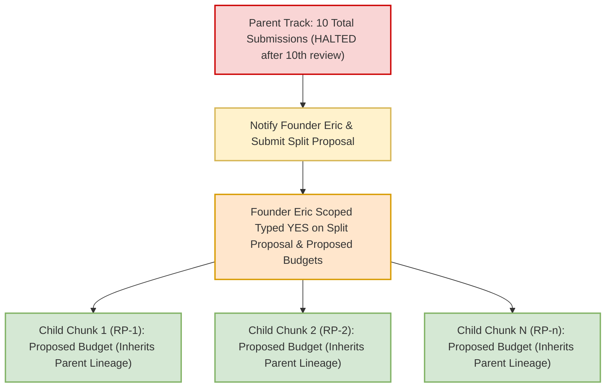
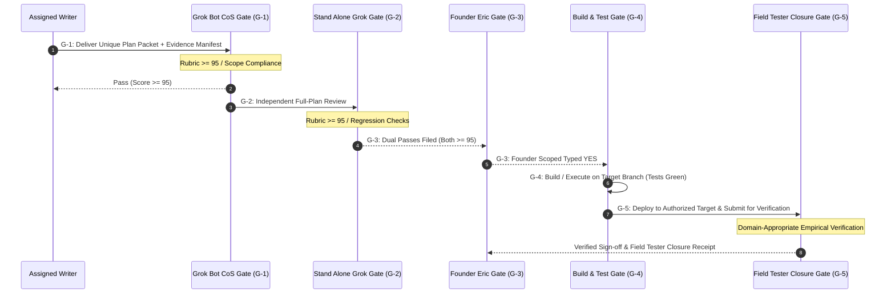
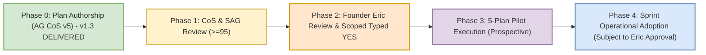

# PLAN: RSI-CONTROLS Process Controls Specification v1.3 (Plan Only)

**Document Version:** 1.3  
**Timestamp Provenance (Declarations & Meanings):**  
- **Artifact Header DTG (Box-Clock Authoring):** Monday, 9 November 2026 18:40 ET (`2026-11-09 18:40:00 -05:00`)  
- **Box-Copy Filesystem mtime:** Recorded on disk at container/box write time  
- **Watcher Recorded Receipt Time:** Logged by Task Master / watcher on container receipt detection  
- **Formal Delivery & Filing Time:** Formal baton delivery and git push timestamp  
*(Note: Timestamp differences across tiers reflect distinct observation points and recording clocks [e.g. authoring system clock vs. box copy vs. watcher detection vs. repository push] rather than clock fabrication; discrepancies are logged with their respective sources without asserting that all differences are inherently error-free pipeline events).*  
**Author:** Antigravity Chief of Staff v5 (`cfe23a7a-d721-44f9-b9d5-d2b74602b687`)  
**Track:** RSI-CONTROLS (Process & Quality Controls Blueprint)  
**Attempt Accounting:**  
- **Antigravity CoS v5 Attempt:** **4 of 4 (4/4) — FINAL WRITER ATTEMPT** on this track  
- **Documented Track Attempt:** **6 of 10 (6/10)**  
- **Historical Provenance Rule & Residual Ledger:** Per Grok Bot CoS Adjudication `COS_ADJUDICATION_RSI-CONTROLS_ATTEMPT-COUNT_20261109.md`, the documented operating base is established from primary message records. Content-changed delivery attempts proven by primary messaging records (such as Founder Eric's primary delivery transcript/evidence) are counted as historical attempt events in the cumulative ledger even if original raw plan bytes were unrecovered on disk. Conversely, purely organizational containers, filesystem mirrors, ACK files, and repeated reviews of identical content do NOT constitute new submission events. The documented track lineage is: Attempt 1 & 2 (RSI Engineer primary-proven submissions), Attempt 3 (AG CoS v5 Plan v1.0, SHA `e3baac28...`, scored 86 REVISE), Attempt 4 (AG CoS v5 Plan v1.1, SHA `a41d273b...`, scored 89 REVISE), Attempt 5 (AG CoS v5 Plan v1.2, SHA `364f25f6...`, scored 92 REVISE), and Attempt 6 (AG CoS v5 Plan v1.3 [this document]). If additional historical submissions are recovered from primary records, the ledger reconciles upward; counters never silently reset or discard history.  
**Authority Receipts:**  
1. **Founder Eric Verbatim Primary Directive (Plan Preparation Context):** Verified in RSI Engineer transcript `b49b2d07-0b2a-41c8-934f-123ca099f23b` around position 6 (`speakerId` `cu:420206129`):  
   > *"Establishing metrics to demonstrate improvement is important, good job. Please implement this plan to get it to CoS."*  
   *(Scope: Authoring and revising the process-controls specification for CoS review only; all proposed changes remain strictly non-operational proposals until explicit typed YES).*  
2. **Founder Eric Verbatim Primary 4/10 Governance Rule:** Verified in Antigravity Desk transcript position 1257:  
   > *"If a team fails 4 times, they're off the project. If no one gets it right after 10 tries, we stop and rethink."*  
3. **CoS-Attested Directive Relay:** Recorded in CoS chat (9 Nov 2026 15:11 EST, widget `t2405s9274` [CoS-Attested Relay, not independently verified as primary]):  
   > *"Yes, Antigravity may draft the existing process-controls plan only, without interrupting active work. No implementation or activation."*  
4. **Grok Bot Desk Baton:** `BATON_RSI-CONTROLS_AGCOS_REVISE_PROCESS-CONTROLS_v1.2-to-v1.3_20261109-1830.md` (Current SHA-256 `b7276dde8b982d2b9fe3d7eae3bbf0c5c26cbfa0e920a5233e504658baa25092`, superseding prior bytes `cbd21a48...` via correction receipt for transcript 1257 citation).  
5. **Grok Bot CoS G1 Disposition:** `COS_SCORE_RSI-CONTROLS_PROCESS-CONTROLS_v1.2_92_REVISE_20261109.md` (92/100 REVISE).  
**Baseline Working Branch:** `origin/p7-v8.9` at commit `1832543445104103ff3bbf17e7a271233f9f2207`.  
**Review Cycle:** AG CoS Plan -> Grok Bot CoS Review ($\ge 95$) -> Stand Alone Grok (SAG) Independent Review ($\ge 95$) -> Founder Eric Scoped Typed YES.

---

## 0.1 Normative Evidence Citations & Pinned References

In accordance with Rule 6a, every normative code citation in this plan provides the repository path, exact 40-character commit SHA, line number, and verbatim source code line(s) verified on disk:

1. **Working Baseline Commit (`HEAD` of `origin/p7-v8.9`):**
   - Commit: `1832543445104103ff3bbf17e7a271233f9f2207`
   - Source: Pinned working tree baseline commit for current planning track [Writer-Asserted from git branch HEAD at authoring session].
2. **Repository Main Lock:**
   - Commit: `9f04550a45fa4da082ba8948c2d89a521a90fa45`
   - File / Ref: `.git/refs/heads/main`
   - Source: Standing Rule invariant and desk operational hold [Desk-Asserted Pinned Commit; ref lock maintained as operational boundary].
3. **Catalog Anchor Reference:**
   - Commit: `4d17ca5ef1f73c0e5f5c9dca3a96f00ab9a15235`
   - Source: Historical catalog anchor commit [Historical Catalog Anchor Citation].
4. **Prior Working Baseline Commit:**
   - Commit: `6fd0b7f329971ec6e01a88484a95842841cf5e14`
   - Source: Baseline commit delivering Plan v1.0 [Historical Baseline Citation].
5. **Image Index Script Entry Point:**
   - Path: `numista_backend/_scripts/build_image_index.py`
   - Commit: `1832543445104103ff3bbf17e7a271233f9f2207`
   - Line 450:
     ```python
     def main():
     ```
   - Verification Receipt: Verified on disk via `Select-String -Path 'numista_backend/_scripts/build_image_index.py' -Pattern 'def main'`.
6. **Currency Index Script Entry Point:**
   - Path: `numista_backend/_scripts/build_currency_image_index.py`
   - Commit: `1832543445104103ff3bbf17e7a271233f9f2207`
   - Line 230:
     ```python
     def main():
     ```
   - Verification Receipt: Verified on disk via `Select-String -Path 'numista_backend/_scripts/build_currency_image_index.py' -Pattern 'def main'`.
7. **Photo Promotion Script Entry Point:**
   - Path: `numista_backend/_scripts/promote_user_photos.py`
   - Commit: `1832543445104103ff3bbf17e7a271233f9f2207`
   - Line 133:
     ```python
     def main():
     ```
   - Verification Receipt: Verified on disk via `Select-String -Path 'numista_backend/_scripts/promote_user_photos.py' -Pattern 'def main'`.
8. **Legacy Reference Library Script Path (Verified Non-Existent):**
   - Path: `numista_backend/scripts/reference_library`
   - Verification Receipt: `Test-Path 'numista_backend/scripts/reference_library'` evaluates to `False`. Correct repository location is `numista_backend/_scripts/*`.
9. **Byte-Verified Prior Plan Artifacts (Preserved Unchanged on Disk):**
   - Plan v1.0: `docs/PLAN_RSI-CONTROLS_PROCESS-CONTROLS_v1.0.md` (332 lines)  
     SHA-256: `e3baac28299c9656356b7f60faa9e8d95b713e1b79c3fe9467b7499549d94009` (Commit `6fd0b7f329971ec6e01a88484a95842841cf5e14`)
   - Plan v1.1: `docs/PLAN_RSI-CONTROLS_PROCESS-CONTROLS_v1.1.md` (373 lines)  
     SHA-256: `a41d273b4d1fd44290544479a108d77b76330e0b1f2fdb37bc7c61efe435b54a` (Commit `20e23b5b34294b0fa9f87339b662611fc0273493`)
   - Plan v1.2: `docs/PLAN_RSI-CONTROLS_PROCESS-CONTROLS_v1.2.md` (465 content lines / 466 lines)  
     SHA-256: `364f25f6753cccf0f9edbc4559fa46daccc2d07178c868dbab4b088b38a2d34a` (Commit `859cdefc331ce60ce7becc4a6214ba48a733fe60`)

---

## 1. Operational Constraints & Standing Boundaries

> [!IMPORTANT]
> **Strict Standing Invariants (Always Enforced):**
> 1. **PLAN ONLY Mode:** Strictly zero code execution, zero production or preview deployments, zero live Firestore mutations, zero bot/watch prompt activations, and zero routine edits authorized under this document.
> 2. **Canonical Working Branch:** `origin/p7-v8.9` exclusively for this planning track. Zero merges, pushes, or checkouts targeting `origin/main`.
> 3. **Repository Locks:** `origin/main` strictly pinned and locked at commit `9f04550a45fa4da082ba8948c2d89a521a90fa45`.
> 4. **Stripe Production & Test-Mode Status:** Live Stripe billing is strictly **LOCKED OFF** across all environments. Stripe test-mode operations are governed strictly by applicable track-approved scope (e.g. NET-827 Stripe preview gate), and live billing activation remains strictly prohibited without explicit Founder Eric typed `YES`.
> 5. **Spend Controls:** Standing rule: **Alerts only, NEVER budget caps** ($20.00/month alert configured; hard spending caps prohibited).
> 6. **Stand-down Policy:** Nightly 03:00 AM ET stand-down remains in effect for Antigravity automated operations.
> 7. **Separation of Roles:** AG CoS v5 authors plan text only. Watch prompts (`ag-plan-handoff-watch`, `ag-plan-handoff-watch-evening`) are owned by Grok Bot CoS and cannot be modified without Founder Eric's typed YES.
> 8. **Founder Direct Authority Requirement:** Founder Eric's **OWN typed YES** is required for all execution, live deployments, watch prompt modifications, or split authoring budgets. Relay assertions alone are unmet without primary citation.
> 9. **Alignment with Track-Approved Scope & Permitted Skips:** This plan establishes general quality and attempt control standards; it strictly defers to track-approved scope. It does NOT impose an all-test Stripe lock on non-Stripe tracks, does NOT impose universal 5-gate/FT requirements on tracks with approved skips, does NOT impose universal 100% test overlays contradicting approved scopes, and prohibits reopening superseded repair plans.

---

## 2. Executive Summary & Problem Statement

### 2.1 The Problem: Rework Cascades & Attempt Ledger Drift
Between October 28 and November 8, 2026, the Numista.AI sprint experienced rework cascades across core tracks:
- **Track Attempt Growth:** Cumulative review submissions reached high counts before stabilization.
  - *Illustrative Historical Observations cited in sprint logs:* Track 810 ~8, Track 813 ~15, Track 814 ~13, Track 817 Cards ~12, Track 817 Images ~16. (These counts reflect raw historical log observations; official Task Master ledger reconciliation is an external dependency).
- **Attempt Miscounting:** Single delivered drafts were at times double-counted when evaluated across multiple review passes (e.g. CoS + SAG reviews on the exact same packet), inflating failure perceived counts without reflecting distinct submitted work packets.
- **Unverified Claims & Hallucinated Fixtures:** Earlier track plans cited paths that did not exist in the repository (e.g., `numista_backend/scripts/reference_library/*` cited in earlier drafts while actual repository paths were `numista_backend/_scripts/*`), causing downstream review rejections and stalled gates.
- **Document-Only Watch Reconciliation:** Attempt accounting must function seamlessly in document-only container/watch environments where git subcommands are unavailable, requiring immutable packet identity based on document content digests and commit metadata.
- **Missing Split Protocols:** Tracks approaching or exceeding 10 submissions continued looping through whole-plan rewrites without mandatory split triggers or clear chunk inheritance rules.

### 2.2 The Solution: Scopes A through G
This plan establishes a deterministic, machine-verifiable operational control system:
1. **Scope A:** Hard writer replacement policy strictly enforced as *"still failing after 4 tries"* / *"4 delivered tries still not right"*, with an unambiguous definition of terminal non-passing dispositions (numeric $< 95$, post-delivery withdrawal, post-delivery preflight SAY-AGAIN, terminal unscored) while preserving active pending reviews from premature retirement.
2. **Scope B:** 10-submission workstream trigger permitting the 10th review, then requiring Founder Eric notification and split proposals before further revisions, with explicitly proposed chunk inheritance semantics and explicit child budgets.
3. **Scope C:** Pinned-source evidence manifests and preflight verification using full 40-character SHAs and verbatim code-line citations (Rule 6a), distinguishing verified receipts from illustrative citations, and reconciling with document-only watch routines.
4. **Scope D:** Formal operational gates (ACK/Delivery, CoS Review, SAG Review, Founder Authorization, Execution & Field Tester Closure) governed strictly by track-approved scope and documented permitted skips, without extra bureaucratic approval tiers or contradictory policy overlays.
5. **Scope E:** A controlled 5-plan pilot framework with separate denominator accounting to measure velocity ($\le 2$ review rounds per delivered packet) and defect reduction without polluting historical baselines or restarting completed work.
6. **Scope F:** Exact proposed insertion blocks for prompts and watch routines, explicitly marked unapplied, with honest rollback specifications, non-toggleable 4/10 safeguards, and immutable override audit trails.
7. **Scope G:** Domain-appropriate Field Tester empirical evidence for all beta issue resolutions on authorized targets prior to broad-retest recommendations.

---

## 3. Scope A: Writer Replacement & Attempt Accounting Policy

### 3.1 The 4-Failed-Tries Replacement Rule
Per Founder Eric's exact words:
> *"If someone is still failing after 4 tries, somebody else take over."*  
*(Desk transcript position 1257: "If a team fails 4 times, they're off the project. If no one gets it right after 10 tries, we stop and rethink.")*

1. **Definition of a Writer Attempt:** A writer attempt is counted **only upon formal delivery of a complete, unique submission packet** (identified by immutable packet hash/manifest, utilizing commit metadata only to reconcile with document-only watch routines) by an assigned writer to the designated review gate (Grok Bot CoS or SAG).
2. **Definition of Terminal Dispositions vs. Pending Review:**
   - **Active Pending Review State (Non-Terminal):** A delivered submission packet actively awaiting or undergoing review is in a non-terminal pending state. An active pending review does **NOT** constitute a failed attempt and does **NOT** prematurely retire a writer.
   - **Terminal Non-Passing Disposition:** A delivered attempt is terminal when review evaluation is completed or when the attempt is abandoned post-delivery. Exactly four terminal non-passing dispositions exist:
     1. **Evaluated Score Below Threshold:** An official evaluation score $< 95/100$ (disposition `FAIL` or `REVISE`).
     2. **Post-Delivery Withdrawal or Supersession:** Retracting, withdrawing, or superseding a complete packet after formal delivery to a review gate.
     3. **Post-Delivery Preflight Rejection (SAY-AGAIN):** Rejection of a delivered packet during preflight screening for missing verbatim quotes, invalid paths, or broken citations.
     4. **Terminal Unscored / Abandoned Disposition:** A delivered packet that is left permanently unscored or abandoned after receipt.
3. **The "Still Failing After 4 Tries" / "4 Delivered Tries Still Not Right" Mandatory Handoff:**
   - Any terminal non-passing disposition on a delivered attempt increments the writer's non-passing attempt counter for that track.
   - **Mandatory Retirement Trigger:** Upon the occurrence of a terminal non-passing disposition on a writer's 4th delivered attempt—whether through an official score $< 95$, a post-delivery withdrawal/supersession, a post-delivery preflight SAY-AGAIN rejection, or a terminal unscored disposition—the writer is immediately retired from that track.
   - **Zero Dependency on Numeric FAIL:** Writer retirement triggers consistently across all four terminal non-passing dispositions on Attempt 4; it does **NOT** require an explicit numeric `FAIL` score to enforce the cap.
   - **Immediate Reassignment:** The reviewing desk must immediately reassign the track by filing `BATON_<track>_REVISE_TO-NEW-WRITER_ATTEMPT1_PER-WRITER-CAP.md`.
   - **Anti-Evasion Restrictions:** A writer cannot evade retirement or erase attempt counts by renaming a document, re-badging a track, altering file headings, or withdrawing a packet after receipt.
   - **Consecutive Loophole Closed:** The rule is strictly cumulative non-passing delivered tries. Securing an intermediate CoS PASS does not erase previous failed attempts if a downstream required gate (e.g. SAG) returns a non-passing disposition.
4. **Persistent Counters Header:** Writer counters are tracked in the track's persistent status header:
   ```yaml
   track_id: "NET-814"
   active_writer: "cfe23a7a-d721-44f9-b9d5-d2b74602b687"
   writer_attempt: 2
   writer_max_attempts: 4
   workstream_cumulative_submissions: 5
   workstream_max_before_split: 10
   last_evaluated_packet_sha256: "a41d273b4d1fd44290544479a108d77b76330e0b1f2fdb37bc7c61efe435b54a"
   ```

### 3.2 Submission Dispositions & Counting Semantics
To eliminate accounting inflation, double-counting, and administrative loopholes, every review must assign exactly one of six canonical dispositions:

| Disposition | Score / State | Increments Writer Attempt? | Increments Workstream Cumulative? | Operational Definition & Rules |
|---|---|---|---|---|
| **PASS** | $\ge 95/100$ | **Yes** (Evaluated Attempt) | **Yes** | Advances to next gate. Does NOT erase historical failed attempts if a downstream required gate subsequently rejects the packet. |
| **FAIL / REVISE** | $< 95/100$ | **Yes** (Terminal Non-Pass) | **Yes** | Official evaluation score below threshold. Returns baton to writer for revision (or triggers immediate writer replacement if this was the writer's 4th delivered try). |
| **SAY-AGAIN** | Citation / Preflight Rejection | **Yes** (Terminal Non-Pass) | **Yes** | Delivered packet rejected for missing verbatim code quotes, invalid paths, or broken citations. Counts as a delivered terminal non-passing attempt; triggers writer replacement if on Attempt 4. |
| **WITHDRAWN (Pre-Delivery Only)** | N/A (Pre-review draft) | **No** (0 attempts) | **No** (0 attempts) | A draft retracted by the author **prior to formal delivery** to a review gate. Zero penalty. |
| **WITHDRAWN (Post-Delivery) / TERMINAL UNSCORED** | N/A (Delivered packet) | **Yes** (Terminal Non-Pass) | **Yes** (Evaluated Attempt) | A delivered packet that is withdrawn, superseded, or abandoned after formal receipt. Does **NOT** erase history; counts as a terminal non-passing attempt; triggers writer replacement if on Attempt 4. |
| **GENUINE EXTERNAL HOLD** | Hold / External Prereq | **No** (0 new attempts) | **No** (0 new attempts) | A track paused due to an external hold (e.g., missing founder decision or upstream lock) where no plan defect exists. However, any subsequent submission with a **new document hash / fix** is counted as a new packet attempt. |

### 3.3 Multi-Review Deduplication & Historical Counting Rules
- **Rule of Single Submission Identity:** A single submission packet identified by its immutable packet hash/manifest (utilizing commit metadata only) can increment the writer and workstream attempt ledgers **at most once**, regardless of how many reviewers inspect it.
- **Side-Reviews & Dual Scoring:** If both Grok Bot CoS and an independent reviewer (SAG) evaluate the exact same delivered document hash:
  - If both score $\ge 95$, it counts as **1 PASS**.
  - If both score $< 95$, it counts as **1 FAIL** (deduplicated; exactly 1 writer non-passing try, NOT 2).
  - If reviewers split (e.g., CoS scores 96 PASS, SAG scores 86 FAIL), the conservative score governs gate disposition (REVISE), recording exactly **1 evaluated attempt** (1 non-passing try on that packet), not 2.
- **Historical Primary-Message Counting Rule:** Content-changed delivery attempts established by primary messaging records (such as Founder Eric's primary delivery transcript/evidence) are counted as historical attempt events in the cumulative ledger even if original plan bytes are unrecovered on disk. Pure organizational containers, disk mirrors, ACK files, and repeated reviews of identical content do NOT constitute new submissions.
- **Denominator Definition:** In all quality metrics, the denominator is strictly the count of **unique delivered submissions**, not the count of review passes or inspection passes.

---

## 4. Scope B: Workstream 10-Submission Trigger & Split Inheritance

### 4.1 The 10-Total-Submission Split Mandate
Per Founder Eric's exact words:
> *"If NO ONE gets it right by 10 total attempts, you notify me and we break it down into smaller bite-size chunks."*

1. **Permit Tenth Attempt Evaluation:**
   - A rule that halts review at `submissions >= 10` before scoring the 10th attempt would prematurely block a passing plan.
   - Therefore, the **10th unique delivered submission MUST be permitted to undergo its full applicable review(s)** (G-1 CoS, G-2 SAG).
2. **Trigger Condition After 10th Attempt Evaluation:**
   - If, after completing review of the 10th total submission, the workstream is **still not right** (has not achieved required plan-quality pass: CoS $\ge 95$ AND SAG $\ge 95$), or terminates in any terminal non-passing disposition (score $< 95$, post-delivery withdrawal, post-delivery SAY-AGAIN preflight rejection, or terminal unscored disposition), all further monolithic single-packet revisions are **HARD HALTED**.
   - **Absolute Prohibition:** Neither CoS nor any desk writer may issue an 11th monolithic revision attempt on an un-split track.
3. **Distinguishing Plan-Quality Review Passes from Founder Execution Authorization:**
   - Achieving required plan-quality passes (CoS $\ge 95$ + SAG $\ge 95$) successfully completes the planning phase.
   - Waiting for Founder Eric's execution authorization (G-3), or Founder Eric declining or deferring execution for non-plan business reasons (e.g. schedule, budget, or scope reprioritization), is **NOT a plan failure** and does **NOT** increment attempt counters or trigger split.
4. **Mandatory Action on 10th Attempt Failure:**
   Upon failure of the 10th attempt to achieve plan-quality pass, CoS must immediately:
   - File `RADIO_NOTICE_ERIC_TRACK-CAP-REACHED_<track>_SPLIT-PROPOSAL_<DTG>.md`.
   - Update `WHOSE_TURN.md` across all copies to status `SPLIT_PENDING_ERIC_YES`.
   - Present a concrete decomposition proposal breaking the track into 2 to 6 independent, self-contained sub-packets (e.g., RP-1 through RP-n) with explicit proposed child budgets.

### 4.2 Proposed Counter Inheritance for Decomposed Chunks
When a monolithic workstream (which reached 10 attempts without pass) is split into child chunks, counter inheritance follows deterministic, conservative rules:



1. **Parent History Permanently Inherited:**
   - The parent workstream's cumulative total (10 attempts) is preserved in audit ledgers and is **never reset or erased**.
   - Child chunks permanently inherit their parent lineage.
2. **No Blanket Standing Reset & Explicit Proposed Child Budgets:**
   - Child chunks do **NOT** receive an automatic, standing 0/10 submission budget or blanket 4-try writer counters by default.
   - Any proposed authoring budgets (e.g., proposed 4 writer tries, proposed chunk split cap of 4 to 6 submissions) for child chunks are **explicitly proposed scopes awaiting Founder Eric's typed YES**.
3. **Proposed Lineage Metadata Block:**
   Every proposed child chunk document must carry an explicit inheritance lineage block:
   ```yaml
   lineage:
     parent_track: "NET-817"
     parent_cumulative_submissions_at_split: 10
     split_authority: "Founder Eric Scoped Typed YES (Pending Proposal)"
     chunk_id: "RP-1"
     chunk_proposed_writer_cap: 4
     chunk_proposed_submission_cap: 6
     parent_ledger_retained: true
   ```

---

## 5. Scope C: Pinned-Source Evidence Manifest & Preflight Verification

### 5.1 Verification Principles, Provenance & Watch Reconciliation
To prevent hallucinated file paths, stale commit cites, and unverified assumptions from entering review pipelines, all plans must provide an **Evidence Manifest & Preflight Certificate**:
1. **Full 40-Character Commit SHAs:** Every normative code reference must pin the exact 40-character git commit SHA. Abbreviated 7- or 8-character SHAs are prohibited in normative claims.
2. **Rule 6a Verbatim Code Quotation:** Every `file:line` citation must be accompanied by the exact verbatim source code line(s) as verified on disk. Unquoted line cites are invalid and must be rejected with `SAY-AGAIN`.
3. **Timestamp Provenance Definitions:**
   - **Header DTG:** The authoring box-clock timestamp when document text was finalized.
   - **Box-Copy mtime:** Filesystem modification timestamp when copied into container/box directories.
   - **Watcher Recorded Receipt Time:** Timestamp logged by Task Master or automated watcher on container receipt detection.
   - **Formal Delivery & Filing Time:** Formal baton delivery and git push timestamp.
   - Differences across these timestamps reflect distinct recording points and systems; discrepancies are recorded with their respective sources without asserting that all differences are inherently error-free pipeline events.
4. **Reconciliation with Document-Only Watch Routines:**
   - Watch routines in containerized environments often lack direct git binary access.
   - Therefore, submission packet identity is established via **immutable packet hash/manifest**, utilizing commit metadata only (e.g. document SHA-256 digest + commit SHA metadata recorded in document headers) rather than requiring live git command execution by watch routines.
5. **Grounding in Verified Receipts & Honest Labeling:**
   - Claims must be grounded in verified disk receipts. Where external evidence is unverified (such as raw historical sprint counts), it must be explicitly labeled `[Illustrative / Unverified]`.
   - Citations of git references and baseline commits must honestly distinguish verified disk states from standing operational constraints without asserting that `git rev-parse` proves remote branches are permanently locked.
   - Zero invented operational checks; zero unauthorized queries to manufacture receipts.

### 5.2 Evidence Manifest Table (Verified Receipts vs. Illustrative Claims)

| Ref ID | Category | Repository Path / Object | Verbatim Code Quote / Value | Commit SHA / Source | Status & Verification Provenance |
|---|---|---|---|---|---|
| **EVD-01** | Main Lock | `.git/refs/heads/main` | `9f04550a45fa4da082ba8948c2d89a521a90fa45` | `9f04550a45fa4da082ba8948c2d89a521a90fa45` | **DESK-ASSERTED PINNED COMMIT:** Standing Rule invariant; operational boundary hold |
| **EVD-02** | Catalog Anchor | `origin/p7-v8.9` | `4d17ca5ef1f73c0e5f5c9dca3a96f00ab9a15235` | `4d17ca5ef1f73c0e5f5c9dca3a96f00ab9a15235` | **HISTORICAL ANCHOR CITATION:** Catalog anchor reference commit |
| **EVD-03** | Working Baseline | `origin/p7-v8.9` | `1832543445104103ff3bbf17e7a271233f9f2207` | `1832543445104103ff3bbf17e7a271233f9f2207` | **WRITER-ASSERTED BASELINE:** Pinned working tree baseline commit at authoring session |
| **EVD-04** | Image Index Script | `numista_backend/_scripts/build_image_index.py` | `def main():` (line 450) | `1832543445104103ff3bbf17e7a271233f9f2207` | **VERIFIED ON DISK:** Path and entry point confirmed via `Select-String` |
| **EVD-05** | Currency Index Script | `numista_backend/_scripts/build_currency_image_index.py` | `def main():` (line 230) | `1832543445104103ff3bbf17e7a271233f9f2207` | **VERIFIED ON DISK:** Path and entry point confirmed via `Select-String` |
| **EVD-06** | Photo Promotion Script | `numista_backend/_scripts/promote_user_photos.py` | `def main():` (line 133) | `1832543445104103ff3bbf17e7a271233f9f2207` | **VERIFIED ON DISK:** Path and entry point confirmed via `Select-String` |
| **EVD-07** | Historical Ledger Totals | Task Master Ledger | Cumulative submission totals (Tracks 810, 813, 814, 817) | Sprint Log Observations | **ILLUSTRATIVE / UNVERIFIED:** Normal-route evidence dependency pending external TM ledger reconciliation |
| **EVD-08** | Legacy Script Path | `numista_backend/scripts/reference_library` | Non-existent path | N/A | **VERIFIED NON-EXISTENT:** `Test-Path` evaluates to False |
| **EVD-09** | Plan v1.0 Digest | `docs/PLAN_RSI-CONTROLS_PROCESS-CONTROLS_v1.0.md` | `e3baac28299c9656356b7f60faa9e8d95b713e1b79c3fe9467b7499549d94009` | Commit `6fd0b7f329971ec6e01a88484a95842841cf5e14` | **VERIFIED ON DISK:** `Get-FileHash` SHA-256 matches (332 lines) |
| **EVD-10** | Plan v1.1 Digest | `docs/PLAN_RSI-CONTROLS_PROCESS-CONTROLS_v1.1.md` | `a41d273b4d1fd44290544479a108d77b76330e0b1f2fdb37bc7c61efe435b54a` | Commit `20e23b5b34294b0fa9f87339b662611fc0273493` | **VERIFIED ON DISK:** `Get-FileHash` SHA-256 matches (373 lines) |
| **EVD-11** | Plan v1.2 Digest | `docs/PLAN_RSI-CONTROLS_PROCESS-CONTROLS_v1.2.md` | `364f25f6753cccf0f9edbc4559fa46daccc2d07178c868dbab4b088b38a2d34a` | Commit `859cdefc331ce60ce7becc4a6214ba48a733fe60` | **VERIFIED ON DISK:** `Get-FileHash` SHA-256 matches (465 content lines / 466 lines) |

---

## 6. Scope D: Operational Lifecycle & Gate Architecture

### 6.1 Formal Gates & Applicable Traversal
Workstreams traverse their applicable formal gates in strict sequence per track-approved scope and documented permitted skips (e.g. doc-only or plan-only tracks skip runtime deployment and Field Tester execution gates). No gate applicable to a track's approved scope may be bypassed without documented authorization, and skipping an inapplicable gate does not constitute empirical proof that an unresolved issue is resolved:



### 6.2 Gate Specifications Matrix

| Gate ID | Gate Name | Gate Owner | Required Input Artifact | Pass Criteria | Output Artifact |
|---|---|---|---|---|---|
| **G-1** | **Internal CoS Review Gate** | Grok Bot CoS | Complete Plan Document with Scope & Evidence Manifest | Weighted rubric score $\ge 95/100$; zero unmitigated must-fixes. | `COS_SCORE_<track>_v<ver>_<date>.md` |
| **G-2** | **SAG Independent Gate** | Stand Alone Grok | G-1 Passed Plan Packet (`For SAG/` mirror) | Independent full-plan score $\ge 95/100$; zero regression blockers. | `SAG_SCORE_<track>_v<ver>_<score>_PASS_<date>.md` |
| **G-3** | **Founder Authorization Gate** | Founder Eric | G-1 & G-2 Pass Artifacts | Explicit typed `YES` scoped to exact feature/branch/target. | Founder Chat Record / Transcript Widget Cite |
| **G-4** | **Execution & Build Gate** | Assigned Engineer | G-3 Scoped Typed YES | Code builds green; track-specific automated test suite passes per track scope; pushed to target branch. | `DONE_BATON_<track>_EXECUTE_v<ver>.md` + Commit SHA |
| **G-5** | **Field Tester Closure Gate** | Field Tester | Authorized deployed target + Test Matrix | Domain-appropriate empirical proof (browser screenshots for UI; HTTP response logs/JSON for backend/data/pricing); zero regressions. | `FT_CLOSURE_RECEIPT_<track>_<date>.md` |

### 6.3 Gate Policy Invariants & Elimination of Contradictory Overlays
1. **Strict Deference to Track-Approved Scope:** Gates preserve each track's actual baseline and standing constraints. There is no universal p7-branch overlay, no universal all-test Stripe overlay on non-Stripe tracks, and no universal 5-gate/FT overlay on tracks with approved skips or alternative scopes.
2. **Authorized Stripe Test-Mode Operations:** Live Stripe billing remains locked OFF across all environments; Stripe test-mode operations are governed strictly by applicable track-approved scope (e.g. NET-827 Stripe preview gate), and live billing activation remains prohibited without explicit Founder Eric typed `YES`.
3. **Inspection $\ne$ Submit:** Merely inspecting or auditing a draft does not constitute an official submission or gate evaluation.
4. **No Automatic Preview Deploys:** Preview deployments require explicit authorization under the track's execution scope; they are not triggered automatically on plan completion.
5. **Track-Specific Test Suites:** Gate G-4 requires green automated tests as specified in the track's approved plan (not an invented universal "100%" or "10-of-10" threshold that contradicts approved track scope).
6. **No Reopening Superseded Repair Plans:** Completed or superseded repair packets remain closed; no recursive re-auditing of historical packages.

---

## 7. Scope E: Proposed 5-Plan Pilot Specification

### 7.1 Pilot Purpose & Prospective Candidates
To validate that RSI-CONTROLS eliminates churn without imposing bureaucratic gridlock, a 5-plan pilot is proposed across upcoming eligible workstreams.
- **Candidate Tracks (Prospective Next-Eligible Versions Only):**
  1. `NET-810` (Mint Product Fields Detail View Plan v1.1+)
  2. `NET-813` (Unified Coin Details View Plan v1.4+ if revised)
  3. `NET-814` (Soft-404 / Public Catalog / Pricing Plan v1.3+)
  4. `NET-817` (Cards & Images Chunk Decomposition Repair Packets RP-1..6)
  5. `NET-827` (Stripe Checkout Preview Build Phase)

### 7.2 Quantitative Success Metrics & Exact Definitions
1. **Review-Round Velocity Metric (Per Delivered Packet):**
   $$\text{Review Rounds to Pass} = \text{Count of unique review cycles (CoS + SAG) per delivered packet to reach } \ge 95$$
   - Target: $\le 2$ review rounds per delivered packet to achieve passing score.
   - Note: This measures per-packet review efficiency, distinct from the track-level 10-submission split limit.
2. **Preflight Accuracy:** $100\%$ of cited commit SHAs, file paths, and verbatim lines verified on disk at first submission.
3. **Zero False Writer Caps:** 0 writers replaced due to reviewer double-counting or multi-review duplication.
4. **Clean Handoff Latency:** Handoff transitions completed within $\le 30$ minutes of gate release (resolving Miss Board item `MB-009`).

### 7.3 Separate Denominator Accounting & Rework Numerator Definitions
To ensure statistical integrity, metrics during the pilot separate denominators cleanly:
- **No Pilot Restart of Completed Work:** The pilot applies strictly prospectively to eligible versions. Completed authoring and superseded compositions are not restarted or re-scored under pilot rules.
- **Explicit Rework Rate Formulas:**
  - **Monolithic Historical Rework Rate:**
    $$\text{Historical Rework Rate} = \frac{\text{Historical Delivered Packets with Terminal Non-Passing Disposition}}{\text{Historical Total Completed Reviews Evaluated}}$$
    *(Tracked separately; never diluted by pilot data).*
  - **Pilot Execution Rework Rate:**
    $$\text{Pilot Rework Rate} = \frac{\text{Pilot Delivered Packets with Terminal Non-Passing Disposition}}{\text{Pilot Total Completed Reviews Evaluated}}$$
    *(Calculated solely over prospective pilot work packets).*
  - **Numerator & Denominator Definitions:**
    - **Numerator:** Strictly the count of delivered unique packets that ended in any terminal non-passing disposition (official evaluation score $< 95$, post-delivery withdrawal/supersession, post-delivery preflight SAY-AGAIN rejection, or terminal unscored disposition).
    - **Denominator:** Strictly the total completed unique delivered reviews.
    - **Pending / Censored State:** Delivered packets currently undergoing review are in a pending state; they are excluded from both numerator and denominator until a terminal disposition is reached.
- **Excluded Administrative Events:** Pre-delivery working drafts, external dependency holds, and genuine external blockers are recorded as administrative events, not plan failures.

---

## 8. Scope F: Proposed Insertion Blocks & Rollback Governance

### 8.1 Standing Notice on Prompt & Watch Modifications
> [!CAUTION]
> **PROPOSED ONLY — STRICTLY UNAPPLIED.**  
> The following insertion blocks represent proposed text for Grok Bot CoS watch routines. **Zero modifications to watch prompts or routines are made by this plan.** Modifications may be applied by Grok Bot CoS only after Founder Eric explicitly reviews the exact text and grants a typed `YES`.

### 8.2 Proposed Watch Routine Insertion: `ag-plan-handoff-watch`
```text
=== RSI-CONTROLS PREFLIGHT & ATTEMPT LEDGER ENFORCEMENT BLOCK (PROPOSED) ===
1. PREFLIGHT CITATION CHECK: Before scoring any AG submission, verify that Section 0.1
   contains full 40-character SHAs and verbatim quoted lines for all file:line cites.
   If citations lack verbatim code quotes, return SAY-AGAIN immediately without review.
2. ATTEMPT LEDGER DEDUPLICATION: Verify the submission via immutable packet hash/manifest,
   utilizing commit metadata only. If this exact document SHA was already evaluated by a peer
   or side-review, record score as corroborating review; DO NOT increment writer attempt.
3. WRITER CAP CHECK ("STILL FAILING AFTER 4 TRIES"): If the track attempt ledger shows
   4 delivered attempts by the current writer that ended in a terminal non-passing disposition
   (score < 95, post-delivery withdrawal, post-delivery SAY-AGAIN, or terminal unscored disposition),
   enforce mandatory writer retirement immediately and transition baton to
   BATON_<track>_REVISE_TO-NEW-WRITER_ATTEMPT1_PER-WRITER-CAP.md.
   (Active pending review is non-terminal and does not retire a writer; numeric FAIL is not required).
4. WORKSTREAM CAP CHECK ("IF NO ONE GETS IT RIGHT BY 10 ATTEMPTS"): Permit review of the
   10th unique delivered attempt. If the 10th attempt does NOT achieve plan-quality pass (>=95),
   or ends in a terminal non-passing disposition, HARD HALT all further monolithic revisions,
   set WHOSE_TURN to SPLIT_PENDING_ERIC_YES, notify Founder Eric, and file decomposition
   split proposal. NO 11th monolithic attempt permitted.
=== END RSI-CONTROLS BLOCK ===
```

### 8.3 Rollback Governance & Pilot Boundary Invariants
1. **Non-Toggleable 4/10 Safeguards:**
   - The 4-try writer retirement and 10-attempt workstream split triggers are strictly non-toggleable.
   - Configuration flags or rollback mechanisms **CANNOT** disable or bypass Founder Eric's mandatory 4-try writer retirement or 10-attempt split safeguards absent a new explicit Founder Eric directive.
2. **Override Audit Trail:**
   - In any emergency situation where an override is explicitly authorized by Founder Eric, an immutable audit trail entry must be filed (`RADIO_OVERRIDE_ERIC_<track>_<DTG>.md`) documenting the exact justification, founder widget reference, and scope.
3. **Proposed Configuration Schema (Read-Only Constraints):**
   - The proposed configuration specification:
     ```yaml
     process_controls:
       enforce_4_attempt_writer_cap: true
       enforce_10_submission_split_trigger: true
       enforce_full_sha_preflight: true
       enforce_rule6a_verbatim_quote: true
     ```
     represents declarative, read-only configuration constraints. They do **NOT** represent mechanical runtime toggles and do not constitute an active rollback system until adapter routines are implemented and verified.
4. **No Instant Restore Claim Without Adapter Evidence:**
   - This plan explicitly disclaims any claim of "instant restore" until mechanical rollback adapters are built, tested, and receipted under future authorized work.
5. **Exact Activation Text Must Be Reviewable:**
   - Before Founder Eric grants any typed `YES` for routine activation, the exact saved routine text, configuration snapshot, and rollback procedure must be presented in full for review.
6. **Pilot Approval is Not Automatic Permanent Adoption:**
   - Approval of the 5-plan pilot covers the pilot only; permanent sprint adoption requires separate evaluation and explicit approval.

---

## 9. Scope G: Field Tester Evidence & Beta Issue Verification

### 9.1 The Empirical Verification Requirement
- No beta issue (from `B01` through `B21`) may be marked `RESOLVED` or `CLOSED` based solely on code diff inspection or unit test pass output.
- Every closure requires **domain-appropriate empirical Field Tester proof** generated against the authorized verified target environment.

### 9.2 Domain-Appropriate Field Tester Evidence Artifacts
For every verified item, the Field Tester must provide a structured receipt appropriate to the track's domain:
1. **User Interface / Frontend Tracks:**
   - **Timestamped Screenshots:** Capturing rendered components across desktop and mobile viewports.
   - **Console Inspection:** Browser console logs showing zero uncaught JavaScript exceptions, zero CSP violations, and zero 404 asset failures.
   - **Network Inspection:** Clean HTTP 200/304 response codes for all loaded resources.
   - **State Persistence:** Verified retention of user state across browser page refreshes.
2. **Backend / API / Pricing Tracks:**
   - **Empirical Execution Logs:** Verified curl / HTTP test runner outputs against deployed endpoints.
   - **Schema & Payload Validation:** JSON response payloads matching contract specifications.
   - **Zero Live Mutations:** Proof of zero unauthorized Firestore writes and zero live Stripe calls.
3. **Data / Indexing Tracks:**
   - **Record Validation Logs:** Verification of indexed record counts and key schemas without live database destruction.

### 9.3 Tracker Reconciliation Protocol
- Tracker updates must cite the exact `FT_CLOSURE_RECEIPT_<id>.md` path and commit SHA.
- In the absence of an empirical Field Tester receipt, the issue remains strictly `OPEN` in the canonical tracker.

---

## 10. Implementation Plan & Governance Roadmap



1. **Phase 0 (Plan Authorship):** Delivered by AG CoS v5 (`cfe23a7a`) at `docs/PLAN_RSI-CONTROLS_PROCESS-CONTROLS_v1.3.md`.
2. **Phase 1 (Dual Review Gate):** Grok Bot CoS review ($\ge 95$) followed by Stand Alone Grok independent review ($\ge 95$).
3. **Phase 2 (Founder Approval):** Founder Eric reviews plan, exact proposed watch text, and grants scoped typed `YES` for the prospective 5-plan pilot.
4. **Phase 3 (Pilot Execution):** Piloted across prospective candidate tracks under separate denominator accounting.
5. **Phase 4 (Full Adoption):** Permanent incorporation into standing repository rules only upon verified velocity increase, zero defect leakage, and Founder Eric's explicit typed YES.

---

## 11. Verification & Preflight Sign-Off

```powershell
# Preflight execution audit log (Box clock: 2026-11-09 18:40 ET)
# Verified disk receipts and path checks:
# 1. Pinned Main Ref: 9f04550a45fa4da082ba8948c2d89a521a90fa45 [Desk-Asserted Operational Hold]
# 2. Pinned Working Baseline: 1832543445104103ff3bbf17e7a271233f9f2207 [Writer-Asserted Baseline Commit]
# 3. Pinned Catalog Anchor: 4d17ca5ef1f73c0e5f5c9dca3a96f00ab9a15235 [Historical Catalog Anchor Citation]
# 4. Verified Repository Script Paths:
Test-Path "numista_backend/scripts/reference_library"               # -> False (VERIFIED: unsupported path)
Test-Path "numista_backend/_scripts/build_image_index.py"           # -> True (VERIFIED: valid path)
Test-Path "numista_backend/_scripts/build_currency_image_index.py"  # -> True (VERIFIED: valid path)
Test-Path "numista_backend/_scripts/promote_user_photos.py"         # -> True (VERIFIED: valid path)
# 5. Verified Prior Plan File Hashes:
# Plan v1.0 SHA-256: e3baac28299c9656356b7f60faa9e8d95b713e1b79c3fe9467b7499549d94009
# Plan v1.1 SHA-256: a41d273b4d1fd44290544479a108d77b76330e0b1f2fdb37bc7c61efe435b54a
# Plan v1.2 SHA-256: 364f25f6753cccf0f9edbc4559fa46daccc2d07178c868dbab4b088b38a2d34a
```

**Sign-off:**  
Antigravity Chief of Staff v5 (`cfe23a7a-d721-44f9-b9d5-d2b74602b687`)  
Monday, 9 November 2026 18:40 ET (`2026-11-09 18:40:00 -05:00`). Strict PLAN ONLY.
